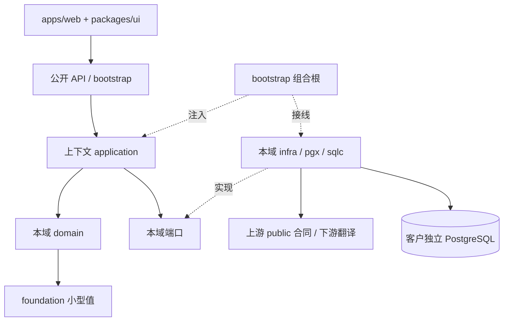

# CHNHCM-004 目录、领域及依赖

登记信息：[registry.json](../governance/registry.json)。适用范围：模块化单体的目录、依赖方向、跨域合同及迁移归属；技术选择由 [002](../adr/002-technology-stack.md) 持有。

## 1 目标与上下文归属

17 个上下文及其领域责任见[上下文登记](contexts.json)。Personnel、Organization、Staffing、Recruiting 和 Access 已接入组合根。登记中的每个切片分别列出所属模块、实际入口和签收范围。Staffing 的 M03 已接入[岗位核编首批](../verification/313-quota-implementation.md)。M04 已接入按职务或按岗首聘、任职维护和人事事务办理记录，M05 已接入招聘录用及预留。修改事实归属时，同步核对上下文登记、对象合同、目标图的节点和箭头，以及实际写表和消费端口。各入口及合成样本见[分阶段验收](../verification/500-job-information-delivery-review.md#stage-delivery-results)。

## 2 目录组织

```text
CHNHCM/
  apps/web/src/{app,features,locales}       React 页面与路由
  apps/vendor-console/                    厂商版本界面，预留
  packages/ui/                            主题、布局及展示组件
  packages/mui-x-data-grid/                Community原字节运行源码、官方同版声明及来源摘要（113）
  packages/api-client/                    OpenAPI 生成类型及请求客户端
  cmd/{server,worker,upgrader,vendor}/      server 与 upgrader 已执行；worker、vendor 预留
  internal/bootstrap/                     组合根、接线、HTTP
  internal/contexts/personnel/             M01 人员身份与个人资料
  internal/contexts/organization/          M02：public/domain/application/infra
  internal/contexts/staffing/              M03 岗位与核编、M04 任职及占编
  internal/contexts/recruiting/            M05 招聘录用、预留及交接
  internal/contexts/access/                X03 本地身份、会话与授权
  internal/foundation/                    X01 小型共享值与协议
  internal/platform/                      DB 设施、X04 调度、X05 适配
  internal/releasecontrol/                 厂商版本管理，预留
  api/                                    公开 API 契约
  db/{migrations,queries}/                 全局迁移、按域 SQL
  deploy/{compose,backup,upgrade}/         三种交付方式的后续实现
  docs/{architecture,adr,assets,reference,plans,specs,governance,verification,templates}/
  tests/{scenarios,fixtures,integration,e2e}/
  scripts/                                仓库及依赖检查
  .github/workflows/                      quality、integration、browser 工作流
  .local/                                 被忽略的构建/检查输出
```

预留目录使用职责说明保留，不提供虚假业务实现或“永远成功”的命令。当前不创建 26 个服务或 17 套空 CRUD。

文档分类与维护见 [014](../governance/014-document-management.md)。切片长期规格按 `docs/specs/<module>/` 组织，阶段计划留在 `docs/plans/`；`docs/guides/` 和 `docs/archive/` 有实际内容时再创建，不提前放置空指南或空归档。

## 3 分层与跨域合同



Go 根 internal 只能限制仓外导入；本仓另用 AST 检查禁止跨域内部包、领域依赖存储、public 暴露内部类型及 foundation 反向依赖。检查器从上下文登记表读取全部域名，以域名标识业务 schema。对每个域的 sqlc 查询源及 infra 中的 Go 字符串和 SQL 文件，检查显式跨域表引用。新增域先登记，新增 SQL 源目录缺少登记时检查失败。括号连接的首表同样校验归属。比较谓词中的限定列按表达式处理，允许本域查询使用表别名。生成的 sqlc 查询由源覆盖，动态拼接表名须追到执行点。迁移、组合根和测试取证各按其职责复核。事务与运行时授权通过真实 DB/API 验证。

共享文字值的唯一外部纯函数依赖为`internal/foundation/unicode.go → golang.org/x/text/unicode/norm`，版本由go.mod锁定；仅提供NFC和组合类别，不含I/O或适配器。检查器按文件及包精确许可，其他foundation文件、领域/public直接导入、存储/网络及反向依赖继续拒绝；对应正反例由边界测试覆盖。307/308首批接入后，固定Unicode 15.0名称字符准入与NFC组合为`foundation/name.go`纯文字配置，由Organization和Staffing两个真实消费者使用；生成表同属foundation，离线源仍由现有生成器固定摘要读取。是否必填、对象字段、错误码和历史处理仍归各域，M02包装保留原错误语义，见013第2.3节和308。

Staffing不导入或复制Organization的dated/submission聚合。两域分别持有按日决策、来源和提交终态。`platform/dbtx`只在infra将既有pgx事务绑定至context；公开企业下界和最早Staffing日期端口只收context和本域值，组合根接线，同一短事务内通过企业共享／排他锁互斥。该设施不拥有SQL表或业务判断，domain/public/application不能导入它。Staffing只读写staffing表，Organization只读写organization表，反向引用查询只能通过public端口。

前端`shared/dated/submission.ts`与`useDraftExit.ts`只承载提交身份互斥、响应归属与离开草稿保护，M02/M03各自提供请求、结果及业务页面，不从staffing导入organization控制器。

跨域引用使用稳定 ID/来源版本及公开 DTO，不共享聚合或可写表；下游自己声明端口，组合根/适配器接上游。source Outbox 与消费者 Inbox/采用分别归所属域。需要共同守卫的合同可在模块化单体中通过公开应用端口共享短事务，禁止私自写别域表。

同一业务经多个域办理时，对象合同分别写明谁写原始事实、谁核验条件、谁保存采用。例如 M05 写招聘预留、释放及转换，M04 写任职及实际占编，M03 维护额度并从两者的来源计算岗位可用数。经录用入职时，各域在同一事务内提交，原录用、任职和回执均可定位。已接通的场景以登记表中的切片及验证范围为准。[岗位核编合同](../specs/m03/313-position-capacity-contract.md#5-正常入口与应用合同)

下游在事务中采用上游资料时，组合根只注入公开端口。端口传入办理身份、业务日期和来源引用，返回可采用的业务值。物理事务由两端的基础设施适配器共用。人员保存地址时，M02 在此事务中核对目录权限和准确来源，M01 保存采用。来源失效或撤权时整笔处理失败。[个人资料合同](../specs/m01/505-personal-profile-contract.md)

## 4 SQL 与迁移约束

sqlc 从全局 goose 迁移读取结构，按域查询输出到 `internal/contexts/<context>/infra/postgres/generated`。不得另手写一份 schema 与 migrations 分叉；迁移补零全局排序，由upgrader独占执行。按[025](../adr/025-greenfield-implementation-policy.md)，未对外交付的开发迁移可随当前模型整理；开发提交/合并不等于发布，正式对外交付的迁移不得原地改写。

## 5 资金与业务编排边界

M14 共同资金执行准入不变成跨所有领域的总资金账；税、社保和福利机构债务分别留在 M11/M12/M13。Journey 由 M20 持有，各源域命令和事实分别完成；技术任务完成不等于业务完成。

## 6 演进与验证

Repository maintainer 维护工程目录和依赖检查；上下文维护者在对应规格中落实公开合同、表所有权及事务设计。首个切片边界由 [007](007-m02-entry.md) 持有，013 的正文入口见[规格入口](../specs/README.md)。新增目录必须有实际职责，不能以空包代替合同或实现。

Go 导入方向运行 `make boundaries`，登记、链接及文档格式运行 `make docs`；业务、数据库和页面按实际变更范围验证，完成口径见 [003](../adr/003-implementation-stages.md)。本文规定检查职责，实际执行结果另记验证报告。

113更新：packages/mui-x-data-grid已承载固定Community8.29.3原字节运行TS/TSX，types条件指向同版官方声明；Vite使用原始源码，无Pro专用插件。运行图退出Pro及x-license，历史来源/许可证/清单保留在docs/reference。构建不依赖相邻仓库，纯build不读取本地profile；Go权威不变，实际结果见[111报告](../verification/111-community-t01-t02.md)。