# 全域目标架构与概念映射

本章为China HCM独立目标设计[D]。以HCM概念和中国业务边界定义事实主责，再以DDD确定上下文、聚合和协作。先阅读本章G02整体业务架构，再按区域展开到[C01—C05概念图](12-concept-architecture.md)，随后进入模块和关键设计。原型代码只作历史参照。

## 1. 整体模块架构

[图源](diagrams/g02-target-domain-map.mmd)

G02是“总图”，图内C编号指向下表的领域概念视图。阅读顺序为：**G02整体业务架构 → C01—C05领域概念 → M/X模块设计 → E系列与G06关键设计**。这些层级表示图纸阅读颗粒度；业务事实归属、聚合和代码分层另由DDD合同定义。

| G02区域 | 概念展开 | 主要展开范围 | 继续阅读与边界 |
| --- | --- | --- | --- |
| 基础与人员生命周期 | [C01 核心人事](diagrams/c01-core-hcm-concepts.svg) | M01—M04：人员、组织、工作定义、关系与任职 | 招聘全过程继续看[M05](modules/m05.md)和[F01招聘到首次工资](diagrams/f01-hire-first-pay.svg) |
| 薪酬、法定义务、资金与成本 | [C02 薪资领域](diagrams/c02-payroll-concepts.svg) | M09—M15的配置、来源、核算与输出协作 | 按模块展开薪酬、税、参缴、福利、支付与成本；保留上游人事/假勤引用的所属域 |
| 计划时间、实际时间与权益 | [C03 假勤](diagrams/c03-time-absence-concepts.svg) | M06—M08：计划、实际、缺勤与权益 | M04提供任职，M10拥有工资采用；不得因出现在同一概念图而合并责任 |
| 人才评价与发展 | [C04 人才](diagrams/c04-talent-concepts.svg) | M16—M19：能力、评价、盘点、继任与发展 | 人员和岗位来自M01/M03/M04，实际任命回到M04 |
| 配置与权限支持及各业务域 | [C05 引用、适用、权限与核准](diagrams/c05-reference-access-concepts.svg) | X02/X03提供引用、适用与权限支持；业务核准归目标域，M20/X04参与待办协作 | C05贯穿业务域；共同配置及鉴权不替代领域决定 |
| 共享协议与技术设施 | [X01协议](modules/x01.md)、[X04运行设施](modules/x04.md)、[X05适配](modules/x05.md) | 身份/日期/修订协议、任务作业、入站出站适配与防腐层 | 提供技术支撑；执行意图及回执的业务确认归所属域 |
| 报表口径与追溯 | [X06分析](modules/x06.md) | 指标定义、授权投影、报告快照与来源追溯 | 消费各域公开事实与确认结果，向授权用户提供分析；不反写业务事实 |
| 员工经理服务与HR任务 | [M20服务设计](modules/m20.md)；核准协作参见[C05](diagrams/c05-reference-access-concepts.svg) | 服务请求、Journey与受控投影 | C05只展示其中的核准协作；端到端办理另看[F系列联合流程](08-cross-module-flows.md) |

C图按概念主题组织，跨域引用仍保留来源标识，因此不是20个业务模块及6项横向能力的互斥分区。G03补充事实归属与依赖，G05补充限界上下文；F系列从业务场景贯穿各层，G04单列技术部署视角。

20个业务模块表达业务职责，6项横向能力按支持上下文和技术设施区分。DDD设计另划分17个限界上下文（含Configuration、Access、Analytics三个支持上下文），X01/X04/X05分别是协议库、运行设施和适配器；见[上下文与聚合目录](10-ddd-and-state-contracts.md)。它们不是26个独立服务，也不要求菜单按此分组。用户通过M20入口或各专业模块办理，最终写入仍由事实所有域控制。

基础人事向假勤、薪税社保和人才供给身份、组织、工作关系与任职。时间和人才结果只有经过明确采用才影响工资。财务接收来源明确的成本和资金事实；报表仅形成可追溯投影。

G02用实线表示事实、候选建议及外部交换，虚线表示办理访问或支撑；每条线以标签说明具体语义。分组边界及跨域连线不授予跨域写权限，区域之间的协作通过公开合同完成。图中的“业务能力”外框是阅读分组，不是额外的统一业务服务或共享事实库。

- **办理入口：**员工、经理及HR服务请求人通过M20提交服务请求或自助办理；专业人员直接进入所属业务域。M20通过来源域命令及授权查询协作，自己维护服务请求、Journey与沟通事实，待办和业务结果是来源域投影；返回链见[M20](modules/m20.md)。
- **分析供给：**各域公开事实和确认结果（含M20服务事实）供X06形成授权分析，报表和下钻仍受X03当前权限限制。X06拥有指标与报告，不决定源域事实。
- **人才到任命：**M19提供候选建议，M04独立核准并办理任命；候选建议不自动占编制或改变任职。概念与流程分别见[C04](diagrams/c04-talent-concepts.svg)及[F08](diagrams/f08-talent-development.svg)。
- **外部交换：**有外联职责的域提交已承诺业务执行意图，X05负责适配与交换；外部数据、渠道回执作为来源观察返回所属域，由其命令核验并确认业务结果。M05招聘、M07考勤、M11税务、M12参缴、M13福利、M14支付、M15会计、M18学习及M20通知分别保留业务主责。原始观察和渠道尝试归X05，业务确认不由适配器代办；详见[X05](modules/x05.md)与[E06外部状态](diagrams/e06-external-state.svg)。

## 2. 事实归属与依赖

[图源](diagrams/g03-fact-ownership.mmd)

箭头表示读取、调用领域评估或明确采用，含义以标签和[合同清单](03-consistency-contracts.md)为准。工资与个税之间的双向箭头表示“提供所得输入、返回税额评估”两个接口阶段，不是互相修改对方数据；参缴先形成独立义务，再由工资承担可适用的个人代扣。

| 事实 | 唯一业务主责 | 主要消费者 | 容易混淆的邻近对象 |
| --- | --- | --- | --- |
| Person、个人资料、账户身份 | M01 | M04/M05/M11/M13/M14 | 员工视图、Candidate、登录账号 |
| 组织、地点、法律实体及允许用途 | M02 | M03/M04/M11/M12/M14 | 扣缴登记/参缴账户的业务生命周期 |
| 职务、职级身份、阶梯、职位和编制预留 | M03 | M04/M05/M09/M19 | 个人任职、薪级金额、人才候选 |
| 工作关系、任职、合同和主选择 | M04 | 各人员业务域 | Person身份、PayrollMembership |
| 招聘申请、Offer及交接 | M05 | M01/M04/M09 | 人员、实际工资条款 |
| 发布班表 | M06 | M07/M08 | 实际工时、法定日历 |
| 实际工时及月结发布引用 | M07 | M08/M10 | 原始打卡、工资金额输入 |
| 休假资格、权益流水、缺勤结果 | M08 | M07/M10 | 企业日历、工资扣减 |
| 薪酬计划、GradeRate、授予及下发记录 | M09 | M03/M10 | Grade身份、计薪分配、实际工资 |
| 计薪责任上下文、归属、采用、运行/结果及工资单发布 | M10 | M11/M14/M15 | 工作关系、税务累计、实付款 |
| 税务身份、评估/承诺、确认累计及申报/缴退 | M11 | M10/M15 | 国籍、工资累计、工资组 |
| 参缴资格、稳定义务账户/差额、申报及扣收实缴 | M12 | M10/M15 | 工资代扣、银行支付成功 |
| 福利登记、资格和确认费用 | M13 | M10/M11/M15 | 税前扣除结果、基本社保 |
| 机构付款账户、运营用途、应付/占用、实付及超付追收 | M14 | M15/X06 | 账户身份、工资结果封存 |
| 成本归属/分摊、会计交换及差额 | M15 | M03/外部ERP/X06 | 预算报价、工资净额、现金总额 |
| 人才内容目录、档案、资格和问卷 | M16 | M03/M05/M17/M18/M19 | 搜索索引、学习完成事实 |
| 目标、绩效文档及发布结果 | M17 | M09/M18/M19 | 模板、绩效奖金授予 |
| 课程/活动、报名、学习记录与发展行动 | M18 | M16/M19/M20 | 已认证资格、任职决定 |
| 盘点、人才池、继任候选及准备度 | M19 | M18/M04 | 编制占用、实际任命 |
| 服务请求、Journey清单、沟通内容及授权投影 | M20 | 用户与领域命令 | 各业务域的事实和状态 |

“唯一主责”指事实维护责任，并不排除其他模块持有不可变采用快照或授权投影。逻辑归属由业务语义决定：例如招聘需求归M05，资源预留归M03，Offer条款需经M09形成实际授予。

## 3. 关键对象设计

[图源](diagrams/e01-person-employment.mmd)

Person可有零到多工作关系，服务独立身份核对和分阶段用工。关系生命周期内有任职记录，不等于每个时点或所有人员类型都强制一个当前在岗席位；任职按M03 StaffingPolicy采用PositionManaged（必须引用岗位）或JobOnly（不引用岗位）；是否占编另按明确政策决定。停任或外部关系不自动等于释放资源。退出、更正和主选择共同守卫见[DDD合同](10-ddd-and-state-contracts.md#22-核心人事的配置层级与完整生命周期)。主任职属于工作关系层，人员的主关系另按日期和用途表达。合同与关系均保留自身身份和终结动作。

Oracle当前Person说明要求有关联的工作或联系人关系；China HCM选择允许独立登记Person，这是明确的产品差异，而非宣称Oracle也允许同样操作。[Oracle Person Records](https://docs.oracle.com/en/cloud/saas/human-resources/fawhr/person-records.html)

[图源](diagrams/e02-legal-contexts.mmd)

LDG、PSU、TRU帮助识别法规、薪资法定责任及报告边界；中国目标以法规上下文、责任主体、扣缴登记和参缴账户等对象表达，不要求照搬这些Oracle对象名称或一对一层级。业务单元、用人单位、扣缴单位和付款主体不能因常见组织形态而默认相同。[Oracle法律主体及薪资用途](https://docs.oracle.com/en/cloud/saas/human-resources/faigh/how-legal-employers-work-with-payroll-statutory-units-and-tax.html)

## 4. 正式应用与部署方向

[图源](diagrams/g04-formal-deployment.mmd)

参考实现选择React/TypeScript/MUI前端和PostgreSQL＋Go＋pgx/v5＋sqlc＋goose。领域模块在单体内通过明确合同协作；同一数据库内由责任根和明确协调器维护事务及约束，不能仅因共用数据库就声称原子性。Staffing入职调动、工资封存与税务承诺/代扣消费、付款占用/领取等边界见[聚合与事务图](diagrams/g06-aggregate-transactions.svg)。外部动作通过已提交执行意图、适配器和回执处理；作业可按正式需要在同进程或同代码库执行角色中部署，不预设微服务。

每个客户独立实例，Docker Compose和本地升级程序支持厂商托管、客户环境及完全离线交付。轻量厂商后台负责版本和升级信息；图不要求把客户HCM事实集中到厂商后台。备份、附件存储和升级迁移属于正式合同需细化的非功能项。

正式设计需明确请求身份/权限、并发冲突、日期区间约束、精确金额、恢复和审计的验证方式；具体表结构/API、性能目标及上线实施按本目标的验证路线确认。本图不是正式部署已完成的证明。

## 5. 全面对标的读法

[概念映射矩阵](07-concept-mapping.md)逐项覆盖参考文档的人员、组织、法定薪资、时间缺勤、人才、有效期和权限七部分。处理方式分为：采纳概念、按中国/本项目语义替代、明确不采纳，以及目标扩展。这里的完整性是每项都有可说明的去向，不是所有Oracle功能都复制或已经实现。
