# 架构一致性与跨模块设计合同

本章为China HCM逻辑设计[D]，用于反查53张目标图及模块说明。目标不变量源于业务语义和DDD边界；数据库/API通过目标验证路线细化。上下文、聚合及资金/税务/参缴/发布的具体状态合同见[DDD闭合设计](10-ddd-and-state-contracts.md)。

## 1. 跨模块不变量

| ID | 不变量 | 具体设计及错误处理 |
| --- | --- | --- |
| I01 | 身份稳定且作用域明确 | 客户实例＋对象类型＋稳定ID定位事实；编号唯一性按对象合同；名称只展示，不当连接键 |
| I02 | 事实有唯一维护域 | 消费者保存引用、采用清单或不可变快照；维护回到原域；禁止双边独立改同一金额 |
| I03 | 业务时间与记录时间分开 | 生效日/所属期/支付日/记录时间各有语义；有效区间采用[start,end)，外部含末日字段按来源合同显式转换 |
| I04 | 日级状态、真实动作与更正分开 | 人事日级切片每日期一份当前状态；真实业务动作另记发生依据及记录时间，更正保留修订。审计顺序不推导业务先后；当前不提供日内任职状态查询/计量 |
| I05 | 适用、默认、权限分开 | X02提供带版本的允许值和建议；X03逐份完整Grant匹配动作/数据/字段/用途；领域命令再校验当前授权、适用、版本及业务约束 |
| I06 | 保存与采用分开 | 源域保存不会自动重写下游；采用绑定来源ID、版本/hash、日期、用途、消费者及操作者 |
| I07 | 原结果和资金事实受保护 | 更正经后继、冲销或差额处理；不原地改已封存/已申报/已发送/已核销结果 |
| I08 | 幂等键绑定内容 | 相同键同内容返回原结果；同键不同内容拒绝；不因一次超时重新发新业务身份 |
| I09 | 未知状态可见 | 缺资料、政策冲突、回执未知、来源未接分别说明；未知不当0、不当成功，也不随意当失败 |
| I10 | 金额、频率和单位齐全 | 正式金额采用精确十进制或最小货币单位，费率保留所需精度；每步舍入有规则；工作小时、人数和编制名额各按本身单位计量 |
| I11 | 历史查询不扩大当前权限 | 当前有效授权决定可见对象/字段；历史业务日只决定读取哪个事实版本，旧报告/下载不得恢复已撤范围 |
| I12 | 局部完成不冒充整体完成 | 各任务和报表声明范围；批次部分成功保留；原型、模拟、正式、实际回执分别标识 |

身份关系及ER见[目标架构](02-target-architecture.md)。X01—X06是共享合同的归属，不能借共享层重新集中所有业务事实。

## 2. 统一交换信封

这是供正式契约细化的逻辑字段，不是已实现API：

| 信息组 | 建议字段 | 作用 |
| --- | --- | --- |
| 业务身份 | customerInstanceId、objectType、objectId、sourceSystemId | 防止跨客户、跨类型或跨来源误关联 |
| 时间上下文 | effectiveFrom/through、businessPeriod、paymentDate、recordedAt、timezone | 只携带该合同需要的字段，含义必须显式 |
| 版本依据 | revision、expectedRevision、sourceRefs、policyRefs、contentHash | 乐观并发和来源新鲜度；hash不证明来源法律真实性 |
| 请求与关联 | requestId、idempotencyKey、correlationId、purpose | 去重、追踪与用途隔离 |
| 结果及责任 | status、acceptedItems、errors、unknownItems、successorOf | 支持逐项成功、失败与未知，保留前后继 |
| 访问与审计 | actorRef、authorizationDecisionRef、redactedEvidenceRefs | 不在信封复制凭据、账户全文或不必要人员信息 |

## 3. 主要接口责任

| ID | 生产者→消费者 | 交付内容 | 采用/一致性要求 |
| --- | --- | --- | --- |
| C01 | M01→M04/M05 | personId、核对结果及必要资料版本 | 登记独立保存；关系/首任职创建失败保留已登记Person |
| C02 | M02/M03→M04 | 允许组织、席位、资源/预留及版本 | Staffing 在同一短事务内按固定顺序锁定并重核版本。拟议安排核验全期间的可用编制，已履职的补录按实际日期计入占编。新旧资源、关系、任职及 Outbox 一起提交。[履职事实与差额](../../specs/m03/313-position-capacity-contract.md#m03-br-036) |
| C03 | M04→M06—M13 | 工作关系/任职有效段、主体和来源引用 | 下游明确建立归属；不因入职自动生成所有工资、福利或参缴事实 |
| C04 | M06/M08→M07 | 已发布班表、缺勤覆盖及版本 | 原始打卡与核对结果分开；重叠/冲突不能默认抹平 |
| C05 | M07/M08→M10 | 月结核对引用、原工时/缺勤输入来源 | 同一事实只走一个金额输入路径；月结采用不再造金额 |
| C06 | M09/M13→M10 | 薪酬授予、福利费用及用途 | 频率/币种明确；模拟报价不能无确认成为正式工资 |
| C07 | M10↔M11 | 拟支付所得/已确认事实→税额评估；确认所得→申报 | 候选计算不更新正式累计；封存时同事务CAS账本并建立含所得成员的未决TaxCommitment；累计确认以唯一所得事实计入，时点由所得/扣缴口径确定，不用“工资已封存”或“银行成功”替代全部税法条件 |
| C08 | M12→M10/M15 | 个人代扣义务、单位成本及原义务版本 | 工资不是义务存在的前提；扣收、实缴、单位成本不能重复或相互冒充 |
| C09 | M01→M14 | 统一账户身份及必要字段 | M14维护用途和生效分配；授权前冻结payload及账户快照；现金等非银行方式按合同不要求账户 |
| C10 | M10→M14 | 已确认应付结果、版本及待付差额 | 稳定PayableAccount守卫占用；先冻结完整payload再按hash授权；领取CAS与M11执行占用共同提交；已确认所得结算核验原锚点；非所得超收返还核验M11分类决定及回收来源，两者均不重开所得承诺；unknown保留占用 |
| C11 | M10/M12/M13/M14→M15 | 成本、单位承担及现金/非现金结算核对引用 | 成本与现金/非现金结算分别分类；结算引用不再次确认工资成本，重复交换不可重复过账；完整分摊总量及提交选版由M15集合守卫，领取与关账共用Period守卫；关账后走后继调整 |
| C12 | M16/M17/M18/M19互用 | 资格、绩效、学习证据及发展行动 | 证据和结论分开；完成课程不自动授予资格；继任候选不自动任命 |
| C13 | 各业务域→M20/X06 | 带范围、权限和来源的任务/报表投影 | 投影可重建；办理返回源域；待办0不代表所有业务已完成 |
| C14 | 各业务域↔X05 | 已提交执行意图、原始观察、逐项回执 | 输入预检、内容绑定、幂等和未知查询；外部结果通过领域命令应用 |

接口的Q/C/E分类、提交点、去重/乱序和恢复责任见[可靠协作](10-ddd-and-state-contracts.md#6-唯一写者与可靠协作)。表中的事务是目标合同；数据库事务隔离及跨进程幂等仍需实现与故障验证。

## 4. 日期与更正

[图源](diagrams/e04-effective-adoption.mmd)

一个人事对象可以有多个生效日切片；同日数据更正改变当前切片修订，不等同又发生一次业务动作。M04的BusinessActionRecord保留每次真实动作的身份、类型/原因、业务日期、发生时刻或其未知原因、前后状态引用、决定证据及recordedAt。反序补录不能用录入顺序决定业务先后，领域命令需明确核对当日最终切片。

日期型人事事实支持按日最终状态、真实动作记录及各次确切来源修订；各类对象的查询支持范围见[历史查询合同](10-ddd-and-state-contracts.md#61-历史查询能力与计算依赖)。不支持查询或按小时计量任职在同一天中的中间有效状态。审计修订和打卡时刻都不是该能力的等价替代。若需要日内任职状态，应先设计有效时刻/业务顺序及编制、主选择、计薪归属的相应约束；不能仅新增一个审计序号。消费结果保留当时采用版本。来源更正后由消费者核对实际影响。普通无影响变更随处理结果留据，需处置、待核或有专项追溯要求时按本域政策处理。[来源变更处理](10-ddd-and-state-contracts.md#62-消费者影响案与闭环)

工资累计、税务累计、社保义务、个人应收、银行实付及会计余额是不同账本。它们各有计入/冲销条件和期间维度；不能让一个通用“完成”事件同时改所有余额。

## 5. 参缴与付款的关键分离

[图源](diagrams/e03-contribution-ledgers.mmd)

申报接受、个人扣收与机构实缴分别记录。稳定ObligationAccount承载完整义务版本与有符号差额；旧100更正完整120只增加20，已收100后更正90形成10待退/待抵。历史申报、收款和核销保留原版本引用，不迁移到新版本。扣收及机构分配同时守卫来源未分配金额与账户余额/占用；明确采用和工资封存按[参缴合同](10-ddd-and-state-contracts.md#5-参缴全量重述版本与差额账分开)处理。

[图源](diagrams/e05-bank-payment-identity.mmd)

M01账户身份和M14工资用途分开。银行转账指令必须有可解释的账户采用快照；现金等方式是否需账户由方式合同决定。授权前冻结完整payload；换卡不替换已授权指令，变更需后继及新授权。稳定应付账户防止不同请求键重复占用。

[图源](diagrams/e06-external-state.mmd)

该状态图描述单条指令；批次由行状态汇总。领取与撤销通过CAS串行化，领取后视为可能外发。部分成功只转换对应占用，补发建立关联新指令，原成功行及原拒绝记录均保留。未知结果必须先查询或核对；不能仅凭客户端报错推断银行没有执行。

## 6. 9条联合链路

| 链路 | 主要证明的设计关系 | 设计图 |
| --- | --- | --- |
| F01 招聘到首次工资 | 身份复用、关系原子保存、预留转化与独立下游建立 | [图与源文件](diagrams/README.md#跨模块流程) |
| F02 组织/法人调动 | 允许范围、资源、新旧关系与责任主体交接 | 同上 |
| F03 假勤到工资 | 月结引用与原金额输入去重、已支付保护 | 同上 |
| F04 绩效到财务 | 结果采用、授予、税额评估、付款授权及成本 | 同上 |
| F05 历史更正 | 原事实修订、影响识别、跨期政策与差额 | 同上 |
| F06 独立参缴 | 应缴、申报、个人扣收和机构实缴分账 | 同上 |
| F07 离职退休再聘 | 合同/关系/任职独立终结、Person稳定与旧未结事项 | 同上 |
| F08 人才发展 | 证据、评价、学习、准备度和实际任命分开 | 同上 |
| F09 可靠通知与采用 | 源事务Outbox、消费者Inbox、水位补拉及明确采用分开 | 同上 |

这些流程用于验证设计连贯性，不是本次自动化用例通过证据。

## 7. 补充合同的定位

[命令与验收索引](16-command-acceptance-index.md)从模块对象归属派生，串联业务命令、参加根、提交点/守卫、恢复合同及AC01—AC10。M20只确认Journey步骤证据；M04按自身政策守卫两层主选择覆盖；M11/M12/M13分别维护机构义务和资金，M14仍维护员工工资资金。历史查询与消费者影响闭环按类型声明支持，不建立全局事实写者。详细语义以[DDD合同](10-ddd-and-state-contracts.md)为准。
