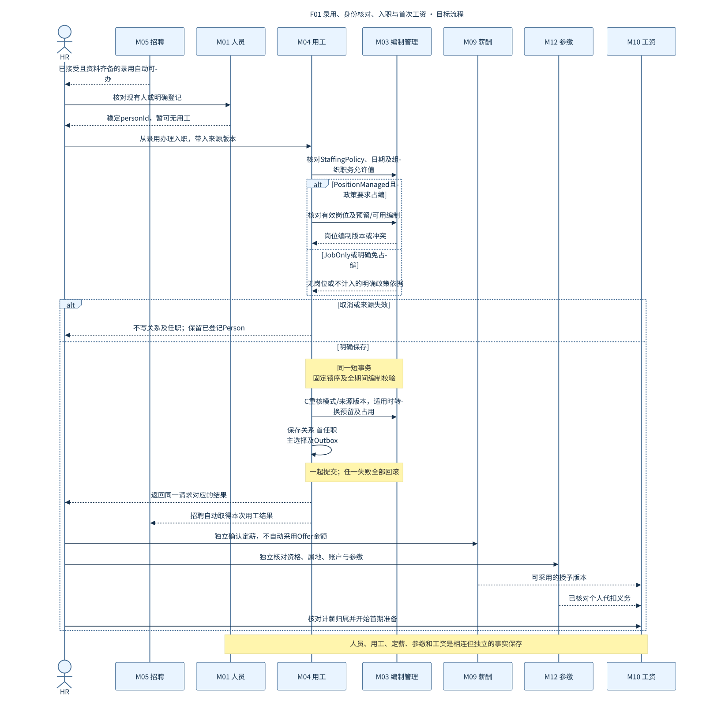
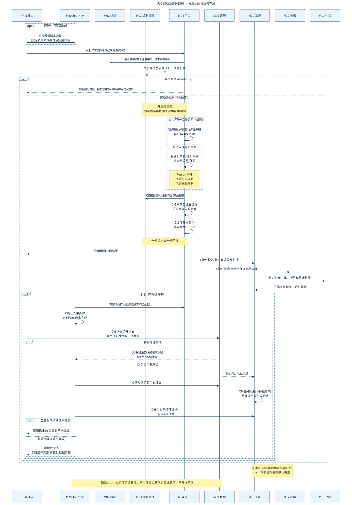
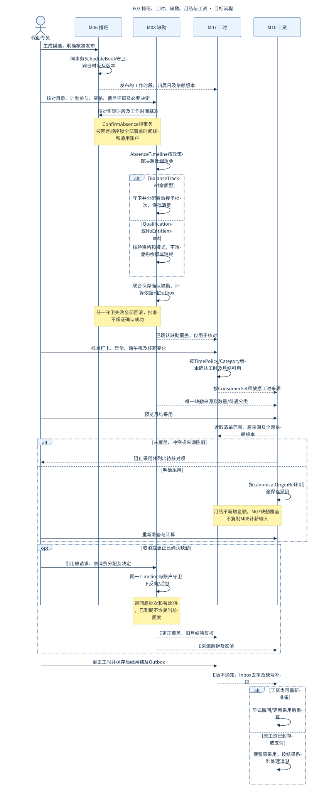
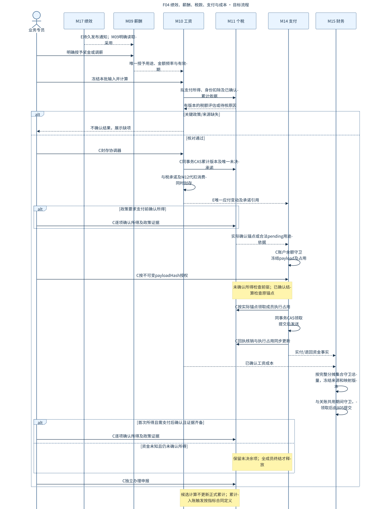
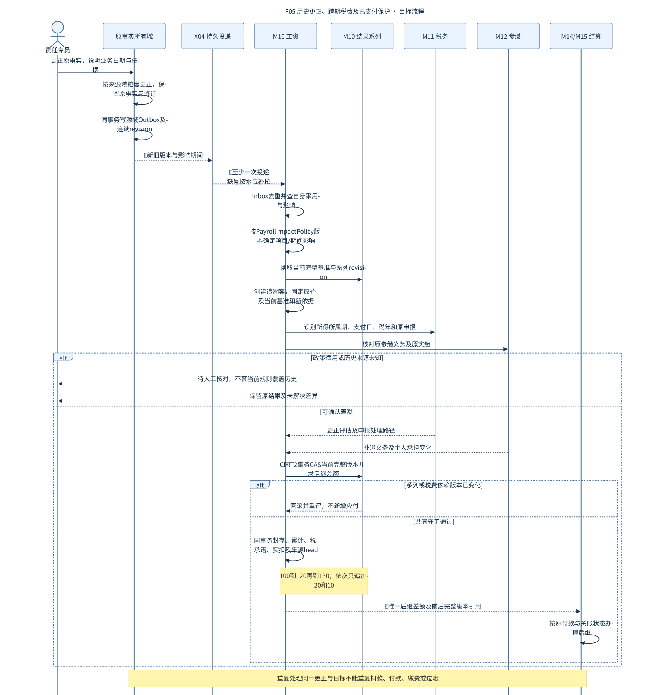
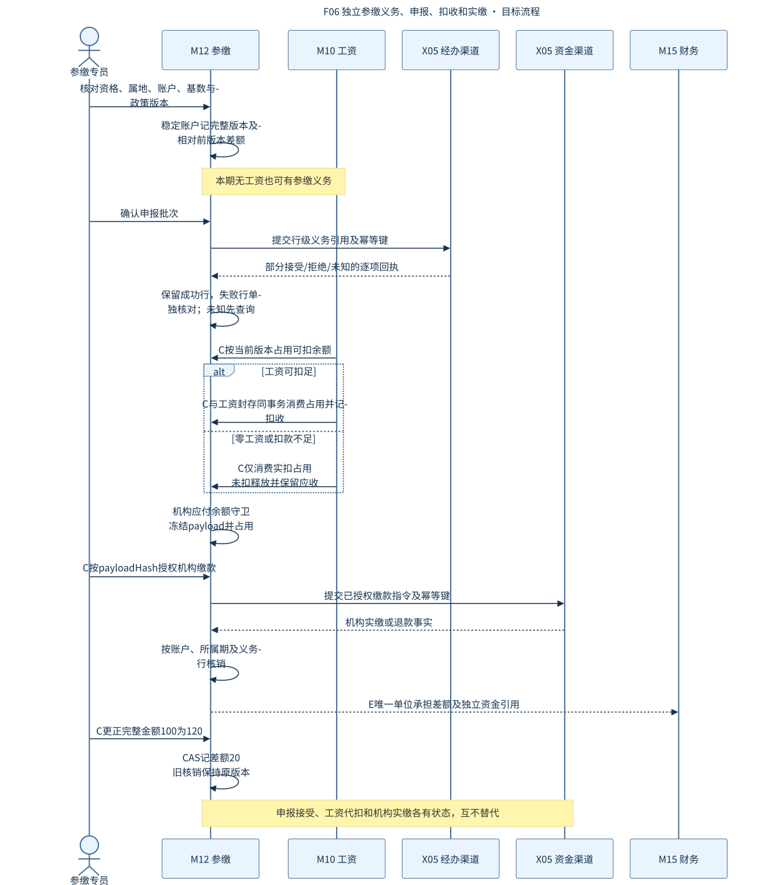
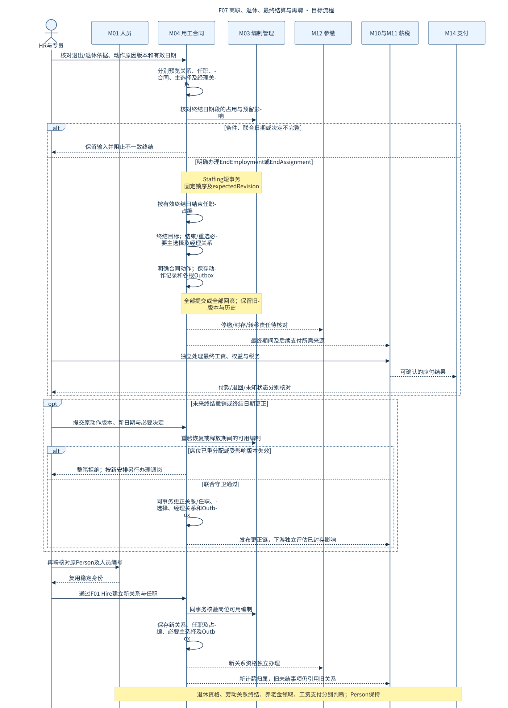
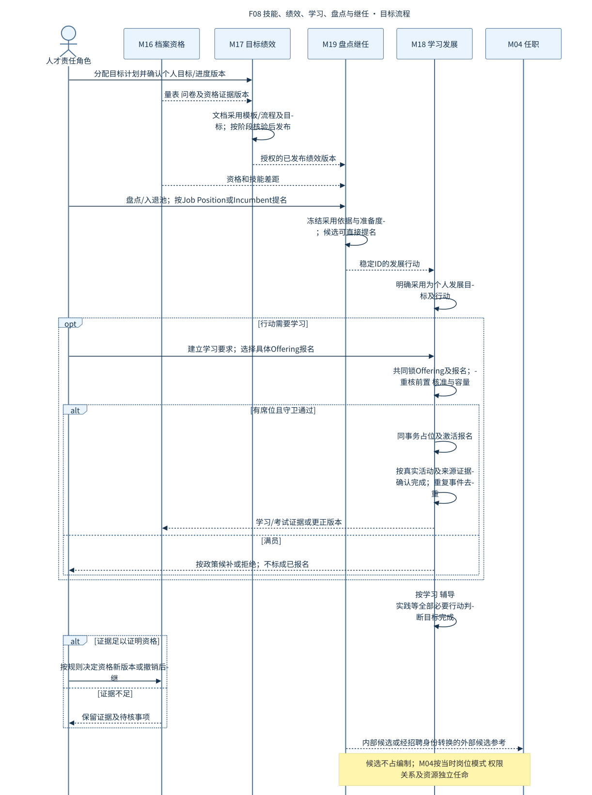
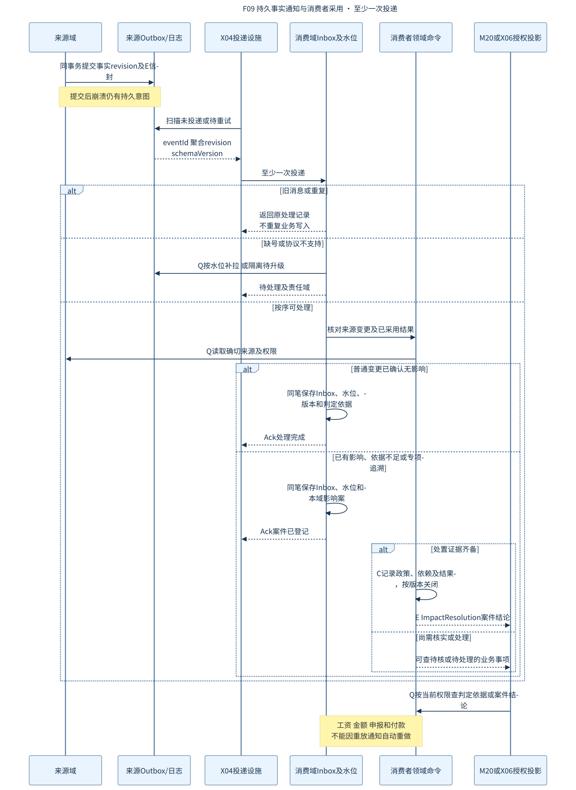

# 9条跨模块业务设计

[返回总览](README.md)。本章是目标设计[D]，不是当前产品已跑通的业务报告。图中的“HR/责任专员”是各步骤负责角色的简写，不表示同一账号具备所有权限；具体授权见[X03](modules/x03.md)。来源保存、消费者采用、外部执行和资金结果分别有身份及状态。

## F01 招聘到首次工资

**前提：**已接受的Offer或人工入职依据、StaffingPolicy版本、权限及人员核对信息；岗位模式要求有效岗位及适用编制，无岗位模式核对职务/组织而无席位。

**事实与责任。** 已接受且资料齐备的录用自动供人事办理。人事核实或登记人员身份，从原录用一次保存工作关系、首任职、主选择及 Outbox，占编段同笔转换本份预留。暂停前已接受的免占编录用仍可按约到岗。招聘自动取得用工结果。定薪和参缴另行办理。[录用与暂停补员](../../specs/m03/313-position-capacity-contract.md#m03-br-029)

**异常与历史保护：**取消入职保留已登记Person，预留与占用不得重复，后续工资只采用确认来源。

[Mermaid源文件](diagrams/f01-hire-first-pay.mmd)

## F02 组织及法人调动、晋升并调薪

**前提：**调动生效日、新旧主体/部门/席位及当前来源版本。

**事实与责任：**关系内调动与跨法人建新关系分开；资源释放/占用与人事保存协调。晋升并调薪复用M20 Journey，分别核对M04人事生效、M09授予/下发及M10工资影响处理；清单不代写这些领域事实。

**异常与历史保护：**来源失效或越权时拒绝对应领域命令；旧工资及参缴责任不因新任职默认被覆盖。人事成功而调薪失败、授予成功而工资待核均保持分步状态；重试复用成功对象。取消Journey只停后续步骤，已生效事实分别更正，已封存工资走后继。具体完成条件见[DDD §2.13](10-ddd-and-state-contracts.md#213-跨域业务完成晋升并调薪)及AC01。

[Mermaid源文件](diagrams/f02-transfer.mmd)

## F03 假勤到工资

**前提：**发布班表、原时间事件、缺勤事实、月结人员范围与工资运行。

**事实与责任：**班表按任职共同发布；缺勤按模式和跨计划时间线确认，只有余额型消耗原批次。核对实际工时和月结，工资采用原业务来源及配置版本。

**异常与历史保护：**不同日期发布不能绕过跨午夜冲突；不同计划不能绕过同一缺勤时间线；到期批次取消不变成当前新额度。重复采用不双算；已封存工资的更正形成追溯而非覆盖。

[Mermaid源文件](diagrams/f03-time-payroll.mmd)

## F04 绩效到支付及财务

**前提：**可见的绩效发布版本、确认授予、工资输入、税务依据和账户用途。

**事实与责任：**各责任角色确认授予、工资结果、付款批次及成本；税务累计按独立口径入账。

**异常与历史保护：**缺政策/来源阻断确认；先冻结完整payload并占用，再按hash授权；领取同步检查税务承诺；申报与资金、成本分别核对。

[Mermaid源文件](diagrams/f04-performance-to-finance.mmd)

## F05 历史更正与差额

**前提：**原事实、旧采用清单、原结果/申报/实缴及新更正依据。

**事实与责任：**按采用的PayrollImpactPolicy定位影响；M10基于ResultSeriesHead当前完整版本求后继差额，税费和财务分别保留自己的更正链。

**异常与历史保护：**历史政策未知时保留原事实及待核差异；100→120→130不能在第二次又补30，系列CAS失败需重新评估。会计分摊更正按已确认基准求差；不能套当前规则或重复付款/过账。

[Mermaid源文件](diagrams/f05-retro-correction.mmd)

来源修订包括区间插入、截断和撤销；消费者为每个影响范围保留唯一案、规则及结论。noImpact也须有依据；候选更新或封存后继形成后才具备关闭证据，技术Ack仅表明处理/登记。见[影响闭环合同](10-ddd-and-state-contracts.md#62-消费者影响案与闭环)及AC06/AC07。

## F06 独立参缴闭环

**前提：**参缴资格、属地/账户、期间、基数来源和政策版本。

**事实与责任：**稳定账户先形成完整义务版本及差额；申报、个人扣收、机构实缴和成本分别记录。

**异常与历史保护：**零工资/扣款不足留应收；申报部分失败保留成功行；未知先查询。

[Mermaid源文件](diagrams/f06-contribution.mmd)

## F07 离职退休与再聘

**前提：**退出或退休依据，各对象日期与当前状态，最终结算来源。

**事实与责任：**合同/任职/关系分别终结；受影响资源、主选择、经理关系及Outbox通过Staffing共同事务保存。Person不删除，再聘按F01建立新关系及任职。

**异常与历史保护：**未来终结到生效日释放编制；撤销或日期更正重新守卫恢复区间，席位冲突拒绝整笔恢复。退出未结事项仍引用旧主体；不按固定年龄自动终结全部对象。

[Mermaid源文件](diagrams/f07-exit-rehire.mmd)

## F08 人才发展与任命

**前提：**授权可见的技能证据、个人目标和绩效发布、继任主题及发展行动。

**事实与责任：**绩效阶段和盘点固定采用版本；学习要求、开班报名与完成独立，Offering共同守卫容量。M16确认资格，实际任命回到M04。

**异常与历史保护：**满员候补或拒绝，不超卖；课程更正只发出资格复核事项，未完成的辅导/实践仍保留。JobOnly继任不强造Position，候选不占编制、不自动任命。

[Mermaid源文件](diagrams/f08-talent-development.mmd)

## F09 可靠通知与消费者采用

**前提：**源域与消费者均持久化版本、业务身份和水位。

**事实与责任。** 源域同事务写事实及 Outbox，X04 至少一次投递。消费者同事务保存 Inbox、水位和核对依据。确有影响、依据不足或有专项追溯要求时才登记影响事项。采用结果归消费域。

**异常与历史保护：**提交后崩溃可恢复；重复不重记、缺号补拉、协议不支持隔离；重建投影不重新付款。

[Mermaid源文件](diagrams/f09-reliable-delivery.mmd)；具体接口分类见[协作合同](10-ddd-and-state-contracts.md#6-唯一写者与可靠协作)。
