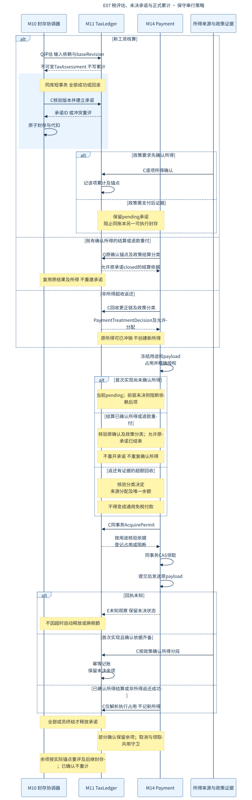
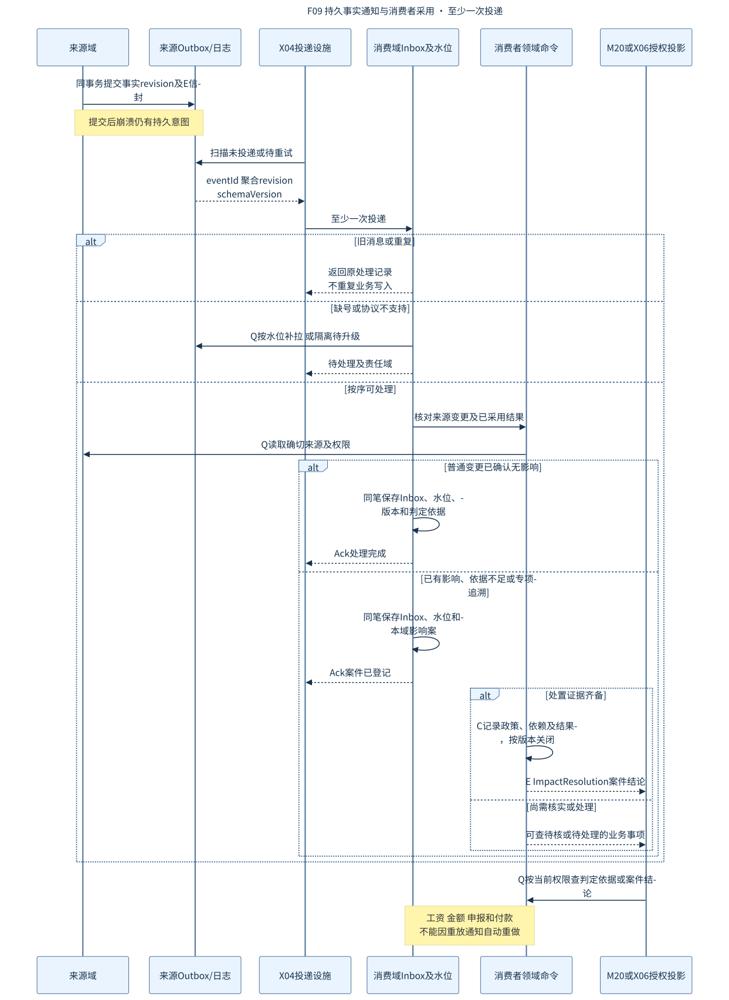

# DDD边界、聚合与状态闭合合同

本章为China HCM独立目标的DDD合同[D]，与[概念架构](12-concept-architecture.md)、模块说明及[同源聚合目录](14-aggregate-catalog.md)共同定义目标。[来源目标设计评审](../../reference/not-imported.md#source-32e2669f2b3b) 仅提供源仓沿革，不是当前 CHNHCM 全部字节的复核结论。本仓采用范围及 R25 后待整合状态见[来源说明](../../reference/README.md)，后续变更见[本仓修订链](../../reference/local-revisions.json)；[009 验证](../../verification/009-m02-terminology.md)只覆盖组织角色、工作关系及直接关联设计。实现和全国政策核验仍是后续验证边界。

## 1. 限界上下文与代码依赖

[图源](diagrams/g05-context-map.mmd)。G02是能力地图，本图才是限界上下文地图。选择模块化单体，一个上下文可以包含多个模块；菜单、聚合、数据库表和部署进程都不与上下文机械一一对应。

| 上下文 | 模块 | 统一语言与公开合同 | 上游及翻译边界 |
| --- | --- | --- | --- |
| Personnel | M01 | Person、个人资料、账户身份；IdentityView | 招聘Candidate由本域核对映射为Person；不以登录账号作为人员身份 |
| Organization | M02 | 组织、树、地点、法律实体允许用途；OrganizationView | 外部组织代码由导入ACL映射；允许用途不含付款运营配置 |
| Staffing | M03、M04 | 职位资源、预留/占用、工作关系、任职；Hire/Transfer/EndEmployment、EmploymentView | 消费Person及组织版本；内部两模块保留各自聚合；不引入薪税余额 |
| Recruiting | M05 | 申请、Candidate、Offer、交接；HireHandoff | Staffing资源接口为上游；Offer条款经薪酬域再次确认 |
| WorkTime | M06、M07、M08 | 排班、工时、缺勤、权益；PublishedTime、AbsenceResult | Staffing有效段为上游；时间分类经Payroll ACL映射为工资输入 |
| Compensation | M09 | GradeRate、授予、下发；AwardDelivery | Staffing的Grade身份、Talent发布结果为上游；不直接写工资项目 |
| Payroll | M10 | PayrollContext、计薪归属、运行/结果、采用、工资累计、工资单发布 | Staffing、WorkTime、Compensation、Tax、Contribution、Benefits的公开合同；本域ACL保留每个金额来源唯一性 |
| Tax | M11 | 扣缴登记、税评估、所得确认、税务累计及申报 | Payroll提供拟支付输入/所得证据；Tax提供评估及有效承诺；互调公开端口，不互导内部模型 |
| Contribution | M12 | 参缴、稳定义务账户、重述/差额、扣收与机构资金 | Staffing、基数证据及政策为上游；Payroll代扣是收款通道 |
| Benefits | M13 | 资格、登记、待遇/费用确认 | Staffing、政策为上游；向Payroll/Tax/Cost交付带用途的确认事实 |
| Payment | M14 | 机构付款身份及共同执行准入、员工工资应付/占用/指令、资金核销及超付追收 | Payroll应付变动、Personnel账户身份为上游；银行ACL归X05 |
| Cost | M15 | 成本归属、分摊、会计交换、关账后调整 | Payroll/Contribution/Benefits分别提供唯一成本来源；Payment提供现金/非现金结算核对事实，不重复确认工资成本 |
| Talent | M16、M17、M18、M19 | 档案/资格、绩效、学习、盘点与准备度 | Staffing人员/任职及岗位身份为上游；岗位能力要求档案归M16；四模块保留独立结论及状态，学习不自动认证、继任不自动任命 |
| Service | M20 | 服务请求、Journey、沟通内容及受众；授权工作台 | 业务域的状态与完成证据为上游；调用来源命令，不代理维护领域事实 |
| Configuration | X02 | 配置目录、适用/默认、政策版本的发布 | 拥有引用/适用元数据、政策来源证据与发布目录；可执行规则和资格/计算结果由业务域维护 |
| Access | X03 | 主体、角色、数据/字段权限及决策 | 客户身份提供方经认证ACL映射；鉴权不推导业务适用范围 |
| Analytics | X06 | 指标定义、授权投影、来源血缘 | 所有事实域为上游；读模型可重建，无事实反写权 |

X01是小型共享协议库：稳定ID类型、日期区间、修订/采用信封和纯校验器；不拥有全局Person、所有审计或所有采用记录。X04是运行设施，拥有投递、作业尝试、检查点和技术证据，业务过程状态仍在来源上下文。X05是入站/出站适配器与防腐层，维护原始观察、映射和渠道尝试；其业务执行意图由业务事务创建。

上下文关系采用“上游公开语言/服务＋下游ACL”。上下文仅发布DTO、命令/查询端口和事实通知，不暴露聚合、ORM对象或可写表。下游应用服务依赖自己定义的端口，由组合根接入上游公开服务；禁止循环导入内部包。领域层只依赖本域模型和X01小型值类型；应用层编排事务，基础设施实现持久化/渠道端口。Tax与Payroll的双向协作通过命令阶段和返回值表达，不以互相持有对方聚合解决。

### 1.1 上下文协作选择

Staffing内M03/M04共享资源与任职的统一语言；WorkTime内M06—M08共享工作时间语义；Talent内M16—M19共享技能/评价语义并保留模块根边界。它们的组合依据是语言与业务一致性，不是代码目录。

上游事实供给采用公开语言及下游ACL。Payroll、Tax、Contribution、Benefits、Payment在适用的封存、领取、取消和扣回场景采用受控伙伴协作及共同版本发布；公开写端口共享同一事务上下文。这是模块化单体的显式取舍：各域拥有自己的根和表映射，但上述强一致操作不能透明跨独立数据库部署。其余发布通知、报表和消费者采用允许最终一致。若将来拆分，应先重做预留/补偿/执行许可合同，再改变部署边界。

### 1.2 配置与规则的主责

X02登记SharedReference引用描述值类型并拥有ApplicabilityPolicy、DefaultRule和政策来源证据/发布元数据。Job、Grade、Calendar、PayrollRule、WorkingTimePolicy及Tax/Contribution规则仍由所属域版本化维护。领域配置引用X02证据；领域资格与计算服务形成自己的结果；消费者保存来源和规则版本。目录发布不直接覆盖业务规则，公共政策包不成为可以跨域写入所有配置的聚合。

## 2. 聚合根与事务边界

[图源](diagrams/g06-aggregate-transactions.mmd)。以下是目标聚合目录；同一行含多个根时，各根独立版本化，不表示合并成一个大聚合。根以客户实例＋类型＋稳定ID定位，修订号用于并发，业务生效切片不是根身份。

完整对象归属及公开写端口由[14 聚合目录](14-aggregate-catalog.md)与模块对象表同源生成。该目录包含配置根、运行根、根内实体、不可变证据及派生索引，避免只列运行聚合而遗漏Application、班次/制度、工资配置、福利计划/费用和会计映射等概念。

关键一致性根如下；根间关联不意味着合并根：

| 范围 | 关键根 | 不变量 |
| --- | --- | --- |
| Staffing | StaffingQuota、Employment、Assignment、PrimarySelection | 编制、预留转换、有效区间及主选择共同守卫 |
| WorkTime | ScheduleBook、AbsenceTimeline、EntitlementAccount、AbsenceRequest、TimeRecord、MonthlyClosing | 跨日排班/跨计划缺勤共同守卫；权益批次不能超扣；发布与采用独立 |
| Payroll | PayrollContext、PayrollAllocationSet、PayrollMembership、PayrollRun、PayrollResult、ResultSeriesHead、PayrollBalance、PayableSourceHead | Run只持结果引用；Result按可控人员/责任范围独立封存；来源唯一及历史保护 |
| Tax | TaxLedger、TaxAssessment、Registration、Filing、TaxRemittanceAccount、TaxRemittanceInstruction、TaxMovement | 评估不写累计；承诺/所得成员/执行许可属于TaxLedger；机构税债、执行及资金独立核对 |
| Contribution | Enrollment、ObligationAccount、FilingBatch、AgencyPayableAccount、AgencyMovement | 义务版本差额、员工应收、机构应付及实际资金不混记 |
| Benefits | BenefitPlan、BenefitEnrollment、BenefitClaim、BenefitCost、BenefitSupplierPayable、SupplierSettlementInstruction、SupplierMovement | 保费、员工待遇与直接理赔分开；供应商付款不重复成本，执行模式排他 |
| Payment | PayerAccount、PayableAccount、PaymentInstruction、Authorization、RecoveryAccount | 机构/个人账户区分；并发不能超付或超收；核准绑定完整载荷 |
| Talent | GoalAssignment、PerformanceDocument、LearningOffering、LearningAssignment、LearningEnrollment、LearningRecord、DevelopmentPlan、SuccessionPlan | 定义与个人事实分开；发布阶段及共同容量守卫；证据不等于资格，候选不等于任命 |
| Cost | CostFact、CostAllocation、AccountingMapping、Period、AccountingBatch、CostCorrection | 来源版本唯一；映射/期间、分摊和回执独立，关账后更正保留历史 |

X02配置版本、X03授权策略/授予、X06指标定义分别是其支持上下文的根。X04的Job/Attempt及X05的Observation/ChannelAttempt是技术记录，无权成为业务聚合根的替代。各消费者拥有自己的Adoption/Inbox；各源域拥有自己的Revision/Outbox。跨根或跨上下文协调只能调用公开写端口，并由事务协调器共享事务上下文，禁止直接更新对方表。

**Staffing强一致选择：**Hire、Transfer、EndEmployment/EndAssignment、未来终结撤销和日期更正均通过同一协调器在PostgreSQL短事务内完成。以固定顺序锁定受影响StaffingQuota、Employment/Assignment及相应用途PrimarySelection；再次校验输入版本、组织允许值与全部受影响日期段，再转换预留、释放/建立占用、保存关系/首任职或调动切片及业务Outbox，一起提交。组织变更也参与版本栅栏：提交时其版本已变则拒绝，不以早先预览作最终判断。M01登记是此前独立事务，失败入职不撤回Person。合同独立办理，只有此命令明确含合同操作时才同事务写入。剩余一席被两人同时争取只能一人成功；任一写入失败全部回滚，数据库唯一/区间约束作为最终守卫。

权益消费、应付占用、税务确认等同样用对应根的revision/锁及业务唯一键；“同一数据库”本身不证明上述约束存在。任何事务都不等待银行、税务、HR人工任务或邮件。跨域后续采用允许最终一致，但是否可付款、是否可扣收必须同步读取责任根的守卫，不能依赖滞后投影。

### 2.1 领域核验、审批与生效

各业务域按对象和动作定义DecisionRequirement值对象，包含过程/政策版本、证据要求、所需职责及职责分离条件。DecisionRecord由目标聚合或本域决定根维护，保存目标ID/版本、结果、理由、决定者、当时授权证据、有效期、撤销和替代链；不得由X04任务记录充当批准事实。规则自动核验与人工核准都通过所属域命令，是否需要审批由该领域政策决定。现阶段编制管理采取有权人直接保存，并在生效命令内校验名额、权限和期间。核编、调编、招聘预留及任职占编均不创建审批任务或决定记录。

业务提案被核准后，最终命令仍检查目标版本、当前执行者权限、必要决定及有效期/撤销状态。实质内容或依赖变化使旧决定失配，保留旧记录并重新核验；纯展示变更是否失效由明确政策判定。记录历史决定时保留当时权限，不用今天的角色倒改历史决定；重新执行则必须验证当前授权。M20提供待办投影，X04分派提醒，X03授权动作。关闭待办、点击通过和消息送达均不等于任职、休假、资格或付款已经生效。M14的精确付款Authorization是此原则的专用对象。

### 2.2 核心人事的配置、层级与完整生命周期

**组织角色与工作关系。** M02 的组织身份、法律实体用途及资格，与 M04 的具体人员关系分别维护。大陆劳动关系语境使用“用人单位”；法律实体不一概限定为独立法人，符合条件的分支机构以可区分身份及登记/资格依据表达。M02 的允许用途不能直接宣告某人与该组织存在劳动关系；受委托签约也不自动产生独立用人责任。

Work Relationship 是上位系统概念，Employment 是其工作关系记录；人员类型与关系性质分别记录。`Employment.entityId` 引用 M02 的关联组织身份，不同时充当所有责任主体。劳动关系明确用人单位，派遣/任职事实另行记录实际用工单位；非劳动或非工作关联按事实使用关联单位及具体角色。派遣A与人员有劳动关系、B接收工作时，B系统中的“非本单位员工”分类不会把B变为用人单位。劳动关系起点、书面合同订立和受托签约分别留证，不凭合同是否存在判定关系。

付款主体由 M14 根据付款用途、账户和授权明确，实际执行以核实证据确认；受托经办方不必是资金付款主体。M11/M12 各自确定扣缴、参缴事实。工作地点、组织层级、人员分类或单一 entityId 都不自动推导这些角色。旧称“法定雇主”只保留为 Oracle 对照及检索别名；具体规则和反例见[CHNHCM-009](../../adr/009-mainland-organization-terms.md)。

**按关系类型确定任职要求。** 实际入职或派驻的 Hire 仍原子建立关系和首任职，不能把所有非劳动或非 Employee 关系都当成无任职。明确的非工作关联由 M04 的受控建立动作 RegisterAssociation 保存关系，可没有 Assignment，按真实关联登记。它在本域事务中复核身份、组织引用、权限、日期、政策和必要主选择并记录 Outbox；终结沿用 EndEmployment 的适用守卫。具体接口、载荷及事务细化由后续 M04 专项规格承接，待立项明确文档编号；CHNHCM-013 仅负责本批 M02 BU，不由 X05 来源记录替代 M04 权威关系。

**定义与实例。** M04的EmploymentActionCatalog根拥有版本化ActionDefinition、ReasonDefinition、AssignmentStatusDefinition及关联；稳定代码不因改名更换身份，停用保留旧版本。动作类型与允许状态转换受领域不变量约束，配置不能绕过退出、资源或权限守卫。新命令核验生效版本、原因与动作关联、适用条件和必要决定；BusinessActionRecord固定实际采用的定义、政策、前后对象版本与发生依据。目录停用不倒改旧记录。Assignment状态与合同、关系、计薪资格分别维护；M10通过公开事实及自己的规则确定计薪。

**层级与汇报。** M02 Hierarchy只拥有按用途的组织节点/边；M03每企业一个管理汇报根，以hierarchyId定位，版本含岗位父子边及有效期，按日期段校验节点存在、有效、单父及无环。本设计采用M03唯一权威岗位层级，不另实现多套可独立编辑的Position Tree；这项取舍不声称与Oracle的两种岗位结构功能等价。X03可显式采用岗位或组织层级构建权限范围，不能由树关系直接推出授权。M04 ManagerRelationship是下属Assignment根内实体，两端都引用有效assignmentId，按用途/区间保留实际汇报。改变岗位父子边不自动改经理关系。

**主选择及经理守卫。** PrimarySelection仍是一种根：人员＋用途选择其工作关系，关系＋用途选择其任职；E01的PRIMARY_RELATION/PRIMARY_ASSIGNMENT是两种层级投影，不是两套维护入口。选择期间内目标必须属于该来源并满足资格，单值用途不得重叠；人员总体主任职从两层组合。SetManager禁止自身及同用途同时有效环路。为防止并发写出环路，Staffing使用客户＋汇报用途的稳定协调锁，再按固定ID顺序锁所有受影响Assignment；SetManager和任职终结共用该守卫，重新检查受影响链及全部日期边界。终结经理任职需明确结束或替换入站关系，缺少处置拒绝提交，不静默迁给岗位上级。

**部门与岗位额度。** M03 的 StaffingQuota 按企业、对象类型和稳定身份记录部门总额或岗位定额。每个对象有独立的按日节点和修订。部门只汇总当日直属启用岗位的定额。部门已定总额时，同日调整总额及多岗定额按最终分配一次提交。部门未定总额时仍可按岗定额。WorkforcePlan 另记目标与预算。[313 编制口径](../../specs/m03/313-position-capacity-contract.md#m03-br-025)

核编与岗位改隶、启停共用受影响部门的稳定守卫，首次设额也可取得守卫。跨部门改隶按稳定身份顺序锁定新旧部门，再锁改动对象。在同一短事务内重读 M02 部门有效期、M03 岗位归属和最新额度节点，按所有受影响日期段检验最终分配。服务端校验改动目标的当前授权，并用完整分配判定上限。成功时同笔写入各对象修订、业务 Outbox 与同一次提交回执。失败时保留原安排。后台减编使用相同检查。[同日调剂及减编](../../specs/m03/313-position-capacity-contract.md#m03-br-040)

**后续招聘与任职用量。** StaffingPolicy 按企业、人员类别、用途和期间确定岗位模式及是否占编。按岗位任职须采用有效岗位，仅按职务任职采用职务与组织。接入后在岗位上记录本次接替的专用期间及各段预留、占编的来源，已办任职保留采用的规则版本。[招聘预留与任职占编](../../specs/m03/313-position-capacity-contract.md#m03-br-027)

涉及招聘份额时，先经 M05 公开端口按企业、需求和稳定份额取守卫，再按 Staffing 锁序锁定受影响对象。保存时重读绑定、承诺及期间。按人数缩招须在同一事务核实选中的份额仍可互换，连同需求新人数和逐份释放结果提交。发正式录用时，Go 重验双方确定的到岗日、全任期和权限，将录用版本、沿用或新增的预留及 Outbox 一起提交，提交成功后才可对外送达。转换采用已接受的有效录用。安排交接时在岗位守卫内核实原任结束边界、接替者、分段用量和后续常规名额。若待锁份额集合变化，退出事务按完整集合重验。任职、名额与各域办理结果同笔提交，重试返回原结果。[招聘预留](../../specs/m03/313-position-capacity-contract.md#m03-br-027) · [限期交接](../../specs/m03/313-position-capacity-contract.md#m03-br-035)

**调动、内部接任及同日对调。** M04 调动可作为交接依据，采用已登记或本次同时确定的离岗边界。纯内部接任在岗位锁内计入已有招聘预留。与招聘份额关联时，入职和调动共用其唯一转换结果。调动撤改重验两岗及受影响的后继。对调以两份稳定的人事动作识别同一组，同一动作只能用于一组。保存时按组内最终结果逐岗逐段核验用量及每人的资格、主选择和权限。动作、任职、编制、回执与各域 Outbox 一起提交。换顺序、换提交号重送或单独重放已用动作均不能再产生变动。[调动业务条件](../../specs/m03/313-position-capacity-contract.md#m03-br-039)

**退出、撤销及更正。** EndEmployment必须明确其各Assignment和合同如何结束；EndAssignment可以只结束一项任职。Staffing协调器锁定受影响人员/关系的PrimarySelection、经理守卫、StaffingQuota及M04根，按统一顺序校验全部有效区间。一次提交结束/截断占用、关系/任职、必要选择及经理关系、动作记录和各根Outbox；合同只有在明确指令内才写入。未来终结只结束指定未来区间，不提前释放当期编制。CancelFutureEnd、CorrectEndDate用相同守卫重算全部恢复/释放区间；若名额已分配给他人、依赖版本失效或选择冲突，整笔拒绝，保留旧事实并另行办理调岗/更正。已经实际终结后的新用工走Hire建立新关系与任职，不借取消动作复活旧对象。再聘保留Person及旧税费/工资采用链。

已履职的补录或更正由 M04 核实人员、岗位、实际日期及依据。沿用入职或任职的权限、资格及版本校验，同笔保存人事事实、适用的占编及各域 Outbox。满编或暂停时按实登记，M03 按当期核定、交接、预留和占编计算差额。原核定数、他人的预留和历次来源可查。拟议安排仍按期核验名额和补员状态。[履职事实与差额](../../specs/m03/313-position-capacity-contract.md#m03-br-036)

招聘与任职接入后，进入 Staffing 依次锁定所需汇报用途、受影响部门及岗位资源、人员或关系主选择、工作关系、任职及必要合同，同层按稳定身份排序。调整岗位定额、暂停或恢复补员、停岗、预留与任职变动共用企业和岗位的稳定守卫。同岗重叠任职在工作关系守卫内复核，无岗位任职仍守卫人事及主选择。保存时重读组织、岗位和占编规则版本，已接管用量的期间调减岗位定额后须覆盖常规承诺，缩短交接须重验接替者其余期间，停岗须核清全部岗位引用。原采用与更正历史可查，下游独立处理影响。

验收反例包括：停用原因仍能解释旧调动；无岗位入职不造虚构占用；主任职不能选到另一关系；相互并发设经理不成环；离职不能遗留有效占用；席位已重分配时不能无条件撤销离职；减编不能抹掉既有事实。这些是后续实现的验收要求，不是已运行结果。

### 2.3 计薪归集与结果粒度

PayrollContext根绑定personId及允许的薪资责任用途/有效期；PayrollMembership根绑定assignmentId、contextId和PayrollDefinition并拥有分配事实。提交时核对任职属于该Person、责任用途有效及时间相容。

PayrollAllocationSet根以客户＋assignmentId＋计薪用途唯一定位，持有权威成员引用、共同规则版本和集合revision，分配数值仍由各Membership维护。规则明确可比单位、上限和允许重叠条件；不能分别按contextId或definitionId缩小应共同校验的范围。AssignPayroll、转组、终结和更正通过同一协调器，固定锁序取得全部受影响集合及其成员，按全部日期边界分段校验总量/重叠和来源版本，再同事务提交成员变化、集合修订及Outbox。新集合的唯一业务键阻止并发创建两套守卫，注册表不是异步投影；移动到另一用途/任职时同时守卫新旧集合。

例如规则上限100%，两请求分别建立不同membership/context的60%：二者必须竞争同一个assignment＋purpose集合，后者见到前者结果后拒绝，总量不能成为120%。历史更正也经该范围，保留已采用旧版本并交由结果更正流程处理。同一人的多个工作关系可以按明确规则进入同一计薪上下文，也可以分开；Tax和Contribution各自决定累计或义务键。终结用工不删除计薪历史，尾款/补退通过有依据的结算用途处理。

PayrollRun是批次协调与结果引用，PayrollResult是受控范围的封存根，不把全企业全部结果放进一个聚合。各结果单元可独立成功或失败，批次控制总数及状态明确；结果、累计与下游应付来源通过下述事务共同维护。

### 2.4 工资配置、影响规则与连续更正

Element/Classification、CalculationRule（含CalculationValue与规则查表）、Calendar、PayrollFlowDefinition及BalanceDefinition/Group分别由M10配置根拥有；分类/参数等可为根内定义，不要求各自成根。PublishElement、PublishCalculationRule、PublishPayrollCalendar、PublishPayrollFlow及累计定义发布端口产生不可变可采用版本；停用/替代结束新采用范围而保留旧定义。AdoptInput、StartPayrollFlow与M12 AssessContributionBase是运行命令，不承担配置发布。M12通过Publish/RetireContributionPolicy管理本域规则版本；X02只提供政策证据与适用元数据。启动的FlowInstance固定定义版本、参数及步骤完成证据，X04执行技术尝试，流程完成不代替各业务结果成功。

M10 PayrollImpactPolicy根定义来源类型、相关字段、变化类型、有效日期及工资项目/期间范围、分段或追溯判定与人工复核条件。来源通知保留实际变更事实，策略决定是否及如何创建ImpactAssessment/RetroCase；评估作为RetroCase内不可变证据固定策略版本与采用清单。未匹配项保留“不影响/待核”依据，不能静默删除事件、漏掉撤销，或绕过同步来源失效栅栏。政策升级仅改变明确适用范围；追溯既往需显式评估，不自动改封存结果。X01提供信封与查询协议，X04投递，不拥有这些业务触发规则。

**完整结果基准。** ResultSeriesHead根以原始受控结果单元seriesId稳定定位，范围固定Person/计薪责任、原业务期、结算币种及计算用途；更正案、重跑或新请求ID不另建系列。它持有currentFullResultVersion、完整金额向量（按稳定项目/用途键）和revision，原结果及全部后继不可变。PayableSourceHead仍负责应付movement的连续发布与M14采用水位，两种head职责不互相替代；一个应付可按显式分配汇集多个结果系列。

SealResult/CorrectResult在现有T2共同事务中，按统一锁序锁相关TaxLedger、ResultSeriesHead、来源head及其他责任根，CAS expectedFullVersion及来源/政策依赖。新完整金额向量减当前已确认完整向量生成唯一ResultDelta；缺少项目按明确终结处理，单位/币种不兼容则拒绝比较。结果、系列head、工资累计的有符号流水、M11承诺、M12实际扣收、M14适用的扣回分录、PayableSourceHead及各根Outbox全部提交或回滚。首次封存与零基准比较；模拟/候选不得推进head。Tax/Contribution各自的确认/累计和更正语义仍由本域决定，不直接从工资净额相减推导税法或义务结果。

例如原全量100，后继120产生+20，再后继130仅产生+10。两个更正案都基于120时，只有一个可推进head，另一个重新核对当前版本；相同更正身份同内容返回原结果，同身份不同内容拒绝。零差额也保留判定及版本链，不凭空新增应付。CancelResult和取消某次更正也从当前head计算有依据的新完整状态与反向/后继delta，不能跳回旧head或独立重复减去旧差额。若100→120→130后要求撤销中间变更，先明确当前应为何值；不得机械-20。已领取/unknown、已确认所得及已付部分继续遵守第3/4节的hold、查明及合法补偿要求；取消只在允许范围推进基准。

### 2.5 成本分摊、会计交换与关账

M15以不可变CostFact接纳来源唯一的成本变动；CostAllocation是完整分摊集合根，以costId＋账簿＋会计用途＋币种为唯一业务键，各allocationLine不是独立余额。新建、更正按集合revision共同守卫来源与全部行，草稿可以不完整，但PrepareJournal前行合计必须精确等于来源的有符号成本，计量和舍入规则一致，禁止两个80分摊争用同一100来源。不同账簿/管理用途保留范围，报表不能把它们相加重复确认成本。

PrepareJournal冻结来源、完整分摊/映射版本、目标期间、逐行业务身份及payloadHash，同时在集合登记活动AccountingBatch；ClaimJournal和BeginClosePeriod共享Period守卫，统一按Period、CostAllocation、AccountingBatch的稳定ID顺序锁定。领取重核版本、权限和核准，不使用过期预览。若关账先提交，新的准备/领取被拒绝；若领取先提交，期间进入Closing后等待该批次查明，不撤销已外发意图。事务提交后才由X05发送，未知先查询，不换新batchId重发。

每个集合保存逐行已确认的会计基准及未决活动引用；外部回执按业务行唯一应用，部分成功仅推进已确认行，待核行保持占位。来源采用一次不代表其分摊只能输出一次，也不允许每次全量重复输出：原分摊60/40已过账，改50/50只输出-10/+10并引用原分摊版本。未发送草稿可明确取消替代，已外发/unknown先查明，再按已确认基准与新完整目标求差，保留全部原请求。来源成本变化由原域新CostMovement产生新的CostFact；不能既改旧事实又采用新差额。

ClosePeriod只在Closing期间全部活动批次已查明且核对/决定满足时转Closed；未发送待办明确取消或完成后再关闭。Closed期间的CostCorrection保留原业务期间和原凭证，在明确允许的新会计期发送后继差额，不重新开启原期或原请求。迟到冲突回执进入待核，不倒改关闭证据。本设计限定HCM的成本交换和对账合同，不声称拥有外部ERP的总账或关账事实。

### 2.6 福利待遇与费用去向

BenefitClaim独立于保费账单：申请采用BenefitPlan/Option、Enrollment、资格及证据版本，由M13核验/决定，登记有效不代表待遇已获批准。企业承担报销的确认待遇经claimId＋确认版本＋用途形成唯一BenefitCost，由M10明确采用并按工资/税务用途办理，由M15采用其唯一企业成本。保险商直接理赔仅经X05接收外部确认与结算引用，不再生成企业工资或成本；税务信息仅在明确政策及目的下交M11判断。保费与待遇以sourceKind及业务来源区分，取消/更正保留原确认和已采用链，按各域后继处理，不把同一赔付重复当两份支出。

### 2.7 WorkTime的配置、时间覆盖与权益

**排班发布。** M06的WorkPattern、Shift、Calendar、WorkingTimePolicy和GenerationProfile是版本化配置；生成ScheduleCandidate只得到未发布方案。ScheduleBook以客户＋assignmentId稳定唯一，持有当前有效SchedulePublication引用及revision。Publish/Swap/Cancel/CorrectSchedule共同锁定全部受影响Book，按真实起止时刻、时区及休息段校验跨午夜、跨业务归属日和不同发布的兼容性，并同事务保存发布/替换版本、登记及Outbox。周五22点至周六6点与周六0点至8点不能分别按日期通过；只有政策明确允许并定义计量的叠加才可并存。换班多任职按固定ID顺序锁Book，不能只释放一侧。旧采用不被改写，源变更推进依赖版本并产生消费者复核事项。

**可复用工时配置。** M07 TimePolicy根含Category定义、ConsumerSet、Profile、Rule、Layout及允许来源定义；每项有稳定内部ID和发布版本。Category是分类条件/单位，TimeRecord中的分类值是采用结果；ConsumerSet是消费者选择、期间、核准/释放及合同要求，不是一次投递或采用。Publish/RetireTimePolicy改变新采用范围，历史TimeRecord/TimeDelivery固定原版本。Device由sourceSystemId＋deviceId标识并在本域允许来源中登记，X05翻译渠道，M07按原sourceEventKey去重；同键不同内容待核，不修改原设备观察。

**假种、计划和个人参与。** M08 AbsenceCatalog根拥有可复用Type、Reason、Category及关联版本，Type引用允许原因和按优先级/明确并行规则组合的Plan；Reason可复用，Category只归组。AbsencePlan独立定义计量单位、转换、权益范围和模式，经Publish/Retire维护；资格评估固定采用目录、计划、人员及工作时间版本，AbsenceEnrollment明确个人参与及有效期。引用未知、单位无法合法转换或多计划优先级不明确时拒绝确认，不能从计划存在直接推导个人已参加。

模式分为BalanceTracked、Qualification、NoEntitlement：余额型使用授予批次及账户；资格待遇型按规则、事件及期间输出数量/待遇比例；无权益型登记不设余额的缺勤。后两者不制造虚构账户或消耗，仍校验资格、参与、授权、必要决定和时间冲突。“有余额”“允许休假”“带薪”不是一个判断；M08提供数量/比例/性质和来源，M10负责工资金额。

**请求与共同时间线。** AbsenceRequest固定personId、assignmentCoverage及实际时段；覆盖单一或多个任职必须明确，不能用日后主任职默认扩张旧请求。DecideAbsence记录批准事实，ConfirmAbsence才保存可供消费的确认缺勤；批准后来源改变须重核，未确认请求不产生事实或虚构消耗。AbsenceTimeline按客户＋assignmentId唯一，拥有所有计划的确认覆盖引用。Confirm/Cancel/Correct固定顺序锁相关ScheduleBook（或其同事务版本栅栏）、全部Timeline、账户、Enrollment/Request，重核日期、兼容政策、决定和版本，再同时保存覆盖、请求事实、必要权益分配、计算结果及Outbox。不同计划账户余额充足不能绕过同一Timeline；明确允许并存时固定待遇组合/用途和来源，禁止未经规则决定重复计薪。未来确认以其有效区间和原分配保留，生效日不再扣一次。取消/更正按同范围更新，不删除原事实。

**授予批次与取消。** EntitlementAccount按personId＋planId＋计划定义的规范权益范围唯一定位，范围可依法区分人员/关系/任职用途，不能由新请求或新计划版本任意另建。GrantLot固定来源业务身份、授予期间、数量单位、可用起止及政策版本；ConsumptionAllocation绑定所用批次和数量，预留同样引用这些批次。授予及更正用来源唯一键和CAS，仅按当前完整授予的差额入账；减少至低于既有消费/预留一律拒绝，先有依据地处理相关更正，不静默抹平余额。跨批次消费按计划顺序并在同一账户守卫；跨账户计划组合锁全部参与账户。

取消始终以原消费身份反向、按原批次原有效期恢复：去年已到期的额度在次年取消后，只恢复历史轨迹并保持当前不可用，不能冒充今年新授予。需要延长或重新授予须另有核准事实。CarryForward以原批次/目标期间唯一业务身份，将原批次出账与后继批次入账同事务完成，保留政策上限及有效期；重试、到期与取消通过相同账户守卫，不能重复结转或同时保留原可用额度。已采用工资的影响交M10按当前结果系列形成后继。

**唯一分发与月结。** TimeDelivery固定sourceFactId/version、canonicalOriginRef、consumerId、用途及Category/ConsumerSet版本；发布记录归M07，采用只归消费者。M08确认缺勤是其计薪影响唯一来源，M07看到的缺勤覆盖仅用于核对；不会换一个TimeRecord或closingId再生成同用途缺勤输入。MonthlyClosing冻结范围清单、原事实及配置/日历/班表/资格版本，缺失和冲突不能按零补齐；新的发布/准备重核所有采用依赖，发生变化即待复核。M10保留原业务来源及依赖版本，月结只核对引用，来源更正按PayrollImpactPolicy进入影响案而不覆盖旧封存。

### 2.8 Talent定义、实例及证据采用

**目标与评价。** M17 GoalDefinition、GoalPlan是可复用配置；GoalAssignment以人员、计划及周期定位个人分配根，拥有GoalInstance、权重及进度。计划改版不更新已分配目标。PerformanceTemplate拥有章节、权重、参与资格及责任规则，引用独立的PerformanceProcessDefinition、DocumentType、ReviewPeriod及M16量表/问卷版本；独立配置根是本目标选择，不要求Oracle的物理模型相同。PerformanceDocument固定个人目标、assignmentCoverage及全部定义版本，拥有StageInstance、评价、反馈与发布历史。阶段推进和发布通过文档revision守卫，核对必需阶段、决定、评分及权重；X04完成任务不能直接推进业务事实。目标刷新、更正和申诉都经显式命令，发布后用后继版本和Outbox通知M09/M18/M19复核，旧奖金和盘点不回写。

**学习要求与容量。** LearningAssignment是人员的学习要求、截止及重修周期；可以先于任何Offering存在。LearningEnrollment才是具体开班报名，课程改版不改变它的历史采用。LearningOffering拥有容量和SeatReservation/WaitlistEntry。Enroll、候补转正、取消、转班及缩容共同锁定受影响Offering，再按固定ID顺序锁学习要求和报名，同一短事务守卫并更新座位、报名及Outbox。核准不保证席位，最终激活仍需前置、受众、当前权限和有效决定；最后一席只允许一份Active，满员按明确政策候补或拒绝。缩容低于有效占座拒绝；重复取消不多释放。转班原子守卫双方，目标无位则整笔失败，或显式保留原报名并登记候补，不先丢失原席位。Offering关闭与报名共用守卫，完成后仍保存历史。这里采用严格不超卖的目标策略，与Oracle可允许超额登记的产品行为不声明等价。

**发展与证据。** M18 DevelopmentGoalDefinition是发展目标库，与M17绩效目标库分属不同用途；DevelopmentPlan拥有个人DevelopmentGoal及学习、辅导、实践等Action。M17/M19行动按稳定来源ID和用途显式采用，通知重投不多建目标。只有需学习的行动创建LearningAssignment；一个课程完成不直接完成所有行动或授予资格。LearningRecord保存报名/要求/课程活动版本和原始来源证据，重复同键去重、同键异文待核，更正/撤销形成后继并通知M16复核。M16拥有问卷定义；M17等具体评价域拥有回答实例，M16只采用不可变引用。M16的QualificationDecision独立决定资格后继，不抹去旧决定或把课程更正自动当成资格撤销。

**继任主题与任命。** M19 SuccessionPlan包含带类型的Subject：Job、Position或Incumbent；前两者引用M03，在任者引用M01/M04并明确任职/组织范围。JobOnly不需要虚构Position。Candidate可直接提名或来自人才池；内部引用Person，外部引用M05 Candidate，进入计划不建立用工关系。来源停用/调动只产生复核事项，准备度和盘点仍保留原依据；外部候选实际入职经M05→M01/M04核对转换。全部候选均不预占资源，最终M04按当时岗位模式、组织适用、权限、用工关系及可用编制独立任命。

### 2.9 共享引用、成组授权与任务证据

**引用与默认。** X02的SharedReference（协议中的ReferenceHandle）是同一引用描述值，真实对象及实际发布版本仍归来源域。ApplicabilityPolicy以目标/类型＋用途为稳定范围，发布版本声明有效区间及完整允许/排除规则集合；同维包含并集、启用维度交集、排除优先。共同范围也必须显式配置，无政策、未知维度、冲突不默认为通用。解析结果固定ReferenceHandle、上下文、有效日期、解析模式和策略版本。DefaultRule独立发布，DefaultProposal只是带版本/期限的建议。接受默认时由目标域命令重新验证来源状态、上下文、策略和当前权限；改BU/日期或撤回策略必须重算/拒绝，不能把旧建议直接作为业务事实。消费者保留当时采用，历史更正依自身政策按声明的业务日及确切来源版本处理，不套当前默认。

**成组授权。** X03 RoleDefinition引用领域公开动作，RoleGrant完整绑定角色定义版本、数据范围/字段策略版本、用途条件和有效期。鉴权逐份Grant同时满足主体、动作、目标对象、字段、用途及条件后，再合并完整许可；强制限制及显式拒绝优先。不能先并集所有角色动作，再并集全部数据范围：A范围工资读取和B范围通讯录读取不构成B工资读取。Person可见不推出Employment、Assignment及敏感结果全部可见。发布/停用定义、授予/撤销及AdoptGrantVersion均为受授权的X03命令；发布新配置不静默扩大已有授予，停用版本不继续放行，授权管理也不能超出操作者可授予范围。

**当前授权与执行。** 业务日期选择事实版本，当前执行时间决定权限。AccessDecision仅为本请求的当前授权结果，不持久化每次输入、Grant及匹配过程。业务终态由所属域最小事实独立解释；必要安全事件按实际操作记录。受保护命令在同库短事务内经X03公开端口重核并守卫当前主体、Grant、角色及策略发布状态/修订；授权依赖与撤销按固定顺序协调，不能仅靠过期缓存或异步事件。动态组织/经理范围还需核对其权威来源版本，缺失或无法确认新鲜度则拒绝。该方案是模块化单体合同，拆库时需重新设计同步撤权与执行许可协议。

X04/X05异步工作必须声明onBehalfOf或serviceOperation：前者同时受当前委托范围及服务能力限制，后者依明确的服务Grant和业务许可。每次新领取/执行重新核验，队列创建时权限和适配器凭据不能代替当前授权。已经可能外发的操作仍按原请求身份核对unknown和回执，不因撤权删除历史或重发；核对者也需具备当前相应服务权限。M20/X06缓存、任务、统计、已发布报告及下载都重核当前范围/字段/用途。权限收窄后不能隐藏明细却保留越权总计，应拒绝该快照或按原历史来源重建授权结果。X06导出业务记录与X03授权审计共享exportId引用，各有单一职责。

**清单与业务结果。** M20 JourneyInstance 固定启动时的模板、步骤和证据条件。对“任职已生效”等可从所属域判定的步骤，初次办理与来源更正、撤销均自动按最新有效事实判断。条件仍成立显示已满足，尚未办理或确认已撤销显示未满足，原完成证据可查。仅在依据不足以判定、相互矛盾或步骤本身要求人工判断时产生复核待办。ConfirmStepByEvidence 和 ReassessStep 复用同一证据条件。实例推进及取消校验修订，取消只停止未执行步骤和后续分派。业务事实由 M04、M16、M10 等所属域办理，X04 负责调度。

### 2.10 人员编号与主选择覆盖

**编号生命周期。** M01在RegisterPerson提交时分配employeeNo，命令重试沿用登记业务键，不因入职失败重发号码。personId始终是跨域身份；employeeNo是可读业务编号。RenumberPerson仅用于有依据的编号纠错或编号制度迁移，固定原因、决定、前后号码及修订；离职、再聘、换雇主不触发改号。Person拥有PersonNumberAlias历史，客户内编号登记守卫对规范化后的现号与全部旧号永久唯一；RegisterPerson与RenumberPerson共用该守卫，旧号不得分给另一人。改号同事务更新Person、旧号别名、新号占位及Outbox。旧号查询解析到同一personId并显示“历史编号”；旧采用保存当时号码，不按今天的别名重写封存快照。编号不建立业务生效切片，RenumberPerson在提交时改变当前号码；GetRecordedNumber(personId, sourceVersion)按确切登记来源返回原号码，ResolvePersonNumber按永久现/旧号登记解析人员。编号不接受回溯或未来业务生效改号，businessAt单独选择或双日期切片请求明确unsupported；9月10日改号不能被解释成8月已改号。

人员编号不得重复分配。登记人员时，只按同一客户实例内非空的现用主要证件号码判断人员是否重复，同名不触发查询、提示或确认。人事发现已有档案可能误建时，M01 才按具体证据办理核对，必要时冻结相关人员的新建关系或新下发用途，保留历史查询和已执行事实。证据不足不自动合并、不批量改跨域外键；确认误建后逐域制定有引用的纠正方案，保留被误建身份及来源链。登录账户和外部候选编号不替代personId。

**覆盖政策。** M04拥有PrimarySelectionPolicy根，版本按人员/工作关系类别、用途、关系及任职状态定义eligible、required与适用区间。PrimarySelection保存政策版本；M03 StaffingPolicy仍只负责岗位模式及是否占编。下表是目标默认政策[D]，客户改变它需显式发布新版本，不是法规断言。

| 日期上的业务状态与用途 | 人员层主关系 | 该关系内主任职 | 必须证明的覆盖 |
| --- | --- | --- | --- |
| 仅登记Person、未来入职尚未生效、全部关系已结束 | 当前可为0 | 当前可为0 | 不制造虚构关系；历史日仍返回历史选择 |
| 至少一段有效Employee关系；HR管理归属用途 | 恰好1，候选是有效Employee关系 | 每段适用Employee关系恰好1；Active或政策明确合格的Suspended任职 | 所有要求覆盖的日期段无空洞；停薪不自动使主任职失效 |
| 承担实际工作的Contingent等非Employee关系；HR管理归属用途 | 默认允许0或1；显式required后恰好1 | 被选关系必须有恰好1个合格主任职；未被选关系按政策可为0 | required而无合格目标时拒绝命令，不能降级为可空 |
| 明确为非工作关联；不由人员类别自动推定 | 默认允许0或1；按用途明确资格 | 默认允许0，不因主关系被选而虚构任职 | 某用途显式required时必须有真实合格目标，否则拒绝；类别与关系性质冲突需明确处置 |
| 报表代表、通知路由等可选用途 | 0或1 | 按该用途显式规则 | 缺失时返回未指定；不得借用HR主任职推导薪资、税务或权限 |

同日多类别命中时按政策的确定优先级解析；同优先级矛盾或未知状态拒绝。人员层required取有效关系中适用要求，不能因另有可选关系而弱化。Hire仍原子创建Employment＋首Assignment，并建立必要两层选择。Transfer、SelectPrimary、EndEmployment/EndAssignment、更正及政策激活均校验全部受影响日期边界的资格、唯一性和覆盖；在既有Staffing事务内守卫选择、政策版本及相关关系/任职。政策可先发布待激活版本，受影响存量未满足覆盖不能激活；不自动挑选候选。激活与相关命令共享政策修订栅栏，避免校验后又产生空洞。结束最后一段关系后允许0；只结束主任职而另有有效关系/任职时，须同事务明确重选或拒绝。

### 2.11 日级人事与跨午夜时间

BusinessActionRecord保存动作身份、依赖动作/对象版本及当日最终状态的组成依据。一天两次真实动作不增加EFFSEQ。CancelAction只撤销指定动作的业务效果：从该日基准与保留动作重建拟议最终切片，校验显式依赖及后续日期段；不能把旧快照整体复制回来。独立的调部门和调职级中只撤销调职级，应保留部门变化；另一动作依赖被撤销结果时须人工明确后继方案，不按录入先后猜测。撤销是新修订和新动作证据；编制、主选择、经理及下游失效仍走同一协调器，已采用历史保持原字节。

M06 WorkingTimePolicy拥有TimeAttributionPolicy值配置，声明任职解释时区、跨午夜分段、班次归属日及计量规则；M07固定其版本。`actualInterval`是真实时刻区间，`staffingBusinessDate`由每一段时刻按任职时区转换，`valuationDate`是班次/工资规则的归属日，三者不可互相替代。日级任职区间`[from, through)`按该时区两日零点转为可覆盖的时刻范围；先按任职、日界及班段边界切分，再按政策计量。夏令时地区按带偏移时刻求实际时长，不假定每天24小时。

例如最后在职日为11月1日，即through=11月2日；22:00—次日06:00的原始班次全部保留。旧任职只覆盖前2小时，后6小时进入TimeRecord待核片段，不能因班次归属11月1日就自动计入旧任职。只有明确的新任职覆盖及核对决定才能重新归属；否则阻止该片段的确认/释放和相关月结完整性通过，不丢弃观察、不默认零，也不把6小时挪到前一天。历史离职日更正使已确认工时越界时，M07生成复核后继，M10按影响政策处理已采用工资；原班表、时间观察、采用与封存仍可解释。这是本目标的边界选择，不宣称任职具备日内生效状态。

### 2.12 薪酬口径、转换与期间分摊

M09 的 AwardDelivery 交付适用于该任职的约定金额或小时单价、币种、频率（annual/monthly/hourly/oneTime）、计量单位、生效期间、采用的授予及费率版本。企业变更任职薪酬时建立有生效日的后继授予。岗位预算报价另行保存。

M10 的 CalculationRule 采用有版本的 ConversionProrationPolicy。先按生效日期分段，再按明确的年度期数或单位换算。固定工资按适用日历的工作日或标准小时做一次期间分摊，同一段的覆盖量及完整参考期分母取同一任职日历。小时工资以约定单价乘已确认可计薪小时，一次性给付按其授予条件办理。各步按规定粒度舍入，保存当期实际采用的版本、输入和结果。

设计算例采用年额 60000、12 期，完整参考期 20 个标准工作日，本次覆盖 10 日。结果为 60000 ÷ 12 × 10 ÷ 20 = 2500.00。约定月额 5000 时，按相同日历得 5000 × 10 ÷ 20 = 2500.00。若按该任职日历的标准小时计算，覆盖 80、完整期 160，得 5000 × 80 ÷ 160 = 2500.00。三种输入各自保存依据。实际加班、缺勤及计薪小时另按本域事实处理。

### 2.13 跨域业务完成：晋升并调薪

复用M20 JourneyTemplate/Instance，不引入全局HRBusinessCase根。模板明确这是“人事已生效”“薪酬已生效”还是“本次工资影响已处理”的完成口径，实例固定templateVersion、personId、assignmentId、业务日期、各来源命令身份及预期步骤证据。晋升并调薪模板至少要求：M04晋升动作及最终任职修订、M09已确认Award/Delivery、M10对两项来源的影响评估与采用/处理结论。

M20确认步骤时查询所属域当前事实及原完成证据，区分pending、blocked、satisfied、reassessmentRequired；实例仅在全部必需步骤仍满足时完成。M04成功而M09失败应显示“人事已生效、薪酬待办理”；M09成功而M10未评估应显示“薪酬已生效、工资影响待核”，均不得显示整体完成。M10确认为无影响须有理由和政策版本；需处理时必须引用实际采用及候选更新或封存后继证据，只有收到事件/Ack不算完成。若业务目标要求本期结果封存或支付到账，模板须另列对应证据步骤，不能从“影响已处理”推导到账。

重试按原 journeyId、stepId 和各域业务幂等键复用成功对象。各步骤独立提交，所属域在新的采用或执行时校验来源。历程展示整体完成前核对当前依赖版本，按各步证据条件自动更新，保留旧完成历史。取消实例只停止后续分派。撤回晋升或调薪分别调用源域命令，已封存或支付的工资按政策形成后继和差额。

## 3. 付款：先冻结再授权，稳定应付账户守卫

[图源](diagrams/e05-bank-payment-identity.mmd)；[执行状态](diagrams/e06-external-state.svg)及[图源](diagrams/e06-external-state.mmd)。这里指工资应付；机构税款、参缴款和保费分别归M11/M12/M13的应付账户，复用执行协议而不共用工资余额。M14的公共付款账户及执行准入边界见§3.2。

PayableAccount的键为客户＋应付业务身份payableId＋币种，沿Payroll原结果和后继差额保持稳定。M10向M14交付不可变PayableMovement，唯一键为来源结果/更正身份＋用途，正差额增加应付，负差额减少应付；改用新requestKey不能重复入账。原工资已付后的负差额可能造成超付，必须按第3.1节保留有符号待结算额及追收记录，不抹掉资金事实或产生第二套余额。M10拥有PayableSourceHead（稳定payableId＋币种、连续来源revision及不可变Movement引用）；任何结果/更正/取消对同一应付的变动都在写Outbox的同一事务推进该head。M14的PayableAccount保存adoptedSourceRevision。PrepareInstruction和ClaimDispatch必须经M10公开端口在共同事务锁住source head，核对已采用水位等于当前head；不相等先按连续来源补齐，不能用滞后余额占用或发款。这样负差额尚在Outbox队列中时，旧应付也不能继续发送；原M10来源与M14结算账户仍各有唯一写者。

1. `PrepareInstruction(expectedAccountRevision)`在同一事务内读取确认应付，冻结付款主体/运营账户、收款人、支付方式、币种、金额、分配、税务执行用途及所得成员/确认锚点或非所得返还分类及回收来源引用、账户身份/用途版本和必要敏感快照，生成payloadHash，并建立对应Reservation。银行方式必须有账户，现金方式按自身凭证合同处理。批次为指令集合，批次hash包含有序指令身份及hash。
2. 对新建或增加付款占用，原子检验 `netSettled + activeReservations + requested <= payableLimit`。netSettled为第3.1节的净结算N，activeReservations仅计付款占用；银行退回、员工归还和核准工资扣回按各自SettlementEntry影响N，不能重复计入。应付100，两条不同幂等键的80指令不能都占用成功。已经发生负差额导致余额低于既有占用时，账户进入deficit/hold，阻断新的占用和未发送领取，并逐项核销或取消未发占用；不伪称历史不变量一直成立。
3. `Authorize(payloadHash, authorityScope, expectedRevision)`绑定确切不可变payload及审批权限范围；金额、主体、方式、分配或账户任一改变都生成后继草稿及新授权。未发旧指令明确取消才释放占用；新卡变更不自动替换旧快照。旧快照是否仍可用必须通过当前账户状态/授权/税务有效承诺等发送守卫。
4. `ClaimDispatch`与M11 `AcquireDispatchPermit`共享同一短事务，先经M14公开端口锁PayerAccount并取得§3.2的付款账户执行准入，再按统一顺序锁TaxLedger/承诺、M10应付来源head、相关依赖栅栏、指令、授权及PayableAccount，核验未撤销、未亏缺、来源未被禁止、当前账户未停用。M11按用途核验未确认所得实现、已确认所得结算或非所得超收返还：分别核对前驱实际锚点、未冲销确认锚点，或有效返还分类及回收来源；不适用的证据不能互相替代。再在TaxLedger内登记该指令的执行占用，M14同时CAS由Queued变DispatchClaimed并持久化执行意图；不是先Q检查税务、再独立CAS付款。账户停用/授权撤销若先提交，领取失败；领取若先提交，后续撤销成为stopRequested，不得宣称已取消或释放占用。已领取到实际外发间存在不可消除的外部窗口，按可能执行处理，查询/渠道撤回确认后才能释放。
5. X05仅发送冻结payload；业务幂等身份保持不变。无渠道幂等能力时，崩溃恢复必须查询/人工核对，不能自动再POST。Unknown保留占用；受理不等于付款成功。部分资金成功将相应占用转为netSettled，其余保留，只有明确未执行的终态余额才释放。批次状态由行汇总，不借批次“部分成功”重发已成功行。
6. 执行状态与资金状态是两个维度：指令已经终止不禁止接收原成功部分的退款，也不会因退款重新打开原指令发送。回执按渠道＋外部交易身份＋资金事件类型/序号去重（修订冲突待核）；原始观察可多次，业务资金流水只一次。ApplyReceipt以同事务转换占用、记资金、产生Outbox；迟到成功与“已取消”证据冲突则冻结账户人工核对，不在历史行上改成功为失败。退回是引用原付款的新资金流水；补发只占用可用余额并重新授权。

M14也拥有PayrollUse和PayerConfiguration；M02只声明LegalEntity的允许用途，M01只维护账户身份。敏感快照加密/按字段授权，与当前权限一起控制历史读取，不把账号全文写进通知或普通日志。

### 3.1 付款账户与超付追收

M01 BankAccountIdentity维护个人收款账户及ownerPersonId；M14 PayerAccount维护机构付款账户及entityId，PayerConfiguration/PaymentUse引用各自用途，不要求机构账户属于某个Person。M12 AgencyAccount维护经办登记与参缴上下文；机构资金执行账户通过其AgencyPayableAccount和X05适配，不共享工资应付余额。

PayableAccount是同一工资应付的唯一权威结算账。其SettlementEntry区分付款、银行退回、员工归还、后期工资扣回及各自冲销，引用不可变现金流水或核准工资来源。令D为该应付全部成功出款（含补付及超收返还）减银行退回，R为员工归还及已确认工资扣回净额，L为当前确认应付，则净结算N＝D−R，有符号待结算S＝L−N。S为正时是唯一可付余额，S为负时才有追收余额。实际现金、非现金扣回和净结算分别报表，不把N称为净实付。

RecoveryAccount只管理原payableId＋币种下的追收决定、追收占用和来源分配。可追收额从原PayableAccount推导；不得另产生“多收待退”或独立可付额度。新增付款占用守卫N＋付款活动占用＋本次金额≤L；新增追收占用守卫N−L−追收活动占用≥本次金额。两种操作都锁原PayableAccount、RecoveryAccount及M10来源head，并核对连续来源版本。新增金额变化使原方向不再适用时，未执行占用失效/待核；已外发未知先查明，真实迟到资金如实入账。

E05中的CashMovement限定为付款指令的出款及其银行退回，计入D；员工主动归还不要求创建或关联出款指令，而由SettlementEntry引用独立、已确认到账的不可变入款证据，计入R。工资扣回引用M10核准来源，属于非现金结算。分录保存sourceKind、来源业务身份、证据引用及冲销关联；不能把原始观察重复次数当作新的资金。

员工归还或工资扣回通过ApplySettlementEntry及RecoveryAllocation共同事务记账，以原现金/工资业务键唯一；银行退回已经计入D，不能再计入R。ReserveRecovery/ConsumeRecovery同时校验当前追收额度、政策允许额、核准与来源版本。M10封存扣回时，通过M14公开端口同事务消费占用、减少本次工资应付并在原应付记回收分录；任一失败全部回滚。未执行工资取消时反向恢复该扣回分录，旧记录保留。补付/退还统一从原PayableAccount的正余额冻结指令并重新授权，RecoveryAccount不直接出款。

| 连续场景 | L | D | R | 唯一结算结果 |
| --- | --- | --- | --- | --- |
| 原付100后应付更正90 | 90 | 100 | 0 | N=100，待追收10 |
| 员工归还10 | 90 | 100 | 10 | N=90，结清 |
| 随后应付更正110 | 110 | 100 | 10 | N=90，仅原应付可补付20，无第二退款来源 |
| 归还10后银行另退10，应付仍90 | 90 | 90 | 10 | N=80，仅原应付可付10 |
| 仅银行退20，应付90 | 90 | 80 | 0 | N=80，仅原应付可付10，不产生追收退款 |

这些是设计算例，未执行产品资金测试。回收与退款并发通过相同结算根守卫；已经收到的真实金额不丢弃，超额收回表现为唯一正待结算额。未来工资扣回须有明确政策、通知/核准及金额范围，M11独立判断其税务性质，不能默认改变税前所得。补付含既有已确认所得结算时按第4节验证原锚点；新的更正所得完成对应税务评估、承诺及依政策的认定流程；非所得超收返还须取得第4节的独立用途分类，不以回收余额绕过税务执行许可。Cost只采用确认现金或非现金扣回事实，不代写结算余额。

### 3.2 机构付款责任与外部财务委托

员工工资资金继续由M14负责；M12已有AgencyPayableAccount及缴退分录。本节补齐M11和M13的执行主责，采用“来源领域拥有义务与资金核销，X05执行适配”的共同协议[D]，不新增通用资金事实域，也不把所有机构款项塞入员工PayableAccount。

| 款项与唯一责任域 | 稳定账户与来源 | 本域执行对象及回执主责 |
| --- | --- | --- |
| 税款缴退 M11 | TaxRemittanceAccount：扣缴登记＋收款税务机关＋税种用途＋币种；所属期间为义务行维度 | TaxRemittanceInstruction根含分配及SettlementAuthorization；TaxMovement不可变资金根；ConfirmTaxLiability依据本域已确认税债/更正建立来源唯一的有符号义务行，申报接受本身不证明付款 |
| 社保/公积金机构缴退 M12 | 既有AgencyPayableAccount、义务及Filing分配 | 沿用第5节机构应付/执行与AgencyMovement合同，不改变员工应收或工资代扣身份 |
| 福利供应商保费 M13 | BenefitSupplierPayable：付款法律实体＋供应商收款身份＋币种；义务行为确认Premium账单的稳定行身份及版本 | SupplierSettlementInstruction根含分配及SettlementAuthorization；SupplierMovement不可变资金根；ConfirmSupplierPayable只采用供应商保费用途，不采用企业员工报销或保险商直接理赔 |

ConfirmTaxLiability和ConfirmSupplierPayable共同守卫稳定账户及来源head，比较当前完整义务生成唯一有符号变动；不能把每次账单重述当新增全额。相同来源版本只采用一次，不因新批次/委托单生成第二套债务。发票/申报状态、成本确认、员工代扣、机构应付与实际资金分别成立。M13成本仍由BenefitCost→M15唯一交付，SupplierMovement只提供现金核对引用；M11缴税不再次生成工资成本。

**唯一执行模式。** 每个账户保存版本化executionMode（direct或externalFinance）、执行方及生效范围，默认externalFinance。直接模式由本域准备/核准/领取后，经X05发送银行或机构指令；委托模式由本域准备同样的精确义务分配并授权给指定财务执行方，经X05交换委托及状态，本域不得并行再发银行指令。财务“已接收”只证明承接，不证明资金支付。模式变更须守卫账户revision，所有活动/unknown执行先查明并结清或被明确取消；旧委托的已执行事实不能换模式再付。同一来源行跨模式仍共用账户分配和资金基准。

**准备与领取。** PrepareInstitutionSettlement按账户读取并冻结拟用逐行可付额、币种、付款账户引用/版本、收款身份快照、义务来源版本、金额、模式、执行方及payloadHash；可付额为已确认义务减净已付和活动占用，不足即拒绝。税款/保费的个人与单位分担可作义务明细，不能通过工资代扣自动将机构应付视为已付。M14 PayerAccount通过公开端口提供机构付款身份及执行准入守卫；M11/M12/M13不能直接改其配置/限制，也不使用员工工资PayableAccount。领域核准条件适用§2.1，SettlementAuthorization绑定精确载荷和决定；这不是M11针对员工所得的DispatchPermit。

ClaimInstitutionSettlement先经M14公开端口锁PayerAccount取得付款账户执行准入，再按固定锁序锁本域账户、来源head及指令，在短事务内重新核对可付额、来源、授权、当前权限、付款账户及模式版本，原子保存占用、指令状态和Outbox；外部执行在提交后。来源更正与领取共用账户/来源守卫，已领取或unknown不得释放占用后另建请求。指令只分配同一账户下的确定义务行；跨账户批次是协调投影，逐指令独立核准/领取，不能隐藏为一笔无归属净额。义务减额超过未付部分时保留已付，形成有依据的退回请求/待核余额，不伪造负向支付成功。

**跨责任账户的执行守卫。** M14 PayerAccount根内拥有PayerExecutionHold及活动ClaimRef登记，只管理付款身份的执行可用性，不拥有M11/M12/M13义务、金额占用或现金余额。根以客户＋payerAccountId定位，Hold以holdId标识并声明渠道范围（一个规范资金渠道或all）、原因观察、责任核查人和状态；使用同一根revision共同守卫。资金渠道不确定时使用all，不能以不同的回执/适配器入口缩窄同一资金渠道的限制；本设计接受同付款账户串行准入的协调代价，锁内不等待外部。只有已识别付款账户的资金观察才能进入此业务核查；付款账户也未知时保留X05隔离观察并人工映射，不能伪造已确认业务资金或据此清偿义务。

PlacePayerHold、ReleasePayerHold、ClaimDispatch和ClaimInstitutionSettlement共用公开端口及同一短事务：统一先按ID锁PayerAccount（多个付款账户时全取），再按原领域锁序锁责任账户/TaxLedger、来源head、指令及必要根，核验当前授权、活动Hold及全部原守卫；准入成功登记带来源域/指令/渠道的ClaimRef，与本域领取、金额占用和Outbox一起提交。不能先Q读取“可用”再单独领取。涉及这些领取引用的撤销/核查/释放与模式变更也遵守同一锁序；不以异步X05/X06投影作为执行栅栏。

未知责任账户的已证实出款登记与PlacePayerHold同事务提交。阻塞先提交时，受影响渠道上的工资及机构新领取全部拒绝；领取先提交时，后到Hold保留活动ClaimRef及原领域资金/税务占用，并通知其进入停止请求/核查，不能宣称已取消。外发窗口仍按可能执行处理。定位到责任账户后，ReleasePayerHold必须引用核查决定和全部关联活动领取的处置证据：旧范围仍未查明时继续保留，或者同事务把限制转为已明确责任账户的本域hold；不得先释放公共限制再异步建立本域限制。每个Hold独立解除，其他活动Hold仍阻断；X04升级或管理员关闭告警无解除权。该准入登记是既有付款账户的局部协调责任，不是新的全局资金账本。

**回执与退款。** 先统一资金事实身份，再应用指令分配：资金事件键为客户＋执行机构/渠道＋资金账户身份＋渠道稳定资金事件键（包含其定义的收付方向/行身份）；同一事件经银行观察、财务回执或人工对账进入时必须映射到同一个键。instructionId、执行模式、观察ID、通知ID和分配行不构成新的现金身份。渠道缺少可靠事件键时先隔离观察，经证据匹配确定唯一身份，不能每个观察都生成新Movement。M11 ApplyTaxMovement、M12 ApplyAgencyMovement及M13资金入口均遵循此协议；ApplyInstitutionReceipt负责关联本域资金事实与执行分配，和账户、占用及Inbox同事务提交。部分成功只核销已证实金额，未决余量仍占用。重复或迟到回执不重复入账；冲突证据待核。无预期指令、超额或模式切换后发现的真实付款也必须留原始观察并纳入本域对账/资金确认，暴露重复付款或超付，不能为满足可付额而丢弃真实资金。无预期指令的已证实资金先作为同一Movement的未分配部分留账；现金总额按唯一Movement计一次，账户/义务的净核销按有效分配计算，不能把未分配现金与后来的分配再相加。已知责任账户的待分配付款保留对账占位，防止同一义务再付；归单时将对应占位原子转为已核销分配，不再增加现金。暂不能确定责任账户时，通过上述PayerExecutionHold同事务阻止已确定付款账户/渠道的潜在重复领取并人工定位，不能任意挂到某员工或另一机构账户。Movement及账户共同守卫所有活动分配之和不超过该资金事实金额，重新分配须保留原分配的冲销/后继，不能另建Movement重计。跨模式沿用同一资金键；跨账户或跨域的合并银行流水必须先有可核对且总量受控的拆分明细，不允许多个域各认整笔金额；无法证明唯一归属及守恒时保持待核。退款以原付出分配＋经本域确认的退回权利/机构凭据限制可收范围，确认退款资金不自动撤销税债/保费义务；义务更正仍由来源命令单独成立。外部财务的凭证号、收付款日期、币种金额和原请求关联由本域核对，M15过账回执不能替代银行资金证据。

### 3.3 unknown的运营处置

unknown沿用原领域阻塞范围：员工付款保留M14占用及适用M11税务前驱，机构付款保留各自账户/行占用，会计交换保留原批次/期间活动引用。X04按渠道和业务用途配置agingPolicy，记录首次不确定时间、最近查询、下次核查、责任队列/领取人和升级等级；超时只能告警与升级，不能自动把unknown改failed或释放资金/税务约束。技术投递Ack也不能关闭领域待核案。

责任领域拥有SettlementInvestigation（指令内核查记录；会计由AccountingBatch拥有），保存原请求、范围、核查人、证据及决定。能查询的渠道只按原业务键查询；不能查询时联系执行方，取得可追溯的未执行证明、逐笔流水或对账材料，由具备当前权限者执行ResolveUnknown。人工决定采用§2.1的证据要求及职责分离政策；“管理员点解除”“超过时限”“再次发送试试”都不是证据。证据不足保持阻塞并升级，不能把等待当成未发生。

ResolveUnknown逐项确定已执行、明确未执行或仍未知，只解除已查明部分；确认资金及相关税务证据仍走原域公开写端口，不能人工编辑余额。明确未执行才可在原业务身份下按幂等合同重试/取消；渠道不支持幂等时需新核准及不执行证据，后继尝试仍归同一指令并保留旧尝试。迟到成功或矛盾材料进入再核对，冻结受影响的新领取并记录真实资金，不重复执行。M20显示业务阻塞与责任人，X06汇总时长和未决金额，均无解除守卫的写权。

## 4. 税务：评估、承诺、确认累计三个阶段

[图源](diagrams/e07-tax-commitment.mmd)。这是并发设计，不设定全国统一纳税确认时点。政策版本必须明确定义所得/扣缴确认事件、税年、所得类、扣缴登记、币种和先后顺序；资料不明时停在待核。

TaxLedger根键为客户＋personId＋扣缴登记/主体范围＋taxYear＋incomeClass＋币种。Employment不是账本键：同年同扣缴范围再聘沿用该账本；跨扣缴主体或税年不自动合并。TaxAssessment是纯计算产物，保存baseLedgerRevision、收入来源身份、输入/扣除/政策版本、计划支付日、税年及金额。模拟和多次评估不计入累计。

**选定的保守并发策略：**每个账本最多一个未决TaxCommitment；承诺含有序IncomeItemPlan集合，逐项记录sourceIncomeId、所得/扣缴金额范围、assessedTax、actualWithheld、计划支付日、评估依赖及pending/recognized/cancelled/replaced状态，另记各项DispatchPermit。只有所有成员已确认或依法取消、所有执行占用已查明且没有待重评余项，才可结束整个未决承诺。其他运行可模拟，但不能在旧累计上同时封存可付款结果。此业务状态不持有长数据库锁；它牺牲同一人同税务范围的并发换取可解释性。

| 步骤 | 原子检查与写入 | 失败或变化 |
| --- | --- | --- |
| Assess | 读取累计revision和输入依赖，产生不可变评估 | 不占用、不累计，不保证以后仍可用 |
| SealWithTaxCommitment | Payroll协调器通过M11公开端口，在同一短事务CAS TaxLedger revision、确认无未决承诺、核验依赖，创建Commitment并封存该工资结果及采用引用；两边同时提交或回滚 | 两运行均读v7，首个封存占位后第二个必须等待；首个确认累计到v8后第二个重新评估，不能凭新assessmentId绕过 |
| RecognizeIncomeItem | 政策要求的成员事实/证据齐备时，按唯一incomeRecognitionId记所得及实际扣缴流水，推进ledgerRevision并将该成员置recognized；仅在集合全部终结时释放承诺 | 同成员不重计；后续成员引用预期累计链，前项实际与计划不同则余项hold/重评；不会因首项确认释放整个集合 |
| AcquireDispatchPermit | M11与M14共用领取事务，在TaxLedger内按税务执行用途核验并登记占用，与M14领取CAS一起提交 | 首次实现未确认所得：须为当前承诺有效pending且政策允许后确认，前驱实际锚点/执行已查明并完成重评。结算已确认所得：须有有效recognized锚点和结算分类，允许原承诺已结束，不创建新所得占位；非所得超收返还：核验M11的PaymentTreatmentDecision、回收来源与未返还额度，不要求原所得锚点仍有效；所有分支均不得只用Q检查 |
| CancelPendingItems / Correct | 同一守卫下逐项确认未发生所得且无未查明DispatchPermit，才取消余项并使其原结果/指令不可执行；释放对应未发占用。已recognized项保留，冲销必须另有事实及政策依据 | 任何已领取/unknown项先hold并查询，不释放整个承诺；部分实付不可删除，未付余项重评仍沿同一未决承诺续办 |

政策若以支付后证据确认所得，则未决承诺跨付款保留，到各所得成员的证据核验后逐项计入累计；Unknown余项会阻塞该账本新的可执行封存，展示责任人和查询入口，不靠超时自动释放。政策若要求支付前确认，则先记录独立所得确认，再领取付款；付款拒绝不自动证明所得没有发生，税务撤销需对应政策依据。

**领取与取消的共同线性化点：**所有相关命令按客户、上下文/聚合类型固定序位、稳定ID排序锁定同一TaxLedger及相关指令/账户/依赖栅栏。AcquireDispatchPermit在根内保存instructionId、executionPurpose、对应的成员/确认锚点/返还分类决定引用、依据版本及claimed状态；取消命令通过同一公开端口检查这些占用。取消先提交则成员已cancelled，领取必失败；领取先提交则取消只能置hold/stopRequested，不能释放成员或允许新承诺。渠道终态由M14 ApplyReceipt和M11 ResolveDispatchPermit同一短事务更新；只有明确未执行/执行已查明才解除执行占用，所得是否已发生仍由政策证据决定。数据库死锁/并发失败只回滚本地事务，不自动重发外部动作。

**已确认所得的结算/退回重付：**M11公开命令以`executionPurpose = realizePendingIncome | settleRecognizedIncome | returnRecoveryExcess`区分三种用途；本段描述第二种，非所得超收返还另见下段。原所得已recognized、尚未冲销且本次政策核对认定仅是原应付结算时，即使原承诺closed、该账本后续累计已经推进，仍可取得settleRecognizedIncome执行许可；它不重新打开未决所得承诺，不创建Recognition，也不重复扣缴/累计。付款前确认所得的首次付款同样走此分支。 因此政策要求先确认所得时，必须先取得实际incomeRecognitionRefs及结算分配，再PrepareInstruction冻结、占用并授权；不能先授权pending载荷再补入确认锚点。确认先后变化导致用途/引用变化时，旧未发指令须取消并建立后继、重新授权。

该分支在共同事务内锁原TaxLedger/确认锚点、依赖栅栏、M10来源head及M14指令/账户，验证原确认未被冲销/置hold、来源所得/收款人/币种和金额分配匹配，结算分类带政策版本/日期依据，且待付余额及占用守卫通过。本分支的新指令冻结payload和授权hash必须包含executionPurpose、incomeRecognitionRefs及结算分配；每条指令只采用一种税务执行用途，混合批次拆为独立行。资金金额不得机械当成所得金额；分配沿原确认与工资应付的映射，并受M14剩余未付/原退回可用余额约束。重复回执仅解析执行占用和资金账，不触发RecognizeIncomeItem。

反例A原付100并确认，原承诺结束后退回40：原所得确认仍合法有效时，M14净实付60，重新占用40并授权；M11核验原锚点后记录settlement permit，资金成功回到100，所得累计仍只计原A一次。全额退回以及后来C已经确认也适用同一判断；不得只因最新ledgerRevision变化就否定仍有效的A锚点。若政策要求撤销/更正原所得，必须先进入Correct并hold重付，不能用结算用途绕开；更正/冲销与本次领取共用TaxLedger守卫，冲销先提交则领取失败，领取已提交则先stopRequested/查明执行，再完成相应补偿，不能假定未支付而释放占用。

**非所得超收返还：**`returnRecoveryExcess`仅用于返还有不可变证据的超额回收，不是通用免税支付用途。M11在原TaxLedger下记录PaymentTreatmentDecision，引用原应付及更正、员工归还/工资扣回、银行退回和此前返还的SettlementEntry，按政策/日期核对收款人、币种、税务性质、允许返还的分配及金额。原所得已依法冲销并不妨碍该分类，但应付正余额本身不足以证明非所得；证据缺失或性质有争议时待核，不能创建虚假pending成员或复活已冲销所得。

M14在原PayableAccount下冻结该决定版本、recoveryReturnRefs、回收来源分配和精确payload；本用途额度同时受原账户正待结算额及该来源未返还额度约束。它们在同一账户内守卫，不另增可付账。AcquireDispatchPermit与领取CAS同事务锁TaxLedger、M10来源head、原PayableAccount、RecoveryAccount及授权/分类依赖栅栏，核对分类未撤销、来源版本连续、分配未重复及占用有效。分类先撤销则领取失败；已领取未知先查明，不释放占用。混有工资或已确认所得结算的金额必须分行按各自用途办理。

返还成功在原PayableAccount记唯一出款SettlementEntry、消费对应分配/占用，并同事务解析M11执行许可；不创建IncomeRecognition、不改变所得累计，也不重开未决承诺。D包含该账户所有成功出款减银行退回，故返还增加D并减少S；重复或迟到回执仍按原资金身份处理。例：原付100后应付及所得均已合法冲销，员工归还100、银行再退20，则L=0、D=80、R=100、N=-20、S=20。分类确认后仅返还20，D回到100、N及S均归零；不得另付工资或再次退20。该算例预设分类证据成立，不宣告全国税务处理规则。

**承诺内部的先后守卫：**对realizePendingIncome分支，IncomeItemPlan显式记录影响税评估的predecessorItemIds，以及实际recognitionId、ledgerRevision、realizedFactsHash构成的dependencyAnchors。AcquireDispatchPermit在共同TaxLedger锁下检查这些锚点与评估匹配；任一前驱pending、claimed或unknown时，依赖后项不能领取。仅把领取事务排队不够，数据库锁不会覆盖外部所得实现过程。本目标选择保守串行，不以未证明的“独立成员”例外绕过此规则。

A的部分实现或取消要先查明执行，按实际事实确认/取消，并在原未决承诺内重评B；B的新评估、后继结果和支付payload再走封存及授权。原来基于预计A的B评估只能用于计划/模拟，不能直接升级为发送依据。初建承诺要求账本无其他未决承诺；续办SealNextItem通过该承诺身份/版本守卫，复用原占位，仅封存已满足前驱锚点的结果单元，不创建第二个承诺。若旧结果已封存，则保留为hold的历史依据，只有后继版本可执行；未核实累计依赖的工资单也不具备发布资格。A确认不等于B自动具备资格，B必须完成实际锚点校验及重评；原A既有资金和累计不重做。

**部分确认与重评：**所得A、B属于同一承诺，A已付且确认、B unknown时，A推进累计但承诺仍open，C不得新占位；B只有其计划依赖仍匹配才可继续。B明确未执行后可依法取消，保留A，再结束承诺。若B须重算，则在原未决承诺内C ReplanPendingItems更新未实现部分，创建后继Payroll结果/税评估及新指令授权；不会释放占位后再抢一次，也不重复计入A。

一个所得成员的付款若只完成一部分，不能把净支付比例机械换算为所得/税额。IncomeRecognitionAllocation必须由该政策的部分实现规则与证据确定，明确来源成员、唯一分段身份、已发生所得和实际扣缴金额；无该规则时标记待核，阻断余款新领取但保留可查询的原执行。存在规则时在同一TaxLedger事务将原pending成员分为recognized分段及pending余项，保留父子范围守恒与前后继，实际扣缴与应纳税评估分别记录；差异进入RetroCase，不改原实付。后项评估按当前已确认累计和仍未决成员顺序重建，旧未付计划/指令必须明确终止后才能替换；已领取unknown余项先查明。金额范围、来源分段和分配业务键唯一，不能通过新RecognitionId重认同一部分。

取消后继的协调范围包括M10执行资格、PayrollBalance按原结果/指标业务键关联的反向流水和原应付的反向差额、M12已封存代扣的对应反向收款流水以及M14未发占用；它们必须通过各自端口共同提交补偿计划的已确认步骤。整项未发送且未发生所得的取消在同库短事务一次完成上述补偿；含已实现部分的取消只能处理明确未实现余项，已实现部分保留并另建差额。原sealed结果、收款和发布件不物理删除，工资单撤回/替代另依第7节命令办理。

计划支付日、所得来源、扣除或政策改变时：来源域与Tax/Payroll守卫在同库事务中推进相关dependencyFence；可执行操作在提交时核验栅栏。未领取付款的承诺置hold，旧封存结果保留，新评估/后继经明确取消旧占位后建立；已领取或unknown不能原地换税额，先核对是否发生，再决定取消或更正。来源通知只供影响定位，不能作为唯一安全栅栏。对已recognized事实的跨年/补退，冲销及替代各自指向原incomeRecognitionId、原税年/所属期及更正理由，外部申报更正独立办理；不能把v8直接回退为v7或重新累计整份工资。

## 5. 参缴：全量重述版本与差额账分开

[图源](diagrams/e03-contribution-ledgers.mmd)。ObligationAccount以客户＋参缴上下文/险种＋所属期＋币种定位，拥有稳定obligationId。ObligationVersion是完整应缴的不可变重述，不是新增全部应收；Correction键为稳定义务＋前版本＋更正业务身份，必须CAS当前版本，重复更正不能换请求键重记。

接受新版本时，在同事务写入新版本和员工/单位/机构应付的**有符号差额**：`delta = newFullAmount - priorFullAmount`。首次形成以零为前值。员工应收余额=员工差额累计－净扣收；机构应付余额=员工与单位应付差额累计－机构净实缴。两本账分别计量，申报接受状态不改变资金余额；单位成本只交付其差额来源，不再由工资重复确认单位承担。

| 独立反例 | 员工账结果 | 保留及后续动作 |
| --- | --- | --- |
| 原应收100已收100，更正为完整120 | 记＋20，余额20 | 旧收款仍绑定原版本；新工资只可采用剩余20 |
| 原应收100已收100，更正为完整90 | 记－10，余额－10 | 10为超收待退/待抵；不再扣90，不将旧收款移绑新版本 |
| 原100已收40，更正为120 | 记＋20，余额80 | 不把未扣旧60和新120重复列为应收 |

CollectionAllocation既指稳定账户也保留当时义务版本、工资扣款/其他收款业务身份。一个来源金额分配到多账户时，须同时守卫来源未分配余额和各账户可收余额，锁顺序固定；退款引用原收款并限制未退余额。AgencyMovement及Allocation同理，允许暂未分配的资金，但不得分配超出资金金额。历史分配不迁移、不删除。负余额只能经明确退款或带对方账户/期间的抵扣分配处理，不自动冲抵下一期。

Payroll使用DeductionReservation先占用可扣余额；在封存确认实际扣收时，同库事务调用M12消费占用并写CollectionMovement，与M10结果同时提交。取消未封存采用释放占用。更正使余额不足时标记受影响未消费占用失效/待核并阻断封存；已封存代扣仅经工资后继及反向收款流水处理。其他收款同样扣除活动占用后才能分配，避免工资和人工收款各扣一遍。旧版本不能产生新的扣收占用；已发生的旧收款仍合法保留。

申报行、回执和资金一直引用当时版本。已经机构实缴但申报更正尚未接受时，差额账与渠道申报差异同时可见，不能伪造受理或重复实缴。机构缴款的授权/冻结、占用、unknown与退款复用第3节协议，由M12拥有AgencyPayableAccount，不能借工资PayableAccount付款。完整新版本可供渠道按其协议生成全量重报或差额申报，但渠道payload语义必须显式，内部余额只记一次差额。

## 6. 唯一写者与可靠协作

| 容易双属的概念 | 唯一写者/命令 | 其他位置是什么 |
| --- | --- | --- |
| TimeAdoption、OrganizationAdoption、PayTermAdoption | 消费者如M10/M04的Adopt命令 | 源域只拥有Publication/Delivery和可重建的采用回执索引 |
| LegalEntity允许用途 | M02 PublishLegalUse | M14 PayerConfiguration维护付款运营账户/方式；M11/M12分别维护登记/经办账户 |
| Journey业务清单、Communication内容/受众 | M20 ConfirmJourneyStep/PublishCommunication | X04拥有Job/Attempt/NotificationRequest及送达技术证据；M20显示其投影，不另造一个可手改送达事实 |
| 修订、采用和业务Outbox | 各事实/消费者域 | X01提供协议及纯工具；X04执行投递，不拥有所有业务历史 |
| PayslipPublication | M10 Publish/Withdraw/SupersedePayslip | M20只读授权投影；通知渠道不决定可见性 |

[图源](diagrams/f09-reliable-delivery.mmd)。接口标注Q=查询/纯评估，C=有守卫的命令，E=已经发生的事实通知；这些含义不由实线/虚线猜测。每个E都有eventId、producerContext、aggregateId、aggregateRevision、factId、factRevision、schemaVersion、customerInstanceId、correlationId；敏感正文以权限化引用替代。

| 接口族 | 类型及提交点 | 消费处理、乱序和恢复责任 |
| --- | --- | --- |
| C01/C02 人员组织与入职资源 | Q读取；C进入Staffing事务；E提交后通知 | 命令需expectedRevision，预览不预留编制；Staffing对失败负责 |
| C03 EmploymentPublished | E 随 M04 状态写入 Outbox，Q 补读来源 | M12 及其他消费者按 eventId 去重、按来源修订推进水位。按 §6.2 核对影响，需要调整参缴时由 M12 命令办理 |
| C04/C05 Time/AbsencePublished | E发布版本；Q读取；M10 C采用 | M10自有Inbox和采用；已封存形成RetroCase，未封存也不得未经采用自动增加金额 |
| C06/C12 Performance/Award/BenefitPublished | E源发布事务；Q证据；C各域采纳/授予 | M09对绩效更正形成复核事项；既有授予保留，后继授予需明确命令 |
| C07 TaxAssessment / Commitment / Recognition | Q纯评估；C短事务封存/确认；E结果通知 | 并发安全依据第4节同步守卫，不靠事件到达顺序 |
| C08 DeductionReservation/Collection | Q余额；C占用/扣收；E差额/资金通知 | 第5节账户及来源双守卫；重放不能再扣款 |
| C09/C10 Payment | Q账户/应付；C冻结/授权/领取；E资金事实 | 第3节强一致占用和业务身份；回执由M14应用，X05不能改工资 |
| C11 CostMovement | E源事实及差额；M15 C采用 | 唯一sourceMovementId＋用途，保留原成本、现金或非现金结算分类；结算不重复确认成本；缺前继先停待补，禁止直接覆盖凭证 |
| C13 工作台/报表/工资单 | E失效/更新通知；Q按当前权限读取 | 投影保存水位、来源版本、最近成功时间；无法确认新鲜度显示待同步，不冒充已完成；工资单读取另有发布守卫 |
| C14 外部执行 | C业务事务内记意图；事务后发送；Q查询；C应用观察 | X05保留原始回执，责任域按业务键去重；unknown恢复由责任域专员核对 |

选择同库Outbox＋持久Inbox，不强制消息中间件。源事实与Outbox原子提交；源提交后进程崩溃，X04仍能扫描未投递行。投递至少一次，消费者在同一事务插Inbox、更新该消费者水位及影响记录后确认；崩溃重投只返回既有处理结果。通知的到达/处理/采用有独立状态，Ack不代表金额已采用。

每个聚合发布序列连续；消费者遇到缺号先暂存并从源公开变更日志按水位补拉，不根据新消息直接跳过中间撤销。旧消息可标stale但保留观察；同身份不同内容为冲突，不吞掉。跨聚合没有全局顺序，业务依赖不齐则待核并Q获取确切版本。源Outbox清理前保证可补拉的持久变更日志/受控快照；Inbox去重身份与资金业务唯一键不能随队列清理丢失。协议不支持的schemaVersion进隔离队列，X04负责告警/重送，消费域负责处理失败和对账；定时对账水位/缺口，恢复后重建投影不重放业务付款。

### 6.1 历史查询能力与计算依赖

X01只统一小型查询协议，能力由每类来源显式声明。现行设计取消 knownAt 及等价的任意系统时间截点查询，不要求领域保存精确数据库提交时间或部署提交捕获设施。日期型事实保留完整有效区间、不可变修订、替代/删除关系、确切来源身份及审计记录时间。审计时间不参与来源顺序或并发裁决，不能仅凭 updatedAt 重建旧内容。跨域查询返回各域来源版本/水位，消费者的 adoptedRef 清单才是原结果的精确采用；不承诺全局原子快照。

| 对象类型 | businessAt＋当前资料 | 确切来源版本 | adoptedRef |
| --- | --- | --- | --- |
| M01日期型资料、M02/M03日期型引用配置、M04关系/任职/主选择、M06/M08有效配置及参与、M09授予、M10计薪归属、M11/M12/M13日期型资格、X02适用版本 | 按当前修订解析业务日 | 在已保留确切来源内解析完整期间及修订，含后来插入、截断、删除的旧原件 | 精确返回被采用的不可变版本，不返回最新替代 |
| M01人员编号及永久别名 | 当前编号及永久别名解析，不按businessAt切片 | 按确切登记修订返回原号码，不按系统时刻推算 | 返回当次personId、号码及登记修订，不用现号覆盖 |
| 排班/工时/缺勤发布、资格/绩效/学习发布、PayrollResult、TaxAssessment、义务重述、CostFact | 按所属域业务期间/发布规则选择 | 按不可变事实及发布版本读取，保留替代/撤销链 | 返回精确事实、来源和状态证据，不抹去原件 |
| 应付/税务/权益账本、机构及工资资金 | 按本域已确认流水解释余额和账期 | 原流水、结账结果及对账记录按业务身份读取，不承诺任意时刻银行余额 | 返回原流水、分配及核对证据，不重算成当前余额 |
| X03授权决定、X04作业、M20待办及X06投影/导出 | 读取当前状态，权限始终按当前授权判定；业务日期仅按各自合同使用 | 按原决定、作业尝试、待办处理或导出身份读取保留证据；投影显式标注来源清单及水位，不冒充权威全局快照 | 返回已保留的确切决定/来源/导出清单；无相应采用语义则明确不支持，缺原件则明确不可用 |

不支持的模式明确拒绝，不静默回退最新。已解析来源但业务日无匹配，与来源不存在分别表达；历史始终执行当前授权。各域按原件保留政策处理依法到期清理，不假称已清理内容仍可读取。

例如来源 S1 保存原切片[7月1日,10月1日)；补录8月1日调动形成 S2，保留原段[7月1日,8月1日)及新段[8月1日,10月1日)；删除错误调动且无依赖后形成 S3。对 businessAt=8月15日，确切 S1/S2/S3 分别返回原值/调动值/恢复后的值，当前读取 S3。三个来源的记录时间可以同刻或回退，身份、顺序和旧区间均不受影响；原采用 S2 的结果仍保留 S2，不因当前已恢复而改写。

结果DependencyManifest逐项记录sourceKind/id/revision、有效范围、adoptedRef及hash，连同规则/表达式、查表、政策、工作与工资日历、标准工时、归属/分摊、汇率（若适用）、舍入精度顺序、引擎/合同版本与外部证据。hash只能校验内容，不能替代内容或可解析的保留引用。ExplainResult依据原输入、步骤及结果解释；ReproduceResult只有全部依赖和兼容执行器都保留且权限允许时才承诺，缺失应列出原因。目标不要求全域双时态数据库、事件溯源或永久运行所有旧算法。

### 6.2 消费者影响案与闭环

消费者按本域政策核对来源变更。确认对已采用结果没有影响且无专项追溯要求时，把来源及修订、政策版本、核对范围和 noImpact 依据随原处理结果保存，至此办完。例如招聘需求只改说明时，原预留继续有效。此类记录可查，无须建案、关闭或发送结案回执。Inbox、水位与判定结果同事务保存，按消费者、源事实身份与修订转换、结果系列或用途去重。重复投递返回原判定。

已采用结果确受影响、依赖缺失或矛盾，或所属域政策明确要求追溯时，消费者在同一事务登记 ImpactCase。未知协议依投递规则隔离待核。案件沿用上述业务身份，合并多事件时保留成员身份。已立案件按核实结果从 pending 转为 needsReview、actionRequired 或 assessedNoImpact。未封存候选可重新准备，已封存结果按政策形成后继、差额或有依据的不处理结论。M10 按 PayrollImpactPolicy 保存 RetroCase 和 ImpactAssessment，包括已封存工资所需的无影响依据。

案件发生候选更新或形成后继时记 candidateUpdated 或 successorFormed。结论齐备后校验当前版本及来源新鲜度，记为 closed，保留政策、依赖清单、影响范围、决定者或规则、来源转换和处理结果。再次更正可关联后继案或重开，原结论可查。案件的 ImpactResolution 可独立通知或查询，投递 Ack 只说明处理进度。M20 按模板读取相应判定依据或案件结论，X06 只做授权汇总。新封存、领取等动作仍同步核验权威依赖。

## 7. 工资单发布与员工可见性

[图源](diagrams/e08-payslip-publication.mmd)。PayslipPublication归M10，键为publicationId；每份明细绑定personId、payrollResultId/resultVersion、范围、语言/模板版本及脱敏后artifactHash。发布批次含确定明细清单和控制总数，逐行结果明确，不以批次成功掩盖失败。

Draft→Scheduled→Published→Withdrawn或Superseded。Schedule/Publish需封存且允许发布的结果（必要来源已核实，不含预计前项累计依赖）、当前角色权限和字段策略；visibleFrom到达时由M10作业重新核验守卫后原子转Published并写Outbox。员工读取同时校验Published、visibleFrom、本人/被授权身份、当前字段权限及组织政策；仅有sealed结果、对象URL、通知或过期投影不提供内容。M20通过M10受控读取端口获取，缓存必须检查publicationRevision/撤销栅栏，不能只靠异步失效事件。

发布与付款是独立状态：已发布未支付可以成立，展示支付信息必须来自M14并标明状态。撤回立即阻止常规内容读取，保留受限审计、原因、时间与原artifactHash；法律留存/导出请求走独立授权流程。更正建立新结果和新Publication，替代关系原子登记，旧件Superseded；员工界面可显示“已更正”的元数据，但旧明细是否可读由明确历史授权决定，不默认暴露。离职/再聘不删除Person或旧发布，但登录/离职人员访问资格由X03独立决定，不能因旧工资单存在自动恢复账号。

## 8. 后续实现必须证明的反例

以下新增场景只定义验收要求，本轮未执行产品验收。命令、聚合、提交点和恢复入口见同源生成的[命令与验收索引](16-command-acceptance-index.md)；本章及模块合同是语义权威，索引不另定义业务规则。

| 场景 | 输入/扰动 | 预期事实与历史保护 |
| --- | --- | --- |
| AC01 晋升并调薪 | M04已提交，M09失败；重试后M10尚未采用 | Journey逐步呈现未完成；重试不重建成功对象；取消不回滚任职；工资处理须有领域证据 |
| AC02 主选择覆盖 | 仅Person、有效Employee、两个可选关系、结束主任职、政策升级 | 可空与必需按政策区分；required全区间恰好1；共同事务拒绝空洞及并发冲突；最后退出允许0 |
| AC03 同日及跨午夜 | 同日调部门/职级后只撤销职级；最后日在职22点至次日6点；回改离职日 | 保留独立动作；2小时覆盖及6小时待核；原观察不丢失；旧工资采用不改，影响案有结论 |
| AC04 机构款项 | 同一税债/保费两次采用、两种执行模式竞争、100资金先待分配后归单、部分成功后退款 | 来源唯一、只有当前模式可领取；按行核销且分配合计不超原资金；待分配100归单后仍只计100；未知余量占用；退款不自动减少义务；不重复确认成本 |
| AC05 薪酬口径 | 约定年额 60000 分 12 期或约定月额 5000，本期覆盖 10/20 个工作日或同一日历的 80/160 标准小时 | 三条路径各得 2500.00。可按授予来源、币种、日历、频率、分母及舍入规则解释结果 |
| AC06 历史查询 | 补插/截断/撤销8月切片；按T1插入前、T2插入后、T3撤销后查询8月15日 | T1原段、T2调动段、T3恢复原值的新修订各可重建；adoptedRef仍精确解析；不支持的能力显式拒绝 |
| AC07 影响闭环 | 招聘说明更正及重送、乱序来源、缺依赖、候选已算、工资已封存、结案后再更正 | 说明变更只有一份可查判定，案件和结案回执均为零。缺依据进入待核，受影响的候选与封存结果按政策处置。各案有唯一身份和结果依据，重送与 Ack 均不能代替处置 |
| AC08 人员编号 | 登记失败重试、改号、再聘、旧号重新分配、同名异证与异名同证 | 一人稳定ID；旧号不转给另一人；仅确切登记来源版本返回原号码，编号businessAt切片明确不支持；旧采用不变；疑似重复无自动跨域合并 |
| AC09 unknown处置 | 渠道无查询、超时、撤权、部分证实未执行、迟到成功；未知出款登记与另一域同付款账户领取并发 | 告警不释放；人工证据及当前权限有效；只解除已查明部分；迟到资金真实入账并待核，不重复付款；PayerHold先提交则新领取拒绝，领取先提交保留占用待核，解除/移交无空窗 |
| AC10 连续更正与并发 | 100→120→130；两个更正同时从120推进；工资扣回与现金回收并发 | +20后仅+10；共同head只允许一个推进；沿用§3.1净追收及税务前驱守卫；关账后走后继 |

本章和图是设计评审材料，以下未执行产品测试：两条80付款争抢100余额；授权后换卡/分配变化；撤销与发送领取竞争；unknown后重复回执；同账本两次v7评估；未决承诺支付日变更及跨年更正；100已收更正120/90与部分扣收；两人抢最后席位；两次休假争抢同一权益；源提交后崩溃、重复/乱序通知；封存未发布、发布未付款、撤回与缓存、离职人员读取。正式实现需要数据库并发与故障注入证据，图的通过不替代这些验收。
