# China HCM概念架构与设计基线

阅读概念图时，可查阅[术语、中文名称与定义](17-terminology-glossary.md)；同名英文按所属业务领域区分，具体采纳和替代关系仍见[概念映射](07-concept-mapping.md)。

China HCM面向中国大陆企业的完整HCM业务，按[HCM概念基准](../../reference/not-imported.md#source-a9f68bab28ef)设计人员、组织、假勤、薪税社保、人才和服务的业务模型。概念完整性、架构一致性和DDD边界是本专题的验收依据。CubeBox固定版本仅提供历史实现参照，不能决定目标模型是否需要某项业务能力。

本章处于[G02整体业务架构](diagrams/g02-target-domain-map.svg)的概念展开层。先从[总图与对应表](02-target-architecture.md#1-整体模块架构)确认业务范围，再阅读C01—C05；各图随后通过模块标识进入M/X设计。C05是横向主题视图，招聘M05、服务M20及其他横向能力另有模块和流程入口。

G02的支持关系按职责展开：X02/X03提供配置与权限支持，X01/X04/X05提供协议、运行及适配设施，X06消费各域事实形成授权分析。C04的候选建议回到M04独立任命；C05的核准决定归所属业务域。总图的区域分组、服务入口及技术支撑均不改变这些主责。

## 1. 设计层次与对标范围

| 设计层次 | 回答的问题 | 阅读入口 |
| --- | --- | --- |
| L1 整体业务架构 | 完整业务范围；补充事实主责及限界上下文 | [G02总图](diagrams/g02-target-domain-map.svg)；[G03归属](diagrams/g03-fact-ownership.svg)、[G05上下文](diagrams/g05-context-map.svg) |
| L2 领域概念关系 | 对象是谁、归属谁、引用谁，配置、事实与结果如何关联 | 本章C01—C05 |
| L3 模块设计 | 模块职责、对象身份、规则、接口与验收问题 | [M01—M20、X01—X06](README.md#模块目录) |
| L4 关键对象与协作 | 聚合、不变量、事务及状态；失败、更正和历史保护 | [DDD合同](10-ddd-and-state-contracts.md)、[聚合目录](14-aggregate-catalog.md)、[G06](diagrams/g06-aggregate-transactions.svg)、E系列 |
| 跨层业务场景 | 招聘至工资、调动、假勤、支付、人才等端到端协作 | [F系列联合流程](08-cross-module-flows.md) |
| 实现选择 | 模块化单体、持久化、适配、运行与部署 | [G04](diagrams/g04-formal-deployment.svg)；技术选择不改变业务概念 |

概念图中的箭头分别标明归属、引用、评估、采用或结果来源。连线不推导表外键、聚合包含或跨域写权限。概念关系不要求所有节点都拆成聚合根，也不要求所有相关概念各占一个框。图中的模块标识指明事实维护责任；组合节点只合并阅读粒度，不合并事实身份。

本次完整性边界是HCM参考文档七部分的131条映射、20个业务模块和6项横向能力。新增中国业务及一致性对象另在模块目录中明确，含PayrollContext、机构付款账户、超付追收、领域决定、独立参缴义务等。该边界不声称涵盖Oracle全部产品、所有国家或全国政策参数。映射中的明确不采纳也不等于功能等价：例如本设计保留日级任职最终状态、真实动作与审计修订，日内任职状态查询/计量尚不在该时间模型能力内，具体取舍见一致性合同。

## 2. 核心人事与任职引用

[SVG](diagrams/c01-core-hcm-concepts.svg) · [Mermaid](diagrams/c01-core-hcm-concepts.mmd)。直接对标[HCM核心人事图](../../reference/not-imported.md#source-50fa45d51f26)。

Person、工作关系、任职、合同各自有身份和生命周期。任职引用Job、Position、Department、Location、Grade和BusinessUnit；职位默认只有在明确采用后才成为任职事实。M03唯一维护PositionHierarchy，M02维护组织用途树，本设计不另采纳独立可编辑的多套Position Tree；实际经理关系由M04按双方任职维护。人员主关系与关系内主任职分别选择。C01中的“一到多份任职”指关系生命周期中的历史记录，并不要求每个时点都有有效在岗席位。

动作/原因/任职状态定义由M04版本化目录维护，BusinessActionRecord保留执行实例及定义采用。M03明确有岗位/无岗位模式与是否占编；退出、未来终结撤销、减编及历史更正共用Staffing联合守卫，详见[核心人事合同](10-ddd-and-state-contracts.md#22-核心人事的配置层级与完整生命周期)。

工作关系属于Staffing，计薪上下文属于Payroll，税务与参缴上下文由各自领域决定。人员独立登记服务于身份核对、招聘转化和分阶段用工；需说明登记目的、权限及保存期限。这是目标架构选择，和Oracle创建路径的差异保留在概念映射中。

M01编号历史永久保留同一人员的旧号，不允许重发给另一人。M04的PrimarySelectionPolicy把“唯一”扩展到“何时可空/何时全区间恰好一项”，仅登记人员无需虚构关系，参见[覆盖政策表](10-ddd-and-state-contracts.md#210-人员编号与主选择覆盖)。

## 3. 薪资领域概念

[SVG](diagrams/c02-payroll-concepts.svg) · [Mermaid](diagrams/c02-payroll-concepts.mmd)。直接对标[HCM薪资图](../../reference/not-imported.md#source-5a865fcb4634)。

PayrollContext把Person与M02声明的薪资责任用途关联；PayrollMembership将任职、上下文和工资定义按日期连接。一个人可有多个责任上下文，一个上下文可容纳多份计薪成员。成员不能跨人员或引用不允许的主体用途；同时有效分配的重叠与总量由PayrollAllocationSet按任职及计薪用途共同守卫，范围跨上下文及工资定义，不能各成员自行读余额后提交。该上下文不直接决定税务累计或参缴义务的归并键。

工资日历、项目、费率/规则、累计定义、流程及追溯影响策略与一次运行结果分别建模；配置发布与运行命令分离，运行固定采用版本。法定计算配置由M11/M12各自维护，承接Calculation Card的业务问题。连续追溯由ResultSeriesHead守卫当前完整基准，例如100→120→130依次只产生+20、+10。工资采用的工时、缺勤、薪酬授予、福利及参缴义务都保留来源和用途。税评估、税务确认与工资累计分别负责。封存、工资单发布、付款、成本确认、申报和资金回执各有状态。成本分摊以唯一集合守卫总量，会计提交与关账共用期间守卫；福利待遇申请与保费账单分开。付款前守卫、分段所得及这些更正合同继续遵循[DDD合同](10-ddd-and-state-contracts.md)。

M09 授予记录适用于任职的金额、单位和频率。M10 按本域政策办理实际工资期换算、期间分摊和舍入。M11税款、M12参缴款、M13供应商保费分别拥有机构应付与资金核销，经X05直接执行或排他委托财务，不进入员工工资应付。共同付款身份及执行限制由M14 PayerAccount公开端口守卫，M11/M12/M13不直接写其内部配置；它不代管机构余额。C02的机构资金框是三个责任域的概念归组，不是一个共享聚合，见[机构付款合同](10-ddd-and-state-contracts.md#32-机构付款责任与外部财务委托)。

## 4. 时间、假勤与权益

[SVG](diagrams/c03-time-absence-concepts.svg) · [Mermaid](diagrams/c03-time-absence-concepts.mmd)。对应HCM参考的排班、工时与缺勤概念群。

WorkTime包含M06计划时间、M07实际工时和M08缺勤权益三个职责模块。ScheduleBook按任职共同守卫跨午夜发布与换班；TimeCategory/ConsumerSet配置和分类/分发实例分别有版本。班表只是预期时间；实际记录保留原始事件及核验结果。假种/原因/分类目录、计划及个人参与分别维护；余额型、资格待遇型、无权益型均有办理路径。休假资格、权益账户、申请、生效缺勤和计薪影响分别记录，AbsenceTimeline跨计划裁决覆盖兼容性。消费分配绑定原授予批次，取消已到期额度不恢复当前可用额。月结清单只引用原事实并核对范围，不形成重复工资金额。进入Payroll时由其ACL按工时分类和唯一用途生成输入，已封存结果的后续更正通过追溯处理。

TimeAttributionPolicy明确真实时段、任职业务日和计量归属日；CoverageSegment是TimeRecord核对中的片段值，不是新聚合。最后在职日跨午夜尾段必须重新证明任职覆盖，不能借班次归属日扩张旧任职。人事保持日级最终状态；同日动作撤销只取消指定效果，完整例子见[日级与跨午夜合同](10-ddd-and-state-contracts.md#211-日级人事与跨午夜时间)。

## 5. 人才评价与发展

[SVG](diagrams/c04-talent-concepts.svg) · [Mermaid](diagrams/c04-talent-concepts.mmd)。对应HCM参考的人才、绩效、学习、盘点及继任概念群。

ProfileType及SectionDefinition定义可复用档案结构和内容类型引用；岗位要求档案与个人能力档案固定采用类型/章节版本，并引用有版本的技能、资格和评分语义。类型升级不重释旧档案或评价。证书、问卷、学习记录是资格判断的证据；M16按规则自动核验或由授权人员决定资格。绩效结果、人才池成员、准备度和发展计划是不同事实。学习完成不直接变成资格，继任候选不自动产生任职或席位占用。M17目标库/计划配置与个人目标/进度分开，绩效文档固定目标、模板、流程和阶段实例。M18学习要求可先于开班；报名由Offering统一守卫容量和候补。发展目标包括学习、辅导和实践，课程完成不自动完成整个发展计划。M19支持Job、Position、Incumbent三种继任主题，兼容JobOnly，不强造席位。各模块详细定义见M16—M19及DDD §2.8，综合图展示概念间的引用链。

## 6. 共享引用、适用与权限

[SVG](diagrams/c05-reference-access-concepts.svg) · [Mermaid](diagrams/c05-reference-access-concepts.mmd)。对应HCM核心图的引用范围及[权限检查视图](../../reference/not-imported.md#source-d713c1961450)。

目标用“所属域＋对象类型＋稳定身份＋版本”定位共享对象。X02按类型、BU、法人、地点、日期和用途解析允许/排除范围；企业通用与业务专用对象都通过显式政策表达。同名不同身份可以并存，消费者记录确切采用，不把显示名称作为键。SharedReference与协议中的ReferenceHandle是同一引用描述值。DefaultRule独立发布，建议携带规则/策略/来源版本和期限；执行时重新核验，政策冲突或依据缺失阻断采用。该方案承接引用数据共享问题，不复刻Oracle Set或PeopleSoft TableSet机制。

X03以RoleDefinition定义职责，以RoleGrant完整绑定动作、人员/关系/任职/敏感结果范围、字段、目的与期限。逐份完整匹配后合并许可，不把不同Grant的动作和范围交叉拼接。当前授权约束历史查询、报表和下载，AccessDecision只在请求内使用，不永久存档；后续执行重新判权。领域决定由目标域记录，包含政策、对象版本、决定者、证据、有效期及撤销/替代。业务命令同时校验适用、权限、状态、版本和必要决定。M20发布JourneyTemplate并按版本建立JourneyInstance，确认步骤需源域证据；模板改版不覆盖在途实例。X04接收运行意图、分派提醒并返回技术证据；任务关闭和通知送达不替代业务事实生效。

## 7. 概念完整性与一致性验收

1. 每个参考概念在[映射矩阵](07-concept-mapping.md)中有目标处置、责任模块和实际图节点；语义替代必须说明承担了哪些业务问题。
2. 每个目标对象在[聚合目录](14-aggregate-catalog.md)中说明根、根内实体、值类型、不可变事实、投影或技术记录及写端口；所有跨域写入经公开合同。
3. 共享配置目录不拥有所有可执行规则；资格、计算及业务核准由领域维护，采用者固定实际来源版本。
4. 正常、并发争用、失效核准、取消、部分成功、未知回执及历史更正均有责任方和后续动作；机器检查不替代这些语义评审。
5. 目标设计不以原型已有功能、页面或阶段退出作为完整性依据。当前文档评审不表示生产实现或政策金额验证完成。

## 8. 对标来源及设计取舍

2026-10-29重新查阅Oracle HCM Readiness及当前书目：相关HR、Payroll、Time/Absence、Talent产品发布入口显示26D。具体概念取自官方当前文档；这不表示某一租户版本。参照[Readiness](https://docs.oracle.com/en/cloud/saas/readiness/hcm.html)、[当前书目](https://docs.oracle.com/en/cloud/saas/human-resources/books.html)。

任职的工作引用、共享引用范围及人员薪资上下文分别参照[Assignments](https://docs.oracle.com/en/cloud/saas/human-resources/fawhr/assignments.html)、[Business Units and Reference Data Sets](https://docs.oracle.com/en/cloud/saas/human-resources/faigh/how-business-units-work-with-reference-data-sets.html)、[Payroll Relationships](https://docs.oracle.com/en/cloud/saas/human-resources/faagp/overview-of-administering-payroll-relationships.html)。China HCM的对象名称、生命周期和语义替代是本项目的设计判断。

DDD依据采用Eric Evans的[DDD Reference](https://www.domainlanguage.com/ddd/reference/)关于限界上下文、统一语言、聚合、分层和上下文协作的定义；具体17上下文及同库协调方式属于本设计选择。原型代码不是这些设计原则的权威来源。
