# M01 人员身份与个人资料

[返回总览](../README.md) · [完整图集](../diagrams/README.md)

**China HCM目标设计 [D]。** 按HCM业务概念、唯一事实主责和DDD合同定义；范围与规则由目标架构决定。

业务边界：向M04提供已核对personId和资料版本；向M14提供最少必要的账户身份引用；招聘候选人通过显式匹配关联。

[Mermaid源文件](../diagrams/m01.mmd)

## 对象、身份与职责

| 对象 | 身份或粒度 | 聚合归属及写端口 | 责任及关系 |
| --- | --- | --- | --- |
| [Person（人员）](../17-terminology-glossary.md#term-m01-person) | personId；employeeNo在客户实例内唯一 | Person根 / RegisterPerson | 跨雇主及离职再聘复用；登记后可尚无工作关系 |
| [PersonalProfile（个人资料）](../17-terminology-glossary.md#term-m01-personalprofile) | personId＋资料项id＋修订 | Person内资料项 / CorrectProfile | 身份、联系方式等按目的维护；有效证件与审核结论分开 |
| [ContactRelationship（联系人关系）](../17-terminology-glossary.md#term-m01-contactrelationship) | relationId＋主体personId | Person内关系实体 / MaintainContact | 联系人角色、期限及最少必要资料；可选择关联已核对Person |
| [BankAccountIdentity（个人银行账户）](../17-terminology-glossary.md#term-m01-bankaccountidentity) | accountId＋ownerPersonId | BankAccountIdentity根 / RegisterAccount | 目标统一账户身份；用途、生效分配和付款快照归M14 |
| [PersonNumberAlias（人员编号历史别名）](../17-terminology-glossary.md#term-m01-personnumberalias) | 所属personId＋规范化编号；客户内永久唯一 | Person内编号历史；客户内编号唯一登记守卫 / RegisterPerson、RenumberPerson | 登记分配现号，纠错/制度迁移才改号；旧号永不重发，历史查询解析同一人员 |

## 关键设计规则 [D]

1. 人员编号在企业实例内唯一，空白及大小写按编号政策规范化。登记只按现用主要证件号码判断人员是否重复，同名不触发查询、提示或确认。
2. 登记和入职分别保存；取消登记零写，登记后取消入职保留Person；不自动创建工资或参缴事实。
3. 个人信息修订需expectedRevision；敏感字段读取和导出分别授权；旧工资快照不随资料更正改写。
4. 本域按对象和动作定义核验/核准要求；决定绑定确切版本及政策，生效命令重核权限、版本和决定有效性；待办完成不替代业务事实。
5. RegisterPerson按登记业务键幂等分配employeeNo；RenumberPerson固定理由、决定及前后号，Person与现/旧号占位同事务提交。旧号解析同一personId，封存采用保留当时编号；离职再聘不改号。
6. 已建档案经人事发现可能误建时，由本域按证据核对，必要时冻结相关新用途。纠正逐域保留依据，不自动合并 Person 或跨域改外键（DDD §2.10）。
7. 编号无业务生效切片；改号在保存后改变当前号码，GetRecordedNumber按确切登记来源版本返回原号码，永久别名解析同一人员；不提供按系统时间截点或businessAt查询编号。日期型资料仅限显式有效区间字段（DDD §6.1，AC06/AC08）。

## 跨模块合同与中国场景 [D]

向M04提供已核对personId和资料版本；向M14提供最少必要的账户身份引用；招聘候选人通过显式匹配关联。

证件种类、税收身份与国籍分开；联系人资料及账户信息有目的、权限和保留规则。

日期、修订、幂等及授权共同约束见[一致性合同](../03-consistency-contracts.md)；上下文、聚合、事务及状态闭合以[DDD合同](../10-ddd-and-state-contracts.md)为准。政策证据和适用边界见[中国大陆设计](../04-china-localization.md)。

## 设计反例与后续验收问题

- 同名不同证号可分别建档，不同姓名使用同一现用证号不能再建。跨法人再聘人员编号不变。
- 越权查看隐藏资料；失败入职不留下半成品关系。
- 改号后旧号仍定位原人且不得重发。确认档案误建后，纠正时仍保留各自的工资和税务历史（AC08）。

以上是目标合同的验收要求；设计图不代替后续实现、并发和外部接口验证。

历史原型比较已移入[独立归档](../../../reference/not-imported.md#source-07154e181a47)，不作为本模块目标合同。
