# M02 企业、组织与地点

[返回总览](../README.md) · [完整图集](../diagrams/README.md)

**China HCM目标设计 [D]。** 按HCM业务概念、唯一事实主责和DDD合同定义；范围与规则由目标架构决定。

业务边界：向M03/M04提供可用组织和地点；向M11/M12/M14提供法律主体引用；自身不拥有税费账户。

[Mermaid源文件](../diagrams/m02.mmd)

## 对象、身份与职责

| 对象 | 身份或粒度 | 聚合归属及写端口 | 责任及关系 |
| --- | --- | --- | --- |
| [OrganizationObject（组织对象）](../17-terminology-glossary.md#term-m02-organizationobject) | objectId＋kind；按日版本 | OrganizationObject根，含Enterprise/BU/Department/Location及LegalEntity用途 / PublishObject | 企业/业务单元/部门/地点及法律实体按类型保留身份；分支机构与设立单位可区分，法律资格不由名称推断 |
| [LegalEntityUse（法律实体用途）](../17-terminology-glossary.md#term-m02-legalentityuse) | entityId＋用途＋生效区间 | LegalEntity所属根的用途实体 / DeclareUse | 分别声明用人、派遣接收用工、薪资责任、扣缴、参缴、付款及成本允许用途；资格不等于具体人员关系，运营登记和账户由消费域维护 |
| [HierarchyVersion（组织架构版本）](../17-terminology-glossary.md#term-m02-hierarchyversion) | treeId＋用途＋生效日 | Hierarchy根含版本及成员边 / PublishHierarchy | 组织的行政、人员范围、安全用途树分别版本化；节点引用组织身份，岗位层级由M03唯一维护 |
| [OrganizationPublication（组织发布记录）](../17-terminology-glossary.md#term-m02-organizationpublication) / [AdoptionReceiptIndex（组织采用回执索引）](../17-terminology-glossary.md#term-m02-organizationadoptionreceiptindex) | sourceVersion；consumerId＋adoptionRef | 发布归源根；回执索引为派生投影 / RebuildIndex | M02拥有发布版本；采用由M04等消费者维护，本域只持可重建回执索引 |
| [ContextBinding（组织上下文绑定）](../17-terminology-glossary.md#term-m02-contextbinding) | bindingId＋业务上下文＋用途＋有效期 | ContextBinding根 / BindLegalPurpose | 将BU/地点等上下文关联允许的法律主体用途；登记和运营账户继续由消费域维护 |

## 关键设计规则 [D]

1. 业务单元、部门、法律实体和地点不互相替代；同一组织可具不同角色，用途及资格分别按日期解析。用人单位不一概限定为独立法人或合同签字公司。
2. 对象自身的适用规则只在被消费者选用时评价，不自动成为组织之间的禁止关系。
3. 层级变更不静默改写旧任职或旧报表；历史事实按业务日期读，权限按当前授权上下文判。
4. 本域按对象和动作定义核验/核准要求；决定绑定确切版本及政策，生效命令重核权限、版本和决定有效性；待办完成不替代业务事实。
5. 本域不维护Position之间的父子边；M03 PositionHierarchy负责岗位层级。本设计不另采纳可独立编辑的多套Position Tree，安全范围由X03显式引用层级版本，不能把组织树自动当岗位树。
6. 大陆劳动关系语境首选用人单位；派遣单位与接收方用工单位分别识别。人员类别和组织责任是不同维度，非劳动或非工作关联按性质使用关联单位或具体角色名称。
7. 分支机构使用可区分的组织身份并保留登记及资格依据；符合条件可作为用人单位。未取得相应证照但受委托签约只记录委托及签约事实，不据此自动认定独立用人责任。
8. M02提供组织身份及允许用途；M04维护具体关系性质、用人和实际用工角色与依据。付款、扣缴、参缴由M14/M11/M12分别确定，不由工作地点、合同落款或单一entityId推导。
9. CHNHCM-200/201：Organization拥有CountryRegion国家/地区目录、GeoArea行政区划及地址分区参考对象；实例共享，不挂BU。Location为企业工作地点。三对象独立事实，复用按日维护和提交机制。首批区域/地点限中国大陆、香港、澳门、台湾；国家目录全球。首次默认1900-01-01不代表真实成立日期。G0仅冻结范围及来源，产品按后续阶段实施。

## 跨模块合同与中国场景 [D]

向M03/M04提供可用组织和地点；向M11/M12/M14提供法律主体引用；自身不拥有税费账户。

劳动关系中的用人单位、派遣接收方用工单位、非劳动关系中的关联单位及实际付款主体分别识别。A派遣公司与人员建立劳动关系、B接收工作时，A为用人单位、B为用工单位；人员在B系统为非本单位员工不改变这一事实。用工建立关系与书面合同订立分别记录。

日期、修订、幂等及授权共同约束见[一致性合同](../03-consistency-contracts.md)；上下文、聚合、事务及状态闭合以[DDD合同](../10-ddd-and-state-contracts.md)为准。政策证据和适用边界见[中国大陆设计](../04-china-localization.md)。

## 设计反例与后续验收问题

- 同名不同法人不得仅按名称匹配；跨法人部门共享需显式允许。
- 部门移树后历史任职仍指原版本；当前授权不能借历史日期扩大。
- 符合条件的非独立法人分支机构不能被模型一律排除；受委托签约不自动成为用人单位。
- 派遣A/B及实际付款C分别留有角色与来源；非员工分类不把B或C变为用人单位。

以上是目标合同的验收要求；设计图不代替后续实现、并发和外部接口验证。

历史原型比较已移入[独立归档](../../../reference/not-imported.md#source-2732c3c479ba)，不作为本模块目标合同。
