# M03 职务、职级、职位与编制

[返回总览](../README.md) · [完整图集](../diagrams/README.md)

**China HCM目标设计 [D]。** 按HCM业务概念、唯一事实主责和DDD合同定义；范围与规则由目标架构决定。

业务边界：本期由 M02 提供部门身份与有效期，M03 维护部门和岗位额度。招聘、人事接入后按 M05 的需求预留岗位名额，并向 M04 提供岗位和可用编制。人员编制计划可消费 M09 费率及 M15 已确认成本。

[Mermaid源文件](../diagrams/m03.mmd)

## 对象、身份与职责

| 对象 | 身份或粒度 | 聚合归属及写端口 | 责任及关系 |
| --- | --- | --- | --- |
| [Job（职务）](../17-terminology-glossary.md#term-m03-job) / [JobFamily（职务系列）](../17-terminology-glossary.md#term-m03-jobfamily) | jobId / familyId＋生效日 | Job与JobFamily独立根 / MaintainJob | 工作类型；不表示一个任职或一个席位 |
| [Grade（职级）](../17-terminology-glossary.md#term-m03-grade) / [Ladder（职级阶梯）](../17-terminology-glossary.md#term-m03-gradeladder) | gradeId / ladderId＋版本 | Grade与GradeLadder独立根 / MaintainGrade | 级别与进阶关系归本域；GradeRate金额由M09维护 |
| [Position（岗位）](../17-terminology-glossary.md#term-m03-position) | positionId＋生效日 | Position定义根 / MaintainPosition | 岗位定义记录组织和职务，岗位编制由 StaffingQuota 维护，父子边由 PositionHierarchy 维护。 |
| [WorkforcePlan（人员编制计划）](../17-terminology-glossary.md#term-m03-workforceplan) | planId＋期间＋版本 | WorkforcePlan根 / PublishWorkforcePlan | 编制计划记录人数目标、预算和预测。管理员可以直接核编，也可以明确采用相应计划版本。 |
| [StaffingQuota（编制额度）](../17-terminology-glossary.md#term-m03-positioncapacity) / [Reservation（招聘编制预留）](../17-terminology-glossary.md#term-m03-positionreservation) / [Occupancy（任职占编）](../17-terminology-glossary.md#term-m03-positionoccupancy) | 额度按企业、对象类型与部门或岗位身份定位。岗位用量各有 reservationId / occupancyId | StaffingQuota 按部门或岗位维护核定数，同日调剂一次提交所有变动对象 / ChangeStaffingQuota。岗位后续办理补员状态、限期交接、预留及占编 / SetRecruitmentStatus、ReserveStaffingQuota、ReleaseReservation、ConvertReservation、ReleaseOccupancy | 部门核定总额与岗位定额各有按日时间线。招聘与人事接入后，按岗位记录限期交接、招聘预留及任职占编，引用招聘份额或 M04 任职并保留原采用。 |
| [PositionHierarchy（岗位层级关系）](../17-terminology-glossary.md#term-m03-positionhierarchy) / [HierarchyVersion（岗位层级关系版本）](../17-terminology-glossary.md#term-m03-positionhierarchyversion) | 企业唯一管理汇报根hierarchyId；versionId；边含parentPositionId / childPositionId＋有效区间 | PositionHierarchy根含版本及边 / PublishPositionHierarchy | M03维护岗位管理汇报边；按日期无环、单父；实际经理关系归M04，不由树变更自动更新 |
| [StaffingPolicy（任职与编制管理规则）](../17-terminology-glossary.md#term-m03-staffingpolicy) | policyId＋版本＋适用期 | StaffingPolicy根 / PublishStaffingPolicy | 企业按人员类别、用途和有效期间确定岗位模式及是否占编。 |

## 关键设计规则 [D]

1. 核定编制以非负整数名额表示。每份占编任职计 1，每份免占编任职计 0，人员数在查询范围内去重。
2. 招聘预留转为任职占用时必须同一责任链扣减预留，重复办理不得双占。
3. 职位默认向任职传播需明确采用和字段覆盖判断；不可把职位报价直接写成真实工资。
4. 人事接入后，入职、调动、离任及撤改同步更新任职与占编。[共同事务合同](../10-ddd-and-state-contracts.md#staffing-quota-transaction)
5. HR 可只给部门核总额、只给岗位定额，或同日调整总额及直属岗位分配。岗位核定合计按当日直属启用岗位计算。已核部门的待分配数为总额减该合计，尚未核总额时留空。保存按现权与完整分配逐段复核，记录原因和新旧版本。[部门分配](../../../specs/m03/313-position-capacity-contract.md#m03-br-040)
6. 按岗位任职须采用有效岗位，派遣等类别按明示规则占编。仅按职务任职采用有效职务和组织。新办理逐段采用有效规则，既有任职和预留保留原采用。显式切换时按期重验新旧岗位及名额。
7. 本期减编按调整后各段的部门上限和岗位分配校验。接管真实用量后，调减岗位定额还须覆盖该段常规承诺及交接结束后的承诺。届时撤编须核对使用及交接，停岗还须核实免占编任职。
8. 提前补招可按已登记的离任边界预留未来名额。撤销未来离任须重新取得恢复期间名额。编制计划经明确采用后才改变岗位核定数。
9. PositionHierarchy与组织树、实际经理关系分别维护；发布版本校验节点有效期、单父及无环，下游保存所采用版本，树改动不改历史任职。
10. 有权人从指定招聘份额或内部调动安排一名接替者的交接，落实重叠段和后续常规名额。专用额度在本次截止日后自然结束。实际超期依人事依据更正占编，差额按日计算。[限期交接](../../../specs/m03/313-position-capacity-contract.md#m03-br-035)
11. 正式未来调动从生效日起按段释放和取得占编。互换岗位时按同日对调后的两岗明细检查全部已知期间，保留其他人的预留和占编。[调动与对调](../../../specs/m03/313-position-capacity-contract.md#m03-br-039)

## 跨模块合同与中国场景 [D]

本期由 M02 提供部门身份与有效期，M03 维护部门和岗位额度。招聘、人事接入后按 M05 的需求预留岗位名额，并向 M04 提供岗位和可用编制。人员编制计划可消费 M09 费率及 M15 已确认成本。

编制以整数名额核定，派遣及正式兼岗是否占编由企业明示规则决定。

日期、修订、幂等及授权共同约束见[一致性合同](../03-consistency-contracts.md)；上下文、聚合、事务及状态闭合以[DDD合同](../10-ddd-and-state-contracts.md)为准。政策证据和适用边界见[中国大陆设计](../04-china-localization.md)。

## 设计反例与后续验收问题

- 部门总额 10，开发 6、测试 3，待分配 1。只把测试调到 5 超额 1，同日一次改成 5、5 后待分配 0。未核部门总额时两岗仍可独立定额。
- 两次并发占同一最后席位，只允许一次成功。
- 调岗释放与占用一致；历史工资成本不能被当前职位报价覆盖。
- 两个并发入职争抢最后一个席位，只有一个事务成功；失败不留下预留已耗但任职不存在的中间态。
- 调减常规编制低于常规承诺、停岗期间仍有岗位引用或拟撤销未来离任却无足额去向时拒绝。人事补录实际到岗或更正交接超期后，按日可查核定数、实际占编及差额。
- 仅按职务任职时用职务与组织。改为占编的岗位任职时，同一事务重新核对该岗的可用编制。

以上是目标合同的验收要求；设计图不代替后续实现、并发和外部接口验证。

历史原型比较已移入[独立归档](../../../reference/not-imported.md#source-228c1ec4c414)，不作为本模块目标合同。
