# M04 用工、任职与劳动合同

[返回总览](../README.md) · [完整图集](../diagrams/README.md)

**China HCM目标设计 [D]。** 按HCM业务概念、唯一事实主责和DDD合同定义；范围与规则由目标架构决定。

业务边界：消费M01身份与M02/M03允许值；向M06—M13提供日期有效的关系/任职事实，工资及参缴由下游明确建立。

[Mermaid源文件](../diagrams/m04.mmd)

## 对象、身份与职责

| 对象 | 身份或粒度 | 聚合归属及写端口 | 责任及关系 |
| --- | --- | --- | --- |
| [Employment（工作关系记录）](../17-terminology-glossary.md#term-m04-employment) | employmentId＋personId＋entityId | Employment根 / Hire、RegisterAssociation、EndEmployment | 一段人与关联组织的系统关系，entityId不自动等于用人单位；保存人员类型、关系性质及角色依据，支持非劳动或非工作关联 |
| [Assignment（任职）](../17-terminology-glossary.md#term-m04-assignment) / [AssignmentRecord（任职有效期记录）](../17-terminology-glossary.md#term-m04-assignmentrecord) | assignmentId＋生效日＋修订 | Assignment根含Record及经理关系 / Transfer、EndAssignment | 关系下的任职、部门、岗位及经理，每日保存一份有效任职事实。 |
| [PersonContract（人员合同）](../17-terminology-glossary.md#term-m04-personcontract) / [Process（合同办理记录）](../17-terminology-glossary.md#term-m04-contractprocess) | contractId＋employmentId；processId | Contract根含过程及后继 / RenewContract | 合同期限、续订/终结及前后继；与任职状态分开 |
| [PrimarySelection（主要关系与任职选择）](../17-terminology-glossary.md#term-m04-primaryselection) / [ManagementHome（主要管理归属）](../17-terminology-glossary.md#term-m04-managementhome) | personId或employmentId＋日期＋用途 | PrimarySelection根 / SelectPrimary | 主关系和关系内主任职各在相应层级选择 |
| [BusinessActionRecord（人事业务办理记录）](../17-terminology-glossary.md#term-m04-businessactionrecord) | actionRecordId＋目标对象及前后版本 | 目标根内不可变动作记录及更正链 / ExecuteEmploymentAction、CorrectActionRecord、CancelAction | 真实业务动作实例；固定action/reason/status定义及政策版本、决定与发生依据；审计更正不代替业务动作 |
| [EmploymentActionCatalog（人事业务配置目录）](../17-terminology-glossary.md#term-m04-employmentactioncatalog) / [ActionDefinition（人事业务类型）](../17-terminology-glossary.md#term-m04-actiondefinition) / [ReasonDefinition（人事业务原因）](../17-terminology-glossary.md#term-m04-reasondefinition) / [AssignmentStatusDefinition（任职状态定义）](../17-terminology-glossary.md#term-m04-assignmentstatusdefinition) | catalogId＋versionId；稳定actionCode / reasonCode / statusCode | EmploymentActionCatalog根含定义及关联 / PublishEmploymentActions | 可复用配置：类型、动作原因关联、启停及允许状态转换；新命令采用有效版本，旧事实保留当时定义 |
| [ManagerRelationship（汇报关系）](../17-terminology-glossary.md#term-m04-managerrelationship) | 所属assignmentId＋relationshipId＋managerAssignmentId＋用途及有效区间 | Assignment根内关系实体 / SetManager、EndManagerRelationship | Assignment根内实体；实际汇报两端均为任职身份；不自动从岗位树或主关系推导 |
| [PrimarySelectionPolicy（主要关系与任职选择规则）](../17-terminology-glossary.md#term-m04-primaryselectionpolicy) | policyId＋version＋用途/类别/状态/期间 | PrimarySelectionPolicy配置根 / PublishPrimaryPolicy、ActivatePrimaryPolicy | 两层主选择的资格与覆盖。岗位及占编规则由 M03 管理。 |

## 关键设计规则 [D]

1. 实际入职或派驻办理Hire时，关系和首任职必须一致保存；Person登记可独立先完成。明确的非工作关联由M04受控RegisterAssociation建立，可没有任职，按该关系的真实用途登记。
2. 再聘不复活已终结关系或任职；保留原合同和工资采用链。
3. 主关系/主任职用于明确单值视图，不决定所有税费、权限或成本归属。
4. 跨法人变化显式交接新旧关系；合同、关系、任职结束动作及日期分别判断。
5. Staffing协调器原子提交关系/任职、M03资源变化、必要主选择和Outbox；组织版本提交时变化即拒绝。M01登记先前独立提交。
6. 直接入职凭人事依据。经招聘时，人事从已接受且资料齐备的录用核实本人、到岗日及拟任期间，保存任职并转换适用预留，招聘自动取得结果。生效前撤销首次入职时，同笔撤销该次建立的工作关系、首任职与占编，结束或重选受影响的主关系和主任职。关联事实和后继无法合法处置时整笔拒绝。
7. 反序补录不能用录入顺序决定业务先后；核对当日最终状态并保留每次真实动作。本设计不支持日内任职状态查询/计量，审计更正不是该能力的等价替代。
8. 新动作核验所采用EmploymentActionCatalog版本、action/reason关联及启停；目录变更不重释旧BusinessActionRecord或Assignment状态切片。任职状态定义不决定Payroll是否计薪，工资域另行解释。
9. PrimarySelection以人员或关系＋用途唯一定位，按有效区间选择合格目标：关系属于该Person，任职属于该Employment；人员总体主任职由两层选择组合，不维护第三套权威。终结时结束/重选受影响选择，不指向失效对象。
10. ManagerRelationship引用双方有效任职及用途；禁止自引用和同用途有效期环路。SetManager及相关终结动作经Staffing共同守卫，锁定受影响关系图作用域/任职，防止并发成环；经理退出需明确结束或替换关系，不静默移给岗位上级。
11. EndEmployment/EndAssignment、未来终结撤销与日期更正，连同全部受影响资源、主选择、经理关系及Outbox在同一Staffing事务保存；保留原切片及更正链。再聘使用Hire路径建立新关系/任职，不能复活已完成终结。
12. PrimarySelection固定M04覆盖政策版本：仅登记/已全退出可为0；有效Employee的HR管理用途人员层及适用关系内恰好1；其他类别/用途按明确政策。Hire仍同事务建关系和首任职；结束、更正及政策激活校验所有日期段无空洞，共享政策栅栏（DDD §2.10）。
13. 同日动作保留独立身份及依赖；CancelAction从基准和保留动作构建当日最终切片，不覆盖其他独立动作；依赖不明拒绝并待核。日级任职不提供日内状态，跨午夜按DDD §2.11切分。
14. Employment.entityId引用关系关联的M02组织身份；劳动关系明确用人单位，派遣/任职事实分别记录用人及实际用工角色，非劳动或非工作关联按性质命名。人员类型不能代替关系性质认定；付款、扣缴和参缴责任由消费域另行确定。
15. 劳动关系起点与书面合同订立时间分别保存；合同未签、签约代理、工作地点或付款账户不能单独决定是否存在劳动关系或谁承担用人责任。
16. 任职基数由关系类型明确：承担实际工作的关系保留首任职及相关守卫，不能把所有非劳动或非Employee关系都当成无任职。非工作关联默认不要求主任职；某用途显式required时必须存在真实合格目标，否则拒绝，不能制造占位任职。RegisterAssociation与EndEmployment仍校验身份、组织、权限、日期、政策及主选择并保存Outbox。
17. 原岗确定的占编结束日可供未来补缺。人事凭履职依据从入职或任职补录实际到岗、更正交接日期，同笔登记相应占编，M03 按日计算差额。拟调动或延期仍须落实名额，已发录用从招聘办理变更。[履职事实与差额](../../../specs/m03/313-position-capacity-contract.md#m03-br-036)
18. 纯内部接任从调动办理，双方任职、交接和后续去向均可查。改期或撤销重验两岗承诺，无冲突直接显示两岗结果，需协调时按权限提示期间、缺额及原单。满编岗位同日对调可一次保存。[调动与两岗占编](../../../specs/m03/313-position-capacity-contract.md#m03-br-037)

## 跨模块合同与中国场景 [D]

消费M01身份与M02/M03允许值；向M06—M13提供日期有效的关系/任职事实，工资及参缴由下游明确建立。

工作关系是上位系统概念；劳动关系性质、合同类型、用人单位、派遣接收用工单位及非劳动关联角色分别记录。退休或非员工类别不能替代关系认定，法律判断节点保留政策和事实依据。

日期、修订、幂等及授权共同约束见[一致性合同](../03-consistency-contracts.md)；上下文、聚合、事务及状态闭合以[DDD合同](../10-ddd-and-state-contracts.md)为准。政策证据和适用边界见[中国大陆设计](../04-china-localization.md)。

## 设计反例与后续验收问题

- 一人多关系、多任职、合同独立续订均可追溯。
- 未来入职在生效前不计当前在职。生效前撤销后，原入职日查不到该次关系、首任职及指向它们的主选择，人员、独立既有关系和原件可查。重试只返回原结果。
- 入职或调动任一写入失败，全事务回滚；Person保留，旧占用不半释放。
- 停用“组织调整”原因后旧调动仍可解释，新调动不得选停用原因；未声明关联的入职动作不得使用该原因。
- 关系内主任职不允许指向别人的关系；经理终结、未来离职取消和日期更正不留下无效选择或悬空汇报区间。
- 结束主任职或政策升级不得产生required覆盖空洞；撤销当日调职级仍保留调部门（AC02/AC03）。
- 同一派遣人员在A有劳动关系、在B为非本单位员工时，不能把B系统关系的entityId直接解释为用人单位。
- 尚未订立书面合同与劳动关系不存在不能互推；非劳动关联不强制拥有用人角色。
- 非工作关联可只保存关系；实际工作的Contingent仍有适用任职。required而无真实合格任职时拒绝，不伪造Job或编制占用。

以上是目标合同的验收要求；设计图不代替后续实现、并发和外部接口验证。

历史原型比较已移入[独立归档](../../../reference/not-imported.md#source-476e1161ca44)，不作为本模块目标合同。
