# M05 招聘、录用与入职协同

[返回总览](../README.md) · [完整图集](../diagrams/README.md)

**China HCM目标设计 [D]。** 按HCM业务概念、唯一事实主责和DDD合同定义；范围与规则由目标架构决定。

业务边界：本域维护招聘需求，向 M03 办理编制预留，从 M16 获取岗位要求。候选经 M01 身份核对后向 M04 交接，薪酬由 M09 确认。

[Mermaid源文件](../diagrams/m05.mmd)

## 对象、身份与职责

| 对象 | 身份或粒度 | 聚合归属及写端口 | 责任及关系 |
| --- | --- | --- | --- |
| [Requisition（招聘需求）](../17-terminology-glossary.md#term-m05-requisition) | requisitionId＋版本，需求内逐个标识待招名额 | Requisition根 / OpenRequisition | 用人需求可先发布并寻访、面试。按份额记录计划到岗日、规则采用、候选绑定和交接版本，落实预留后保存各段名额来源和回执。 |
| [Candidate（候选人）](../17-terminology-glossary.md#term-m05-candidate) / [Application（求职申请）](../17-terminology-glossary.md#term-m05-application) | candidateId；applicationId＝候选人与需求的申请 | Candidate与Application独立根 / Apply | 同一候选多申请；与Person建立显式匹配 |
| [OfferVersion（录用方案版本）](../17-terminology-glossary.md#term-m05-offerversion) | offerId＋revision | Offer根含不可变版本 / ApproveOffer、AcceptOffer | 录用条款、接受状态及失效；接受不自动产生真实工资 |
| [HireHandoff（入职信息交接）](../17-terminology-glossary.md#term-m05-hirehandoff) | handoffId＋sourceVersion | HireHandoff根 / 随已接受录用与资料齐备生成，关联用工结果 | 已接受且资料齐备的录用可供人事办理。保存交接版本，关联人员身份、预留及实际用工结果 |
| [RecruitingProcessDefinition（招聘流程定义）](../17-terminology-glossary.md#term-m05-recruitingprocessdefinition) | processId＋版本 | RecruitingProcessDefinition根 / PublishRecruitingProcess | 招聘阶段、评价要求及所需核准；申请记录采用明确过程版本 |
| [Interview（面试）](../17-terminology-glossary.md#term-m05-interview) / [Assessment（招聘评价）](../17-terminology-glossary.md#term-m05-recruitingassessment) | assessmentId＋applicationId＋过程版本 | Application根内评价实体及不可变证据 / RecordInterviewAssessment | 针对申请的面试、评价及证据；保留评价者、量表与所用过程版本 |

## 关键设计规则 [D]

1. 候选人和人员可在核对后关联，不能按姓名、电话直接合并。
2. 候选人接受且资料齐备后自动形成可办交接。暂停登记前已接受的有效录用可按原约定报到，免占编段沿用录用依据。人事核实身份和到岗安排，一次保存。招聘自动取得用工结果，入职失败保留预留，重送查回同一结果。[暂停补员](../../../specs/m03/313-position-capacity-contract.md#m03-br-029)
3. 录用薪酬是M09定薪的候选依据；必须保留来源和差异确认。
4. 预留可提前办理，沿用需求依据。缩招在原单改人数，未绑定、未承诺且条件相同的普通空缺由系统逐份释放。存在不同去留安排时选择具体名额。缩招、撤销均同笔释放相应未用预留和专用额度，沿用原单原因。独立提前释放记录新的原因。
5. 换人使旧绑定和交接失效。预留变更、换人与人事交接共用份额守卫。交接核对有效录用、绑定、岗位、人员类别及用途，逐段按实际占编性质使用预留，免占编段可无预留。
6. 原员工拟离职或调出时即可寻访。双方确定一个到岗日后，招聘一次发出正式录用。核对绑定、拟任期和分段资格，沿用本份预留或按权限同笔取得。缺额或越权时保留草稿和原预留。改期从原录用一并调整。[提前补招与到岗承诺](../../../specs/m03/313-position-capacity-contract.md#m03-br-034)
7. 已办未来调动决定原岗哪天释放、新岗哪天已有占用。真实招聘份额由同一员工经调动接替时，核对绑定、录用及任期并一次转换。纯内部接任由人事办理。[调出补缺与内部接任](../../../specs/m03/313-position-capacity-contract.md#m03-br-038)

## 跨模块合同与中国场景 [D]

本域维护招聘需求，向 M03 办理编制预留，从 M16 获取岗位要求。候选经 M01 身份核对后向 M04 交接，薪酬由 M09 确认。

求职资料目的、保留期和联系同意按场景管理；入职资格/合同核对与招聘评价分开。

日期、修订、幂等及授权共同约束见[一致性合同](../03-consistency-contracts.md)；上下文、聚合、事务及状态闭合以[DDD合同](../10-ddd-and-state-contracts.md)为准。政策证据和适用边界见[中国大陆设计](../04-china-localization.md)。

## 设计反例与后续验收问题

- 候选人重复投递不重复创建Person；撤回Offer不删除已完成用工历史。
- 五份等价空缺缩至三份，重试仍只释放原两份。混有已承诺份额时保护录用。换人先成则旧交接拒绝，入职先成则旧份额不能换人。

以上是目标合同的验收要求；设计图不代替后续实现、并发和外部接口验证。

历史原型比较已移入[独立归档](../../../reference/not-imported.md#source-eea40526e17d)，不作为本模块目标合同。
