# M06 排班与工时制度

[返回总览](../README.md) · [完整图集](../diagrams/README.md)

**China HCM目标设计 [D]。** 按HCM业务概念、唯一事实主责和DDD合同定义；范围与规则由目标架构决定。

业务边界：消费M04任职及X02政策证据、引用目录和适用元数据；本域维护工作日历与工时制度，排班明确采用其版本，向M07/M08提供发布班表和工作时间基准。

[Mermaid源文件](../diagrams/m06.mmd)

## 对象、身份与职责

| 对象 | 身份或粒度 | 聚合归属及写端口 | 责任及关系 |
| --- | --- | --- | --- |
| [WorkPattern（排班循环模式）](../17-terminology-glossary.md#term-m06-workpattern) / [Shift（班次）](../17-terminology-glossary.md#term-m06-shift) | patternId / shiftId＋版本 | WorkPattern与Shift独立配置根 / PublishWorkPattern、PublishShift | 班段、休息段、跨午夜及工作量单位 |
| [SchedulePublication（排班发布版本）](../17-terminology-glossary.md#term-m06-schedulepublication) / [Candidate（排班候选方案）](../17-terminology-glossary.md#term-m06-schedulecandidate) | publicationId＋版本；candidateId；引用assignmentId及实际时段 | SchedulePublication根含不可变发布版本；Candidate为未发布方案 / PublishSchedule、SwapSchedule、CancelSchedule、CorrectSchedule | 候选是未发布方案；发布固定班段、日历、制度及来源版本，当前有效引用由ScheduleBook登记 |
| [WorkingTimePolicy（工时制度规则）](../17-terminology-glossary.md#term-m06-workingtimepolicy) | policyId＋地区/对象＋生效期 | WorkingTimePolicy根 / PublishWorkingTimePolicy | 工时制度和周期、适用依据；不由员工标签猜测 |
| [ScheduleGenerationProfile（排班生成方案）](../17-terminology-glossary.md#term-m06-schedulegenerationprofile) | profileId＋revision | 独立配置根 / DefineGenerationProfile | 排班生成约束与候选方案；候选不等于发布 |
| [WorkingCalendar（工作日历）](../17-terminology-glossary.md#term-m06-workingcalendar) | calendarId＋版本＋地区/企业用途 | WorkingCalendar根 / PublishWorkingCalendar | 法定日与企业工作安排分别引用来源；排班明确采用，不直接作为计薪分母 |
| [ScheduleBook（任职排班登记簿）](../17-terminology-glossary.md#term-m06-schedulebook) | 客户＋assignmentId，稳定唯一；revision | ScheduleBook根含发布成员引用 / PublishSchedule、SwapSchedule、CancelSchedule、CorrectSchedule | 按任职持有权威有效发布引用，守卫跨业务日、跨午夜及不同发布的兼容性；不把归属日当实际时段 |

## 关键设计规则 [D]

1. 计划班次不直接计入实际出勤；更改已采用班表需输出影响事项。
2. 跨午夜以明确归属日及起止时刻表达；法定日历、公司安排和计薪分母各自解析。
3. 任职变更切分适用范围，不能使用月底任职覆盖全月排班。
4. 本域按对象和动作定义核验/核准要求；决定绑定确切版本及政策，生效命令重核权限、版本和决定有效性；待办完成不替代业务事实。
5. 发布、换班、撤销及日期更正共同锁定受影响ScheduleBook，按实际起止时刻校验所有跨日时段、工作/休息段、政策允许的叠加及来源版本；同事务写发布版本、登记修订和Outbox。新publicationId不能绕过同任职守卫。
6. 发布替换只明确停用指定旧版本的对应区间，保留历史及消费者采用；已被工时/缺勤采用的变化产生影响并推进来源依赖版本，未重新核对的结果不能作为最新准备依据。候选生成不预占发布权，也不自动改变当前班表。
7. WorkingTimePolicy内TimeAttributionPolicy区分actualInterval、staffingBusinessDate、valuationDate；按任职时区零点及班段分段再计量。班次归属日不扩张任职有效区间，末日在职跨午夜尾段需明确新覆盖或待核（DDD §2.11）。

## 跨模块合同与中国场景 [D]

消费M04任职及X02政策证据、引用目录和适用元数据；本域维护工作日历与工时制度，排班明确采用其版本，向M07/M08提供发布班表和工作时间基准。

标准/综合/不定时等制度作为有依据的适用配置；加班资格与金额计算由相应规则确认。

日期、修订、幂等及授权共同约束见[一致性合同](../03-consistency-contracts.md)；上下文、聚合、事务及状态闭合以[DDD合同](../10-ddd-and-state-contracts.md)为准。政策证据和适用边界见[中国大陆设计](../04-china-localization.md)。

## 设计反例与后续验收问题

- 夜班跨日不重复计算；月底换班保留原发布版本。
- 制度或日历缺失时阻止相关计算并提示缺项。
- 周五22:00到周六06:00与另一周六00:00到08:00并发发布，若政策不兼容只能一项成功；更换业务归属日不能绕过实际区间守卫。

以上是目标合同的验收要求；设计图不代替后续实现、并发和外部接口验证。

历史原型比较已移入[独立归档](../../../reference/not-imported.md#source-96f0cb0d20d7)，不作为本模块目标合同。
