# M07 考勤与实际工时

[返回总览](../README.md) · [完整图集](../diagrams/README.md)

**China HCM目标设计 [D]。** 按HCM业务概念、唯一事实主责和DDD合同定义；范围与规则由目标架构决定。

业务边界：消费M04/M06/M08；把核对引用及明确的工时分类提供M10，金额输入按来源契约唯一生成。

[Mermaid源文件](../diagrams/m07.mmd)

## 对象、身份与职责

| 对象 | 身份或粒度 | 聚合归属及写端口 | 责任及关系 |
| --- | --- | --- | --- |
| [TimeEvent（原始考勤与工时事件）](../17-terminology-glossary.md#term-m07-timeevent) / [DailyCheck（逐日考勤核对）](../17-terminology-glossary.md#term-m07-dailycheck) | eventId / assignmentId＋日期＋revision | TimeEvent不可变事实；DailyCheck属TimeRecord / ConfirmTime | 原始事件与人工核对结果分开；设备重复事件去重 |
| [TimeRecord（实际工时记录）](../17-terminology-glossary.md#term-m07-timerecord) | recordId＋任职＋时段 | TimeRecord根 / CorrectTime | 实际工时、分类及修订；不直接等同工资金额 |
| [MonthlyClosing（工时月结）](../17-terminology-glossary.md#term-m07-monthlyclosing) | closingId＋范围/期间＋版本 | MonthlyClosing根 / PublishClosing | 核对的人员清单、源事实与控制总额 |
| [TimePublication（工时发布记录）](../17-terminology-glossary.md#term-m07-timepublication) / [AdoptionReceiptIndex（工时采用回执索引）](../17-terminology-glossary.md#term-m07-timeadoptionreceiptindex) | closingId＋revision；consumerAdoptionRef | 发布属MonthlyClosing；采用回执为派生索引 / RebuildIndex | M07发布月结；M10独占TimeAdoption写权限，M07只保留可重建采用回执索引 |
| [TimePolicy（工时处理规则）](../17-terminology-glossary.md#term-m07-timepolicy) / [Category（工时类别）](../17-terminology-glossary.md#term-m07-timecategory) / [ConsumerSet（工时数据使用方集合）](../17-terminology-glossary.md#term-m07-timeconsumerset) / [Profile（工时处理方案）](../17-terminology-glossary.md#term-m07-timeprofile) / [Rule（工时规则）](../17-terminology-glossary.md#term-m07-timerule) / [Layout（工时录入布局）](../17-terminology-glossary.md#term-m07-timelayout) | policyId＋版本；根内categoryId / consumerSetId / profileId | TimePolicy配置根含可复用定义与关联 / PublishTimePolicy、RetireTimePolicy | 可复用分类条件、单位、消费者选择/释放要求、录入及校验规则；运行记录和发布采用确切版本 |
| [TimeDelivery（工时分发记录）](../17-terminology-glossary.md#term-m07-timedelivery) / [SourceDefinition（考勤与工时来源配置）](../17-terminology-glossary.md#term-m07-timesourcedefinition) | sourceFactId＋版本＋consumerId＋用途；sourceSystemId / deviceId | Delivery归TimeRecord或MonthlyClosing源根；SourceDefinition属TimePolicy / PublishTime、RegisterTimeSource | 投递固定分类/消费者策略及原始来源；设备身份和允许输入由本域政策登记，X05映射渠道，消费者采用仍归M10等 |

## 关键设计规则 [D]

1. 迟到、缺卡、加班等事实与薪资扣补规则分开；未知出勤不能默认全勤。
2. 月结核对引用不再造一份金额输入；同一原事实进入工资只能有一条有效采用路径。
3. 已封存工资保留原采用；考勤更正走新月结及追溯差额。
4. 本域按对象和动作定义核验/核准要求；决定绑定确切版本及政策，生效命令重核权限、版本和决定有效性；待办完成不替代业务事实。
5. TimeCategory是可复用分类条件而非一次工时的分类值；TimeConsumerSet固定消费者、选择范围、期间、核准/释放前提及合同版本。两者由TimePolicy版本化维护，分发保存实际采用版本，不以当前配置重新解释旧发布。
6. 原始TimeEvent以sourceSystemId＋deviceId＋sourceEventKey去重并保留时区/原时刻；不同内容冲突待核。更正工时保留原事件与人工修订依据，不改原设备观察。
7. M08缺勤覆盖在M07只用于核对，不生成第二条缺勤计薪来源。工时/缺勤分发携带canonicalOriginRef＋计薪用途及源版本；M10按该业务来源去重而非deliveryId或closingId。月结仍只核对引用。
8. MonthlyClosing固定对象清单、期间、工时/缺勤来源及配置版本，缺失/冲突不得按零补全。源改变后生成待核影响；新的发布或工资准备必须重核依赖版本，旧已封存采用通过追溯保护。
9. 原时间观察完整保留；无任职覆盖片段待核，不能丢弃、当零或移到班次归属日。历史任职更正触发确认/释放复核，已采用工资由M10形成后继；依赖改变同步阻断新的错误采用（DDD §2.11）。

## 跨模块合同与中国场景 [D]

消费M04/M06/M08；把核对引用及明确的工时分类提供M10，金额输入按来源契约唯一生成。

跨月、节假日、调休及不同工时制度必须携带政策上下文，不用单一isWorkday决定全部计薪。

日期、修订、幂等及授权共同约束见[一致性合同](../03-consistency-contracts.md)；上下文、聚合、事务及状态闭合以[DDD合同](../10-ddd-and-state-contracts.md)为准。政策证据和适用边界见[中国大陆设计](../04-china-localization.md)。

## 设计反例与后续验收问题

- 补卡重放不增加工时；月结重复采用不增加工资。
- 已支付月份改考勤只形成影响/差额，不覆盖已支付结果。
- 分类条件或消费者集合从v1到v2，旧分发仍能解释v1；重复投递或月结重发不会增加工资来源。
- 同一缺勤在M08发布且在M07显示覆盖，工资只采用M08原始业务来源一次。
- 最后日在职22点至次日6点仅前2小时有原任职覆盖，后6小时未核实前不释放；离职日更正不改旧采用（AC03）。

以上是目标合同的验收要求；设计图不代替后续实现、并发和外部接口验证。

历史原型比较已移入[独立归档](../../../reference/not-imported.md#source-0f5f9630111e)，不作为本模块目标合同。
