# M08 休假、缺勤与权益账户

[返回总览](../README.md) · [完整图集](../diagrams/README.md)

**China HCM目标设计 [D]。** 按HCM业务概念、唯一事实主责和DDD合同定义；范围与规则由目标架构决定。

业务边界：消费M04人员关系、M06工作时间；向M07提供缺勤覆盖，向M10供唯一的缺勤工资影响来源。

[Mermaid源文件](../diagrams/m08.mmd)

## 对象、身份与职责

| 对象 | 身份或粒度 | 聚合归属及写端口 | 责任及关系 |
| --- | --- | --- | --- |
| [AbsencePlan（休假与缺勤方案）](../17-terminology-glossary.md#term-m08-absenceplan) / [Eligibility（休假与缺勤资格）](../17-terminology-glossary.md#term-m08-absenceeligibility) | planId＋版本；evaluationId＋主体/期间 | AbsencePlan配置根；Eligibility不可变评估 / PublishAbsencePlan、RetireAbsencePlan、EvaluateEligibility | 计划定义BalanceTracked、Qualification或NoEntitlement模式及规则；资格评估不可变，采用目录/计划与来源版本 |
| [EntitlementAccount（休假额度账户）](../17-terminology-glossary.md#term-m08-entitlementaccount) / [GrantLot（休假额度发放批次）](../17-terminology-glossary.md#term-m08-grantlot) / [Entry（休假额度变动流水）](../17-terminology-glossary.md#term-m08-entitlemententry) / [ConsumptionAllocation（休假额度扣减分配）](../17-terminology-glossary.md#term-m08-consumptionallocation) | personId＋planId＋规范权益范围；lotId / entryId / allocationId | EntitlementAccount根含授予批次/流水/分配 / Grant、Reserve、Consume、ReverseConsumption、Expire、CarryForward、AdjustGrant | 账户持有授予批次、原有效期、到期/结转、预留和消费分配；取消必须回到原批次，不把到期额度变当前可用额 |
| [LeaveRequest（休假与缺勤申请）](../17-terminology-glossary.md#term-m08-leaverequest) / [AbsenceEvent（生效缺勤记录）](../17-terminology-glossary.md#term-m08-absenceevent) | requestId＋personId；明确assignmentCoverage及有效时段 | AbsenceRequest根含Event、决定及更正 / SubmitAbsence、DecideAbsence、ConfirmAbsence、CancelAbsence、CorrectAbsence | 请求可覆盖一个或多个明确任职；决定、生效缺勤、取消和更正分别留证，确认时共同守卫所有覆盖时间线 |
| [AbsenceCalculation（缺勤计算结果）](../17-terminology-glossary.md#term-m08-absencecalculation) | resultId＋规则版本＋来源 | AbsenceRequest下不可变结果 / CalculateAbsence | 数量、单位、期间、待遇比例/分类、权益分配及来源版本；M10负责工资金额，不重复发布M07覆盖 |
| [AbsenceCatalog（休假与缺勤目录）](../17-terminology-glossary.md#term-m08-absencecatalog) / [Type（缺勤类型）](../17-terminology-glossary.md#term-m08-absencetype) / [Reason（缺勤原因）](../17-terminology-glossary.md#term-m08-absencereason) / [Category（缺勤分类）](../17-terminology-glossary.md#term-m08-absencecategory) | catalogId＋版本；typeId / reasonId / categoryId | AbsenceCatalog配置根含定义和关联 / PublishAbsenceCatalog、RetireAbsenceCatalog | 可复用假种、原因及分类；Type关联允许原因、计划优先级和兼容性规则，支持一假种引用多计划 |
| [AbsenceEnrollment（休假与缺勤方案参与记录）](../17-terminology-glossary.md#term-m08-absenceenrollment) | personId＋planId＋规范权益范围；enrollmentId及有效期 | AbsenceEnrollment根 / EnrollAbsencePlan、EndAbsenceEnrollment | 明确个人参与计划和所用资格结果；不以人员入职自动推导全部计划或虚构余额 |
| [AbsenceTimeline（任职缺勤时间线）](../17-terminology-glossary.md#term-m08-absencetimeline) | 客户＋assignmentId，稳定唯一；revision | AbsenceTimeline根含确认覆盖引用 / ConfirmAbsence、CancelAbsence、CorrectAbsence | 所有已确认缺勤覆盖的权威引用，跨计划共同校验实际时段和政策兼容性；不重复拥有请求事实 |

## 关键设计规则 [D]

1. 权益按授予批次/有效期和不可变流水计算；取消以原ConsumptionAllocation身份冲销，原批次已到期则仍不可用，不删除已采用消耗。
2. 资格依据、工作时间和可用余额均要按请求期间解析；计划变更不改写原授予依据。
3. 是否带薪、可休时长与工资扣减不是同一个字段；工资侧只接收约定的结果。
4. ConfirmAbsence在同一WorkTime短事务守卫任职时间线、全部适用账户和请求版本，保存确认缺勤、必要资源变化与Outbox；取消/更正共用范围。只有BalanceTracked模式要求账户余额，其他模式不创建虚构授予或消耗。
5. 本域按对象和动作定义核验/核准要求；决定绑定确切版本及政策，生效命令重核权限、版本和决定有效性；待办完成不替代业务事实。
6. AbsenceCatalog与AbsencePlan分别发布/停用。可复用Reason关联多个Type，Category用于归组；Type按顺序或明确并行规则引用多个Plan。新请求采用有效目录、原因、计划及Enrollment/Eligibility版本，旧记录不被定义更新重释。
7. BalanceTracked按有效授予批次消耗；Qualification按资格/期间产生待遇比例或分类；NoEntitlement登记无余额缺勤。三种模式都核验对象、实际时段、规则、必要决定和冲突；是否带薪不能由是否存在余额推断。
8. AbsenceTimeline按任职统一覆盖全部假种和计划；多个任职同时覆盖则固定顺序锁全部时间线、账户和请求，按实际时段及目录兼容规则共同决定重叠。政策允许的并存要明确待遇组合和来源，不能把两项充足余额当作兼容证据。
9. 授予采用稳定来源/期间身份，修订额度按前后差额及CAS处理。减少至低于已消费/预留时拒绝整笔调整，保留原账并发起有依据的更正；不静默删除历史消费。结转关联原批次出账与后继入账同事务完成，重试不重复授予。
10. 取消次年查询到的去年消费，仍返回原grantLot及有效期；过期量计入历史恢复/到期轨迹，不恢复本期可用额。需要重新授予时必须独立核准新业务事实，不能借取消暗中延长期限。
11. 资格通过及DecisionRecord批准不自动等于ConfirmAbsence成功；确认时重核所有版本与守卫。未来已确认缺勤按有效区间展示和占用相应批次，生效日不再次扣减；拒绝/未确认请求不产生确认缺勤。

## 跨模块合同与中国场景 [D]

消费M04人员关系、M06工作时间；向M07提供缺勤覆盖，向M10供唯一的缺勤工资影响来源。

法定年假及地方假种、医疗/育儿等政策按适用对象和期间核验；企业增加待遇独立记录。

日期、修订、幂等及授权共同约束见[一致性合同](../03-consistency-contracts.md)；上下文、聚合、事务及状态闭合以[DDD合同](../10-ddd-and-state-contracts.md)为准。政策证据和适用边界见[中国大陆设计](../04-china-localization.md)。

## 设计反例与后续验收问题

- 并发申请不能透支同一余额；撤销更正有可追踪流水。
- 跨政策生效日和跨月请假按规则分段；已采用结果保留。
- 无余额无薪假无需虚构账户也能办理；仍受资格、授权、决定及冲突检查。
- 同一时段分别用年假和另一计划并发确认，必须竞争同一AbsenceTimeline并按兼容政策裁决。
- 去年到期批次的消费次年取消不增加本年可用额度；缩减已消费授予整笔拒绝；结转重试只入账一次。

以上是目标合同的验收要求；设计图不代替后续实现、并发和外部接口验证。

历史原型比较已移入[独立归档](../../../reference/not-imported.md#source-e53c18be6ca9)，不作为本模块目标合同。
