# M09 薪酬体系、定薪与激励

[返回总览](../README.md) · [完整图集](../diagrams/README.md)

**China HCM目标设计 [D]。** 按HCM业务概念、唯一事实主责和DDD合同定义；范围与规则由目标架构决定。

业务边界：从M03获取职级/职位、M17获取确认绩效；向M10提供已确认授予，向M03提供有标记的预算报价。

[Mermaid源文件](../diagrams/m09.mmd)

## 对象、身份与职责

| 对象 | 身份或粒度 | 聚合归属及写端口 | 责任及关系 |
| --- | --- | --- | --- |
| [CompensationPlan（薪酬计划）](../17-terminology-glossary.md#term-m09-compensationplan) / [GradeRate（职级薪酬标准）](../17-terminology-glossary.md#term-m09-graderate) | planId；gradeId＋币种/频率/有效期 | CompensationPlan与GradeRate独立根 / PublishPlan、PublishRate | 薪酬结构和级别金额/区间；Grade身份来自M03 |
| [CompensationAward（个人薪酬核定）](../17-terminology-glossary.md#term-m09-compensationaward) | awardId＋personId/assignmentId＋revision | Award根 / ConfirmAward | 定薪调薪、固定/浮动授予；依据与预算记录 |
| [AwardDelivery（薪酬核定下发记录）](../17-terminology-glossary.md#term-m09-awarddelivery) | deliveryId＋awardRevision＋用途 | Award内Delivery实体 / DeliverAward | 固定授予口径、频率、已应用步骤及版本；下发归M09，实际工资期运算/采用归M10 |

## 关键设计规则 [D]

1. 金额必须含币种、频率、单位和舍入规则；预算报价与真实授予分别标识。
2. 薪酬授予引用任职、费率、绩效等来源版本；来源变化只产生待复核影响。
3. 同一授予不得同时以固定条款和一次性输入重复进入工资；计薪分配由M10承担。
4. 本域按对象和动作定义核验/核准要求；决定绑定确切版本及政策，生效命令重核权限、版本和决定有效性；待办完成不替代业务事实。
5. AwardDelivery 交付适用于该任职的约定金额或小时单价、币种、频率、单位及来源版本。工资域按实际工资期办理换算和期间分摊，预算报价单独维护（DDD §2.12）。

## 跨模块合同与中国场景 [D]

从M03获取职级/职位、M17获取确认绩效；向M10提供已确认授予，向M03提供有标记的预算报价。

基本工资、津贴、奖金、年薪拆分及非现金待遇分别表达；税务所得分类由M11判断。

日期、修订、幂等及授权共同约束见[一致性合同](../03-consistency-contracts.md)；上下文、聚合、事务及状态闭合以[DDD合同](../10-ddd-and-state-contracts.md)为准。政策证据和适用边界见[中国大陆设计](../04-china-localization.md)。

## 设计反例与后续验收问题

- 录用条款改动不直接覆盖已生效工资；跨月调薪可分段并追溯。
- 模拟来源不能静默提升为已确认事实。
- 约定年额 60000 分 12 期或月额 5000，覆盖 10/20 个工作日各得 2500.00。每个结果可追溯至实际采用的授予版本（AC05）。

以上是目标合同的验收要求；设计图不代替后续实现、并发和外部接口验证。

历史原型比较已移入[独立归档](../../../reference/not-imported.md#source-b3835354822f)，不作为本模块目标合同。
