# M10 工资核算、累计与追溯

[返回总览](../README.md) · [完整图集](../diagrams/README.md)

**China HCM目标设计 [D]。** 按HCM业务概念、唯一事实主责和DDD合同定义；范围与规则由目标架构决定。

业务边界：消费来源公开合同，自有ACL、采用及去重；通过M11/M12公开写端口共享短事务封存，输出唯一应付/成本变动。工资单由本域发布，M20经受控查询展示。

[Mermaid源文件](../diagrams/m10.mmd)

## 对象、身份与职责

| 对象 | 身份或粒度 | 聚合归属及写端口 | 责任及关系 |
| --- | --- | --- | --- |
| [PayrollContext（计薪上下文）](../17-terminology-glossary.md#term-m10-payrollcontext) | contextId＋personId＋薪资责任用途＋有效期 | PayrollContext根 / EstablishPayrollContext | 人员与薪资责任主体的独立计薪上下文；可汇集多个任职成员，不作为税务或参缴累计键 |
| [PayrollMembership（计薪归属）](../17-terminology-glossary.md#term-m10-payrollmembership) / [Allocation（计薪分配）](../17-terminology-glossary.md#term-m10-payrollallocation) | membershipId＋assignmentId＋contextId＋definitionId＋有效期 | PayrollMembership根含Allocation，仅经集合协调入口 / AssignPayroll、EndPayrollMembership、CorrectAllocation | 成员拥有分配事实；登记到唯一PayrollAllocationSet，同用途跨成员的重叠/总量通过共同事务守卫 |
| [PayrollDefinition（工资核算配置）](../17-terminology-glossary.md#term-m10-payrolldefinition) / [Calendar（工资日历）](../17-terminology-glossary.md#term-m10-payrollcalendar) | definitionId；calendarId＋period | PayrollDefinition与Calendar独立根 / PublishPayrollDefinition、PublishPayrollCalendar | 周期、期间、计薪/支付日；RunType和报告归并范围为PayrollDefinition内版本化值定义 |
| [Element（工资项目）](../17-terminology-glossary.md#term-m10-element) / [PayrollInput（计薪输入）](../17-terminology-glossary.md#term-m10-payrollinput) / [CalculationRule（工资计算规则）](../17-terminology-glossary.md#term-m10-calculationrule) | elementId；inputId及entryId＋来源版本；ruleId＋版本 | Element与CalculationRule独立配置根；PayrollInput根含Entry / PublishElement、PublishCalculationRule、AdoptInput、RetirePayrollConfiguration | Element拥有分类和输入规范；PayrollInput拥有Entry/采用；CalculationRule拥有计算值及查表版本，引用M09费率 |
| [PayrollRun（工资核算批次）](../17-terminology-glossary.md#term-m10-payrollrun) / [Result（工资核算结果）](../17-terminology-glossary.md#term-m10-payrollresult) / [Balance（工资累计）](../17-terminology-glossary.md#term-m10-payrollbalance) | runId＋resultVersion；累计键＋维度 | PayrollRun只持结果引用；PayrollResult与PayrollBalance独立根 / SealResult | 准备、计算、核对、封存；运行结果和累计历史 |
| [RetroCase（工资追溯事项）](../17-terminology-glossary.md#term-m10-retrocase) | caseId＋原结果/更正来源 | RetroCase根 / OpenRetroCase | 差额、冲销及后继，不重写原已支付事实 |
| [TimeAdoption（工时采用记录）](../17-terminology-glossary.md#term-m10-timeadoption) / [PayTermAdoption（薪酬条款采用记录）](../17-terminology-glossary.md#term-m10-paytermadoption) | consumerId＋sourceFactId＋用途＋版本 | 消费者采用属输入或结果根 / AdoptSource | 由M10保存采用和去重；来源域只有发布/下发记录 |
| [PayslipPublication（工资单发布记录）](../17-terminology-glossary.md#term-m10-payslippublication) | publicationId＋resultVersion＋scope | PayslipPublication根 / PublishPayslip | 工资单草稿、定时发布、撤回、替代及审计；M20只读投影 |
| [PayableSourceHead（工资应付来源版本链头）](../17-terminology-glossary.md#term-m10-payablesourcehead) | payableId＋币种＋sourceRevision | PayableSourceHead根 / AppendPayableMovement | 连续结果/更正/取消变动的权威来源头；M14采用水位必须追平才可占用或领取 |
| [PayrollFlowDefinition（工资流程定义）](../17-terminology-glossary.md#term-m10-payrollflowdefinition) / [Instance（工资流程实例）](../17-terminology-glossary.md#term-m10-payrollflowinstance) | flowId＋版本；instanceId | FlowDefinition与FlowInstance独立根 / PublishPayrollFlow、StartPayrollFlow、RetirePayrollFlow | 业务步骤定义及一次运行；技术尝试由X04执行，结果由PayrollResult维护 |
| [BalanceDefinition（累计指标定义）](../17-terminology-glossary.md#term-m10-balancedefinition) / [Dimension（累计维度）](../17-terminology-glossary.md#term-m10-balancedimension) / [Group（累计指标组）](../17-terminology-glossary.md#term-m10-balancegroup) | definitionId＋版本；groupId | BalanceDefinition与BalanceGroup配置根；Dimension为定义内值类型 / PublishBalanceDefinition、PublishBalanceGroup | 工资累计指标、维度及分组；结果和流水固定采用的定义版本，新版本不重释旧金额 |
| [PayrollAllocationSet（计薪分配集合）](../17-terminology-glossary.md#term-m10-payrollallocationset) | 客户＋assignmentId＋计薪用途，稳定唯一 | PayrollAllocationSet根含成员引用与规则依据 / AssignPayroll、EndPayrollMembership、CorrectAllocation | 权威成员集合及规则版本；跨context/definition共同守卫所有有效分配，金额仍由Membership维护 |
| [PayrollImpactPolicy（工资变更影响规则）](../17-terminology-glossary.md#term-m10-payrollimpactpolicy) | policyId＋版本；来源类型/字段/变化类型/项目及日期范围 | PayrollImpactPolicy配置根 / PublishPayrollImpactPolicy | 选择、归组来源和规则变化，形成分段/追溯影响事项；策略不是来源通知或RetroCase实例 |
| [ResultSeriesHead（工资结果版本链头）](../17-terminology-glossary.md#term-m10-resultserieshead) | seriesId＝原始结果单元身份；currentFullVersion＋revision | ResultSeriesHead根含当前完整结果引用 / SealResult、CorrectResult、CancelResult | 同一计算责任/期间/币种结果系列的权威完整金额向量及后继指针；多次更正始终相对当前确认全量求差 |

## 关键设计规则 [D]

1. 计算使用冻结来源清单、规则版本及明确舍入；缺失法律或关键输入要阻断，不能按0补齐。
2. 同一工资事实只采用一次；核对月结不再次生成缺勤/加班金额。
3. 累计按人员、责任主体、年度及指标定义分域；工资累计不能冒充税务累计。
4. 封存结果不可原地改写；追溯必须指出原结果、受影响区间和差额用途。
5. 封存协调器同时提交Payroll结果、M11 TaxCommitment、M12实际代扣消费及各自Outbox；任一守卫失败均回滚。累计确认与付款按M11政策合同独立办理。
6. 发布工资单独立于封存和付款；读取需Published、visibleFrom和X03当前字段权限。撤回/替代同步阻断旧常规内容读取。
7. 预计前项累计支持计划/模拟，后项通过原TaxCommitment的SealNextItem续办，实际锚点核实前不形成可执行/可发布工资；历史封存件保持hold，正式后继重新封存。
8. PayrollContext归集同一人员在薪资责任用途下的计薪成员；PayrollMembership连接任职、上下文和工资定义。税务及参缴累计键独立由M11/M12确定。
9. 本域按对象和动作定义核验/核准要求；决定绑定确切版本及政策，生效命令重核权限、版本和决定有效性；待办完成不替代业务事实。
10. 每任职及计薪用途只有一个稳定PayrollAllocationSet。新建、转组、终结和更正先锁受影响集合及全部成员，以可比单位按所有日期段校验重叠/总量，再同事务写成员、集合修订和Outbox；不同membershipId或contextId不能绕过范围守卫。
11. 配置发布与业务执行分别有端口：Element、CalculationRule（含参数/查表）、Calendar、FlowDefinition、BalanceDefinition/Group独立版本化发布，输入/运行固定采用版本；发布不直接执行或重释已封存结果。
12. PayrollImpactPolicy选择来源字段、变更类型、有效期及项目范围；Inbox保留全部合法观察，策略仅决定生成何种影响案/待核原因，不能删除撤销事实或绕过同步依赖栅栏。策略变化显式评估历史影响，不静默重跑已结工资。
13. ResultSeriesHead通过稳定原结果单元识别同一更正系列。封存/更正/取消均CAS当前完整版本：差额＝新完整向量－当前完整向量，与Result、Balance流水、PayableSourceHead及Outbox同事务提交；新caseId不能另起基准。
14. 100→120已确认后再到130只追加10；两个不同更正案同时基于120时只一个推进head，另一个重评。撤销早期更正也先从当前head计算有依据的后继，不能独立减回旧差额。
15. 配置根通过本域Retire命令结束新采用的有效期或发布替代版本；已启动FlowInstance、输入和结果仍保留原版本供解释，继续执行需重核当前依赖守卫，停用不删除历史定义。
16. CalculationRule 采用 ConversionProrationPolicy 的频率和单位换算、期间分摊及舍入顺序。固定工资使用完整参考期分母，小时单价按确认的计薪小时计量（DDD §2.12，AC05）。
17. DependencyManifest固定来源/授予/任职、规则查表、政策、日历/标准工时、分摊、汇率（适用时）、舍入和引擎合同版本；可解释不等于旧算法永久可重跑。缺依赖明确报告，不能只存hash（DDD §6.1）。
18. 来源插入/截断/撤销按PayrollImpactPolicy形成去重RetroCase/ImpactAssessment；无影响、待核、需处理、候选更新/后继形成及关闭保存政策和证据。Inbox/Ack不等于闭环；新封存同步校验依赖（DDD §6.2）。
19. 采用标准小时法时，覆盖小时和完整参考期小时取同一任职日历。例如约定月额 5000，覆盖 80 小时、全期 160 小时，结果为 2500。按段保留日历与分母（AC05）。

## 跨模块合同与中国场景 [D]

消费来源公开合同，自有ACL、采用及去重；通过M11/M12公开写端口共享短事务封存，输出唯一应付/成本变动。工资单由本域发布，M20经受控查询展示。

计薪期间、所得归属期、支付日、申报期分别记录；跨年追溯交给M11按政策路由。

日期、修订、幂等及授权共同约束见[一致性合同](../03-consistency-contracts.md)；上下文、聚合、事务及状态闭合以[DDD合同](../10-ddd-and-state-contracts.md)为准。政策证据和适用边界见[中国大陆设计](../04-china-localization.md)。

## 设计反例与后续验收问题

- 相同冻结输入确定性重算；撤回和重复采用不改变已封存结果。
- 已付款后更正只产生有前后继的差额，不重复支付原金额。
- 两次v7税评估不能封存两个并行可付款结果；第二次等待后重新评估。
- 封存未发布不可见；已发布未付款允许；撤回后旧URL和缓存不能绕过发布守卫。
- 同任职、日期段及用途上限100%，并发新增两份不同上下文的60%分配只能一份成功；跨段变更及反向更正也经同一集合守卫。
- 发布新追溯策略不抹去旧影响记录；未选择的变化仍可按显式决定建案，关键来源失效仍阻断执行。
- 原100、首次120、再次130，对外累计变动仅100+20+10；并发更正、零差额及中间更正撤销都保留系列链及当前基准。
- 晋升/授予通知已收但未评估时，Journey不得报工资处理完成；案关闭后再更正保留原结论并关联后继案（AC01/AC07）。

以上是目标合同的验收要求；设计图不代替后续实现、并发和外部接口验证。

历史原型比较已移入[独立归档](../../../reference/not-imported.md#source-f7aff308926b)，不作为本模块目标合同。
