# M11 个人所得税扣缴与申报

[返回总览](../README.md) · [完整图集](../diagrams/README.md)

**China HCM目标设计 [D]。** 按HCM业务概念、唯一事实主责和DDD合同定义；范围与规则由目标架构决定。

业务边界：消费M01必要身份、M04关系、M10所得结果、M13福利事实；向M10提供税额评估，向申报适配器和M15提供确认记录。 M14回收/返还来源经本域核定用途，执行许可与付款领取同事务提交。

[Mermaid源文件](../diagrams/m11.mmd)

## 对象、身份与职责

| 对象 | 身份或粒度 | 聚合归属及写端口 | 责任及关系 |
| --- | --- | --- | --- |
| [WithholdingRegistration（扣缴义务人登记）](../17-terminology-glossary.md#term-m11-withholdingregistration) | registrationId＋entityId＋期间 | WithholdingRegistration根 / RegisterWithholding | 扣缴主体登记及税务范围 |
| [TaxIdentity（税收身份）](../17-terminology-glossary.md#term-m11-taxidentity) / [Deduction（个税扣除信息）](../17-terminology-glossary.md#term-m11-taxdeduction) | personId＋适用期间＋revision | TaxIdentity与Deduction独立有效根 / ConfirmTaxFacts | 居民判定及证据、扣除信息、选择和外部来源 |
| [TaxLedger（税务累计账）](../17-terminology-glossary.md#term-m11-taxledger) / [TaxAssessment（个税计算结果）](../17-terminology-glossary.md#term-m11-taxassessment) | 人员＋扣缴范围＋税年/所得类/币种；assessmentId | TaxLedger根；TaxAssessment不可变独立根 / Assess、RecognizeIncome | 账本含确认/冲销流水；不可变评估保存baseRevision和输入依赖 |
| [Filing（个税扣缴申报）](../17-terminology-glossary.md#term-m11-taxfiling) / [TaxMovement（税款资金流水）](../17-terminology-glossary.md#term-m11-taxmovement) | filingId＋批次/更正链；movementId | Filing与TaxMovement独立根 / File、ApplyTaxMovement | 申报、回执、缴退税和对账；申报接受不等于资金到账 |
| [TaxCommitment（所得确认控制记录）](../17-terminology-glossary.md#term-m11-taxcommitment) / [IncomeItemPlan（所得明细处理计划）](../17-terminology-glossary.md#term-m11-incomeitemplan) / [DispatchPermit（涉税付款执行许可）](../17-terminology-glossary.md#term-m11-dispatchpermit) | commitmentId；incomeItemId；instructionId | TaxLedger内成员与执行许可 / Commit、AcquirePermit | 成员逐项确认；执行许可按用途关联所得成员、确认锚点或返还分类，不要求每种用途都有未决成员 |
| [TaxPolicy（税务规则）](../17-terminology-glossary.md#term-m11-taxpolicy) / [IncomeEvidence（所得来源证据）](../17-terminology-glossary.md#term-m11-incomeevidence) | policyId＋版本；来源业务身份 | TaxPolicy配置根；IncomeEvidence属评估/确认快照 / PublishTaxPolicy、AdoptIncomeEvidence | 本域可执行税务规则引用X02证据；所得输入为采用快照，确认所得流水仍归TaxLedger |
| [PaymentTreatmentDecision（付款涉税处理认定）](../17-terminology-glossary.md#term-m11-paymenttreatmentdecision) | taxLedgerId＋decisionId＋来源/政策版本 | TaxLedger内用途决定实体 / ClassifyRecoveryReturn | 非所得超收返还的用途决定、允许分配及撤销链；余额本身不证明分类 |
| [TaxRemittanceAccount（应缴税款台账）](../17-terminology-glossary.md#term-m11-taxremittanceaccount) | 扣缴登记＋税务机关＋税种用途＋币种；期间属行维度 | TaxRemittanceAccount根含义务行及来源head / ConfirmTaxLiability | 来源唯一税债/更正、逐行应付、活动占用、净已付；不复用员工工资应付 |
| [TaxRemittanceInstruction（税款缴纳指令）](../17-terminology-glossary.md#term-m11-taxremittanceinstruction) / [SettlementAuthorization（税款结算授权）](../17-terminology-glossary.md#term-m11-settlementauthorization) / [SettlementInvestigation（税款结算核查）](../17-terminology-glossary.md#term-m11-settlementinvestigation) | instructionId＋账户/分配/模式/载荷版本 | TaxRemittanceInstruction根含分配、核准及核查 / PrepareInstitutionSettlement、ClaimInstitutionSettlement、ApplyInstitutionReceipt、ResolveUnknown | 本域授权、直接执行或排他财务委托、unknown核查；TaxMovement独立记录已证实缴退资金 |

## 关键设计规则 [D]

1. 税收身份不由国籍或任职类型直接推导；未知事实须核对。
2. 累计范围和外部历史引入按规则明确；跨雇主调动不无条件合并累计。
3. 预扣、申报、实缴/退税和年度汇算使用不同对象；员工年度汇算不冒充企业申报任务。
4. 计算更正保留原评估/申报链及政策版本；跨年不套用当前规则覆写过去。
5. 模拟评估不更新累计；封存工资时CAS账本revision并占用未决承诺，与M10结果同事务提交。来源失效置hold，不原地改净额。
6. 所得/扣缴确认按政策证据触发，保留唯一来源身份及冲销链；pending支付后的unknown不得释放占位；recognized锚点不因后续正常累计推进而失效。
7. AcquireDispatchPermit与M14领取CAS共享事务和TaxLedger守卫；取消先提交阻止领取，领取先提交则取消只能hold。逐项确认不提前释放多成员承诺，部分实现依政策分段并在原承诺中重评余项。
8. 领取依赖后项前，必须核对predecessorItemIds的实际确认锚点、执行终结及评估版本；前驱pending/claimed/unknown阻断。预计前项只供模拟，取消或部分确认后先在原承诺内重评再封存/授权后项。
9. 执行许可分realizePendingIncome、settleRecognizedIncome及returnRecoveryExcess。已确认所得结算核验原有效锚点；非所得超收返还核验本域分类决定及不可变回收/更正链，允许原所得已冲销，但不得创建新所得或形成通用免税出款。三者都与M14领取共用守卫。
10. 本域按对象和动作定义核验/核准要求；决定绑定确切版本及政策，生效命令重核权限、版本和决定有效性；待办完成不替代业务事实。
11. 税款机构资金归本域：TaxRemittanceAccount采用确认税债的唯一变动；executionMode默认externalFinance，与direct排他且共用账户守卫。精确核准/领取、部分回执/退款按DDD §3.2办理；不用员工所得DispatchPermit冒充缴税授权。
12. unknown按原身份查询或人工证据核查，超时只升级；税务前驱及机构占用由本域分别决定，X04告警不释放。回执与义务更正分别记账（DDD §3.3，AC04/AC09）。
13. 资金事实按渠道/账户及稳定资金事件键唯一，跨观察、指令、模式不换现金身份；未分配资金后来归单只改分配，不二次计现金，Movement共同守卫分配合计。渠道无可靠身份先待核（DDD §3.2，AC04）。
14. 机构领取经M14公开端口先锁PayerAccount，校验PayerExecutionHold并登记ClaimRef，再守卫本域账户/来源/指令；未知责任出款与公共阻塞同事务登记，定位/解除无空窗。资金余额仍归本域（DDD §3.2，AC09）。

## 跨模块合同与中国场景 [D]

消费M01必要身份、M04关系、M10所得结果、M13福利事实；向M10提供税额评估，向申报适配器和M15提供确认记录。 M14回收/返还来源经本域核定用途，执行许可与付款领取同事务提交。

居民/非居民、工资薪金/劳务等所得、奖金及特殊所得分别确定适用政策；目录先保留未知项。

日期、修订、幂等及授权共同约束见[一致性合同](../03-consistency-contracts.md)；上下文、聚合、事务及状态闭合以[DDD合同](../10-ddd-and-state-contracts.md)为准。政策证据和适用边界见[中国大陆设计](../04-china-localization.md)。

## 设计反例与后续验收问题

- 同一纳税人多关系不重复减除；同年跨雇主按独立规则核验。
- 申报未知结果先查询对账，重复回执只应用一次。
- 两个运行基于v7，先确认v8后另一个必须重算；取消、更改支付日和跨年更正有独立后继。
- 所得A已确认而B unknown，承诺保持open；B取消或重评不能使新C抢入，也不能重计A。
- A仍unknown时B不得领取；A明确未执行后，B按不含A的实际累计重评，不能先付后用RetroCase补救。
- A付100并确认后退40，若原确认仍有效则重付40；全额退回、后来C累计推进也不重计A；原确认被冲销则不得使用结算分支。
- 原应付及所得合法冲销、员工归还100后银行又退20，仅按有效非所得返还分类退20；不复活所得、不新建pending成员或重复返还。

以上是目标合同的验收要求；设计图不代替后续实现、并发和外部接口验证。

历史原型比较已移入[独立归档](../../../reference/not-imported.md#source-bedc33cd8bfa)，不作为本模块目标合同。
