# M12 社会保险与住房公积金

[返回总览](../README.md) · [完整图集](../diagrams/README.md)

**China HCM目标设计 [D]。** 按HCM业务概念、唯一事实主责和DDD合同定义；范围与规则由目标架构决定。

业务边界：消费M04关系、X02政策及工资基数证据；向M10提供个人代扣义务，向M15提供单位成本，向X05提交经核对批次。

[Mermaid源文件](../diagrams/m12.mmd)

## 对象、身份与职责

| 对象 | 身份或粒度 | 聚合归属及写端口 | 责任及关系 |
| --- | --- | --- | --- |
| [AgencyAccount（社保公积金经办账户）](../17-terminology-glossary.md#term-m12-agencyaccount) / [Enrollment（参保与缴存登记）](../17-terminology-glossary.md#term-m12-contributionenrollment) | accountId；enrollmentId＋人员/关系/险种＋期间 | AgencyAccount与Enrollment独立根 / Register、Enroll | 社保险种和公积金分别有账户、资格与属地 |
| [ObligationAccount（参缴义务账户）](../17-terminology-glossary.md#term-m12-obligationaccount) / [ObligationVersion（应缴义务版本）](../17-terminology-glossary.md#term-m12-obligationversion) | obligationId＋参缴上下文/期/币种；versionId | ObligationAccount根含Version及Delta / AssessObligation | 稳定账户累计有符号差额；每个版本是完整应缴重述 |
| [ContributionFiling（参缴申报）](../17-terminology-glossary.md#term-m12-contributionfiling) / [LineReceipt（参缴申报明细回执）](../17-terminology-glossary.md#term-m12-linereceipt) | filingId；lineId＋回执id | FilingBatch根含LineReceipt / FileContribution | 按行申报及接受/拒绝/未知结果 |
| [ContributionSettlement（参缴实缴与退款记录）](../17-terminology-glossary.md#term-m12-contributionsettlement) | settlementId＋账户/义务行 | AgencyMovement根含结算引用 / ApplyAgencyMovement | 机构实缴/退款资金事实；不等同申报状态 |
| [EmployeeReceivable（应收个人缴费款）](../17-terminology-glossary.md#term-m12-employeereceivable) / [DeductionReservation（代扣预留）](../17-terminology-glossary.md#term-m12-deductionreservation) | obligationId；reservationId＋工资结果 | ObligationAccount内员工子账及占用 / ReserveDeduction | 员工子账余额/占用；M10封存时原子消费，旧版本不得新扣收 |
| [Correction（参缴义务更正）](../17-terminology-glossary.md#term-m12-contributioncorrection) / [CollectionAllocation（个人缴费扣收分配）](../17-terminology-glossary.md#term-m12-collectionallocation) | 更正业务身份＋前版本；sourceMovementId＋分配id | ObligationAccount内更正及分配 / Correct、AllocateCollection | 差额以CAS防重复；分配关联稳定账户和原版本，历史不迁移 |
| [AgencyPayableAccount（应付经办机构缴款台账）](../17-terminology-glossary.md#term-m12-agencypayableaccount) | agencyPayableId＋经办账户＋币种 | AgencyPayableAccount根含机构执行意图、授权及核查 / ReserveAgencyPayment、Settle、ResolveUnknown | 机构资金执行的占用及核销根；与ObligationAccount逐义务分配，承接同一义务的既有资金事实 |
| [ContributionPolicy（参缴规则）](../17-terminology-glossary.md#term-m12-contributionpolicy) / [BaseAssessment（缴费基数评估）](../17-terminology-glossary.md#term-m12-baseassessment) | policyId＋版本；assessmentId | ContributionPolicy配置根；BaseAssessment不可变评估 / PublishContributionPolicy、AssessContributionBase、RetireContributionPolicy | 险种/公积金规则引用属地政策证据；基数评估固定来源与期间 |

## 关键设计规则 [D]

1. 一个期间义务不从工资结果倒推存在与否；资格/地区/账户/基数不足时保留待核，不默认停缴。
2. 个人应承担、工资已扣、机构实缴和退回分别核销；禁止用一个paid布尔值表示全部。
3. 社保与公积金可同屏办理，但粒度、账户、属地和政策分别保存。
4. 补退须关联原义务和实缴，不仅修改本期扣款；行级部分成功可继续核对。
5. 全量120替代100只记＋20；全量90替代已收100记－10待退/抵，不能重记90应收。员工账与机构应付账分开。
6. 扣收与机构资金分配同时守卫来源未分配金额和账户余额/活动占用；工资和其他收款不能双收。
7. 机构付款由M12 AgencyPayableAccount复用M14资金协议：先冻结/占用再授权，未知保留占用，不共享工资应付余额。
8. 本域按对象和动作定义核验/核准要求；决定绑定确切版本及政策，生效命令重核权限、版本和决定有效性；待办完成不替代业务事实。
9. ContributionPolicy发布仅生成新配置版本；基数评估与义务确认固定采用版本和来源证据，不因政策发布直接覆盖旧义务。
10. 停用/替代政策经本域命令保留旧定义及证据；新的评估不得选择已不适用版本，历史评估和义务继续保留当时依据，更正按明确业务期重新核定。
11. 机构资金继续由AgencyPayableAccount拥有；直接/外部财务委托遵守DDD §3.2排他执行协议，不与员工代扣账户混记。unknown按§3.3升级/查证，超时不释放占用，部分资金只解除已查明范围。
12. 资金事实按渠道/账户及稳定资金事件键唯一，跨观察、指令、模式不换现金身份；未分配资金后来归单只改分配，不二次计现金，Movement共同守卫分配合计。渠道无可靠身份先待核（DDD §3.2，AC04）。
13. 机构领取经M14公开端口先锁PayerAccount，校验PayerExecutionHold并登记ClaimRef，再守卫本域账户/来源/指令；未知责任出款与公共阻塞同事务登记，定位/解除无空窗。资金余额仍归本域（DDD §3.2，AC09）。

## 跨模块合同与中国场景 [D]

消费M04关系、X02政策及工资基数证据；向M10提供个人代扣义务，向M15提供单位成本，向X05提交经核对批次。

基数年度、政策发布日期/生效日、新入职特殊口径和跨地接续分别记录；不能全国固定一套比例。

日期、修订、幂等及授权共同约束见[一致性合同](../03-consistency-contracts.md)；上下文、聚合、事务及状态闭合以[DDD合同](../10-ddd-and-state-contracts.md)为准。政策证据和适用边界见[中国大陆设计](../04-china-localization.md)。

## 设计反例与后续验收问题

- 本期零工资仍可有参缴义务；扣款不足保留应收。
- 申报部分拒绝与资金到账分别对账，重复回执不重复记实缴。
- 100已收100更正120只待收20；独立更正90产生超收10；部分收40后改120剩80。
- 重复更正、重复回执、申报更正待受理及已实缴同时存在，不重复扣缴。

以上是目标合同的验收要求；设计图不代替后续实现、并发和外部接口验证。

历史原型比较已移入[独立归档](../../../reference/not-imported.md#source-48360159e25c)，不作为本模块目标合同。
