# M13 企业福利

[返回总览](../README.md) · [完整图集](../diagrams/README.md)

**China HCM目标设计 [D]。** 按HCM业务概念、唯一事实主责和DDD合同定义；范围与规则由目标架构决定。

业务边界：消费M01/M04资格事实；向M10提供确认扣款/非现金待遇、向M11提供税务所需来源、向M15提供单位成本。 企业承担报销经BenefitClaim确认后形成唯一BenefitCost，保险商直接理赔只经X05记录证据与结算引用。

[Mermaid源文件](../diagrams/m13.mmd)

## 对象、身份与职责

| 对象 | 身份或粒度 | 聚合归属及写端口 | 责任及关系 |
| --- | --- | --- | --- |
| [BenefitPlan（福利计划）](../17-terminology-glossary.md#term-m13-benefitplan) / [Option（福利选项）](../17-terminology-glossary.md#term-m13-benefitoption) | planId＋optionId＋版本 | BenefitPlan根含Option / PublishBenefitPlan | 保障内容、费用分担、受众和适用期间 |
| [BenefitEnrollment（福利参与记录）](../17-terminology-glossary.md#term-m13-benefitenrollment) / [LifeEvent（生活事件）](../17-terminology-glossary.md#term-m13-lifeevent) | enrollmentId；eventId | BenefitEnrollment与LifeEvent独立根 / EnrollBenefit | 个人/家属选择、资格变更、退出和证据 |
| [BenefitCost（福利费用）](../17-terminology-glossary.md#term-m13-benefitcost) / [Premium（保费）](../17-terminology-glossary.md#term-m13-premium) | costId＋登记/期间 | BenefitCost根含Premium及账单引用 / ConfirmBenefitCost | 单位和个人费用、供应商账单及结算引用 |
| [BenefitClaim（福利待遇申请）](../17-terminology-glossary.md#term-m13-benefitclaim) | claimId＋enrollmentId＋事件 | BenefitClaim根 / DecideClaim | 待遇申请、证据及决定；区分企业承担报销与保险商直接理赔，确认待遇来源不等于保费账单或已支付 |
| [BenefitSupplierPayable（应付福利供应商款）](../17-terminology-glossary.md#term-m13-benefitsupplierpayable) | 付款法律实体＋供应商收款身份＋币种；账单行为稳定来源 | BenefitSupplierPayable根 / ConfirmSupplierPayable | 供应商保费义务、来源head、活动占用和净已付；员工报销/保险商直接理赔不进入此账 |
| [SupplierSettlementInstruction（福利供应商结算指令）](../17-terminology-glossary.md#term-m13-suppliersettlementinstruction) / [SupplierMovement（福利供应商资金流水）](../17-terminology-glossary.md#term-m13-suppliermovement) | instructionId＋精确分配及模式；movementId＋渠道资金身份 | SupplierSettlementInstruction根含授权/核查；SupplierMovement不可变根 / PrepareInstitutionSettlement、ClaimInstitutionSettlement、ApplyInstitutionReceipt、ResolveUnknown | 直接/财务委托排他；本域拥有授权、unknown核查、部分付款/退款及核销 |

## 关键设计规则 [D]

1. 福利登记与税前可扣金额分开；M11根据适用政策处理税务结果。
2. 一次生活事件只产生一组有效登记变更；新规则不覆盖已结算保单或费用。
3. 家属资料按福利目的获取，不能因HR可见而对供应商全量导出。
4. 本域按对象和动作定义核验/核准要求；决定绑定确切版本及政策，生效命令重核权限、版本和决定有效性；待办完成不替代业务事实。
5. BenefitClaim采用计划/选项、登记、资格及证据版本。企业承担的核准报销以claimId＋确认版本＋用途生成唯一BenefitCost，经M10明确采用形成应付、M15采用确认成本；保险商直接理赔只记录外部确认/结算引用，不再生成企业工资或成本。
6. 登记有效并不自动批准待遇；取消/更正claim经后继及差额，已经进入工资/税务/成本的来源保留原采用链。保费和待遇费用分别标明sourceKind，不能把同一赔付重复记为两种企业支出。
7. 供应商保费以BenefitSupplierPayable独立结算；默认externalFinance，可配置direct但同账户不可并行执行。义务重述只产生差额，来源/占用/模式共同守卫；部分回执、退款及unknown按DDD §3.2—3.3，X05/M15无资金事实写权。
8. SupplierMovement仅提供现金核对引用；BenefitCost仍是M15单位成本唯一来源。企业员工报销仍经M10/M14，保险商直接理赔仅留外部证据，不再生成供应商应付。
9. 资金事实按渠道/账户及稳定资金事件键唯一，跨观察、指令、模式不换现金身份；未分配资金后来归单只改分配，不二次计现金，Movement共同守卫分配合计。渠道无可靠身份先待核（DDD §3.2，AC04）。
10. 机构领取经M14公开端口先锁PayerAccount，校验PayerExecutionHold并登记ClaimRef，再守卫本域账户/来源/指令；未知责任出款与公共阻塞同事务登记，定位/解除无空窗。资金余额仍归本域（DDD §3.2，AC09）。

## 跨模块合同与中国场景 [D]

消费M01/M04资格事实；向M10提供确认扣款/非现金待遇、向M11提供税务所需来源、向M15提供单位成本。 企业承担报销经BenefitClaim确认后形成唯一BenefitCost，保险商直接理赔只经X05记录证据与结算引用。

年金、商业保险、企业补充福利与基本社保分别表达；供应商结算和税务扣除不是同一状态。

日期、修订、幂等及授权共同约束见[一致性合同](../03-consistency-contracts.md)；上下文、聚合、事务及状态闭合以[DDD合同](../10-ddd-and-state-contracts.md)为准。政策证据和适用边界见[中国大陆设计](../04-china-localization.md)。

## 设计反例与后续验收问题

- 福利取消后保留此前费用和税务采用；退保退款关联原账单。
- 重复账单不产生重复扣款。
- 保险商直接支付员工的理赔不得再向工资发款；企业报销重复确认只形成一个待遇来源，取消不删除已结算事实。
- 重复保费账单、两种执行模式竞争、部分付款及退款不会重复欠款、付款或确认成本（AC04）。

以上是目标合同的验收要求；设计图不代替后续实现、并发和外部接口验证。

历史原型比较已移入[独立归档](../../../reference/not-imported.md#source-67afdcc13394)，不作为本模块目标合同。
