# M14 工资支付与银行用途

[返回总览](../README.md) · [完整图集](../diagrams/README.md)

**China HCM目标设计 [D]。** 按HCM业务概念、唯一事实主责和DDD合同定义；范围与规则由目标架构决定。

业务边界：消费M10应付差额及M01个人账户身份，维护机构付款账户、权威结算账及追收决定；向X05发已授权指令，向M15分别输出现金和非现金扣回事实。

[Mermaid源文件](../diagrams/m14.mmd)

## 对象、身份与职责

| 对象 | 身份或粒度 | 聚合归属及写端口 | 责任及关系 |
| --- | --- | --- | --- |
| [PayerAccount（机构付款账户）](../17-terminology-glossary.md#term-m14-payeraccount) | payerAccountId＋entityId＋revision | PayerAccount根 / RegisterPayerAccount、PlacePayerHold、ReleasePayerHold、AcquirePayerExecution | 机构运营付款账户由M14维护；引用M02允许用途，与M01个人收款账户分别建模；根内PayerExecutionHold及ClaimRef共同守卫工资/机构付款准入，不接管机构义务和资金余额 |
| [PaymentUse（账户支付用途）](../17-terminology-glossary.md#term-m14-paymentuse) / [PayerConfiguration（付款方配置）](../17-terminology-glossary.md#term-m14-payerconfiguration) | useVersionId；payerConfigId＋revision | PaymentUse与PayerConfiguration独立根 / ConfigurePaymentUse | M01账户身份、M02允许用途的运营配置与分配 |
| [PayableAccount（工资应付结算台账）](../17-terminology-glossary.md#term-m14-payableaccount) / [SettlementEntry（工资结算分录）](../17-terminology-glossary.md#term-m14-settlemententry) / [Reservation（付款额度占用）](../17-terminology-glossary.md#term-m14-paymentreservation) | payableId＋currency；entryId；reservationId | PayableAccount根含SettlementEntry及付款Reservation / ApplySettlementEntry、ReservePayable | 单一权威结算账：应付差额、支付、银行退回、员工归还及工资扣回分别记账；付款与追收分别占用；分录按来源类型引用指令资金、独立入款证据或工资扣回，保留业务去重键 |
| [PaymentInstruction（付款指令）](../17-terminology-glossary.md#term-m14-paymentinstruction) / [Authorization（付款授权）](../17-terminology-glossary.md#term-m14-paymentauthorization) | instructionId＋payloadHash；authorizationId | PaymentInstruction与Authorization独立根 / Freeze、Authorize | 先冻结主体、收款人、方式、金额、分配和账户快照再授权；包含税务执行用途及原确认分配 |
| [PaymentAttempt（付款执行尝试）](../17-terminology-glossary.md#term-m14-paymentattempt) / [Receipt（付款渠道回执）](../17-terminology-glossary.md#term-m14-paymentreceipt) / [Movement（工资付款资金流水）](../17-terminology-glossary.md#term-m14-cashmovement) | attemptId；渠道交易身份＋资金事件序号 | 尝试属指令；Receipt观察去重后CashMovement不可变 / ApplyReceipt | unknown保留占用；唯一资金流水及原付款退回/后继；CashMovement仅表达指令出款及银行退回，员工归还另用不可变入款证据 |
| [RecoveryAccount（工资超付追收台账）](../17-terminology-glossary.md#term-m14-recoveryaccount) / [Allocation（追收分配）](../17-terminology-glossary.md#term-m14-recoveryallocation) | recoveryId＋payableId＋币种；allocationId | RecoveryAccount根含追收占用及Allocation；实际分录归PayableAccount / ReserveRecovery、AllocateRecovery | 追收决定、占用与来源分配；余额由原PayableAccount净结算推导，不产生第二份退款/可付额度 |

## 关键设计规则 [D]

1. 先在账户事务内守卫余额并冻结payload，再按hash授权；新金额/账户/分配须取消可取消旧件、生成后继并重新授权。
2. 新增付款占用须满足净结算＋付款活动占用＋本次金额不超过确认应付；净结算统一计入原支付、银行退回、员工归还及已确认工资扣回。超付只产生追收任务，不删除原付款。
3. 领取CAS与M11 AcquireDispatchPermit同事务锁共享守卫；领取后撤销仅为stopRequested，查明前不释放占用。发送守卫包括税务成员计划及账户状态。
4. 超时/崩溃为unknown，不自动新建业务身份重发；回执按渠道交易业务身份去重，部分成功仅转换对应金额，退回关联原资金。
5. 执行终止与资金账独立；部分成功后终止仍可收原资金退款，不重开原指令。
6. 占用和领取在共同事务锁M10 PayableSourceHead并比对已采用水位；来源差额尚未投递时先补齐，不按滞后余额付款。
7. M11共同守卫同时验证影响税评估的前驱所得已实际确认/依法取消及执行查明；计划版本未变不能证明依赖后项可领取。
8. 冻结payload及授权hash含税务用途及其确切证据。已确认所得结算核验原锚点；非所得超收返还核验M11分类决定、回收来源和未返还分配，仍受同一原应付净结算及占用守卫。回执只核销资金和许可，不重计所得。
9. 支付前确认所得的首次付款，先取得实际所得确认锚点和结算分配，再冻结、占用及授权；不能事后补写引用或沿用pending用途的旧授权。
10. 个人收款账户身份由M01维护；机构付款账户由M14 PayerAccount维护并引用M02法律主体，机构参缴账户由M12维护，不以ownerPersonId代替机构归属。
11. 超付由RecoveryAccount管理追收决定和分配；收回资金/工资扣回以独立SettlementEntry计入原PayableAccount。银行退回不重复计回收，所有补付/退还均受原结算账同一可付余额守卫。
12. 本域按对象和动作定义核验/核准要求；决定绑定确切版本及政策，生效命令重核权限、版本和决定有效性；待办完成不替代业务事实。
13. SettlementInvestigation核查记录归PaymentInstruction；按DDD §3.3保留原请求、证据及当前授权决定。aging超时只升级，部分查明只解除对应占用/税务约束。PayerAccount可向M11/M12/M13公开校验机构付款身份，不将机构义务并入员工PayableAccount。
14. PayerExecutionHold/ClaimRef归PayerAccount根，按付款账户及渠道范围、根revision守卫；工资和M11/M12/M13机构领取都先锁该根，再锁本域责任根。登记阻塞与未知出款同事务；先领取则保留占用待核。解除或转本域hold必须无空窗、逐个Hold有证据（DDD §3.2，AC09）。

## 跨模块合同与中国场景 [D]

消费M10应付差额及M01个人账户身份，维护机构付款账户、权威结算账及追收决定；向X05发已授权指令，向M15分别输出现金和非现金扣回事实。

账户主体与代发用途核对；集中代发主体与成本主体可以不同，需有明确责任和资金归属。

日期、修订、幂等及授权共同约束见[一致性合同](../03-consistency-contracts.md)；上下文、聚合、事务及状态闭合以[DDD合同](../10-ddd-and-state-contracts.md)为准。政策证据和适用边界见[中国大陆设计](../04-china-localization.md)。

## 设计反例与后续验收问题

- 应付100，两条不同requestKey的80指令只能一条占用成功。
- 授权A账户后换B或变更分配，不能用原授权发送变更payload。
- 撤销与领取并发、unknown后迟到成功、部分退回及负差额超付均保留余额与历史。
- 先确认所得的正常分支，F04与E07均在冻结/授权前形成实际锚点；改变税务用途或引用必须新指令及新授权。
- 员工归还后又银行退回造成超收，返还须有M11分类及回收来源分配；同一原应付仅返还唯一余额，撤销分类与领取共用守卫。
- 未知责任出款登记与另一域同付款账户并发领取：Hold先提交则拒绝，领取先提交保留既有资金/税务占用；定位解除不制造可重复付款窗口（AC09）。

以上是目标合同的验收要求；设计图不代替后续实现、并发和外部接口验证。

历史原型比较已移入[独立归档](../../../reference/not-imported.md#source-9a7e1439da6a)，不作为本模块目标合同。
