# M15 人工成本与财务衔接

[返回总览](../README.md) · [完整图集](../diagrams/README.md)

**China HCM目标设计 [D]。** 按HCM业务概念、唯一事实主责和DDD合同定义；范围与规则由目标架构决定。

业务边界：消费M10工资、M12单位承担、M13福利的唯一成本来源及M14现金/非现金结算核对事实；向M03供确认成本，向外部ERP供可对账凭证。结算引用不再次确认工资成本。

[Mermaid源文件](../diagrams/m15.mmd)

## 对象、身份与职责

| 对象 | 身份或粒度 | 聚合归属及写端口 | 责任及关系 |
| --- | --- | --- | --- |
| [CostFact（人工成本事实）](../17-terminology-glossary.md#term-m15-costfact) / [CostAllocation（成本分摊）](../17-terminology-glossary.md#term-m15-costallocation) | costId＋唯一来源业务版本；costId＋账簿＋会计用途＋币种为集合唯一键 | CostFact不可变根；CostAllocation集合根 / AdoptCost、AllocateCost、FreezeAllocation | CostFact不可变；CostAllocation根拥有完整分摊行、修订、已确认会计基准及活动批次引用，总量共同守卫 |
| [AccountingMapping（会计映射）](../17-terminology-glossary.md#term-m15-accountingmapping) / [Period（会计期间）](../17-terminology-glossary.md#term-m15-accountingperiod) | mappingId＋生效期；ledgerPeriodId | AccountingMapping与Period独立根 / PublishMapping、BeginClosePeriod、ClosePeriod | 科目/成本中心/项目映射和开关账状态 |
| [JournalRequest（会计分录请求）](../17-terminology-glossary.md#term-m15-journalrequest) / [Receipt（会计回执）](../17-terminology-glossary.md#term-m15-accountingreceipt) | requestId＋批次hash；receiptId | AccountingBatch根含冻结请求及回执 / PrepareJournal、ClaimJournal、ApplyJournalReceipt | 会计输出、外部接受和过账回执分开 |
| [CostCorrection（成本更正）](../17-terminology-glossary.md#term-m15-costcorrection) | correctionId＋原costId/凭证 | CostCorrection根引用原事实 / CorrectCost | 差额、冲销及新期间过账，不覆盖旧财务事实 |

## 关键设计规则 [D]

1. 人工成本、预算消耗、现金付款不是同一事实，报表不可简单相加。
2. 每个成本来源只有一个责任对象；其他模块明确采用，不能各自复制金额并独立维护。
3. 期间已关账时按财务规则产生后继调整；引用的原工资/参缴结果保留。
4. 本域按对象和动作定义核验/核准要求；决定绑定确切版本及政策，生效命令重核权限、版本和决定有效性；待办完成不替代业务事实。
5. 每一costId＋账簿＋会计用途＋币种只有一个CostAllocation根，持有全部行和版本。提交前分摊完整、单位一致，按舍入规则精确合计为来源有符号成本；不能用不同allocationId分别占用同一来源。
6. PrepareJournal/ClaimJournal与BeginClosePeriod共享Period守卫，按期间、分摊集合、批次固定锁序冻结来源/分摊/映射版本及payloadHash；关账先提交则新领取拒绝，已领取/unknown保留原版本且阻止最终关闭，外部调用在事务后进行。
7. 已会计确认分摊60/40改50/50，只形成引用原版本的-10/+10调整；未发送草稿可显式取消替代，已外发/unknown先查明，不能以新batchId再次输出全量。外部逐行确认后才推进对应会计基准；部分成功行不得重发。
8. Closed期间不得新投递原期调整；CostCorrection保留原业务期/原分摊，在明确允许的新会计期记录差额。原成本事实、已过账请求及回执不原地改写。

## 跨模块合同与中国场景 [D]

消费M10工资、M12单位承担、M13福利的唯一成本来源及M14现金/非现金结算核对事实；向M03供确认成本，向外部ERP供可对账凭证。结算引用不再次确认工资成本。

集中支付、跨法人分摊和属地缴费保持主体/币种/期间；会计处理具体口径由客户财务规则决定。

日期、修订、幂等及授权共同约束见[一致性合同](../03-consistency-contracts.md)；上下文、聚合、事务及状态闭合以[DDD合同](../10-ddd-and-state-contracts.md)为准。政策证据和适用边界见[中国大陆设计](../04-china-localization.md)。

## 设计反例与后续验收问题

- 相同成本来源重复交换不会重复过账；部分失败保留已成功凭证。
- 原实际更正后预算冲销和财务差额有一致前后继。
- 同一成本100的两个80分摊不能各自提交；不足100的草稿不得发送；不同账簿范围的报表不可相加冒充同一成本。
- 60/40已过账后改50/50仅发送-10/+10；提交和关账并发有共同线性化点，unknown批次不能被新批次或关账吞掉。

以上是目标合同的验收要求；设计图不代替后续实现、并发和外部接口验证。

历史原型比较已移入[独立归档](../../../reference/not-imported.md#source-abaff95a9fb4)，不作为本模块目标合同。
