# M16 人才档案、技能与资格

[返回总览](../README.md) · [完整图集](../diagrams/README.md)

**China HCM目标设计 [D]。** 按HCM业务概念、唯一事实主责和DDD合同定义；范围与规则由目标架构决定。

业务边界：服务M03岗位要求、M05招聘匹配、M17评价、M18发展和M19盘点；各消费者采用版本和用途可追溯。

[Mermaid源文件](../diagrams/m16.mmd)

## 对象、身份与职责

| 对象 | 身份或粒度 | 聚合归属及写端口 | 责任及关系 |
| --- | --- | --- | --- |
| [ContentType（人才档案内容类型）](../17-terminology-glossary.md#term-m16-contenttype) / [Item（人才档案内容项）](../17-terminology-glossary.md#term-m16-contentitem) / [RatingModel（评分模型）](../17-terminology-glossary.md#term-m16-ratingmodel) | typeId/itemId/modelId＋版本 | ContentDefinition及RatingModel独立根 / PublishContent、PublishRatingModel、RetireDefinition | 技能、资格和评分语义；内容及尺度分别发布，变更保留历史 |
| [Profile（人才档案）](../17-terminology-glossary.md#term-m16-talentprofile) / [Section（档案栏目）](../17-terminology-glossary.md#term-m16-profilesection) | profileId＋对象类型＋版本 | TalentProfile根含Section及所采用类型/章节版本 / MaintainProfile、AdoptProfileTypeVersion | 人员与职务/职位档案分开；固定profileTypeId/version及章节定义引用，字段另有权限 |
| [Qualification（人员资格）](../17-terminology-glossary.md#term-m16-qualification) / [Assessment（资格评价证据）](../17-terminology-glossary.md#term-m16-qualificationassessment) | factId＋人员/项目＋期间＋来源 | Qualification根；Assessment为不可变证据 / RecordEvidence | 自评、经理、专家、证书等证据及有效期 |
| [Questionnaire（问卷）](../17-terminology-glossary.md#term-m16-questionnaire) / [Response（问卷作答记录）](../17-terminology-glossary.md#term-m16-questionnaireresponse) | questionnaireId＋版本；responseId＋评价上下文 | Questionnaire配置根 / PublishQuestionnaire、RetireQuestionnaire；Response归所属评价聚合 / SubmitResponse | M16拥有问卷定义；回答由具体评价域的证据/文档持有，本域仅采用不可变来源引用 |
| [QualificationDecision（资格认定决定）](../17-terminology-glossary.md#term-m16-qualificationdecision) | decisionId＋qualificationId＋证据版本 | Qualification内DecisionRecord / DecideQualification | 授予、拒绝、撤销或更新资格的规则/人工决定；不以学习完成替代结论 |
| [ProfileType（档案类型）](../17-terminology-glossary.md#term-m16-profiletype) / [SectionDefinition（档案栏目定义）](../17-terminology-glossary.md#term-m16-sectiondefinition) | profileTypeId＋版本；sectionDefinitionId | ProfileType配置根含SectionDefinition / PublishProfileType | 可复用档案类型及章节定义，声明适用对象、内容类型引用和结构约束；实例固定采用版本 |

## 关键设计规则 [D]

1. 同名技能不能无映射合并；量表等级语义改变需新版本，旧评分不套新尺度。
2. 学习完成只提供证据，不自动升级为已认证技能或岗位任职资格。
3. 索引是可重建投影；权限在来源读取和搜索返回两端执行，不能由索引权限替代事实权限。
4. QualificationDecision归M16，可按明确规则自动核验或由授权人员决定；技能证据、资格结论与职位任命分别记录。
5. 本域按对象和动作定义核验/核准要求；决定绑定确切版本及政策，生效命令重核权限、版本和决定有效性；待办完成不替代业务事实。
6. ProfileType与实际TalentProfile分开发布和采用；类型v2不重释已有v1档案或评价。AdoptProfileTypeVersion显式验证结构迁移，生成后继档案版本并保留旧类型、章节与评价依据；缺少必要内容时待补，不静默补齐资格。
7. 各评价域固定问卷、内容项和量表版本。M17绩效反馈回答由PerformanceDocument拥有，M16需要时采用其证据引用，不另建可独立修改的同一回答。学习证据更正/撤销通知M16产生资格复核事项；既有资格决定保留，后继资格由DecideQualification明确确认。

## 跨模块合同与中国场景 [D]

服务M03岗位要求、M05招聘匹配、M17评价、M18发展和M19盘点；各消费者采用版本和用途可追溯。

证书有效性、岗位准入资格和内部技能评分分开；附件及评价按目的限制。

日期、修订、幂等及授权共同约束见[一致性合同](../03-consistency-contracts.md)；上下文、聚合、事务及状态闭合以[DDD合同](../10-ddd-and-state-contracts.md)为准。政策证据和适用边界见[中国大陆设计](../04-china-localization.md)。

## 设计反例与后续验收问题

- 来源证书失效使当前匹配提示变化，但旧录用评价保留依据。
- 受限人员技能不得经搜索/汇总泄露。
- 类型v1与v2章节结构不同，新档案可采用v2，旧评价仍按原v1解释；调整类型不批量覆盖档案或资格。

以上是目标合同的验收要求；设计图不代替后续实现、并发和外部接口验证。

历史原型比较已移入[独立归档](../../../reference/not-imported.md#source-125704fbd578)，不作为本模块目标合同。
