# M17 目标与绩效

[返回总览](../README.md) · [完整图集](../diagrams/README.md)

**China HCM目标设计 [D]。** 按HCM业务概念、唯一事实主责和DDD合同定义；范围与规则由目标架构决定。

业务边界：消费M04任职分段和M16量表；向M09提供已确认结果、向M18/M19提供授权的发展输入。

[Mermaid源文件](../diagrams/m17.mmd)

## 对象、身份与职责

| 对象 | 身份或粒度 | 聚合归属及写端口 | 责任及关系 |
| --- | --- | --- | --- |
| [GoalDefinition（绩效目标定义）](../17-terminology-glossary.md#term-m17-goaldefinition) / [GoalPlan（绩效目标计划）](../17-terminology-glossary.md#term-m17-goalplan) | definitionId/planId＋版本；周期/适用范围 | GoalDefinition及GoalPlan独立配置根 / PublishGoalDefinition、PublishGoalPlan、RetireGoalConfiguration | 可复用绩效目标与计划配置；计划声明期间、适用范围及可选目标，不保存个人进度 |
| [ReviewPeriod（绩效考核周期）](../17-terminology-glossary.md#term-m17-reviewperiod) / [PerformanceTemplate（绩效模板）](../17-terminology-glossary.md#term-m17-performancetemplate) | periodId/templateId＋版本 | ReviewPeriod及PerformanceTemplate独立配置根 / PublishReviewPeriod、PublishTemplate、RetireTemplate | 模板拥有章节、权重及资格/参与规则，引用ProcessDefinition、DocumentType和M16量表/问卷版本 |
| [PerformanceDocument（绩效评价文档）](../17-terminology-glossary.md#term-m17-performancedocument) / [StageInstance（绩效阶段实例）](../17-terminology-glossary.md#term-m17-stageinstance) | documentId＋personId＋明确assignmentCoverage＋periodId＋revision | PerformanceDocument根含StageInstance及反馈 / CreatePerformanceDocument、Evaluate、AdvanceStage、PublishPerformance、CorrectPerformance | 固定个人目标、模板/流程/类型/量表版本；阶段实例、评价责任分段及发布结果归本文档 |
| [Feedback（绩效反馈）](../17-terminology-glossary.md#term-m17-feedback) / [Appeal（绩效申诉）](../17-terminology-glossary.md#term-m17-appeal) / [Calibration（绩效校准）](../17-terminology-glossary.md#term-m17-calibration) | caseId＋原文档版本 | PerformanceDocument内决定及后继 / Appeal、Calibrate | 反馈、申诉、校准依据与结果前后继 |
| [GoalAssignment（个人绩效目标分配）](../17-terminology-glossary.md#term-m17-goalassignment) / [GoalInstance（个人绩效目标）](../17-terminology-glossary.md#term-m17-goalinstance) / [Progress（目标进度）](../17-terminology-glossary.md#term-m17-goalprogress) | goalAssignmentId＋personId＋planId＋periodId；goalInstanceId | GoalAssignment根含GoalInstance及Progress / AssignGoalPlan、AddGoal、UpdateGoalProgress、ConfirmGoals | 个人分配根拥有目标实例、权重与进度，引用库/计划版本；可自建目标，确认后供绩效显式采用 |
| [PerformanceProcessDefinition（绩效流程定义）](../17-terminology-glossary.md#term-m17-performanceprocessdefinition) / [DocumentType（绩效文档类型）](../17-terminology-glossary.md#term-m17-performancedocumenttype) | processDefinitionId/typeId＋版本 | PerformanceProcessDefinition及DocumentType独立配置根 / PublishPerformanceProcess、PublishDocumentType、RetirePerformanceConfiguration | 可复用流程定义任务、顺序及完成条件；文档类型区分评价用途；实例状态归PerformanceDocument |

## 关键设计规则 [D]

1. 调岗后评价责任按期间分段；当前经理不自动拥有全部历史敏感评价。
2. 已发布成绩更正产生新版本并通知采用者；不自动重写已发奖金。
3. 问卷/量表引用M16，薪酬决策归M09，绩效发布本身不生成工资。
4. 本域按对象和动作定义核验/核准要求；决定绑定确切版本及政策，生效命令重核权限、版本和决定有效性；待办完成不替代业务事实。
5. GoalPlan是配置，GoalAssignment是个人周期实例，绩效文档是采用者。改库或计划不覆盖已分配目标；个人目标更新不静默更新已发布绩效，RefreshGoals需显式采用新版本并重新核验受影响评价。
6. 创建文档固定参与资格、assignmentCoverage、责任分段、模板/流程/类型/量表/问卷与个人目标版本；阶段推进和发布以文档revision守卫。PublishPerformance核对必经阶段、必要决定、有效评分及权重约束；X04任务完成只提供过程信息，不能跳过领域阶段或直接发布结果。
7. 申诉/校准后的更正形成文档后继版本及Outbox，消费者收到复核事项后自行决定是否采用；旧奖金、盘点及评价证据均不被覆盖。
8. 跳过阶段仅允许冻结流程明确声明的条件；记录跳过理由和必要决定，不能以X04任务取消绕过阶段。模板新增阶段不追改正在执行文档的过程版本。

## 跨模块合同与中国场景 [D]

消费M04任职分段和M16量表；向M09提供已确认结果、向M18/M19提供授权的发展输入。

考核结果、劳动关系决定和法定补偿不能由一个分数自动推导；保留人工判断与依据。

日期、修订、幂等及授权共同约束见[一致性合同](../03-consistency-contracts.md)；上下文、聚合、事务及状态闭合以[DDD合同](../10-ddd-and-state-contracts.md)为准。政策证据和适用边界见[中国大陆设计](../04-china-localization.md)。

## 设计反例与后续验收问题

- 跨部门考核权重不重复计入；历史评分仍按旧量表解释。
- 申诉成功后已采用奖金产生待评估差异，不直接扣回。
- 计划v2不改变甲已确认的v1个人目标；修改个人目标必须显式刷新尚未发布的评价内容，已发布文档走后继。
- 两个评价者并发推进同一阶段仅当前revision成功；待办全部关闭但必需反馈或核准缺失仍不能发布。

以上是目标合同的验收要求；设计图不代替后续实现、并发和外部接口验证。

历史原型比较已移入[独立归档](../../../reference/not-imported.md#source-182db0d87d6c)，不作为本模块目标合同。
