# M18 学习与发展

[返回总览](../README.md) · [完整图集](../diagrams/README.md)

**China HCM目标设计 [D]。** 按HCM业务概念、唯一事实主责和DDD合同定义；范围与规则由目标架构决定。

业务边界：消费M16技能差距、M17/M19发展行动；向M16提供可核验证据，向M20提供任务状态。

[Mermaid源文件](../diagrams/m18.mmd)

## 对象、身份与职责

| 对象 | 身份或粒度 | 聚合归属及写端口 | 责任及关系 |
| --- | --- | --- | --- |
| [LearningCatalog（学习目录）](../17-terminology-glossary.md#term-m18-learningcatalog) / [Offering（课程开设安排）](../17-terminology-glossary.md#term-m18-learningoffering) | courseId＋版本；offeringId＋revision | Course与LearningOffering独立根 / PublishCourse、OpenOffering、ChangeCapacity、CloseOffering | 课程定义与开班/活动分开；Offering拥有容量、有效座位及候补登记 |
| [LearningEnrollment（学习报名）](../17-terminology-glossary.md#term-m18-learningenrollment) / [SeatReservation（学习名额占用）](../17-terminology-glossary.md#term-m18-seatreservation) | enrollmentId＋personId＋offeringId；seatId | LearningEnrollment根；SeatReservation及WaitlistEntry归LearningOffering / Enroll、CancelEnrollment、PromoteWaitlist、TransferEnrollment | 具体开班报名与座位状态；受学习指派、受众、前置、核准及容量共同守卫；座位登记归Offering |
| [LearningRecord（学习记录）](../17-terminology-glossary.md#term-m18-learningrecord) | recordId＋人员＋课程/活动 | LearningRecord根 / ConfirmCompletion | 进度、完成证据、考试/证书及修订 |
| [DevelopmentPlan（个人发展计划）](../17-terminology-glossary.md#term-m18-developmentplan) / [DevelopmentGoal（个人发展目标）](../17-terminology-glossary.md#term-m18-developmentgoal) / [Action（发展行动）](../17-terminology-glossary.md#term-m18-developmentaction) | planId＋personId＋期间；goalId/actionId | DevelopmentPlan根含DevelopmentGoal及Action / PlanDevelopment、AddDevelopmentGoal、UpdateDevelopmentAction、CompleteDevelopmentGoal | 个人发展目标可来自库或自建；含学习、辅导、实践等行动及状态，固定M17/M19需求来源 |
| [LearningPath（学习路径）](../17-terminology-glossary.md#term-m18-learningpath) / [Audience（学习适用人群）](../17-terminology-glossary.md#term-m18-learningaudience) | pathId / audienceId＋版本 | LearningPath及Audience独立配置根 / PublishPath、DefineAudience | 学习路径、前置条件与受众适用；权限由X03独立校验 |
| [LearningAssignment（学习任务）](../17-terminology-glossary.md#term-m18-learningassignment) | learningAssignmentId＋personId＋requirementScope＋revision | LearningAssignment根 / AssignLearning、ReviseLearningRequirement、CancelLearningAssignment | 学习要求和截止/重修周期；可尚无开班、可更换报名，撤销要求不删除已完成证据 |
| [DevelopmentGoalDefinition（发展目标定义）](../17-terminology-glossary.md#term-m18-developmentgoaldefinition) | developmentGoalDefinitionId＋版本 | DevelopmentGoalDefinition配置根 / PublishDevelopmentGoal、RetireDevelopmentGoal | 可复用发展目标定义；区别于M17绩效目标库和个人发展目标，更新不重写已采用行动 |

## 关键设计规则 [D]

1. 课程改版不重写已完成记录；报名成功不等于完成。
2. 完成事件幂等，向M16提交证据仍需资格规则确认。
3. 外部学习平台回执要保留来源及版本；缺失证据不能自动标完成。
4. LearningPath的前置条件、Audience适用与X03可见权限分别校验；资格授予仍由M16核验决定。
5. 本域按对象和动作定义核验/核准要求；决定绑定确切版本及政策，生效命令重核权限、版本和决定有效性；待办完成不替代业务事实。
6. 学习要求、具体开班报名和实际完成分别有稳定身份。重复指派按来源行动/用途及重修周期幂等，不以课程名称去重，也不把指派视为已经报名或完成。
7. Enroll/Promote/Cancel/Transfer及容量修改共同锁定受影响Offering，再以固定ID顺序锁LearningAssignment/Enrollment，同一短事务更新座位、报名及Outbox。核准不预占席位；执行时重核受众、前置、有效决定和容量。满员按发布政策进入候补或拒绝，不超卖；缩容低于有效占座拒绝，需先明确撤销/转班。候补转正重新守卫，重复取消不多释放。
8. Offering取消/关闭在同一共同守卫内拒绝新报名；未完报名按明确命令取消/转班，历史完成保留。转班按两Offering固定顺序锁定；目标无位则整笔失败或明确保留原报名并登记候补，不出现两边同时占位或无故丢失原位。
9. 完成记录固定报名/学习要求/课程活动版本及来源证据；重复同一sourceEventKey不重记，同键异文待核。更正/撤销生成后继与通知，不删除旧事实；M16决定资格后继，DevelopmentPlan按行动完成标准决定目标完成，不能由一次课程完成自动完成整个发展目标。
10. 同一Offering＋Person至多一份有效SeatReservation；多个学习要求可显式引用同一报名，不能因此重复占位。重修需新的授权学习尝试，已完成记录仍保留。
11. 候补不占已确认席位；按已发布优先规则在转正命令重核容量与全部前置，只有成功转正才成为Active。取消具体报名不取消其LearningAssignment，取消要求也不删除学习证据。

## 跨模块合同与中国场景 [D]

消费M16技能差距、M17/M19发展行动；向M16提供可核验证据，向M20提供任务状态。

岗位必须培训、证书周期和企业培养计划分别建模；个人学习行为数据按目的限制。

日期、修订、幂等及授权共同约束见[一致性合同](../03-consistency-contracts.md)；上下文、聚合、事务及状态闭合以[DDD合同](../10-ddd-and-state-contracts.md)为准。政策证据和适用边界见[中国大陆设计](../04-china-localization.md)。

## 设计反例与后续验收问题

- 同一外部完成事件重复同步只记录一次。
- 课程失效后旧完成记录和证书依据仍可解释。
- 最后一席并发报名只能一个Active；另一候补或拒绝，缩容/转班/撤销共用容量守卫。
- 要求先创建而开班未确定时没有虚构报名；同课程下一认证周期可产生新的学习要求。
- 辅导行动可不报名课程；课程更正不抹去旧证据或自动取消资格，目标完成需全部必要行动。

以上是目标合同的验收要求；设计图不代替后续实现、并发和外部接口验证。

历史原型比较已移入[独立归档](../../../reference/not-imported.md#source-70e42091f782)，不作为本模块目标合同。
