# M19 人才盘点、人才池与继任

[返回总览](../README.md) · [完整图集](../diagrams/README.md)

**China HCM目标设计 [D]。** 按HCM业务概念、唯一事实主责和DDD合同定义；范围与规则由目标架构决定。

业务边界：消费M03职务/职位、M01/M04在任者、M16资格及M17绩效；可引用M05外部候选，向M18提供稳定的发展行动，向M04提供任命候选而非任职事实。

[Mermaid源文件](../diagrams/m19.mmd)

## 对象、身份与职责

| 对象 | 身份或粒度 | 聚合归属及写端口 | 责任及关系 |
| --- | --- | --- | --- |
| [TalentReviewSession（人才盘点会议）](../17-terminology-glossary.md#term-m19-talentreviewsession) | sessionId＋范围/周期＋revision | TalentReview根 / ConfirmReview | 盘点范围、评价维度、参与者和结论 |
| [TalentPool（人才池）](../17-terminology-glossary.md#term-m19-talentpool) / [Membership（人才池成员关系）](../17-terminology-glossary.md#term-m19-talentpoolmembership) | poolId；membershipId＋人员＋期间 | TalentPool根含Membership / EnterPool、ExitPool | 入池、退出、依据与历史 |
| [SuccessionPlan（继任计划）](../17-terminology-glossary.md#term-m19-successionplan) / [Candidate（继任候选人）](../17-terminology-glossary.md#term-m19-successorcandidate) | planId＋subjectType/ref；candidateId＋personId或M05 candidateId | SuccessionPlan根含Subject、Candidate及发展行动引用 / CreateSuccessionPlan、NominateSuccessor、WithdrawCandidate、CloseSuccessionPlan | 计划主题为Job、Position或Incumbent（人员及任职范围）；可直接提名或引用人才池，不占资源 |
| [ReadinessAssessment（继任准备度评估）](../17-terminology-glossary.md#term-m19-readinessassessment) | assessmentId＋候选/日期 | SuccessionPlan内ReadinessAssessment及决定 / ConfirmReadiness | 准备度依据、证据版本及后继 |
| [TalentReviewTemplate（人才盘点模板）](../17-terminology-glossary.md#term-m19-talentreviewtemplate) / [Dimension（人才盘点评价维度）](../17-terminology-glossary.md#term-m19-talentreviewdimension) | templateId＋版本 | TalentReviewTemplate配置根含Dimension / PublishReviewTemplate | 盘点模板及评价维度引用M16尺度；Session保留模板/尺度版本，更新模板不改写旧盘点 |

## 关键设计规则 [D]

1. 继任候选不占用编制，也不保证任用；实际任命仍走M04/M03守卫。
2. 盘点结论冻结采用的绩效/资格版本；未来评分变化不重写旧盘点。
3. 权限按盘点范围、评价敏感度和参与者授权；员工自助默认不暴露内部继任名单。
4. 本域按对象和动作定义核验/核准要求；决定绑定确切版本及政策，生效命令重核权限、版本和决定有效性；待办完成不替代业务事实。
5. 盘点Session固定模板、维度和评分尺度版本；模板v2只供新盘点采用，旧Session继续按v1解释。
6. SuccessionSubject是带类型的值对象：Job/Position引用M03，Incumbent引用M01/M04；适用BU/部门及生效范围固定版本。JobOnly任职可参与Job/Incumbent计划，不强造Position。来源对象停用或任职变化产生计划复核事项，旧盘点不倒改；实际任命按当时M04的岗位模式独立决定。
7. 候选可以直接提名或来源于人才池；内部候选引用Person，外部候选引用M05 Candidate，拟入职时经M05→M01/M04核对转化；进入计划不先造Employment。发展行动用稳定ID交给M18显式采用，重复通知不重复创建目标。

## 跨模块合同与中国场景 [D]

消费M03职务/职位、M01/M04在任者、M16资格及M17绩效；可引用M05外部候选，向M18提供稳定的发展行动，向M04提供任命候选而非任职事实。

人才判断与法定劳动权利分开；人员标签和评分不自动触发解除用工。

日期、修订、幂等及授权共同约束见[一致性合同](../03-consistency-contracts.md)；上下文、聚合、事务及状态闭合以[DDD合同](../10-ddd-and-state-contracts.md)为准。政策证据和适用边界见[中国大陆设计](../04-china-localization.md)。

## 设计反例与后续验收问题

- 人员转部门后按授权控制可见；旧盘点依据仍可核查。
- 同一继任候选可出现在多计划，实际任命只经一次资源核对。
- JobOnly员工可进入Job或Incumbent继任计划；外部候选不因进入计划自动成为员工。

以上是目标合同的验收要求；设计图不代替后续实现、并发和外部接口验证。

历史原型比较已移入[独立归档](../../../reference/not-imported.md#source-b4101a8f3cac)，不作为本模块目标合同。
