# M20 员工经理服务与HR任务

[返回总览](../README.md) · [完整图集](../diagrams/README.md)

**China HCM目标设计 [D]。** 按HCM业务概念、唯一事实主责和DDD合同定义；范围与规则由目标架构决定。

业务边界：从各业务域收集授权后的任务投影，调用各域办理合同；使用X04编排和X05通知渠道。

[Mermaid源文件](../diagrams/m20.mmd)

## 对象、身份与职责

| 对象 | 身份或粒度 | 聚合归属及写端口 | 责任及关系 |
| --- | --- | --- | --- |
| [ServiceRequest（人力资源服务请求）](../17-terminology-glossary.md#term-m20-servicerequest) | requestId＋请求人＋业务主题 | ServiceRequest根 / Open、ResolveRequest | 咨询/服务请求、分派及结论，不替代领域事实 |
| [TaskProjection（业务待办视图）](../17-terminology-glossary.md#term-m20-taskprojection) | sourceObjectId＋来源状态＋任务类型 | 可重建投影 / RefreshTaskProjection | 可重建待办；办理动作返回所属领域 |
| [JourneyInstance（员工历程实例）](../17-terminology-glossary.md#term-m20-journeyinstance) / [StepInstance（历程步骤实例）](../17-terminology-glossary.md#term-m20-stepinstance) | journeyInstanceId＋templateId/version；stepId | JourneyInstance根含StepInstance / StartJourney、ConfirmStepByEvidence、ReassessStep、CancelJourney | 实例固定模板版本、上下文和来源证据；步骤状态/完成依据归M20，实际业务状态仍归所属域 |
| [Communication（员工沟通内容）](../17-terminology-glossary.md#term-m20-communication) / [DeliveryProjection（消息送达视图）](../17-terminology-glossary.md#term-m20-deliveryprojection) | messageId＋受众快照；deliveryRef | Communication根；Delivery为X04/X05投影 / PublishCommunication | 内容与受众归M20；送达事实归X04/X05，本域只显示投影 |
| [PayslipView（工资单授权视图）](../17-terminology-glossary.md#term-m20-payslipview) | publicationId＋revision | M10发布件授权投影 / ReadPayslip | M10发布状态/可见日与X03当前权限双守卫；无权发布工资单 |
| [JourneyTemplate（员工历程模板）](../17-terminology-glossary.md#term-m20-journeytemplate) / [StepDefinition（历程步骤定义）](../17-terminology-glossary.md#term-m20-stepdefinition) | journeyTemplateId＋版本；stepDefinitionId | JourneyTemplate配置根含StepDefinition / PublishJourneyTemplate、RetireJourneyTemplate | 可复用清单、依赖顺序和证据要求；配置变更不改已有实例或完成证据 |

## 关键设计规则 [D]

1. 任务计数注明覆盖范围；0条待办不能宣告全部HCM完成。
2. 自助动作通过领域命令和X03授权，工作台不直接修改底层对象。
3. 通知、请求关闭和领域事实生效是不同状态；链接失效时重新核对来源。
4. Journey清单及业务完成由M20命令依据来源证据维护；X04仅持调度/尝试/通知状态。
5. 工资单只通过M10受控查询，撤回或替代不能靠旧缓存继续阅读；通知送达不等于发布或付款。
6. 本域按对象和动作定义核验/核准要求；决定绑定确切版本及政策，生效命令重核权限、版本和决定有效性；待办完成不替代业务事实。
7. 初次办理和来源修订时按同一模板条件自动核对当前事实。已生效显示已满足，尚未办理或已撤销显示未满足，旧完成证据可查。依据不足以判定、相互矛盾或该步要求人判断时才生成复核待办。
8. 任务列表、通知链接和工资单缓存每次读取均检查X03当前权限及源域可见状态；旧受众快照或创建时权限不能放大当前访问。
9. StartJourney固定发布模板及对象上下文；CancelJourney只停止尚未执行的本清单步骤和后续分派，不自动撤销已生效领域事实。模板依赖无环，实例推进/取消以revision守卫；已经执行或unknown的外部操作仍回所属域核对。
10. 晋升调薪Journey分别确认M04动作/任职、M09授予/下发及M10影响评估/采用/闭环证据。任一步未满足不报整体完成；工资影响处理不推导到账。重试复用来源幂等键，取消不撤销已生效事实，源变更重核（DDD §2.13，AC01）。

## 跨模块合同与中国场景 [D]

从各业务域收集授权后的任务投影，调用各域办理合同；使用X04编排和X05通知渠道。

HR服务请求附件及沟通受众按目的限制；经理视图基于关系权限而不是部门名称。

日期、修订、幂等及授权共同约束见[一致性合同](../03-consistency-contracts.md)；上下文、聚合、事务及状态闭合以[DDD合同](../10-ddd-and-state-contracts.md)为准。政策证据和适用边界见[中国大陆设计](../04-china-localization.md)。

## 设计反例与后续验收问题

- 历史/越权任务不泄露人员信息；重复点击返回同一办理结果。
- 消息失败不回滚已成功的人事事实，并显示可续办状态。
- 模板改版后在途清单仍用原版本。更正说明但任职仍有效，入职步骤保持已满足。明确撤销后自动显示未满足，原完成依据可查。这两种情况均无人工复核待办。
- 同一步骤的依据相互矛盾时提示待核。重送只对应同一步。任职已生效而调薪失败、授予成功而工资待核时，分别呈现各步真实状态。

以上是目标合同的验收要求；设计图不代替后续实现、并发和外部接口验证。

历史原型比较已移入[独立归档](../../../reference/not-imported.md#source-4942276641ce)，不作为本模块目标合同。
