# X01 身份、有效期、修订与采用历史

[返回总览](../README.md) · [完整图集](../diagrams/README.md)

**China HCM目标设计 [D]。** 按HCM业务概念、唯一事实主责和DDD合同定义；范围与规则由目标架构决定。

业务边界：只定义小型值类型、信封及纯工具；来源修订、消费者采用、影响任务和Outbox/Inbox分别由责任域持久化。

[Mermaid源文件](../diagrams/x01.mmd)

## 对象、身份与职责

| 对象 | 身份或粒度 | 聚合归属及写端口 | 责任及关系 |
| --- | --- | --- | --- |
| [Identity（稳定对象标识）](../17-terminology-glossary.md#term-x01-identity) / [EffectiveRange Types（有效期间）](../17-terminology-glossary.md#term-x01-effectiverange) | 类型定义，不是全局事实表 | 共享值类型 无业务写者 | 统一小型值类型及日期区间校验 |
| [Revision（修订版本）](../17-terminology-glossary.md#term-x01-revision) / [Adoption（版本采用）](../17-terminology-glossary.md#term-x01-adoption) / [Event Envelope（事件信封）](../17-terminology-glossary.md#term-x01-event-envelope) | 协议字段与版本 | 共享协议 无业务写者 | 源域拥有修订/Outbox，消费者拥有采用/Inbox |
| [Impact Lookup Protocol（影响查询协议）](../17-terminology-glossary.md#term-x01-impact-lookup-protocol) | sourceRef＋consumerRef＋版本 | 各域接口约定 无全局索引事实根 | 各域实现影响索引，可重建；共享库不产生业务结果 |
| [DecisionRef Envelope（决定引用信封）](../17-terminology-glossary.md#term-x01-decisionref-envelope) | 目标域＋对象ID＋版本＋decisionId | 共享协议 决定仍归目标域 | 只共享决定引用协议；决定记录及其生命周期归目标业务域 |

## 关键设计规则 [D]

1. 有效区间统一明确为[from,through)；日级人事事实、时刻级时间事件和审计记录分别声明粒度，外部闭区间通过适配器转换。
2. 业务日期使用明确时区日历；打卡、发送、记录时间保留时间戳，不能压成日期。
3. 当前事实查询、截至某日的有效查询、确切来源版本查询分别声明支持程度。
4. 已采用版本保留或有不可变快照；散列只验证内容变化，不替代来源权限、签名或真实性证明。
5. 日级任职状态、真实业务动作及系统修订分别留证；记录时间不代表业务先后，本设计不提供日内任职状态查询或计量。
6. 每类来源声明businessAt/currentKnowledge、确切sourceVersion及adoptedRef能力；修订保留区间集合、替代/撤销和确切来源身份，unsupported不回退最新。协议不强制全域双时态存储（DDD §6.1）。
7. 消费者对普通无影响变更在原处理结果留据。已采用结果受影响、依据不足或有专项追溯要求时，才登记 ImpactCase，M10 按政策使用 RetroCase。案件结论与投递 Ack 可分别查询。共享库只定义协议，M20/X06 按授权读取（DDD §6.2）。

## 跨模块合同与中国场景 [D]

只定义小型值类型、信封及纯工具；来源修订、消费者采用、影响任务和Outbox/Inbox分别由责任域持久化。

政策公布晚于生效、跨年度补发及地方参数追溯需要同时保存publishedAt、effectiveFrom和recordedAt。

日期、修订、幂等及授权共同约束见[一致性合同](../03-consistency-contracts.md)；上下文、聚合、事务及状态闭合以[DDD合同](../10-ddd-and-state-contracts.md)为准。政策证据和适用边界见[中国大陆设计](../04-china-localization.md)。

## 设计反例与后续验收问题

- 同日更正只有一个有效业务结果且审计完整。
- 历史来源更正能定位消费者；已支付结果仍可按原采用解释；重跑按明确支持合同。

以上是目标合同的验收要求；设计图不代替后续实现、并发和外部接口验证。

历史原型比较已移入[独立归档](../../../reference/not-imported.md#source-05217f71a4d5)，不作为本模块目标合同。
