# X02 共享配置、适用范围、默认与政策版本

[返回总览](../README.md) · [完整图集](../diagrams/README.md)

**China HCM目标设计 [D]。** 按HCM业务概念、唯一事实主责和DDD合同定义；范围与规则由目标架构决定。

业务边界：按对象、日期、主体、地区和用途返回候选/禁止原因、来源版本与默认；消费者负责采用。

[Mermaid源文件](../diagrams/x02.mmd)

## 对象、身份与职责

| 对象 | 身份或粒度 | 聚合归属及写端口 | 责任及关系 |
| --- | --- | --- | --- |
| [SharedReference（共享对象引用）](../17-terminology-glossary.md#term-x02-sharedreference) | objectId＋type＋版本 | 引用描述值类型，实际对象归所属域 | SharedReference即协议中的ReferenceHandle描述值；指向所属域稳定对象及版本，不建立另一份业务对象 |
| [ApplicabilityPolicy（适用范围规则）](../17-terminology-glossary.md#term-x02-applicabilitypolicy) | policyId＋目标引用/对象类型＋用途；版本含生效期 | ApplicabilityPolicy根 / PublishApplicability、RetireApplicability、ResolveApplicability | 同一目标/用途的允许和排除规则集合；版本发布有唯一当前采用入口 |
| [DefaultRule（默认值规则）](../17-terminology-glossary.md#term-x02-defaultrule) / [DefaultProposal（默认值建议）](../17-terminology-glossary.md#term-x02-defaultproposal) | ruleId＋版本；proposalId＋上下文/来源/策略版本 | DefaultRule配置根 / PublishDefaultRule、RetireDefaultRule；DefaultProposal为派生值 / ProposeDefault | 默认规则独立发布；建议值带选择依据和有效期限，显式接受仍需领域重新守卫 |
| [PolicyVersion（政策版本）](../17-terminology-glossary.md#term-x02-policyversion) / [Evidence（政策来源证据）](../17-terminology-glossary.md#term-x02-policyevidence) | policyId＋jurisdiction＋有效期＋revision | PolicyEvidence及发布版本根 / PublishEvidence | 官方来源、发布日期、适用条件、参数及核验状态 |

## 关键设计规则 [D]

1. 同维并集、跨启用维度交集、exclude优先；未知或缺失适用依据不自动放行。
2. 共享对象保留所属域、类型、稳定ID及版本；按对象类型和业务上下文定义共享/专用范围，支持跨BU共享及同名不同ID。采用对象级适用策略是本设计的取舍。
3. 政策优先级按规则定义；国家、地区、企业规则不机械层层覆盖。
4. 每个领域拥有自己的资格/计算结果，X02不成为万能税费或人事规则引擎。
5. X02拥有适用元数据、政策来源证据与发布目录；可执行工资/税费/工时规则由各业务域版本化维护并引用该证据，目录发布不能直接改领域结果。
6. 解析返回完整ReferenceHandle、业务上下文、生效日期、解析模式及全部政策/来源版本；共同/专用范围均须显式声明。无策略、未知维度或同优先级冲突返回拒绝/待核，空条件不隐式等于全企业通用。政策发布在同一目标/用途根内按日期校验唯一有效规则集合。
7. DefaultProposal不是已采用事实，也不是授权凭证。接受建议时目标域重核上下文、来源对象和适用/默认策略版本、期限及当前权限；来源停用、策略变化或改BU/日期则重算，旧建议不直接入账。保留旧采用及解析依据，历史重演按命令声明的有效日及确切来源版本解析，不套今天默认。
8. 发布适用/默认规则只改变其适用版本入口，不自动修改消费者已采用事实；将来源变更交给消费者形成复核事项，业务更正仍通过各域命令。

## 跨模块合同与中国场景 [D]

按对象、日期、主体、地区和用途返回候选/禁止原因、来源版本与默认；消费者负责采用。

每条中国政策记录适用期间与核验范围；例外、新入职/调入等条件必须可解释。

日期、修订、幂等及授权共同约束见[一致性合同](../03-consistency-contracts.md)；上下文、聚合、事务及状态闭合以[DDD合同](../10-ddd-and-state-contracts.md)为准。政策证据和适用边界见[中国大陆设计](../04-china-localization.md)。

## 设计反例与后续验收问题

- A的适用规则不能误解释为A对B的全局禁令。
- 两个同优先级政策冲突时明确待核，不随机取一条。
- 建议Job A后BU改变或策略撤回，保存时必须重算或拒绝；旧采用仍能按当时依据解释。
- 无任何政策的对象不因空条件交集而变成企业通用。

以上是目标合同的验收要求；设计图不代替后续实现、并发和外部接口验证。

历史原型比较已移入[独立归档](../../../reference/not-imported.md#source-0111c177aef4)，不作为本模块目标合同。
