# X03 身份权限与隐私

[返回总览](../README.md) · [完整图集](../diagrams/README.md)

**China HCM目标设计 [D]。** 按HCM业务概念、唯一事实主责和DDD合同定义；范围与规则由目标架构决定。

业务边界：对各域请求返回当前allow/deny及最少必要字段，不默认存储判权过程；域服务执行对象状态和业务适用校验。必要认证、安全配置变更和实际敏感操作仅保存最小事件。

[Mermaid源文件](../diagrams/x03.mmd)

## 对象、身份与职责

| 对象 | 身份或粒度 | 聚合归属及写端口 | 责任及关系 |
| --- | --- | --- | --- |
| [Principal（访问主体）](../17-terminology-glossary.md#term-x03-principal) / [RoleGrant（角色授权）](../17-terminology-glossary.md#term-x03-rolegrant) | principalId；grantId＋角色/范围/字段/用途绑定＋有效期 | Principal与RoleGrant独立根 / RegisterPrincipal、DisablePrincipal、GrantRole、AdoptGrantVersion、RevokeGrant | 账号/服务主体与完整授予分别有身份；每份授予固定角色及策略引用，不允许跨授予拼接动作和数据范围 |
| [DataScope（数据访问范围）](../17-terminology-glossary.md#term-x03-datascope) / [FieldPolicy（字段访问策略）](../17-terminology-glossary.md#term-x03-fieldpolicy) | policyId＋对象类型/关系/字段/动作＋版本 | AccessPolicy根 / PublishAccessPolicy、RetireAccessPolicy | 可复用范围及字段策略；被RoleGrant完整绑定，人员、关系、任职、薪资等分别明确授权 |
| [ProcessingPurpose（个人信息处理目的）](../17-terminology-glossary.md#term-x03-processingpurpose) / [Retention（数据保留策略）](../17-terminology-glossary.md#term-x03-retentionpolicy) | purposeId；retentionPolicyId＋数据类 | PurposePolicy与RetentionPolicy独立根 / DefinePurpose | 处理依据、目的、保存/删除和保全例外 |
| [AccessDecision（访问判定结果）](../17-terminology-glossary.md#term-x03-accessdecision) / [ExportAudit（导出审计）](../17-terminology-glossary.md#term-x03-exportaudit) | AccessDecision仅为请求内结果；ExportAudit引用所属域导出身份 | AccessDecision请求内计算结果 / EvaluateAccess；ExportAudit最小操作事件 / RecordExportEvent | 当前授权结果不持久化；已有必要导出只记操作者、时间、对象类型、字段名、行数和结果，不存全量目标或判权过程 |
| [RoleDefinition（角色定义）](../17-terminology-glossary.md#term-x03-roledefinition) / [CapabilityRef（操作能力引用）](../17-terminology-glossary.md#term-x03-capabilityref) | roleId＋版本；所属域actionRef | RoleDefinition配置根 / PublishRoleDefinition、RetireRoleDefinition | 职责定义引用领域公开动作，可复用；可选继承必须无环并固定定义版本，不照搬Oracle角色名 |

## 关键设计规则 [D]

1. 默认最小权限；功能权限、数据范围、字段可见、导出和高影响操作授权分别判断。
2. 历史查询不会回到历史上的宽权限；当前授权变更应约束历史数据读取。
3. 前端隐藏不能替代服务端鉴权；日志、搜索、统计和错误消息同样执行授权。
4. 个人信息更正/删除与法定保存、争议保全分别路由，不任意删除已支付的必要审计事实。
5. 实际业务决定由所属域保存最小事实和准确来源；X03不永久保存逐次授权输入、Grant快照或匹配轨迹。新执行仍检查当前权限，权限变化不倒改业务历史。
6. RoleGrant把RoleDefinition、DataScope、FieldPolicy、用途条件和有效期作为完整授权单元。逐份Grant同时匹配主体、动作、对象、字段、目的及条件，再合并完整许可；强制限制和显式拒绝优先。不得将各角色动作并集与全部数据范围并集作笛卡尔组合。
7. 角色/策略版本停用或Grant撤销后不继续用旧版本放行；AdoptGrantVersion需授权命令，配置发布不自动扩大已有Grant。每次执行读取当前有效发布状态与Grant版本；AccessDecision只在当前请求内使用，后续执行必须重判。
8. 数据范围依据明确的Person/Employment/Assignment/结果引用及其当前授权关系，Person可见不递推全部关系和薪资。搜索、任务、报表及缓存必须验证当前授权依赖；过期投影不能授权读取。受保护变更提交在短事务内重核并守卫授权依赖版本，撤销与新执行有明确先后。
9. 异步执行明确onBehalfOf委托或serviceOperation服务职责。前者同时受当前委托范围与执行服务能力限制，后者需明确的服务Grant及业务许可；不能把队列创建者曾有权限或服务账号广泛权限作为永久许可。已可能外发的操作仍按领域unknown/回执核对合同办理，不因角色撤销抹掉执行事实。
10. 报表快照和已生成文件再次读取/下载仍检查当前范围、字段和用途；范围收窄后原汇总不可只隐藏明细继续展示旧总计，拒绝旧快照或按同一历史来源重新生成授权结果。

## 跨模块合同与中国场景 [D]

对各域请求返回当前allow/deny及最少必要字段，不默认存储判权过程；域服务执行对象状态和业务适用校验。必要认证、安全配置变更和实际敏感操作仅保存最小事件。

人力资源管理必要性、合同/法定义务或同意等依据按场景记录；敏感信息及跨境提供另评估。

日期、修订、幂等及授权共同约束见[一致性合同](../03-consistency-contracts.md)；上下文、聚合、事务及状态闭合以[DDD合同](../10-ddd-and-state-contracts.md)为准。政策证据和适用边界见[中国大陆设计](../04-china-localization.md)。

## 设计反例与后续验收问题

- 经理不能通过索引或汇总读取其他关系工资。
- 导出授权失效时停止新导出；历史审计不暴露账户全文。
- A范围工资读取＋B范围通讯录读取不能组合为B工资读取。
- 经理调离后历史业务日期查询和旧下载链接都不能恢复旧宽权限；导出排队期间撤销授权不得继续新领取。

以上是目标合同的验收要求；设计图不代替后续实现、并发和外部接口验证。

历史原型比较已移入[独立归档](../../../reference/not-imported.md#source-1829811c72e9)，不作为本模块目标合同。
