# X04 任务、作业与人工核对

[返回总览](../README.md) · [完整图集](../diagrams/README.md)

**China HCM目标设计 [D]。** 按HCM业务概念、唯一事实主责和DDD合同定义；范围与规则由目标架构决定。

业务边界：执行持久意图和投递，调用公开领域命令；M20拥有Journey清单，来源域拥有业务Outbox，消费者拥有Inbox/采用。技术失败由X04告警，业务失败由责任域核对。

[Mermaid源文件](../diagrams/x04.mmd)

## 对象、身份与职责

| 对象 | 身份或粒度 | 聚合归属及写端口 | 责任及关系 |
| --- | --- | --- | --- |
| [TaskProjection（技术任务视图）](../17-terminology-glossary.md#term-x04-technicaltaskprojection) / [Job（技术作业）](../17-terminology-glossary.md#term-x04-job) / [Attempt（作业执行尝试）](../17-terminology-glossary.md#term-x04-attempt) | sourceTaskRef；jobId；attemptId | 技术作业及尝试记录 / DispatchJob | 技术调度/检查点/尝试，不拥有Journey或业务清单状态 |
| [Delivery（事件投递）](../17-terminology-glossary.md#term-x04-delivery) / [ProcessingEvidence（处理证据）](../17-terminology-glossary.md#term-x04-processingevidence) | eventId＋consumer；attemptId | 投递及处理证据记录 / DeliverEvent | Outbox投递与消费者Ack、失败、重放水位 |
| [NotificationRequest（通知请求）](../17-terminology-glossary.md#term-x04-notificationrequest) / [DeliveryReceipt（通知送达回执）](../17-terminology-glossary.md#term-x04-deliveryreceipt) | notificationId＋业务消息引用；receiptId | 通知尝试及回执记录 / SendNotification | 渠道投递与技术送达；内容/受众归M20或来源域 |

## 关键设计规则 [D]

1. 业务任务完成只能引用来源域命令结果；X04只记录调度和技术证据，待办覆盖范围明确。
2. 源事实及Outbox同事务提交，消费者Inbox/水位/影响记录原子提交；至少一次投递，缺号补拉，未知协议隔离。
3. 核验、审批和执行许可按领域政策配置；DecisionRequirement/DecisionRecord及业务生效归目标域，X04仅负责分派、提醒与运行证据。
4. 步骤重试必须幂等或人工确认；unknown不能按failed重发；不持数据库事务等待外部动作。
5. 执行时明确onBehalfOf或serviceOperation及受限授权引用；每次新领取/导出由所属域和X03重核当前权限与业务许可。技术作业、过去的允许结论或适配器凭据不能替代授权；已外发/unknown结果保持原身份并核对，不能因撤权重发。
6. agingPolicy按渠道/用途触发unknown责任分派、时长告警及升级；X04无权解除领域占用/税务前驱。无查询渠道由领域核查人收证，部分查明只关闭已证实范围（DDD §3.3）。

## 跨模块合同与中国场景 [D]

执行持久意图和投递，调用公开领域命令；M20拥有Journey清单，来源域拥有业务Outbox，消费者拥有Inbox/采用。技术失败由X04告警，业务失败由责任域核对。

人工判断节点呈现政策依据和已核事实；通知内容减少敏感字段。

日期、修订、幂等及授权共同约束见[一致性合同](../03-consistency-contracts.md)；上下文、聚合、事务及状态闭合以[DDD合同](../10-ddd-and-state-contracts.md)为准。政策证据和适用边界见[中国大陆设计](../04-china-localization.md)。

## 设计反例与后续验收问题

- 任务重试不重复入职、扣款或过账。
- 通知失败可单独重试，不撤销已经成功的人事办理。
- 超时/关闭技术告警不把unknown改failed，不释放资金或换新业务键重发（AC09）。

以上是目标合同的验收要求；设计图不代替后续实现、并发和外部接口验证。

历史原型比较已移入[独立归档](../../../reference/not-imported.md#source-da127a6f9b5d)，不作为本模块目标合同。
