# X05 导入导出与外部集成

[返回总览](../README.md) · [完整图集](../diagrams/README.md)

**China HCM目标设计 [D]。** 按HCM业务概念、唯一事实主责和DDD合同定义；范围与规则由目标架构决定。

业务边界：为M05/M07/M11—M15/M18提供适配；统一协议不改变各域的授权、业务校验和状态主责。

[Mermaid源文件](../diagrams/x05.mmd)

## 对象、身份与职责

| 对象 | 身份或粒度 | 聚合归属及写端口 | 责任及关系 |
| --- | --- | --- | --- |
| [Endpoint（集成端点）](../17-terminology-glossary.md#term-x05-endpoint) / [MappingVersion（接口映射版本）](../17-terminology-glossary.md#term-x05-mappingversion) | endpointId；mappingId＋version | 适配配置版本 / ConfigureAdapter | 环境、权限和字段映射；凭据放安全存储 |
| [ImportBatch（导入批次）](../17-terminology-glossary.md#term-x05-importbatch) / [Observation（外部观察记录）](../17-terminology-glossary.md#term-x05-observation) | batchId＋artifactHash；rowId＋sourceId/version | 不可变来源观察记录 / ObserveImport | 原始观察不可变，校验后明确采用 |
| [ExecutionIntentRef（外部执行意图引用）](../17-terminology-glossary.md#term-x05-executionintentref) / [ChannelAttempt（渠道执行尝试）](../17-terminology-glossary.md#term-x05-channelattempt) | 源域intentId；attemptId | 技术尝试记录 / DispatchCommittedIntent | 源域事务写执行意图；适配器保留尝试，不拥有业务授权 |
| [Receipt（接口回执）](../17-terminology-glossary.md#term-x05-integrationreceipt) / [Reconciliation（对账与核对）](../17-terminology-glossary.md#term-x05-reconciliation) | externalId＋requestId＋内容hash | 原始观察及核对记录 / ObserveReceipt | 逐项回执、冲突、未知和人工核对 |

## 关键设计规则 [D]

1. 输入先核对身份、来源版本、作用域和形状；未知列/歧义映射不得静默吞掉。
2. 业务事务提交后再发外部请求；回执通过领域命令应用，不能直写领域表。
3. unknown不等于failed，超时先查询；无幂等协议不自动重复付款/申报/导入。
4. 批次行级部分成功保留；相同键不同内容为冲突，相同键相同内容返回既有结果。
5. 执行时明确onBehalfOf或serviceOperation及受限授权引用；每次新领取/导出由所属域和X03重核当前权限与业务许可。技术作业、过去的允许结论或适配器凭据不能替代授权；已外发/unknown结果保持原身份并核对，不能因撤权重发。

## 跨模块合同与中国场景 [D]

为M05/M07/M11—M15/M18提供适配；统一协议不改变各域的授权、业务校验和状态主责。

税务、社保、公积金、银行和财务分别有渠道与登记身份；数据跨境/供应商传输需目的及字段限制。

日期、修订、幂等及授权共同约束见[一致性合同](../03-consistency-contracts.md)；上下文、聚合、事务及状态闭合以[DDD合同](../10-ddd-and-state-contracts.md)为准。政策证据和适用边界见[中国大陆设计](../04-china-localization.md)。

## 设计反例与后续验收问题

- 文件重复导入不重复入职或发薪；未知回执不得自动反向冲销。
- 渠道接受但客户端超时后可查询恢复，并保留同一业务请求身份。

以上是目标合同的验收要求；设计图不代替后续实现、并发和外部接口验证。

历史原型比较已移入[独立归档](../../../reference/not-imported.md#source-af79214edf0e)，不作为本模块目标合同。
