# X06 报表、指标与事实追溯

[返回总览](../README.md) · [完整图集](../diagrams/README.md)

**China HCM目标设计 [D]。** 按HCM业务概念、唯一事实主责和DDD合同定义；范围与规则由目标架构决定。

业务边界：只读各域事实或确认结果，经X03授权生成报告；更正返回源域，不在报表里改事实金额。

[Mermaid源文件](../diagrams/x06.mmd)

## 对象、身份与职责

| 对象 | 身份或粒度 | 聚合归属及写端口 | 责任及关系 |
| --- | --- | --- | --- |
| [MetricDefinition（指标口径定义）](../17-terminology-glossary.md#term-x06-metricdefinition) | metricId＋版本＋粒度/过滤 | MetricDefinition根 / PublishMetric | 业务定义、统计日期、去重和计量单位 |
| [AuthorizedProjection（授权分析视图）](../17-terminology-glossary.md#term-x06-authorizedprojection) | projectionId＋来源水位＋授权范围 | 可重建读模型 / ProjectFacts | 可重建分析投影，保留来源版本 |
| [ReportSnapshot（报表快照）](../17-terminology-glossary.md#term-x06-reportsnapshot) / [Lineage（数据来源追溯）](../17-terminology-glossary.md#term-x06-lineage) | reportId＋参数/来源清单 | ReportSnapshot不可变根含Lineage / PublishReport | 结果快照、下钻引用与重现范围 |
| [ExportRecord（报表导出记录）](../17-terminology-glossary.md#term-x06-exportrecord) | exportId＋报告/actor/目的 | ExportRecord不可变根 / ExportReport | 导出字段、范围、用途及审计 |

## 关键设计规则 [D]

1. 人数在查询范围按 Person 去重。有效工作关系数、任职数、已占编制分别按其事实统计。
2. 应付、实付、员工回收、非现金扣回、净结算、应缴、实缴及单位成本分别列示；不能混同现金与结算口径，也不能直接相加预算与实际。
3. 历史报告选择有效日期、确切来源及结果版本；更新投影不抹除已发布报表依据。
4. 聚合与下钻均执行当前授权；小样本敏感推断风险按用途限制。
5. 报告发布、再次读取、下钻和文件下载都按当前授权校验；权限收窄后拒绝不再完整获准的旧快照，或按原历史来源重新生成获准范围的统计。不能仅遮住明细而保留包含越权数据的总数。ExportRecord保存导出业务身份与来源，X03 ExportAudit只记录同一exportId的必要导出事件摘要，不保存逐次判权过程。
6. 历史查询标明各域来源版本/水位；影响闭环、unknown时长和未决金额仅为授权投影。无权关闭消费者影响案或解除资金/税务约束，汇总水位不是跨域原子快照。
7. HR 有明确用途时，才按需选取接替指标，随该报表独立验收。关键岗位同一空缺从原任最后在岗日次日计到接替者实际到岗前一日，尚未到岗截至统计日，无缝或重叠取 0。晚于首次明确计划日到岗且已有业务记录确认编制原因的，每次到岗计一次编制延误，缺依据列为原因未明。到期仍有缺口的交接按统计日计，只计与该次接替有关的缺口，同一安排计一次。三项均沿用获权的业务记录。

## 跨模块合同与中国场景 [D]

只读各域事实或确认结果，经X03授权生成报告；更正返回源域，不在报表里改事实金额。

分法人/扣缴/参缴/地区的统计口径分别列出；集团总览必须带范围和期间解释。

日期、修订、幂等及授权共同约束见[一致性合同](../03-consistency-contracts.md)；上下文、聚合、事务及状态闭合以[DDD合同](../10-ddd-and-state-contracts.md)为准。政策证据和适用边界见[中国大陆设计](../04-china-localization.md)。

## 设计反例与后续验收问题

- 多关系人员人数只计一次但关系数可多；分项与总计按同一口径对得上。
- 原事实更正后旧发布报表可追溯，新版本显示差异。
- 选用接替指标时，原任工作至 2027-03-31，新人原定 2027-04-01、实际 2027-04-04 到岗，空缺 3 天。原因未明仅列未明，有编制协调依据时延误计 1。核实的一份交接超期有缺口时计 1，自实际调编或任职结束消除该缺口之日起计 0。[编制事实](../../../specs/m03/313-position-capacity-contract.md#m03-br-036)

以上是目标合同的验收要求；设计图不代替后续实现、并发和外部接口验证。

历史原型比较已移入[独立归档](../../../reference/not-imported.md#source-c3652d036cc1)，不作为本模块目标合同。
