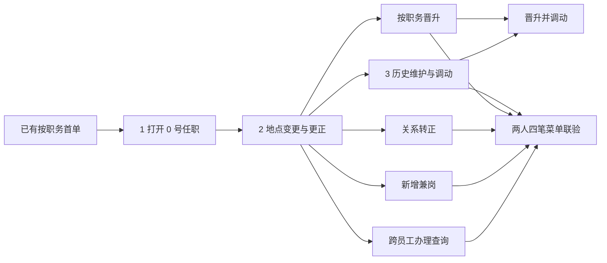

# CHNHCM-500 人员模块实施路线图

人事专员从「人员」找到一个人，登记或更正其资料，再从该人办理入职、调动、兼岗和离职。第一批的签收条件是，专员能登记一个尚无工作关系的人，重新登录后按编号找回，更正资料并查看原值。后续批次逐一接入工作关系、任职、合同和招聘录用。[M01 人员身份](../architecture/target/modules/m01.md) · [M04 用工与任职](../architecture/target/modules/m04.md) · [登记表](../governance/registry.json)

## 1 起点与参照

| 当前可用的依据 | 对交付顺序的影响 |
| --- | --- |
| M02 已有企业、部门、地点及法律实体基础维护。法律实体的用途声明与必要绑定在 L2，M04 的真实采用在 L3。[206 分批](206-legal-entity-implementation.md) | 可以开始 M01。办理劳动关系须先取得业务期间内的用人单位资格及依据。派遣分别核实用人、实际用工角色，按关系性质确定需要的资料。 |
| M03 已交付职务、职级、阶梯及岗位定义，314 的职类验收已关闭。313 的首批核编已实测，实际任职使用和人员调动随相应批次接入。[314 签收](../verification/314-job-function-t05-acceptance.md) · [岗位签收](../verification/311-position-definition-signoff.md) · [313 首批实测](../verification/313-quota-implementation.md) | 按职务办理可用现有职务与职级。按岗办理另需该次用途下的有效岗位、政策及真实使用来源。 |
| 路线图初立时的基线为 `063c92fd`。当前已有 M01 档案和 M04 按职务首次入职，后续从真实首单接入新页签。[现有路由](../../apps/web/src/app/App.tsx) · [首单实测](../verification/400-first-hire-integration.md#decision-first-hire) | [第 6.3 节](#job-information-delivery)区分已交付的入口、下一项产品增量和条件性联验。 |

本地 CubeBox 的员工表按任职列行，部门人数按人员去重。个人资料支持多条联系方式，在两份任职间共享。Fusion 的人员记录、工作关系、任职分层，再聘可以匹配原人并建立新关系。本仓采用独立登记、两层主选择及当前权限过滤。对照所用版本和原文定位见[评审记录](../verification/500-personnel-roadmap-review.md)。后续实际采用的体验、业务、验证资产由各批按[006](../assets/006-preservation-contract.md)登记到[资产台账](../assets/inventory.json)。[Fusion 本地来源索引](../architecture/target/data/oracle-release-check.json) · [本仓概念对照](../architecture/target/07-concept-mapping.md)

## 2 批次、前置与交付结果

Personnel 牵头登记与名录，Staffing 牵头用工办理。先确定切片合同。每个产品批次一起交付 Go 命令、授权、PostgreSQL、公开 API、正常菜单与验收样本。[实施阶段](../adr/003-implementation-stages.md) · [跨域办理](../architecture/target/08-cross-module-flows.md)

| 任务 | 前置及负责人 | 从正常菜单可核对的交付结果 |
| --- | --- | --- |
| T00 首批范围及规格 | Personnel、人事业务、Access、体验 | 在 M01 规格确定姓名、主要证件、来源、人员编号及联系方式的用途、基数、必填、脱敏、保留及读写权。以未任职者、同名者、受限读者审定业务、页面与技术合同。原版与本次修订的采用范围见第 6 节。 |
| T01 人员名录与登记 | T00。Personnel、Access、体验、验证 | T01 已交付的人员档案名录按人列行。经办人可凭姓名登记尚无工作关系的人，按姓名、现/旧人员编号找回，更正资料、有据改号并查原件。本次修订以主要证号约束重复建档；登记与后续入职仍分别保存。 |
| T02 入职合同与依赖 | 可与 T00/T01 并行设计。Staffing、人事业务牵头，Organization、Access 参与 | Organization 在 L2 提供本切片所需主体用途、绑定、期间及版本。M03 明确按日期、类别和用途适用的岗位政策。M04 确定关系性质、动作与原因、必要决定及两层主选择。106 第 8 节已在按职务首单范围采纳日级模型，多动作和试用由相应专项接续。[106 首批决定](../adr/106-same-day-personnel-actions-and-daily-state.md#first-hire-adoption) |
| T03 直接入职 | T01 和 T02 中本模式所需的已交付能力。Staffing 主责，Personnel、Organization 提供公开合同 | 在人员详情选择「办理入职」，凭人事依据核对本人、用人单位、到岗日与首任职，一次保存。可从原办理撤销尚未生效且可合法撤销的首次入职。以真实写入完成 L3 采用验证。按职务、按岗位免占编、按岗位占编分别签收。按岗核对实际岗位和补员状态，需占编时逐段核对名额。 |
| T04 在职变动、结束与再聘 | 以 T03 已签收的模式分别推进。Staffing、Personnel、Organization、Access | 从部门树联动的人员名录进入任职，办理资料更改、转正、晋升、调动、正式兼岗、实际汇报和终结。从同级「人事事务」跨员工查回和维护原笔。主岗终身为 0，再聘沿原 0 号接入新任期，新增兼岗按人递增且不回收。主兼岗转换后置。晋升与调动须共同生效时一次提交。交接或两岗对调从原调动办理，涉及既有合同与 T05 联验。[T04 分批交付](#job-information-delivery) |
| T05 人员合同 | 已有真实工作关系，可与 T04 分批交付。Staffing 及合同经办人 | 从所属工作关系登记签订日与合同期限，续订保留前后继。核实结束的是合同、任职还是整段关系。已形成其他关系的同一人员，各段合同独立可查。 |
| T06 招聘录用转入职 | T03 对应模式、M05 真实录用与交接。涉及预留时需 313。Recruiting 与 Staffing | 已接受且资料齐备的录用供人事核实身份和到岗日，一次保存，招聘取得同一任职结果。覆盖预留转占编、换人、撤销未来入职及重送。实际薪酬、计薪、参缴由后续消费者另立切片。 |

联系人关系、更多个人资料集、银行账户身份可在 T01 后按资料用途独立安排。账户用途及支付分配由 M14 承接。教育或证书用于岗位资格时，由 M16 核验资格。M05 的录用、M20 的办理待办和工资配置均独立交付。另有明确的非工作关联时，在 M04 以 RegisterAssociation 核验身份、组织角色及选择政策，可只建关系。承担实际工作的派驻仍须有首任职。T03 先验直接入职，非工作关联在其专项接入时单验。[工作关系类型](../architecture/target/modules/m04.md) · [岗位模式与事务](../architecture/target/10-ddd-and-state-contracts.md#staffing-quota-transaction) · [编制分批验收](../specs/m03/313-position-capacity-contract.md) · [106 待决事项](../adr/106-same-day-personnel-actions-and-daily-state.md#6-待决事项)

九栏个人资料的后续实施已单列 [504 M01 个人资料扩展](504-personal-profile-extension.md)。从员工名录进入原档案维护，可与 T02 并行。栏目及操作范围由 [505](../specs/m01/505-personal-profile-contract.md) 持有。

## 3 领域与接口的归属

| 能力 | 唯一写者与数据 | 协作方式及可检查的边界 |
| --- | --- | --- |
| 身份、编号、个人资料 | `internal/contexts/personnel` 拥有 Person、主要证件、资料项、客户实例内永久唯一的现/旧人员编号、来源与 Outbox。登录账号由 Access 维护。 | 普通登记按提交号幂等分配人员编号，有实单时另按单据识别原办理。不同人员的现用非空主要证号在客户内唯一。人员改号限有据纠错或制度迁移，旧号仍定位原人，准确来源重现当时编号。Staffing 办入职时按用工要求补齐必要身份资料，通过公开合同采用 personId 和资料版本。 |
| 组织、岗位、用工 | Organization 拥有主体、用途、部门和地点。`internal/contexts/staffing` 内 M03 拥有岗位、岗位模式与占编政策、核编及其台账。M04 拥有工作关系、任职、实际汇报、人事动作目录及实例、主选择政策与选择、人员合同。 | 按日复核用人、实际用工及关联组织各自资格。实际经理的两端是任职。M04 先按人和用途选关系，再按关系和用途选任职。有效 Employee 的人事管理用途在相应期间两层各有一项合格主选择。仅登记或已全部退出可为零。在职人员的 0 号对应人层人事管理主岗，其他关系内选定的主任职仍按其正号显示兼岗。 |
| 读取与授权 | M01 提供可查人员及资料，M04 提供获权的关系和任职摘要。各自只读写本域表。X03 逐份匹配动作、范围、字段及用途。 | 人员名录以 M01 可见人员为基础，在同一事务内合并其获权任职；按部门、主兼岗和搜索条件列行、排序和分页。仅人数按人去重。当前条件失权时提示重选。经下游声明的端口和上游 public，由组合根接线。读取失败时可重试。 |
| 入职与录用采用 | M01 登记先独立提交，Staffing 在同一短事务内重核权限及采用版本，由各责任聚合保存关系、首任职、必要主选择、适用占编、动作及 Outbox。M05 拥有录用、绑定和交接。 | 与停岗、组织资格收窄、政策换版或最后名额竞争时逐段检查。已确认的空岗可从零办理。缺使用来源的存量岗不能把空表当空编。招聘入职锁定同一份额，重验录用/交接、绑定、到岗日及各段规则后等额转换。Recruiting 经公开合同取得同一结果。下游各存自己的采用及 Inbox。 |
| 工程落点 | SQL 按表归域，sqlc 产物归本域 infra。核对在途及已合入的全局迁移序号，由 upgrader 执行。X01 只存小型值或协议，X04/X05 提供设施。 | `apps/web/src/features/personnel` 负责名录与个人资料，Staffing 页面承接关系、任职及合同，Go 返回可办动作和办理结果。共享布局、草稿和提交会话可复用。每个命令及回执仍归所属域，M04 按本域动作建模，避免直接引入 M02 的 dated 内核或源原型的 DemoState。 |

实际任职按日采用左闭右开区间。按业务日期（businessAt）查适用事实，按来源版本（sourceVersion）还原原件，按采用引用（adoptedRef）解释下游当时用了哪份。一天可有多项真实动作。更正保存新修订，先后及依赖按业务依据判断。M01 人员编号只在登记或改号时变化。M04 雇用记录编号按稳定人员身份分配。入职或再聘填实际业务日期，配置首建的 1900-01-01 不适用于这些事件。业务日期统一 YYYY-MM-DD，记录时刻保留原值并按北京时间显示 YYYY-MM-DD HH:mm:ss。[目录与公开端口](../architecture/004-repository-layout.md) · [日期规范](../adr/026-date-display-and-input-format.md) · [主数据初始化](../adr/202-master-data-default-effective-date.md) · [编号与历史](../architecture/target/10-ddd-and-state-contracts.md#ac08)

## 4 页面继承与业务差异

列表、详情、表单、来源和历史以 BU 及已交付的职务系列/职务页面为对照。下表用于实施前逐页登记及产品候选实测。按日对象还须按 121 写出适用与有据差异。M04 的同日动作以人事合同维护，M01 的人员编号按来源查看。[012 页面标准](../specs/m02/012-m02-functional-and-interaction-design.md#m02-ui-expression) · [121 接入矩阵](../specs/m02/121-dated-object-admission-matrix.md) · [308 逐页继承表](../specs/m03/308-job-foundation-contract.md#m03-page-inheritance) · [308 产品验收](../verification/308-job-page-standard-implementation.md)

| 任务及既有实现 | 人员页面落点 | 从菜单操作时的独立预期 |
| --- | --- | --- |
| 进入名录。[应用壳](../../packages/ui/src/AppShell.tsx)、[列表控制区](../../packages/ui/src/components/Lists.tsx)、[职务列表](../../apps/web/src/features/staffing/List.tsx) | 有名录权限时由「人员」进入唯一的「人员」名录。桌面沿用主题、顶栏、紧凑控制区及独立正文滚动，短屏允许自然滚动，放大后按可用宽度显示导航和列表摘要。同一名录支持按人检索和登记，没有可列任职的人员按名录授权列一行。接入职务信息后，左侧部门树联动右侧每份获权任职，明确雇用记录编号和主兼岗。 | 录入搜索草稿、取消、应用，分别核对条件和结果。排序、分页和匹配数基于服务端获权集合。按部门查询时同人同部门的两份任职各占一行。无结果、读取失败、权限收回分别显示空态、重试、清除受限内容。 |
| 详情与返回。[职务详情](../../apps/web/src/features/staffing/Detail.tsx)、[日期轴](../../packages/ui/src/components/EffectiveDates.tsx)、[导航恢复](../../apps/web/src/shared/navigation.ts) | 点任职行直接打开该岗职务信息，页头显示姓名、人员编号、工作关系、雇用记录编号和主兼岗。0 号按权可看个人资料和个人日志，正号只显示职务信息。按日生效的任职以所选记录定位，未来记录标明尚未生效。编号及普通联系方式按资料修订查看。 | 从筛选结果页末进入，再切换到下一页首项。返回时恢复条件、排序、页码、刚查看的对象、滚动及焦点。辅助导航失败只局部重试。直达详情无原查询时省略位置和总数。 |
| 新建、更正与动作。[紧凑表单](../../packages/ui/src/components/ObjectForm.tsx)、[日期输入](../../packages/ui/src/components/DateField.tsx)、[职务编辑器参照](../../apps/web/src/features/staffing/Editor.tsx) | 新建在列表控制区。详情显示当前任务的主动作，其他获权动作进入所选对象的更多菜单。桌面左标签、两列分组，放大时按可用宽度重排。更正带入原值，可改的可选字段直接呈现，自动识别变化。保存/取消均在控制区。 | 同屏对照 BU 的标签、字号、字段高度、两列/单列和页面滚动。未改可直接取消，有改动才触发离开保护。无变化不新增修订，业务拒绝保留可见输入并将焦点移至摘要/字段。只读者看不到写入口，直接写请求仍被拒。 |
| 日志与历史。[日志展示](../../apps/web/src/shared/dated/OperationLog.tsx)、[原件提示和返回](../../packages/ui/src/components/Feedback.tsx) | 资料底部显示所选修订的操作者和北京时间。日志按办理分组，主要差异直显，敏感差异与来源按需查看，原件返回恢复原办理位置。人员页签、分组及查询验收见[502](../specs/m01/502-person-directory-interactions.md#m01-change-log)及[503](../specs/m01/503-person-registration-design.md#m01-change-query)。从当前来源选中过往生效记录，按该动作授权办理。打开确切旧来源后显示只读历史短条和返回。 | 旧来源按当前权限读，退出后重新读取当前资料并恢复合法选中项。撤权后清理正文、日志子行、计数及可能泄露的旧标签。 |
| 草稿与保存。[离开保护](../../apps/web/src/shared/dated/useDraftExit.ts)、[提交会话](../../apps/web/src/shared/dated/submission.ts) | 切换人员、关系、任职、日期或离开都尊重未保存输入。保存后定位实际结果。结果未知时沿用原提交号确认或重试。持久化查回引用限于必要标识，个人资料正文留在获权的当前编辑会话。 | 版本冲突须重新核对。分别模拟请求未到达及提交后响应丢失，恢复同一操作。仅失写权仍可按当前读权确认终态。失去读权清理受限内容。 |

每批对照同一构建下的 BU 或职务页面，从正常菜单走查经办人和只读者各自的路径。视口及缩放按 012 的共享矩阵选取。T01 验证按姓名查人、登记和返回；职务信息验证从本人切签、选择真实生效日及返回原行。记录角色、实际倍率、内容尺寸、可见焦点、滚轮和键盘操作，核对末字段、错误、弹窗、历史退出及返回。[012 视口矩阵](../specs/m02/012-m02-functional-and-interaction-design.md#m02-ui-viewport-matrix) · [页签验收](../specs/m04/507-job-information-tab.md#m04-ac-016)

2026-11-26，固定 f 的 4386 在 `b67cb72` 上完成页面专项评审，11 项待修复（高 2、中 8、低 1），建议暂缓页面专项验收。优先核对跨员工更正时的本人身份，以及旧修订与当次任职的地点。各项均有实页截图和关闭条件。[500 页面问题登记](../verification/500-personnel-page-review.md)

同日补查按用户明确的普通「人员」入口和本人「职务信息」页签复验，登记 500-UI-12 至 20 共 9 项（高 3、中 4、低 2）。该基线的双名录、中转页及常驻查看日期与该要求冲突。补充报告列出涉及的 502、506、507 条款、组件接线和旧用例，也更正首轮 500-UI-05 的普通页查看日判据。[入口与日期补充评审](../verification/500-personnel-entry-and-date-review.md) 510 按五步完成上述 20 项整改。固定 f 原库复验、写入反例和逐项截图见[实施记录](../verification/510-personnel-page-remediation-implementation.md)，整改依赖及判据见[510 计划](510-personnel-page-remediation.md)。

T00 要把「人员登记与核对」的授权对象、用途和保留范围写入首批合同。仅有 A 部门任职范围的负责人，不能据此检索没有任职的人。经办人在员工名录按姓名查人时，只看得到有权查看的档案。名录、汇总和直接链接均按各自授权展示。同一人仅 A 任职可见时，界面只呈现 A。真实主任职受限时保持受限信息边界，不能把 A 改标为主。若没有获权任职摘要，不据此断言此人“尚未入职”。首批名录只提供履行登记任务的查询。批量导出在用途、字段、固定成员及下载时授权有明确需求后另行接入。[X03 授权](../architecture/target/modules/x03.md) · [普通维护与专项按日查询](../adr/123-current-maintenance-and-dated-query-boundary.md)

## 5 验收样本与关闭条件

本计划在办，下表是 8 项场景当前的唯一原定义，调用方可继续按原锚点引用。后续修订分别由下列合同维护者承接，采纳新定义时同批切换调用方。登记与权限（M01 的 001、002）归 [501](../specs/m01/501-person-registration-requirements.md)，资料字段由 [505](../specs/m01/505-personal-profile-contract.md) 补充。M04 的 001 入职及撤销归 [401](../specs/m04/401-direct-hire-requirements.md)，002 兼岗计数、003 调动再聘及 006 同日动作归 [506](../specs/m04/506-job-information-records.md)，岗位占用归 [313](../specs/m03/313-position-capacity-contract.md)。004 合同续订由 M04 劳动合同维护者在 T05 确定关系级规则后承接，005 招聘交接由 M04/M05 在 T06 连通录用和入职时分别维护转换两端，并按 313 验占编。当前批次与原入口保留至接续条件满足。

以下合成人物、日期和名额供建立独立预期。每个产品批次将适用样本映射到本模块规格和可执行验证，编号用于跨批定位。

| 场景 | 操作与独立预期 | 主责批次与实测层 |
| --- | --- | --- |
| M01-SCN-001 登记与编号 | 只填姓名即可登记。判断人员重复只看现用主要证件号码。同名不查询、不提示。两人证号不同可分别建档，同一证号即使由两人同时录入或姓名写法不同，也只能建一份档案。离职再聘沿用原人。取消草稿零写。同一提交号原样重送只得原人原号，换内容被拒。获准改人员编号后，旧号仍定位原人，原来源显示原号，旧号不得重发。 | T01，Go、真实 DB/API、菜单；再聘由 T04 联验 |
| M01-SCN-002 个人资料与权限 | 经办人更正一条联系方式，另一条原样保留。两人按同一旧修订先后保存，后者收到冲突并保留可见输入。有历史权时能核对原值。撤联系方式读权后返回已开的原件、当前页或原回执均无号码。用仅有部门维护权、无相应人员核对或读权的账号，从员工名录搜索或直接访问 API 都不能发现该范围外的人。 | T01，Go、DB/API、按登记、只读、受限权限走查 |
| M04-SCN-001 直接与未来入职 | 仅按职务时，以甲办 2027-04-01 直接入职，首任职引用组织和职务。2027-03-31 查甲在职人数为 0。另在按岗样本中，甲乙同时争同期间最后一编，保留两人档案，仅胜者的关系、首任职、主选择、占用及事件成立。各模式均在生效前撤销该次入职。至原入职日，此次关系、任职、主选择及适用占用均为零，原办理仍可查。 | T03，各模式分别用 Go、DB/API 和菜单核对。争编用双连接。 |
| M04-SCN-002 兼岗与人员计数 | 甲有 0 号主岗及 1、2 号兼岗。0、1 在产品部，2 在培训部。全部为 3 份任职、1 人，产品部为 2 行 1 人。只获甲识别及培训任职权者见 2 号一行。乙仅任职可见、人员识别无权时，其任职及人数均不计入结果。另以两岗验占编，两岗均计编时占 2，一岗免占时占 1。 | T04 用真实兼岗，查询、DB/API、浏览器。T03 独验只用自身首任职。 |
| M04-SCN-003 调动、离职与再聘 | A、B 各满 1 编，两名满足资格且各占一编的员工由获权经办人办理同日对调，成功后两岗各占 1。改期按两岗逐段重验。单独结束 0 号会使必需主岗缺失时整笔拒绝。全部退出时在任为零。再聘在原 0 号下新建关系和主岗任期，旧关系、间隔及原件可查。原 1、2 号兼岗均已结束时，再新增兼岗取得 3。 | T04，Go、双连接 DB/API、菜单。独验使用可核清全部依赖的关系。既有合同与 T05 联验。[调动合同](../specs/m03/313-position-capacity-contract.md#m03-br-039) |
| M04-SCN-004 合同续订 | 对已存在的工作关系 A 登记合同并续订，前后继可相互定位，签订日、合同起日和任职起日可各不相同。仅续订时任职与编制保持。接入第二段关系后复核 A 的续订不改 B 合同。终结关系时按明确指令处置对应合同。 | T05 以单关系独验。多关系、离职处置由 T04/T05 联验，Go、DB/API、菜单。 |
| M04-SCN-005 招聘交接 | 岗位核 1，已接受且资料齐备的录用有效预留 1、已占 0。按约定日入职后预留 0、已占 1，同一交接换提交号也只得原任职。生效前撤销这次未来入职，原入职日两数均为 0，原转换可查。招聘随后重新取得该份额，重送旧入职或撤销后，新预留仍为 1。换人、到岗日或岗位失配的交接拒绝，改期回原录用。全段免占或仅按职务可零预留、零占编完成交接。 | T06，M03/M04/M05 的真实 DB/API、双方菜单。[录用交接](../specs/m03/313-position-capacity-contract.md#m03-br-027) · [撤销及再次预留](../specs/m03/313-position-capacity-contract.md#m03-ac-097) |
| M04-SCN-006 同日独立动作与经理 | 同日两项独立且合法的动作分别把部门 A 改为 B、职级 G1 改为 G2。仅撤职级动作后当日为 B/G1，最初两项动作及撤销依据可查。后项依赖前项时，拒绝缺少后继处置的撤销。另用两份有效任职并发将对方设为同用途经理，两笔最多一笔成功。 | T04，按已采纳的 M04 专项执行 Go、双连接 DB/API、菜单。[同日动作反例](../architecture/target/10-ddd-and-state-contracts.md#ac03) |

各批据实际影响运行领域用例、`make boundaries`、`make check`、真实 PostgreSQL/API 集成和正常菜单浏览器检查。用空库和从本批前版本升级的自有隔离库验证。核对重启后的原来源和回执，共用 UI 变更同时回归 BU 和职务的实际消费者。记录构建、数据规模、角色、首错、复验、未测项及接续责任。各批验收负责人依据已执行范围签收。任务自建隔离环境按 [003 资源规则](../adr/003-implementation-stages.md#development-environment-cleanup) 清理。保留验收环境按原责任移交。

## 6 首项工作与接续

初版从 T00 确定登记、检索、更正和历史四项任务，T01 交付人员登记。第 6.1、6.2 节保存当时的交接，第 6.3 节给出职务信息的实施顺序。登记表分别记录路线图采纳情况与实施进度。[初版路线图评审](../verification/500-personnel-roadmap-review.md) · [文档治理](../governance/014-document-management.md)

2026-11-22，原 T00 规格通过四轮评审，原 T01 构建已实测「人员 → 员工」登记、重登按号找回、联系方式更正及查原件。当时采用编号材料必填、确认同名候选的规则。原实测及其适用构建见[T00 评审](../verification/500-t00-personnel-specifications.md)和[T01 产品验收与实测](../verification/500-t01-personnel-registration.md)。

### 6.1 主要证件防重修订的实施顺序

独立登记只要求填写姓名。经办人录入主要证件号码时，系统按号码检查是否已经建档。暂缺号码时可以直接登记。上一版的同名提示和更早的同名确认、材料必填均已取消。正式入职时需补齐哪些资料由 T02/T03 按用工场景确定。T02 可并行设计。[业务规格](../specs/m01/501-person-registration-requirements.md#m01-br-002) · [页面操作](../specs/m01/502-person-directory-interactions.md#m01-page-register) · [技术合同](../specs/m01/503-person-registration-design.md#m01-recovery) · [本次方案评审](../verification/500-registration-without-name-prompts.md)

1. **先改人员登记规则。** 同一套人事系统里，一个主要证件号码只能登记在一个人名下。新建档案、补填或更换证件时都按这条规则办理。姓名相同不提醒，也不用经办人确认。
2. **再检查已有档案。** 升级前后核对原有人员编号、登记单和办理记录。原来没填主要证件号码的档案继续保留，日后拿到证件可在原档补填。
3. **调整人事日常使用的页面。** 在「人员 → 员工」登记时，有主要证件就填写，暂缺也可保存。证件号码已登记过时，在号码栏提示。需要补证或换证时，从本人的档案点「更正资料」。
4. **请人事按三种情况试办。** 分别登记两位同名但身份证号不同的员工，请两位经办人同时录入同一身份证号，再把一张有单号且已办过的登记单按原内容录一遍。对照员工名录中的档案份数和每次的办理结果验收。[三种情况的预期结果](../specs/m01/501-person-registration-requirements.md#m01-registration-examples)

本轮已按上述顺序修改登记规则、核对 00026 备份中的档案、调整页面，并在独立客户中从员工名录试办。2026-11-23 已将同一版本更新到 4380 手工验收环境，并通过原档案链接复查。[本轮实施和试办结果](../verification/500-personnel-registration-trial.md)

### 6.2 T03 首单的人员供给

Personnel 的 `CheckIdentity` 从当前会话取客户，依本人、入职用途和到岗日核对当前来源的姓名及主要或补充证件。返回人员来源、证件项及修订，缺项受独立披露范围限制。Staffing 保存时经 dbtx 借用外层事务，人员更正／处置与用途撤回都与该核对串行。普通 Employee 首单免人工查验；目前没有可供采用的独立原件查验结论时，要求查验的规则停止办理。[用途接口](../../internal/contexts/personnel/public/hire.go) · [实库用例](../../tests/integration/personnel_hire_test.go)

现行入职规则按原档识别本人，证件在到岗前到期也可采用。下述到期日边界为调整前的首轮实测。

在 6f3cabb9 上实施。独立 PostgreSQL 18.6 以真实会话预览并提交重核，2027-03-31 到期拒绝、2027-04-01 到期可用，合格补充护照可采用。换证拒绝原修订；持外层事务时换证守卫不可取得，撤权连接经 pg_blocking_pids 确认等待，外层回滚后完成撤权，重跑初始化后保存仍被拒绝。真实关系与任职的写入、回滚及撤销由 e 的首单验证。

期限未知按客户规则判断，要求已知期限时只接受明确的到期日或长期有效。真实库已覆盖两者。4380（API 8380、DB 54370）保留原库前向升级到 00036，升级前后均为 5 人、9 份来源、9 个登记回执。Chromium 从「人员 → 员工」重新打开[第二批原样本](http://127.0.0.1:4380/personnel/employees/afa95f0f-5c9c-4b77-8705-0b63e573e761)。本树负责保留至下次验收更新。全量集成首跑触及每包 20 分钟限时，其中发现的 00009 测试库重建漏清了新版账本，修正测试前置后原升级用例单独通过。

### 6.3 从直接入职接入职务信息

2026-11-25，本节十个阶段已合入 main，并在固定 f 的 4386 环境从正常菜单验收。本轮沿用 f 的 `3771272` 已交付的人员九栏、按职务首聘及未来撤销，按 e 的 `ec4572a` 实施 404 岗位方案。Staffing 负责办理、存储和查询，Personnel 与体验负责人员菜单及返回，Access 随每个入口交付其权限。[阶段提交、主线检查与操作样本](../verification/500-job-information-delivery-review.md#stage-delivery-results) · [九栏交接](../verification/504-personal-profile-fourth-batch.md) · [按职务首单实测](../verification/400-first-hire-integration.md#decision-first-hire) · [分模式准入](400-hire-readiness.md#hire-gates)

同日对产品合并 `dfd49554` 的后续复核发现六项缺陷，其中历史调动后转正归属错误、有据可查的同日顺序无法完整办理，均影响整体验收。上述发现使原版本暂缓接受。508 六项修复及交叉回归现已通过，固定 f 的 4386 已更新，第 6.3 节在本地修复候选上重新验收通过。[修复版本与原库复验](../verification/508-job-information-implementation.md) · [修复次序与验收用例](508-job-information-remediation.md) · [复核事实](../verification/508-job-information-remediation-review.md)

包含 508 的提交 `39660e7` 经七轮独立评审确认 27 项问题，其中 P1 有 11 项，P2 有 16 项，末轮无新增。该提交当时暂缓接受。509 方案经多轮独立评审修订后实施，经理接任、退出与再聘、兼岗与占编、同日办理及原件交互等 27 项现均已关闭。第 6.3 节已在本地 509 候选和固定 f 的 4386 原库重新验收通过。[原反例及阶段 7 专查](../verification/500-t04-implementation-rereview.md#stage-seven-verdict) · [509 分批实施](509-t04-remediation.md#delivery-order) · [独立方案评审](../verification/509-t04-remediation-review.md) · [产品复验与 4386 交接](../verification/509-t04-remediation-implementation.md#fixed-environment)

#### 6.3.1 先交付一份按职务任职的日常维护

| 顺序 | 从哪里接手、要交付什么 | 正常菜单验收及交给下一步的结果 |
| --- | --- | --- |
| 1　从首单打开 0 号职务信息 | 接 T03 已签收的按职务首单。Staffing 将原首任期与本人永久的 0 号关联，新首聘也写入同一编号体系。人员名录按获权任职或人员身份列行，在同一入口登记、补件及首次入职。 | 从部门树点任职行，与原档案中的任职链接应打开同一任期、日期和原办理。未来首单可从本人档案进入，撤销后到原生效日该笔有效任职为零，历史仍可找回原件和回执。仅有档案权或任职读权的读者各见获权面板。下一步沿用这份真实任期。[首单与撤销](../specs/m04/506-job-information-records.md#m04-ac-015) · [页面入口](../specs/m04/507-job-information-tab.md#job-tab-layout) |
| 2　新增地点变更并更正原笔 | 接步骤 1 的任期、办理身份和真实地点。在开放首笔在职写入前，前向升级首单动作约束，接通数据更改的类型、原因、写权、按日资料、不可变修订与原号查回。已办首单、已撤销首单及名单采用可从升级库核对。[升级约定](../specs/m04/403-hire-technical-contract.md#job-information-handoff) | 从 0 号将 2027-05-01 的地点由甲改乙，再从原笔纠错为丙。前一天仍为甲，原修订为乙，一笔业务、一次更正。另在同一任期的另一日期新增同类变更。并发更正同一旧修订一成一冲突，中途失败整笔回滚，断线重送得原笔。[地点样本](../specs/m04/506-job-information-records.md#m04-ac-010) |
| 3　补录、删除与按职务调动 | 接步骤 2 的真实日期节点与动作修订。先能在本关系的任期内办理合法部门／职务调动，再在两条已办记录之间补漏、改日或删除误建记录。按 106 从受影响日重核后继和来源。 | 从日期轴补 2027-06-01 的变动，2027-07-01 的独立调动继续有效。删除误建记录后可查原笔，有必要依赖未能处置则整笔拒绝。用同日互不依赖的两项核对录入顺序互换、同一任职在该来源内一日一份状态及两笔原件。[补录与删除](../specs/m04/506-job-information-records.md#m04-ac-011) |

步骤 1、2 可在同一版本交付，先验旧首单能读回，再验第一笔在职资料可新增、更正和查回。每一步都从正常菜单调用公开 API，由 Go 核权并读写真实数据库。f 的人员菜单接入 e 的首单及后续按岗能力时，按共同版本的实际账本追加迁移，复查先前已办的任期、准确来源和原回执。后续办理沿用同一套身份和修订。[首单接续合同](../specs/m04/403-hire-technical-contract.md#job-information-handoff)

#### 6.3.2 按业务前置接入查询、多任职和同日办理

步骤 2 交给后续办理的是可写的真实任期、稳定的办理身份和原笔修订。经办人可在任一符合条件的任职上直接办兼岗、转正或晋升。下图画出按职务路径中，两人四笔菜单样本需要哪些已交付能力。

| 可交付的能力 | 直接前置 | 首次可用及后续联验 |
| --- | --- | --- |
| 跨员工办理记录 | 步骤 2 的原笔读取、更正命令，加上 X03 获权的跨人集合查询 | 从「人员 → 人事事务 → 办理记录」查回本人刚办的地点变更，和另一人的记录分开。从列表更正后回任职，看同一办理的新修订。仅有原件权者不能枚举他人。以后每种新办理沿用此入口，最后用两人四笔核对日期、发生部门、关系转正去重及受限计数。[双入口样本](../specs/m04/507-job-information-tab.md#m04-ac-017) |
| 兼岗与并行工作关系 | 接步骤 2 的任期和办理身份，本批增加按人分配正号、在同一事务中维护两层主选择 | 从已有关系「新增兼岗」，验同部门 0、1 两行一人，另一个部门的 2 号单独授权。并发办两份取不同正号，重送原单仍是原号。另建有独立任用依据的并行关系，其首任职使用下一正号并可成为该关系的主任职。这些真实任期用于验多岗转正、局部退出和再聘后的续号。[按人编号与并发](../specs/m04/506-job-information-records.md#m04-ac-013) |
| 关系转正 | 步骤 2 的办理和来源能力，适用关系已有可核对的实际试用开始日。缺记时可从该关系补录真实开始事实 | 先从一份任职办理转正，查到关系一笔。兼岗到位后从另一行查同笔，调动到位后验发生部门。仅统计归属不明可以保存，影响资格或授权时核对缺项。实际试用与 T05 的合同约定各自归属。[转正规则](../specs/m04/506-job-information-records.md#m04-br-014) |
| 晋升与同日多动作 | 单办晋升接步骤 2 及 M03 在该期间的可用职级，实际职级归所选任期。晋升并调动再接步骤 3 | 先在一份按职务任职用两个职务的资格，验共用通知一次保存两笔、单撤晋升时保留合法调动或整笔拒绝。转正、兼岗及办理列表就绪后，联验「转正 → 晋升 → 调动」和反序补录、更正及撤销。任职详情按业务先后，事务列表按登记时刻，从旧来源仍能核回当时职级及次数。[五步日状态](../specs/m04/506-job-information-records.md#m04-scn-018) · [共同提交、回滚与重送](../specs/m04/506-job-information-records.md#m04-ac-019) |
| 实际汇报 | 步骤 2 的写入能力和两份有效任职，两人的首任职即可 | 从任职维护实际经理，按任职和用途核对有效期。两人互设同用途经理并发时最多一笔成功。经理退出或调动涉及既有汇报时，联验结束或替换后无悬空关系。[经理样本](#m04-scn-006) |
| 结束任职、离职与再聘 | 步骤 2 的已办关系及可核清的实际依赖。再聘接已经终结的旧关系 | 先在单关系、无待处置事项者上验离职间隔在任为零，从本人档案或原离职办理回到 0 号再聘，新关系、新任期可与旧段区分。有兼岗后再验结束一岗、退出一段关系保留另一段，以及原 1、2 号结束后新增兼岗取 3。已有必需主选择、汇报或合同随实际影响处置。[退出与再聘](../specs/m04/506-job-information-records.md#m04-ac-014) |

#### 6.3.3 按岗位、合同和招聘随对应业务接入

| 办理范围 | 接入时机与新增验收 |
| --- | --- |
| 按岗位免占编 | 待 T03 免占首单产品签收后，接相应任职动作，复用按职务路径已验的办理与恢复。接入该办理用途下的分段岗位政策、补员状态、M04 实际使用及授权。按岗调入后能查到真实岗位任职，常规占编增量为零。用量涉及占编的后段须待相应来源可核实后整笔办理。[分模式条件](400-hire-readiness.md#hire-gates) |
| 按岗位占编、补录与交接 | 待 T03 占编模式交付，逐段定额、占用和预留有可信覆盖或有据零起点，再对该用途开放占编办理。先验最后一编竞争、暂停补员和整单回滚，再从同一满编岗验拟调入缺 1 编、补录已履职三天实占 4／核定 3，次日实占回 3。对调、内部交接或按岗晋升分别在对应任职动作可用时追加联验。[实况样本](../specs/m04/506-job-information-records.md#actual-duty-case) · [双岗对调](#m04-scn-003) · [313 人员调动](../specs/m03/313-position-capacity-contract.md#m03-br-037) |
| T05 合同、T06 招聘 | T05 有真实关系即可独立订立、续订，涉及在办合同的离职再联合处置。T06 以真实已接受录用及对应 T03 入职模式为前置，仅有预留时联验份额转换。M20 审批待办、年资、调薪与工资采用各随其专项。[合同样本](#m04-scn-004) · [招聘样本](#m04-scn-005) · [106 首单决定](../adr/106-same-day-personnel-actions-and-daily-state.md#first-hire-adoption) |
