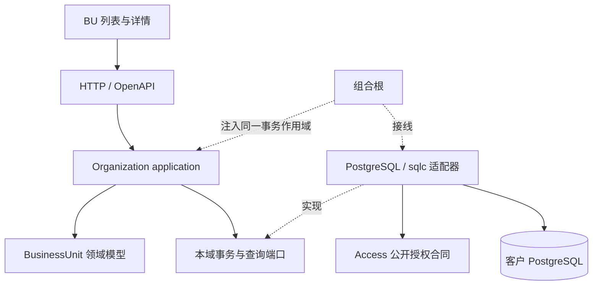

# CHNHCM-013 技术详细设计

2026-11-13首次新建默认日期按用户确定的[202项目规则](../../adr/202-master-data-default-effective-date.md)统一为1900-01-01，由Go创建上下文提供defaultEffectiveDate；currentDate仍表示今日，明确输入、原日期、后续位置/启停规则及依赖资格保持。默认非法时准确拒绝并允许用户明确改日，不静默换今天或改写父对象。本轮合同已接入现有BU/部门，产品适配及受影响分批回归见[200 G1报告](../../verification/200-g1-default-date.md)，原实施报告不改写。

登记信息：[registry.json](../../governance/registry.json)。适用范围：M02 首批业务单元（BU）后台直接维护，承接 [010 范围](../../archive/plans/010-m02-scope-and-plan.md)、[011 业务需求](011-m02-business-requirements.md)、[012 功能交互](012-m02-functional-and-interaction-design.md)、[018 历史决策](../../adr/018-effective-records-and-source-history.md)和[020记录维护决定](../../adr/020-effective-record-delete-and-redate.md)。本文持有实施合同；创建/查询及共同约束已采纳并落到真实代码，范围、检查及未完成项见[首批验证](../../verification/010-first-vertical-slice.md)和[运行指南](../../guides/017-local-bu-development.md)。

当前普通维护查询按[123决定](../../adr/123-current-maintenance-and-dated-query-boundary.md)执行：取消通用查看日期；列表按服务端D，详情按所选记录，明确来源仍只读。原修订日志及旧验证报告保留其时点；当前合同以下述正文为准。

2026-11-07按获批[126](../../archive/plans/126-compact-history-storage-research.md)同步紧凑存储。第3.1及6.3节持有当前物理格式；后文来源、成员、修订、command_result、change_entry及字段名描述其逻辑事实，除明确列出的原生表外不再表示独立宽表/列。第9节按日期保留实施沿革，其旧SQL、索引及模型标识不属于当前安装合同。实际效果见[126实施报告](../../verification/126-compact-history-implementation.md)。

公共约束引用 [002 技术栈](../../adr/002-technology-stack.md)、[004 分层与迁移](../../architecture/004-repository-layout.md)、[DDD 合同](../../architecture/target/10-ddd-and-state-contracts.md)、[17 术语表](../../architecture/target/17-terminology-glossary.md)及 [014 文档规范](../../governance/014-document-management.md)。业务规则与验收 ID 继续在 011 唯一定义；本稿不以技术实现扩大或覆盖其范围。

按[025](../../adr/025-greenfield-implementation-policy.md)，以下维护目标按一套当前模型实施，不要求兼容既有开发库、请求/结果或事件格式。现有创建/查询代码仍需同步适配并回归；文档更新不表示运行实现已完成。

当前实施补充：第一批已接通创建/查询、AddEffectiveRecord、CorrectRecord及其预览、来源和提交恢复；实际证据见[第一批验证](../../verification/010-first-record-maintenance.md)。T04停用/重新启用已接线，分层结果见[T04实施报告](../../verification/021-lifecycle-implementation.md)；T05/T06/T08业务入口已逐批接线；T07综合验收见[当前报告](../../verification/010-t07-acceptance.md)，以下业务目标与历史编写记录不自动计为通过。

当前交互按[101直接保存](../../adr/101-direct-save-and-form-assistance.md)执行：全部场景取消手动预览及预览许可门槛，填写后直接提交；只读计算用于自动默认/必要影响，Go在保存事务内重新核验。下文“预览”在仍有计算含义处指只读辅助，不再指用户按钮或必经步骤；历史实施记录保留原时点。


2026-11-02采纳[103位置新增/插入](../../adr/103-positioned-record-addition.md)：本稿单条普通新增的准备上下文及anchorRecordId已由[105](../../archive/plans/105-positioned-addition-and-coverage.md)同步OpenAPI、生成客户端和Go实现。既有报告保持原范围，不接受缺锚点旧写入格式。

2026-11-08合同修订：[128](../../adr/128-authorization-evidence-removal.md)撤除逐次授权过程档案及业务终态对其依赖。本文件第2节、第3.1.3/3.1.4节、第4—6节和第8节有关完整授权证据的旧要求按128局部替代；第9节原批次描述及旧报告保留历史语境。下述128目标合同尚未实施，现行代码和固定库仍为原模型；不将当前权限、操作者身份快照或业务历史一并取消。

## 1 需求映射与边界

2026-11-03按[113](../../adr/113-bu-list-community-adoption.md)接入Community原字节源码、摘要列及原生列设置，执行归[111](../../archive/plans/111-bu-list-experience-upgrade.md)。T01/T02代码、类型/构建与组件定向结果见[本轮报告](../../verification/111-community-t01-t02.md)，T03真实业务与七组条件另见[本轮报告](../../verification/111-community-t03.md)；上述基础批次Go/API/SQL及生成客户端不变。本次单列增量按4.1.2扩展唯一查询合同；取消列拖动/固定不影响其他规则。

### 1.1 交付范围和当前事实

正常入口保持“设置 → 组织配置 → 业务单元”。本批交付目标为单客户独立实例、一个已初始化企业、多个 BU，连接真实 Go、PostgreSQL、接口与页面。新建、过去/当天/未来新增、更正、改日、删除、停用、重新启用和来源历史沿用011/012/018/020/021/022；更正记录可按权限显式修改业务分类，未修改时不提交；改日/删除不另填处理原因；109仅保留两个固定启停操作；多目标分类纠错、日期交换等退出，首条按107两步维护。已生效删除及改日包含停用和重新启用记录，首条禁止删除但允许改日；多次启停按完整候选时间线验证，普通字段不能直接改状态。

2026-10-31，以 `wt-dev-a` 的 `4a9844498b9a51330d6011ab4a5efe7556616709` 为编写基线，开始时工作区干净。该提交包含前轮删除用语和分类输入简化。编写时只有导航壳、健康服务和目录说明，API 尚无 BU 数据库、命令或鉴权实现。后续已实现创建/查询及共有约束，当前合同见[API 源](../../../api/openapi.yaml)，创建/查询历史修正见[018记录](../../verification/018-source-history-simplification.md)；当前T01—T03新增候选与失败边界、受控升级及资料新增/普通更正，见[010验证](../../verification/010-record-maintenance.md)。其余动作继续按后续批次实施。

| 上游依据 | 本稿承接 | 边界 |
| --- | --- | --- |
| [身份与创建](011-m02-business-requirements.md#m02-br-001)、[创建保护](011-m02-business-requirements.md#m02-br-004) | 企业初始化、稳定身份、编码唯一及原子创建 | 不建设企业维护页面或整 BU 删除 |
| [日期](011-m02-business-requirements.md#m02-br-003)、[新增](011-m02-business-requirements.md#m02-br-005)、[更正](011-m02-business-requirements.md#m02-br-006)、[删除](011-m02-business-requirements.md#m02-br-007)、[停用](011-m02-business-requirements.md#m02-br-008)、[改日](011-m02-business-requirements.md#m02-br-017) | 显式Go命令、期间重算及日期修订；新增含过去/当天/未来，删除/改日含已生效及重新启用记录 | 首条删除、同日序号、跨BU联合办理和整BU作废仍不在范围；固定两条按BR019、首条两步按BR020纳入；独立重新启用见[BR018](011-m02-business-requirements.md#m02-br-018) |
| [历史](011-m02-business-requirements.md#m02-br-009) | 业务日期、不可变完整来源、当前授权及历史只读 | 不构建系统时间截点平台；实际采用归消费者，未接入则明确不支持 |
| [授权](011-m02-business-requirements.md#m02-br-010)、[引用](011-m02-business-requirements.md#m02-br-011) | 最小身份/授权、同事务守卫及实际引用清单 | 不建设权限配置产品，不伪造 M03/M04 接入 |
| [幂等](011-m02-business-requirements.md#m02-br-012)、[并发](011-m02-business-requirements.md#m02-br-013)、[返回](011-m02-business-requirements.md#m02-br-015) | 内容绑定、结果查回、并发拒绝及页面恢复 | 无持久表单草稿，不以超时当失败 |
| [分类](011-m02-business-requirements.md#m02-br-016)、[012 字段](012-m02-functional-and-interaction-design.md#m02-ui-actions) | 分动作白名单、原分类继承、同源约束 | 无备注、额外处理原因或通用原因平台 |

### 1.2 采用的技术选择

采用完整 BU 来源清单引用不可变记录修订。每次成功变更保存当次全部有效记录的区间及解析资料；未变化修订可以复用。不选择从可删日志倒推历史，也不复制整个企业或旧 DemoState。存储增加量由本稿第 7 节给出的规模样本测量。

业务事实、修订、完整期间、审计、Outbox 和成功结果同事务保存；按018读取确切来源即可解释当次资料，不另采集数据库提交时间，不投递业务事件或建立消费者采用。

## 2 领域模型与代码结构

### 2.1 聚合与唯一写者

`BusinessUnit` 是 M02 `OrganizationObject` 的首批类型实现，拥有稳定身份、当前来源头、全部生效记录及其变更规则。企业也是 M02 的组织身份，本批仅受控初始化其起点与开放终点。不先创建部门、地点、法律实体或可配置对象引擎。

| 模型或端口 | 归属和职责 |
| --- | --- |
| `BusinessUnit`、`EffectiveRecord`、`RecordRevision` | Organization domain；身份、日期、状态、字段变化及期间连续性 |
| `SourceVersion` | Organization；一次已提交完整 BU 来源，不表示下游采用 |
| `SubmissionResult`、成功操作记录、源 Outbox | Organization；原提交结果、目标/差异/血缘和未投递事件 |
| `CurrentAccess`、当前判权、会话及授权守卫 | Access/X03；M02通过公开合同取得当前决策。按128取消不可变授权过程引用，不直接读写其私有表 |
| `BusinessDate`、`DateRange`、小型 ID 值 | foundation/X01；不放业务目录、全局审计库或 BU 状态机 |
| `UnitOfWork`、`Clock`、仓库及来源查询端口 | application 定义本域所需接口；infra 实现，组合根接线 |



### 2.2 实施路径与生成边界

以下为计划创建或扩充的位置，目录存在不代表功能已实现。

| 位置 | 实施内容 |
| --- | --- |
| `internal/contexts/organization/domain/` | BU、记录、分类常量、单条及固定两条命令共用的完整生命周期扫描和纯期间计算 |
| `internal/contexts/organization/application/` | 命令/查询、事务编排、结果恢复、来源引用核验 |
| `internal/contexts/organization/public/` | 只含公开 DTO、命令/查询入口及可用性合同；不暴露 domain 或 pgx 类型 |
| `internal/contexts/organization/infra/postgres/` | 仓库、sqlc 映射、当前/确切来源查询及事务适配器 |
| `internal/contexts/access/{public,domain,application,infra}/` | 真实主体、会话、逐份授予和撤权守卫，027 T04 在 X03 管理入口维护客户账号与版本 |
| `internal/bootstrap/`、`cmd/server/` | HTTP 与依赖接线；当前无 worker，Outbox 消费后置 |
| `cmd/upgrader/`、`db/migrations/` | 唯一迁移调度；补零全局序号，已发布迁移不修改 |
| `db/queries/{organization,access}/` | 按表拥有域维护 SQL；sqlc 生成到各域 `infra/postgres/generated/` |
| `api/openapi.yaml`、`packages/api-client/` | 唯一 HTTP 合同与生成的 TypeScript 类型，运行时采用 `openapi-fetch` |
| `apps/web/src/features/organization/` | 保留 012 布局，使用生成类型和服务端约束；不加入第二套日期引擎 |

Go HTTP 层使用标准库，严格解码到各动作独立 DTO，再映射 application 命令；领域不读 HTTP/SQL/系统时钟。组合根将同一个 `pgx.Tx` 的 Organization 仓库和 Access 授权适配器组成 application 的事务作用域；公开合同只接收意图和授权结果，不泄漏 pgx 或跨域可写表。真实事务句柄只由适配器接线管理，不放进 X01 的业务值对象。

### 2.3 字段和值约束

| 字段 | 技术合同 |
| --- | --- |
| 身份 | 服务端生成 UUID；实例、企业、BU、记录、修订、来源各有独立身份，客户端不能自行指定业务身份 |
| 编码 | 首尾去空白后匹配 `^[A-Za-z0-9][A-Za-z0-9_-]{0,39}$`；额外保存 ASCII 小写规范值，用于唯一键 |
| 中文名称 `name` | 原输入先拒绝无效UTF-8、控制/换行/制表及Zl/Zp；裁首尾Zs空格并做NFC，1—200个码点；名称准入目录见下文，不作音译、繁简或NFKC全半角改写 |
| 英文名称 `nameEn` | 与中文同一准入/NFC/计量规则，最多200码点；空串或仅Zs空格归null，制表/换行不作为可清洗空值；不持久化中文回落值 |
| 日期 | ISO `YYYY-MM-DD`，范围 `0001-01-01` 至 `9999-12-31`；用日期值比较和加日，不能通过 UTC 毫秒转换业务日 |
| 时区和当前日期 | `Asia/Shanghai`；生产 Clock 取得 PostgreSQL 当前时刻，Go 在获得全部必要守卫后、写入前采样 evaluatedAt，并由同一次采样换算 D＝evaluatedBusinessDate；新记录维护终态保存这两个值，见第3.3节。该采样用于办理说明与当次今日状态，不作为提交截点或排除过去/当天新增的门槛；默认日期/预览另取当次服务端日期，无客户端 today 参数 |
| 期间 | PostgreSQL `daterange [start,end)`；开放终点为无界，不使用 `9999-12-31` 冒充无界 |
| 并发依据 | `expectedSourceVersion` 为必填来源 UUID；更正/改日/删除另有 `expectedRecordRevision`；不使用全局计数或含义不明的 `version` |
| 审计时间 | recordedAt 是服务端实际记录时刻，仅用于展示；不输入时间截点、不证明提交完成时刻 |

显示与输入按[026](../../adr/026-date-display-and-input-format.md)统一YYYY-MM-DD；recordedAt按Asia/Shanghai显示YYYY-MM-DD HH:mm:ss并保留原始时刻。共享DateField的格式/日历/min/max辅助不改变请求、业务日期范围、Go最终校验、幂等或存储；不新增前端业务日历。

200 码点是本稿提出的技术长度上限，未限制中文名称必须为汉字或英文名称必须为 ASCII。组织名称不作为自由装饰文本；emoji及序列属于拒绝输入。Go 的约束目录返回长度、计量、必填及可写字段；前端可用码点计数辅助输入，服务端仍独立拒绝。无需将技术字段或内部表名新增为业务术语。

名称准入固定为以下有限规则，适用于创建和资料维护的新输入，不对读取及未声明字段重跑规范化：

- Unicode字母L、数字N、附着于文字的Mn/Mc标记；至少一个字母或数字。允许Zs空格；独立标记和Me包围标记拒绝。
- 名称标点完整目录为 `.．·・-‐‑–—_()（）[]［］【】'’‘"“”/／&＆+＋,，、:：#＃%％`；未列举的标点/符号拒绝。不以禁用SQL字符替代参数化或安全文本输出。
- Extended_Pictographic全部拒绝，配合字符目录拒绝旗帜、肤色、ZWJ图形组合和键帽；不能因Emoji属性包含数字而禁用普通数字。私用区、未分配字符、替代字符及不合法不可见字符拒绝。
- ZWNJ仅在同文字脚本的L/D→R/D连接上下文（可跨透明字符），或紧邻virama之后且后接同脚本文字时允许；ZWJ仅允许后一virama上下文。其他Cf及Other_Default_Ignorable_Code_Point拒绝。此处借用UTS39的有限上下文，不宣称实现整个标识符安全规范。
- 汉字后可接FE00—FE0D或E0100—E01EF的文字变体选择符；蒙古文字母后可接180B—180D/180F。FE0E/FE0F及脱离文字、连续选择符拒绝。本批校验文字上下文，不宣称完成字体或全部IVD注册字形验证。
- 长度在NFC后判断；OpenAPI不对原输入另设200码点上限，避免合法分解重音被提前拒绝。只对显式输入规范化，未声明继承及后继快照不改写；每次写入仍先核验全部声明字段权限，即使同值或规范等价。若显式值与已存值仅为NFC规范等价，视为无数据变化并保留已存字节，不为规范化旧文本单独生成业务修订。

Go1.26及已锁定golang.org/x/text v0.43.0使用Unicode15.0.0。名称所需DerivedJoiningType/emoji-data原件按字节保存在领域testdata/unicode-15.0.0.zip，摘要固定在生成脚本，`scripts/generate-name-tables.py`离线生成；make generate重生成、make check检查一致性，升级Unicode需显式复核。Context及Detail的nameGuidance由同一Go目录返回，页面只展示说明与API错误，不复制字符判定。

外部依据于2026-11-01核对：[企业名称登记实施办法](https://www.samr.gov.cn/zw/zfxxgk/fdzdgknr/fgs/art/2023/art_1e269e76abdb405ab5253b7c78e45f6a.html)自2023-10-01施行，第二条限定登记企业、第七条规范汉字，不直接约束内部BU；[GB18030发布说明](https://www.samr.gov.cn/xw/zj/art/2023/art_76ce782e7c584ea991c3a887d3ad0d02.html)说明编码及生僻字支持，不构成BU名称白名单；[Unicode15归一化](https://www.unicode.org/reports/tr15/tr15-53.html)、[Unicode15 Emoji](https://www.unicode.org/reports/tr51/tr51-23.html)及[Unicode15安全上下文](https://www.unicode.org/reports/tr39/tr39-26.html)提供技术定义；[OWASP输入校验](https://cheatsheetseries.owasp.org/cheatsheets/Input_Validation_Cheat_Sheet.html)要求按字段定义准入并保留合法文字。[Oracle BU名称240](https://docs.oracle.com/en/cloud/saas/financials/26b/farfa/op-finbusinessunitslov-get.html)和[Dataverse BU名称160](https://learn.microsoft.com/en-us/power-apps/developer/data-platform/reference/entities/businessunit#name)仅说明各自长度合同，不能推导行业统一emoji禁令。禁emoji和200码点为本产品选择，未宣称GB18030符合性认证。旧验证保持原证据，当前见[名称规则复测](../../verification/011-organization-name-policy.md)。

## 3 数据模型与历史

### 3.1 表与约束

按用户批准的[126方案](../../archive/plans/126-compact-history-storage-research.md)，当前物理模型采用对象拥有的强类型历史块。每份来源仍包含完整逻辑成员、修订、原结果和事件；重复值和结构通过不可变字典及内容根共享。下文“来源、修订、成员、来源项、终态、Outbox”指逻辑事实，不要求一事实一宽表行。迁移00001—00007、m02-compact-4是130当前可执行结构，旧物理布局由Git及原验证报告保留，不建立兼容视图、双写或旧算法回退。

| 当前物理表 | 所有权、索引及内容 |
| --- | --- |
| organization.enterprise | 实例唯一企业，编码/名称、有效起点及初始化摘要；原企业复合键与不可变保护保持 |
| organization.business_unit | 稳定BU身份、企业、规范编码、首条身份、当前来源/序号/块号；实例＋企业＋规范编码唯一；current_shape/current_refs/current_envelope引用当前日期轴，UUID复用头块；delivered_no只记录投递游标 |
| organization.bu_history | 按实例＋对象＋块号主键；first_no＋目录槽定位连续来源；完整uuid[]、主体/提交局部引用、状态/操作/证据根、字典引用、摘要及封口标记；来源/提交身份不从种子编号再生成 |
| organization.bu_dictionary | 实例＋企业内不可变字符串、字节值及daterange[]字典；摘要唯一。范围采用[start,end)，可选日期对以empty哨兵表示；业务记录非空及连续性由Go校验 |
| organization.bu_shape | 实例＋企业内不可变强类型编码片段；摘要唯一；内容根由引用范围和封套绑定。内容相同只共享字节，不获得另一对象的读取资格 |
| organization.bu_terminal | 非accepted终态；实例＋主体＋提交主键、原目标/终态原生授权封套、UUID池/字典/操作根/摘要及closed_at；accepted终态随来源保存在BUOperation中 |

BUState保存完整本源时间线及每成员修订的原操作者摘要；BUOperation保存来源、当次形成的修订及前值/删除墓碑、原请求摘要/声明/结果、关闭时刻、事件ID和精确影响。固定事件类型及schemaVersion由唯一当前强类型格式定义，源ID/序号/相关提交及内容保持原身份。无消费者时不宣称事件已投递。

#### 3.1.1 身份、引用和完整性责任

| 原保护对象 | 当前数据库责任 | 当前Go责任 |
| --- | --- | --- |
| 企业、BU身份及编码 | 企业复合FK；对象主键及规范编码唯一；首条/编码/企业不可变 | 创建、规范化、当前授权及业务起点 |
| 来源前驱及当前头 | 块号/首序号连续；目录ID完整且不重复；头指向完整尾块最后来源；目录与头延迟闭包检查 | Source.Previous/Number与输入旧头一致；原来源精确定位；首条必须为本版最早CREATE |
| 修订归属、前后链及删除 | 根/字典必须属于同实例及企业；封套绑定对象、块和全部目录/值池 | 强类型解码后核对对象/记录/修订、前值与修订序号；变化项和成员闭包；删除墓碑不得成为活跃成员 |
| 生效日及成员区间 | 原生daterange字典及编码范围/长度约束 | 唯一记录、日期顺序、连续不重叠、开放终点、启停状态链及准确继承；不再使用逐成员EXCLUDE作为第二套保护 |
| 提交唯一性及accepted闭包 | 原完整身份事务锁是写入前置；16位标签GIN只预筛选，submission_slot核对完整UUID及主体；accepted与独立终态不能重叠 | 原摘要、声明、执行日、动作、X03决定及精确结果绑定；重试/resolve先当前授权后解码可选详情 |
| 日志及事件 | 来源根与原子事务封口 | 一源一事件，事件ID/相关提交/影响与原终态一致；日志直接从原前后事实解释，不写另一套可变差异 |

块内细粒度关系由Go的统一候选校验及存储边界校验承担，不能宣称原宽复合FK仍然存在，也不能把SHA相等当作业务正确性证明。读错误、缺根、未知格式、错范围或损坏均失败关闭，不重做业务。权限判断优先使用原生对象/终态封套，避免损坏详情泄露不可见对象。

#### 3.1.2 来源提交后的封口

每块最多64来源且最多256KiB编码预算，先达到者切块。单个超限来源独占一块，状态/路径的每个内容片段仍至多256KiB、每根至多256片；超过界限拒绝写入，不建立无限大单块。确切来源读取只解码所需来源，不重放此前命令。

尾块允许追加新来源，原目录、UUID池及字典只能保留原前缀，旧根不得改变；封口块禁止业务更新/删除。DB写入时盖完整xid8，头、目录及当前投影必须在同一拥有者事务完成。原首条、编码和企业不可改；应用角色不是所有者，不能禁用触发器、TRUNCATE或改写不可变内容。给内容表的单列UPDATE权限只用于去重时的行锁，实际UPDATE仍由不可变触发器拒绝。

130规定：只有不被history、terminal或read_segment任一引用者使用的旧字典，才可由受控停写维护删除。dry-run和执行共同显式限定target instance；其他实例及异常跨实例引用仍保留。调用者先核对自有临时环境和全部实例归属，停止API/写入者并排空连接，按固定序锁住BU及部门的dictionary/history/read_segment/terminal全集，在READ COMMITTED事务内重新检查、删除并核对保护根不变；中断整体回滚，不在普通保存尾部执行回收。真实历史、修订、结果、事件及必要安全事件不按容量目标清理。普通VACUUM、离线FULL及二者前后实际分配分别记录；FULL不能作为持续写入增长的掩盖手段。实际范围见[130实施记录](../../verification/130-implementation.md)。

#### 3.1.3 提交结果的终态字段

提交身份三元组均非空；closed_at在accepted强类型操作或独立终态中保存，精度为微秒。outcome 只允许下表四项；pending 不落成终态行。请求绑定统一为当前 request_format_version=2（CREATE、单条维护及联合均同一格式）、SHA-256 request_digest（32 字节 bytea）及 action；action为CREATE/ADD/CORRECT/REDATE/DELETE/DEACTIVATE/REACTIVATE/REVISE_TIMELINE八个技术命令标识，不是业务操作类型。原请求定位为 request_bu_id/request_record_id/request_revision_id，保留请求所指身份。格式不可解析或尚未建立可信主体的请求不落本表，不能编造可供重放的摘要。

新增`request_expected_source_id`保存已严格解析的原预期来源：新维护请求的accepted/rejected/no_change必填，CREATE及not_applied为空。它是请求定位而非真实来源证明，拒绝请求可指向不存在的UUID，不一概建立事实外键；accepted须与本次来源的previous_source一致，no_change须与observed_source一致，由Go与来源关系共同核验。不得用查回时的当前头补填原依据。

128目标合同：四种终态不再保存authorization_decision_id，不以历史X03访问判定作为完整性证明。M02自有强类型终态保存恢复真正需要的请求定位、摘要、锚点、声明字段/逐项定位及原结果，并在本域核验来源/修订归属和唯一性；缺失事实不能从当前头或当前授权配置补造。accepted/no_change仍须原命令当前获权，rejected区分授权拒绝与业务拒绝；not_applied仍只封闭本人提交身份，不补造未收到的正文。精确重试、resolve和历史读取均重新执行适用的当前权限规则，详见第6.3节及128第2.3节；此解耦尚待产品实施。

| outcome | 请求绑定及定位 | 来源、修订及错误组合 |
| --- | --- | --- |
| accepted（单条） | 请求绑定必填；CREATE 无原 BU/目标，ADD/DEACTIVATE/REACTIVATE 只有原 BU，CORRECT/REDATE/DELETE 带完整原目标 | result_bu_id/result_source_id/result_record_id/result_revision_id 必填并引用本次真实来源及命令直接产生的修订；observed_source_id、error_code 为空 |
| rejected | 已识别请求绑定必填，定位按动作保留原输入 | 所有结果/观察来源为空，error_code 必填；不得用拒绝行证明不存在的 BU 或修订 |
| no_change（单条） | 仅 ADD/CORRECT/REDATE；请求绑定及原定位按动作必填 | 不产生结果来源/修订，result_* 全空；以 request_bu_id＋observed_source_id 引用当次核验的既有来源；error_code 为空 |
| not_applied | 请求绑定及原定位全部为空；resolve 只有实例、主体和 submission_id，不能补造原动作或摘要 | result_*、observed_source_id 全空；error_code 固定 M02_REQUEST_CLOSED；迟到正文不得再补入或改变终态 |

以上组合由强类型存储验证落实；原生终态封套使用显式NOT NULL/CHECK，块内逻辑字段由Go检查，不依赖SQL CHECK对NULL的隐式放行。原请求定位可能指向不存在对象，因此不对 request_* 一概建立事实外键；accepted的实际结果、no_change的观察来源必须通过完整拥有者/来源/成员闭包验证。单条accepted 的 result_revision 是本命令直接产生的修订，删除时是删除修订，不是页面选中的前段记录；selectedRecordId 及删除后事实按原结果来源与业务日解析，两者不可混用。

来源目录保存完整主体/提交引用，accepted终态随来源操作根原子封存。其逻辑唯一键仍为实例＋主体＋提交；原生完整身份锁、标签预筛选后的UUID比较以及目录/头闭包防止另一个结果冒领来源。Go校验结果修订由本源形成、目标/来源/事件归属一致。非accepted没有新来源，保存在独立终态表；同UUID在不同主体下仍是不同提交身份。

新增重新启用是实际状态变化，即使名称不变也必须accepted；重复停用/启用按非法转换rejected。联合命令扩展的多目标及no_change组合见下节，现行单目标动作组合按上表区分。

终态行只 INSERT，不 UPDATE/DELETE；请求锁下先识别 not_applied 并返回已封闭，再对其他终态核验原摘要和当前权限。无正文恢复封闭、业务拒绝和没有实际变化都不会生成成功来源、修订、审计或事件；第 5.2 节的恢复协议保持。

#### 3.1.4 多记录来源项与历史终态

当前新多记录来源仅固定ADD/ADD或DELETE/DELETE，服务端生成两项；本节UPDATE/no_change结构用于既有不可变通用历史解码，不是当前写入协议。拒绝中的原/新分类可为固定请求槽位声明，不证明目标存在或配对合法；配对必须另按锁定当前来源核验。

BUOperation中的固定项只保存REVISE_TIMELINE中直接发生变化的项；Go校验本源item_id及record_id各自唯一。当前item_id由服务端生成，历史沿用原请求UUID。列包含`action, processing_facets, record_id, before_revision_id, after_revision_id`（此处action为固定项动作，区别于来源的汇总动作）：ADD无before，UPDATE/DELETE必须有before；after全部必填，DELETE指向删除修订。UPDATE的修改面为非空CORRECT/REDATE/RECLASSIFY子集，ADD/DELETE使用对应单一处理面。每个发生变化的记录在本次来源至多一个新修订，直接变化和派生期间/继承变化合并生成。

强类型操作绑定完整实例/BU/来源；before/after按完整记录/修订定位，Go校验after确由本次形成。UPDATE/DELETE的before须是本次来源的previous_source中的准确成员，ADD身份须为本次新建；Go核验这些集合关系、修改面、枚举和唯一性；来源根按第3.1.2节封口，禁止改写或给旧源追加项。单条来源按动作使用单目标表示，不生成联合项；联合来源顶层target_record_id/target_revision_id均为空。

强类型终态保存`request_items`及`item_outcomes`。前者存每项itemId、固定动作、原目标/修订、拟定日期、声明的修改面、`declaredFields`及授权所需原/新类型代码；完整业务输入仍由原request_digest绑定，不重复保存名称值。declaredFields是按字段名排序、去重的原请求显式业务字段集合，含同值输入及显式null，不从实际差异倒推：ADD固定含effectiveDate/operationType/operationReason，并加入changes中出现的name/nameEn；UPDATE将newEffectiveDate映射为effectiveDate，classification存在时含operationType和operationReason，再加入changes中的字段；DELETE为空数组。协议定位字段和itemId不属于业务字段写权。拟定日期只用于原请求定位，尤其无变化ADD的说明，不构成新的业务记录；原类型仅在准确目标可解析时由服务器填写，拒绝请求不得伪造原事实。

item_outcomes按itemId保存accepted/no_change；不成为第二套业务事实。Go校验项集合完整覆盖、唯一性、声明面/字段集合与严格解析输入一致，不再与X03历史判定快照对照；128目标模型由M02终态保存所需原请求字段并执行本域完整性校验；请求绑定语义维持request_format_version=2，强类型编码及Go校验限定数组、动作和终态组合，DB保护独立终态封套与不可变根。可识别请求的rejected也保留declaredFields，用于原输入范围及审计；格式不可信的请求不生成终态绑定。拒绝输入可含不存在目标，不给request_items建事实外键。已存终态按原定位核验当前读取权限，不用declaredFields重建原写权限门槛，也不依赖反解摘要或直接读取X03内部表。

| 联合终态 | 顶层定位与结果 | 逐项定位及完整性 |
| --- | --- | --- |
| accepted | action=REVISE_TIMELINE，request_bu_id及request_items必填；顶层原record/revision和结果record/revision为空；result_bu/source必填，observed/error为空 | 至少一项实际变化；每个accepted项有且仅有本次source_change_item，no_change项无直接新修订；UPDATE无变化目标从基准来源解析，ADD无变化无新记录ID |
| no_change | 请求同上；result_*为空，observed_source指向基准来源，error为空 | 所有项no_change；无source_change_item、新来源、修订、成功审计或事件，只终结整笔技术结果 |
| rejected | 可识别完整请求绑定及项定位保留；所有结果/观察来源为空，error_code及安全itemId/字段路径说明拒绝 | item_outcomes为空，无accepted项或部分业务结果，不以拒绝行证明请求目标真实存在 |
| not_applied | 沿用无正文resolve封闭，action/digest/全部请求定位、request_items及item_outcomes均为空 | 不补造项，迟到请求不能重新开启 |

非联合结果的两项JSON列为空；联合accepted的来源/原结果互指及唯一性沿用第3.1.3节，不因无顶层result_record而放松source唯一性。无变化项仍可能受到其他项产生的派生期间变化，该变化列入整笔affectedRecordIds和期间差异，不伪称该无变化项直接生成修订。汇总change_entry和Outbox各一条，项明细与完整来源同事务提交。

#### 3.1.5 拒绝诊断的不可变存储

终态的强类型FailureDetails保存以下严格逻辑结构：`{formatVersion:1, issues:[{code, locations:[{itemId, fieldPath}]}]}`。每个issue的code来自稳定错误目录；locations可为空表示整笔问题，联合项定位必须使用原itemId，fieldPath仅允许相对该项的协议字段路径（如`changes.name`、`newEffectiveDate`），项级问题可省略fieldPath。单条字段问题省略itemId。禁止保存`items[0]`一类数组位置、名称/原因等输入值、任意错误文本、SQL和堆栈；必要原目标/修订/日期及原预期来源由request_*和request_items定位，不重复形成表单快照。

所有已识别并持久化的rejected（含CREATE）必须保存非空issues；accepted/no_change/not_applied的failure_details为空。CREATE的整笔或字段问题无需itemId，不存在BU时不伪造对象引用。JSON版本、字段白名单、类型和终态组合由严格解码及DB CHECK共同约束；Go另核验itemId属于原项、字段属于该动作、无重复位置。项校验本身按规范化itemId及固定规则优先级执行，不能按传输顺序遇错即停后只排序一个错误。locations按itemId/fieldPath排序，issues按code及规范化locations排序去重，顶层error_code取规范化首项code，确保同一内容的项重排不改变主要错误。

诊断与rejected终态一次INSERT，后续不覆盖；首次响应、精确重试及无正文resolve均序列化这份原诊断，再按当前对象/历史及字段读取权限裁剪。仅撤销写权不阻断已存诊断读取。摘要、declaredFields及原目标用于绑定、定位和原执行审计，不能反解失败字段，也不得对当前时间线重跑校验来替代原拒绝原因。原输入已丢失或来源已推进时，仍按原itemId与相对字段定位；不能恢复不存在的表单值。新格式必需元数据缺失、未知版本或损坏时返回安全的M02_RESULT_UNAVAILABLE并保留提交引用；当前读取授权拒绝优先，不能把解码失败转成not_applied或再次执行业务。

### 3.2 来源、修订与期间算法

从同一BU当前完整来源加载成员，以本版修订日期排序，不从身份表推测适用日。创建/普通资料/重新启用持有完整明确资料快照；停用只继承紧邻前序的明确资料。统一候选构造与校验用于命令和预览，由Go唯一实现，前端不重建状态机。

1. `CreateBusinessUnit` 原子建立BU、固定首条、修订及source_no＝1；首条为CREATE/ACTIVE，之前为NO_FACT。首条永不删除且始终最早。
2. `AddEffectiveRecord` 显式提供当前所选anchorRecordId；在匹配的当前来源中核定其紧邻后继，将普通CHANGE限制在锚点之后、后继之前或末尾开放段，另核验企业范围、日期占用及目标日前ACTIVE。Go按第4.2.3节准备默认，但命令不信任准备结论；从该位置准确前序合并changes，保存独立完整快照，无实际变化返回no_change。不能从今日资料、其他位置或停用期间推导基准，后继明确快照保持。
3. `CorrectRecord` 按独立权限合并名称、原相邻位置内新日期及显式分类；至少一面。保留recordId/BU身份，未编辑面保持。最终DEACTIVATE不接受名称变化，日期/分类仍可更正；原停用转明确资料时取基准目标自身解析资料。完整候选一次保存，后继普通/恢复快照不传播，随后停用按最终前序继承。
4. `DeactivateBusinessUnit`（绑定当前末条anchorRecordId，日期须严格晚于末条且末条生效后ACTIVE） 新增DEACTIVATE，目标日期前必须ACTIVE；允许过去/当天/未来，继承名称且不接受名称输入。它使状态进入INACTIVE直到之后另次合法REACTIVATE；单条只追加末尾，中间停用期间使用固定配对。
5. `ReactivateBusinessUnit` 须绑定当前末条anchorRecordId，日期严格晚于末条、且末条生效后INACTIVE；新增类型REACTIVATE、记录处理ADD；目标日期前必须INACTIVE。以该次停用前最近明确资料为默认，合并获权changes，保存完整独立名称快照；即使名称相同也新增。今日ACTIVE而有未来停用时可登记其后的未来恢复；不自动恢复外域对象或采用。
6. `DeleteRecord` 先核验非首条、准确目标及目标类别权限，再移除候选成员，完整扫描剩余集合。若留下无停用前提的REACTIVATE、停用期间CHANGE或重复DEACTIVATE则拒绝；无依赖的末尾停用/重新启用可删除。成功时追加目标删除修订和血缘，不纳入新成员，原分类/资料/原区间作为删除证据保存。
7. `RedateRecord` 保留recordId、目标修订类型、明确资料及分类，移除旧落点后按newEffectiveDate插回；允许过去/当天/未来，首条仍最早，同日冲突拒绝。普通单条改日保持原相邻位置；跨节点重排拒绝；停用/重新启用不能越过必要启停或资料依赖。同值no_change；其余全部经过下列扫描及引用校验，不先提交中间移除状态。

候选集合从固定首条起逐条校验[BR018](011-m02-business-requirements.md#m02-br-018)：NO_FACT→CREATE→ACTIVE，ACTIVE→CHANGE→ACTIVE，ACTIVE→DEACTIVATE→INACTIVE，INACTIVE→REACTIVATE→ACTIVE；其余转换拒绝。先检查日期真实/企业范围/唯一/首条顺序，再验证全体后继；不以D或所选记录原state替代目标日期前状态。任何最终非法后继都返回依赖位置，不隐式级联删除、转换类型或移动其他日期；仅两个专用操作由应用层构造固定两项候选，不开放任意关联项。

扫描合法后，各段上界为下一记录日期，末段开放。明确资料不互相覆盖，停用继承最终紧邻前序的资料及准确修订；REACTIVATE的默认来源仅用于本次确认，不作为以后动态继承边。日期、区间、字段、分类、继承值或继承引用任一变化都产生新修订，全部不变才可复用。按最终日期顺序确定前序修订后再确定停用修订：即使名称、状态和停用区间不变，只要前序身份或修订变化，也必须追加继承关系的派生修订。衍生修订不伪造额外用户更正动作/原因；直接变化与派生变化合并为该记录唯一的本次修订。新完整来源引用最终结果，旧来源、原件及分类快照封存不变。

影响集取原新来源在事实存在性、资料或状态上有差异的全部区间并集，另保留记录结构变化，准确表示见第3.6节；包含首条NO_FACT边界、原新落点之间、各启停段及继承变化。首条前移可扩展原资料，也可按显式更正补成不同早期资料；后移可能使今日NO_FACT。删除末尾REACTIVATE可能使今日INACTIVE，删除末尾DEACTIVATE可能使今日ACTIVE。预览/保存返回前后期间、今日状态和依赖摘要，不能只返回目标新日，不能以业务值差异为空判定整笔无变化。

各类过去登记按实际保存顺序产生新source_no，recorded_at不倒填；旧sourceVersion、adoptedRef及消费者业务结果保持。全期间引用按第4.4节校验；无消费者不补空服务。示例及独立预期在011的AC003—AC006、AC014—AC015，算法和期望不得共用同一实现计算。

### 3.3 来源顺序与审计时间

018 取消 knownAt 与提交元数据采集。`recorded_at` 是服务端如实记录的审计时间，不是精确提交时间、并发令牌或历史截点；不保存 committed_at/captured_at、LSN 和 db_epoch。创建和查询不检查采集器、复制槽或时钟单调性。

同一 BU 的 source_no 在头行锁内递增并持锁至提交/回滚，前驱键和头指针共同确定已保存来源顺序；回滚不留下可见来源。不以 nextval、XID、审计时间或请求到达代替来源顺序。时间同刻或回退时按 source_no 分页日志，保留真实记录时间；精确旧版通过 sourceVersion 读取。

xid8 只作为第 3.1.2 节的同事务封存标识，继续由触发器写入，禁止跨事务补造旧来源内容。一次事务提交即可读取其事实、清单、日志和幂等结果，不需要后台补齐。

创建及记录维护命令的accepted/no_change终态保存不可变`evaluated_at timestamptz(6)`与`evaluated_business_date date`，分别保存写前最后一次数据库Clock采样及其Asia/Shanghai业务日；Go核验二者对应及成对存在，完整终态摘要绑定原值。已到该校验阶段的rejected可成对保存，提前拒绝及not_applied均为空。CREATE的accepted同样必须有采样，不能沿用旧开发格式的空值例外。预览返回同名值但不持久化，也不锁定正式提交的D。两列是服务器上下文，不进入请求摘要，不接收客户端输入。

source_version.recorded_at仍记录实际插入来源的时间，可以晚于evaluated_at并跨午夜，不把它回填为采样时刻。日期场景按原输入日期与已保存evaluatedBusinessDate比较，原结果中的“当次今日状态”也按该日从原来源解析；重试/resolve不以查回日或recorded_at换算日重标。页面同时说明办理校验日和实际登记时间，当前今日状态另行读取并明确标注；上述列不提供knownAt或提交时间查询。

### 3.4 查询一致性与索引

| 查询 | 读取方法与结果 |
| --- | --- |
| 当前＋businessAt | 一次一致读取确定 head_source_id，再从该完整来源定位区间；未到首条返回无适用事实，列表另附明确标记的未来首条展示资料 |
| 确切 sourceVersion | 先检查当前对象/历史授权，再按实例＋BU＋source_id 读取完整清单；在该版业务日无记录与版本不存在分别返回 |
| adoptedRef | 不在当前详情参数白名单内，按未知参数统一400拒绝；不保留501占位或转换为当前来源 |

当前与确切来源读取使用当前授权保护的短事务；读取确定来源后，该来源及成员不可变，不需要历史时间屏障。并发写入形成另一个来源，不能让单个响应混合两份来源。

列表以一条SQL固定当前来源及投影，随后在Go完成授权过滤、搜索、计数、排序和分页，不在前端隐藏无权结果。投影展开只读取不可变内容，不混入后续新头。页大小允许 20/50/100，默认 20；默认规范编码升序，次序以 bu_id 稳定；首批另支持名称升降序，名称用数据库固定 `C` 排序规则且明确不是拼音排序。名称/编码搜索为规范化后的字面子串，转义 SQL LIKE 通配字符，不把用户文本当模式或 SQL。字段无读权时不允许据该字段搜索、排序或产生命中提示。

搜索词上限为400个Unicode码点，与名称采用同一计量方式；合法200码点中文名称可整体复制搜索，不因UTF-8字节数更大而拒绝。上限在API合同声明，由Go核验，不新增前端搜索规则引擎。

详情在同一受当前授权保护的短事务里取来源、成员、所选记录和能力，不能由前端混合数次不同来源响应。实际索引为稳定对象/规范编码、拥有者＋历史块号主键（块内连续来源序号）、拥有者有界块目录核对完整UUID定位确切来源、16位提交标签GIN预筛选及独立终态完整身份键；后两种定位均核对完整原身份。日志按来源序号分页读取有界块。当前投影先一次展开头块UUID池再选择局部引用，避免对TOAST逐引用反复解压；页面只取所需来源时间轴。

### 3.5 固定两条候选与资料默认

应用层只从两个固定DTO构造两条ADD或两条DELETE，内部复用domain.Calculate。插入在锁定来源中验证锚点、紧邻后继及L＜S＜A＜R；两条从停用前同一资料取值，停用继承、恢复保存独立快照。删除从当前来源定位相邻停用/重新启用，核对两记录ID及准确修订；不依据同批创建身份配对，也不允许跨段指定。

同一候选扫描完整日期/首条/启停链、独立资料及继承关系并核验引用；任何失败不产生业务变化。生命周期新增即使资料同值也产生实际状态变化；固定两条成功为accepted。普通ADD的同值去重与单条CORRECT的no_change仍按各自合同执行。旧通用来源中的UPDATE/no_change项只按原件读取，领域私有候选结构不等于对外项目编排能力。

一个记录的直接/必要派生变化合并为本次唯一新修订；后继独立快照保持，停用继承按最终前序重算；一个来源、终态及事件原子保存。

### 3.6 准确影响范围与结构差异

预览、引用守卫、保存结果及创建/维护事件共用Go计算的`TimelineImpact`，比较原完整来源与最终合法候选，不包含中间集合。CREATE的前来源为空、创建前全期间为NO_FACT，新增首条的beforeRevisionId为空；不为统一影响伪造原BU或原修订。其合同如下：

| 成员 | 精确含义与表示 |
| --- | --- |
| dataAffectedRanges | 事实存在性、state、name或nameEn不同的业务日期集合；JSON为按起点排序的`{start,endExclusive}`数组，endExclusive为null表示无界；段非空、不重叠，相邻段合并，不同段之间的未变期间必须保留为空隙。空数组表示这些业务值未变 |
| structuralChanges | 成员新增/删除、生效日、分类代码/名称快照、区间或继承引用变化；每项含recordId、可选直接itemId、beforeRevisionId/afterRevisionId及非空facets（ADD/DELETE/REDATE/RECLASSIFY/PERIOD/INHERITANCE），不复制名称正文。提交后指向原/新准确修订，删除after指删除证据修订；预览新身份及新修订尚未分配，使用itemId定位新增项，afterRevisionId为空并明确为候选 |
| affectedRecordIds / periodChanges | 前者为所有实际直接或派生变化的既有/新记录身份；新增尚无身份的预览另以itemId列出。后者从前后修订产生可读的期间差异，不是另一个范围计算源；只有名称更正的记录也计入affectedRecordIds |

候选期间确定后按时间顺序识别直接或派生的待生成修订，停用引用待生成前序时不能沿用其旧修订。当前内核中Record.Revision保留基准定位，InheritedRevision为空表示等待绑定；预览仍须报告INHERITANCE，保存分配修订后绑定准确引用。无实际变化的前序继续使用原修订，不制造派生修订。

分类、改日、同日删除再新增或继承引用变化可使dataAffectedRanges为空而structuralChanges非空，仍须accepted并产生来源/审计/事件；只有两者均空且所有项均无实际变化才整笔no_change。不以最小至最大日期的外包区间代替准确集合。新引用守卫接收完整两部分及最终候选，按真实引用要求核验；历史引用保持校验不因数据差异为空被略过。内部全量差异用于守卫，响应按当前读权裁剪，不能将裁剪后的页面摘要作为内部校验范围。

创建及维护事件均使用第4.4/7.2.1节的同一当前存储/影响格式。该范围合同同时适用于后续单条维护与联合维护，避免同一领域差异在不同入口被压缩成不同含义。

## 4 API、事件与跨域合同

### 4.1 唯一 HTTP 合同与查询

实施时扩充 `api/openapi.yaml`（OpenAPI 3.1），所有请求对象关闭额外属性，Go 同时拒绝重复 JSON 键、未知字段及多余 JSON 内容。生成 TypeScript 类型不提供运行时业务校验保证；Go 契约测试验证实际响应和拒绝行为。下面路径以 `/api/v1` 为统一前缀；创建、查询、资料新增、普通更正、启停、删除、改日、预览及提交结果查回已接线；T06实际验证与待完成复审见[实施记录](../../verification/020-redate-implementation.md)。有限联合已接线；统一更正按104扩展，详见010及104。

| 方法和相对路径 | 输入/输出与权限 |
| --- | --- |
| `GET /organization/context` | 返回本实例唯一可见企业、业务时区、服务端currentDate、首次新建defaultEffectiveDate＝1900-01-01、字段约束和当前创建能力；两日期用途分开，默认适配按202及200 G1实施；不接受任意 enterpriseId 选第一条 |
| `GET /business-units` | `q, status, sort, page, pageSize`及成组`filterField/filterOperator/filterValue`（第4.1.2节）；返回授权内列表、数量、实际页及读取日期；不接受 knownAt/adoptedRef 列表历史扫描 |
| `GET /business-units/{id}` | `selectedRecordId` 及可选 `sourceVersion`；默认当前来源，指定来源全部只读；返回事实、所选记录、来源和时间轴；当前有权详情另按第4.2.3节返回additionContext，旧来源不返回；拒绝 knownAt |
| `GET /business-units/{id}/changes` | 受历史权限保护的操作分页；每项能定位目标修订、前后来源、改日前后日期及删除后的区间 |
| `POST /business-units/{id}/preview` | 非业务写入：action、目标定位及相应业务字段/版本依据，包含拟保存changes；仅现行单条动作使用完整写入DTO，固定两条不接受预览输入。与命令共用候选算法，合法完整预览返回基准来源/目标修订、目标日前状态、允许字段、默认及合并后资料、原新日期、完整受影响区间、今日状态及依赖/引用安全摘要；说明过去/当天/未来和原采用保持。不建立提交身份、不承诺后续可保存，提交重验 |
| `GET /organization/operation-reasons` | 新建/资料变更/停用/重新启用及有分类修改权限的更正表单调用，按所选类型返回稳定代码和显示名称；无分类修改权限的更正、单条改日及删除不调用该入口；未编辑分类的保存不依赖目录加载成功或原值仍在候选中 |
| `POST /organization/submissions/{submissionId}/resolve` | 当前主体查回自己的提交；共享写入请求的身份锁，必要时封闭尚未提交的身份，详见第 5 节；不是新增业务动作 |

普通GET不接受businessAt，出现即按未知参数拒绝；服务端每请求只取一次D，投影/currentDate/未来提示共用该值；响应businessAt只读。内部按日读取仍可显式指定业务日期，不扩大普通HTTP输入。两种详情模式不接受混合隐藏条件；sourceVersion 与写入入口不共用 DTO。`adoptedRef` 按未知参数统一400拒绝。当前详情返回 `headSourceVersion`；历史详情返回 `resolvedSourceVersion`，不提供可供旧页面直接写入的办理依据。选中记录在当前版不存在时明确说明并给出有权的历史入口，不偷偷改成另一条同日记录。

`capabilities` 分别表达读字段、可写字段、动作是否授权及业务拒绝原因，不能仅返回一个管理员布尔值。单条停用/重新启用能力在当前来源中同时核验动作/日期原因字段权、所选记录为最大生效日期末条、末条生效后状态及尚有合法次日；只开放对应动作。Detail.lifecycleContext返回anchorRecordId、operationType、minEffectiveDate、maxEffectiveDate、defaultEffectiveDate及获权名称defaults；默认max(D,末条次日)，下界末条次日/企业起日的较晚者，上界9999-12-31。日期不可读时省略日期默认及范围，仍保留既有可写新日期的能力，不泄露历史边界。单条两DTO及preview必须携anchorRecordId，缺失/非末条/状态不合/越界分别拒绝；写事务锁定BU并验证expectedSourceVersion后重验，不信任准备结论。按末条生效后状态判断，不按今日或最后登记时间；非末条的启用空档只提供固定配对操作。自动辅助业务拒绝直接反馈并禁确认，网络错误仍保留直接保存能力。预览按相应目标类别动作权和读字段过滤，禁止字段不得先预览后在提交才拒绝。无权字段在返回值、差异、冲突及列表计数中一致处理。浏览器收到较旧请求响应时按页面请求身份丢弃，不能覆盖用户已经切换到的新对象/日期。

当前T06采用m02-timeline-5空库基线，按四类目标增加日期专用权；T05的m02-timeline-4环境保留原库和程序。删除结果的targetRecordId/targetRevision是本次删除证据修订，effectiveDate是目标原日；selectedRecordId另按该日从新来源解析适用前段。原结果恢复据原来源及原日重新得到同一定位，不用当前头替代。GET详情在显式sourceVersion下选中该来源的删除recordId时，selectedRecord.deleted=true并返回原资料/原期间；timeline仍仅有效成员，viewFact仍按该来源和businessAt读取，两者不混用。该读取先执行当前对象/历史/字段权，普通当前查询不会把删除原件重新放回时间轴。

T06及更正改日预览返回afterRecord、currentStatus/previousCurrentStatus及必要的newNoFactRange；固定首条后移明确新增无事实区间。这些字段执行当次读字段裁剪。完整timeline、beforeRecord、defaults、targetPreviousState、successorSnapshotsPreserved、writeFields及referenceCoverage退出当前BU预览DTO；详情办理context中的defaults仍由实际表单消费。

单条删除的原适用期间与记录详情共用当前获权的日期。BU、企业将首条生效日后移时，预览的 `newNoFactRange` 同时返回起日、排他终点及 Go 计算的最后适用日。支持成对删除的对象在获准的资料变化区间中投影 `endInclusive`，页面按有限段或开放段显示。地点与法律实体删除成对记录时，按当前读权分别解析删除前后准确采用的国家名称和适用的区划路径。同一引用身份有可读标签变化时展示期间和前后值。两边可见资料相同则省略该段。失去日期读权时隐藏期间，有限段缺少最后适用日显示“期间不可用”。持久化影响与原回执继续使用既有半开区间。[实施与验收范围](../../plans/140-module-cohesion-roadmap.md)

当前单条Preview返回readFields；已取得当前对象读授权的预览/提交4xx响应可携带同名字段，供页面清理受限缓存。该响应元数据来自当次bu.read，不存入不可变终态，不以历史读字段交集代替当前对象范围；原结果正文仍按对象及历史字段交集裁剪。未建立安全对象读范围的拒绝和依赖故障不返回此元数据。删除诊断无业务输入字段定位，保留安全整体错误及原拒绝终态。


<a id="m02-tech-list-pro"></a>
#### 4.1.1 Community列表接线与服务端边界

基础改造沿用`GET /business-units`的`q/status/sort/page/pageSize`及响应。Community DataGrid只承载受控展示，paginationMode和sortingMode为server，单列增量见4.1.2；filterMode为server，主网格只接收A的单item投影。列显隐/宽度及恢复使用原生组件，状态仅在当前挂载期；列定义稳定，A/D变化不覆盖显隐和宽度。受控sortModel只随sort语义变化保持引用，避免输入/响应重渲染触发原生sortModelChange并退回第一页。列拖动/固定及其自研适配按用户裁决退出，默认列顺序服从声明，不另建列顺序编辑器。不得本地过滤/排序当前页冒充全量，不引入跨会话偏好、列API、Data Source、新缓存或第二套查询状态。

URL中的已应用A是查询与返回依据，搜索D及日期/状态面板草稿各自独立。组件事件经单一适配入口按012应用A、回第一页或仅翻页；重试不应用D。DataGrid的0基页码转换为现有API的1基page，默认20、允许20/50/100；实际page/pageSize/count由服务端响应纠正，空结果和页码失效分别表达。表头name升/降映射name/name_desc，清除映射默认code；code只提供升序，其他列及多列排序关闭。排序/过滤错误按当前查询错误处理，不改用本地排序或放宽字段权。

GridPagination在Community上下文内复用，优先通过稳定的toolbar插槽承载现有ListControl及搜索、分页；底部重复分页隐藏。保持搜索组件与草稿状态稳定，不因每次渲染创建新插槽类型而卸载输入、丢焦点。仅做记录范围文字及尺寸适配，不维护与受控paginationModel竞争的另一套page/count。加载及失败时保留控制结构、隐藏失效正文/数量，不能为了稳定Grid状态沿用未重新授权的数据或将旧count显示为最新；未就绪不同于成功空集。

控制区通过稳定toolbar插槽共享DataGrid上下文，视觉分为上方三段控制区和下方表格面板；以CSS适配背景、边框/顶部圆角及行密度，不为复刻样板引入第二套分页状态或额外布局业务引擎。T01依赖替换与必要组件/类型迁移协同完成可构建中间点，随后按111 T02-A/B/C验收。CubeBox的useDemo、全量rows切页、search JSON、department_panel和部门树/层级不进入BU接线；选择/导出不在111原批，后续目标合同按4.1.3及114/115承接，不复制源客户端业务引擎。

同一Community DataGrid按媒体条件切换四列与摘要列（同一字段集合的受控显隐），退出Pro listView和GridListViewColDef。摘要renderCell只显示API裁剪值，空名称用通用详情链接，纯日期仅作格式化。同一rows、A/D、分页、排序与对象ID保持；桌面列显隐不影响窄屏摘要可达，列切换不重挂载DataGrid/工具栏或搜索；原行链接有焦点时按对象等待新布局单元格实际出现后恢复，用户焦点已移出时不抢占。名称是真实Router Link/href，按单元格焦点协议接tabIndex，不注册行/普通单元格导航或编辑。长文与动态行高按实际可达性验证，不按来源截图固定高度裁切。

返回定位以当前授权查询中的对象ID和页为准；先取API结果，再用组件滚动/定位API及DOM渲染观察等待虚拟行及名称链接出现后恢复焦点。自动行高后续测量通过实际stateChange继续校正可见性，恢复只首次设置焦点；自身程序聚焦不当作用户接管。不设固定帧数超时，不缓存旧行正文/DOM。名称点击将对象ID与滚动位置存入当前历史条目的展示快照；首次浏览器后退即使原URL无selected，仍可在同一条目及原选择条件匹配时恢复受控选择及焦点，不覆盖显式改变的选择或保存旧授权。用户后续输入、滚动或焦点移动优先，停止迟到恢复。对象范围、页码和读权变化按012回退；现有`useBusinessUnitNavigation`仍在移动前重读当前授权列表，不将DataGrid当前页数组作为全量对象集合。

现有会话/请求身份保护必须覆盖列表、日期/状态应用、分页、排序及返回读取；旧会话或较早响应不得覆盖新A/D/对象及数量。403等当前授权拒绝清除受限正文、计数及草稿，普通网络失败保留仍合法输入及重试；共享状态不缓存授权allow。组件可见列、隐藏列、tooltip、摘要和可访问文字都受同一Go字段裁剪，不以隐藏列代替拒绝。

110/111/113的T04原评估已完成，见[评估记录](../../verification/111-column-filter-evaluation.md)。本次用户另采纳单列增量，见4.1.2；完整Excel候选、跨列组合及高级查询继续后置，未建候选服务。

113已按同提交接入Community8.29.3原字节TS/TSX；官方同版500份.d.ts仅供TypeScript types导出，runtime/default仍为src。来源/声明两个归档及1001项文件摘要见[接入清单](../../../packages/mui-x-data-grid/upstream.json)，显式pnpm verify:mui-source不在构建中增加门禁；Vite不读取许可或releaseInfo，纯build不依赖本地profile。Pro运行源码包、x-license、初始化/环境声明/旧夹具已移除，历史原件及[112清单](../../reference/112-datagrid-pro-upstream.json)保留；实际无水印/许可提示组件结果见本轮报告。

#### 4.1.2 单列谓词的公开查询合同

GET列表新增可选filterField、filterOperator、filterValue，三者全部省略表示无列条件；任一出现必须完整非空，不接受重复键。字段白名单code/name/status/effectiveDate，不接收GridFilterModel或逻辑操作符。保留既有参数和List响应，列条件与q/status按AND生效。公开ColumnFilter DTO独立于组件；不增加DB模型、迁移、缓存或兼容格式。

| 字段 | 操作符 | 值与语义 |
| --- | --- | --- |
| code/name | contains、equals | Go先TrimSpace及ToLower，非空且最多400 Unicode码点；SQL字面包含或lower/normalized_code相等，不增加NFC转换。LIKE的百分号/下划线/反斜杠转义；不检索nameEn |
| status | is、isAnyOf | active/inactive/not_effective；is恰一值，isAnyOf为1—3个不同值，filterValue以英文逗号连接；同列OR，不允许all、空值、重复值或任意自由文本 |
| effectiveDate | is、before、after、onOrBefore、onOrAfter | foundation.ValidDate的YYYY-MM-DD，年1—9999。与businessAt解析的展示记录日期比较，严格或包含边界；服务端D早于首条时比较未来首条，不匹配任意历史行，不接受时刻或范围 |

缺项、未知字段/操作符、非法配对/枚举/日期/长度返回400 M02_INVALID_INPUT；字段授权按对象读权和字段读权在同一SQL过滤：code/name/effectiveDate不可读的对象不命中该列条件，数量也排除；status沿用现行对象读取规则。名称排序仍独立按原字段授权拒绝，不为筛选放宽。全量筛选、总数、稳定排序及页码clamp在同一statement snapshot，先筛后分页；日期或名称/状态条件需先解析展示记录，编码条件可保留原延迟解析优化。查询不创建业务来源/修订。

前端复用GridFilterForm字段/操作符和singleSelect输入；文字/日期使用同步MUI TextField，避免原生150ms防抖在显式应用前尚未提交最后一次输入及原生Date对象转换。操作符和值映射为上述三参数；原生客户端谓词不执行。主网格受控filterModel只来自URL A，字段菜单/筛选图标指向同一应用对话框，不挂原生即时筛选面板；面板内局部draft变化不改主网格图标。对话框保留在稳定toolbar上下文内以复用公开Grid API。

应用（含清除）经现有patch单入口合并当时搜索D、回page=1；取消不修改A/D，不发请求。分页/大小/重试保留原A及D；历史导航、详情上/下对象跨页请求和返回携带三参数。有效及无效直达参数都传Go，不前端静默丢弃非法列条件后扩大查询。权限拒绝清除受限结果与输入，普通网络失败保留草稿；迟到响应依会话/请求代际忽略。验收为023第22节，本次执行报告按111登记。

<a id="m02-tech-query-selection"></a>
#### 4.1.3 完整查询结果选择及CSV目标合同

依据[114](../../adr/114-bu-query-selection-and-export.md)、[BR022](011-m02-business-requirements.md#m02-br-022)、[BR023](011-m02-business-requirements.md#m02-br-023)和[012交互](012-m02-functional-and-interaction-design.md#m02-ui-query-selection)，由[115](../../archive/plans/115-bu-query-selection-and-export.md)实施。以下合同已由115接入OpenAPI、Go/SQL、客户端与页面；本轮实际结果由[115实施报告](../../verification/115-query-selection-implementation.md)记录。原文档评审及111报告保留原受测范围，不据此扩大通过。

**查询与集合版本。** 实现时从现有List提炼同源授权查询投影：同一实例/企业、当前bu.read对象及字段合并权、服务端D解析、q/status、至多一个列条件、相同字段筛选拒绝/排除语义。分页查询、完整集合核对和导出共用该投影；不另写前端过滤器、无授权ID扫描或使用管理角色连接绕过过滤。集合U中每BU一个ID，包含未生效首条的现行列表语义；不接受sourceVersion、knownAt、adoptedRef或任意enterpriseId。

GET /business-units目标响应增加queryKey、selectionVersion。queryKey由Go对服务端确定的businessAt/q/status/filterField/filterOperator/filterValue及实例/企业做规范化后生成，排除sort/page/pageSize和selected返回位置；q及列值仍严格沿用4.1.2，不另加归一化算法。前端以服务端queryKey判断实际范围是否变化，不因大小写/空白等规范化等价输入误判范围。新响应未核对前不消费旧选择，失败即清空。

queryKey与selectionVersion均采用SHA-256小写64位十六进制摘要；格式错误或缺失的expectedSelectionVersion按400 M02_INVALID_SELECTION拒绝。selectionVersion是当前实例/企业/主体/会话、queryKey以及整个U中按稳定ID排序的“BU ID、当前head来源、合并字段读权”序列的确定性不透明摘要。序列需无歧义编码（结构化序列/长度前缀，禁止字符串裸拼），不能只哈希count、当前页或max更新时间；空集同样有版本。排序/页变化不改变版本，成员替换、当前来源或有效读权变化会改变版本；不需要因无关写权变更失效。摘要不得暴露原始授权、受限字段或成员清单；它只作乐观一致性比对，绝不作为授权凭证。算法在Go适配层唯一实现，不引入签名密钥、持久选择表、历史快照会话、跨域缓存或旧版本回退。

同一列表响应的items/count/queryKey/selectionVersion必须来自同一读取快照，避免页面集合与版本混读；不得先取一页再另次无关查询计算版本。现有SQL和应用单元需在T01调整为共同一致读取，不能从现有分页接口已经通过推导新增版本已经正确。

**唯一目标DTO与端点。** POST请求仍执行当前会话、同源/CSRF、严格JSON解码、未知/重复键和额外内容拒绝；不携命令submissionId、写入幂等键或维护DTO。

| 目标入口 | 输入与结果 |
| --- | --- |
| POST /api/v1/business-units/selection/resolve | query、selection、expectedSelectionVersion；返回queryKey、selectionVersion、totalCount、selectedCount、canExport。只返回当前获权汇总，不返回全量ID/正文或导出失权对象清单 |
| POST /api/v1/business-units/export | 与resolve相同输入，另带合法sort（code/name/name_desc，默认code）；成功返回完整CSV及X-Selected-Count，失败按现有安全JSON错误，不输出CSV |

query只含q、status及成组filterField/filterOperator/filterValue；默认q为空、status为all，列条件可整体省略。sort只影响导出顺序，page/pageSize、组件模型、queryKey和主体/实例声明均不得出现在query输入。服务端自行解析范围与身份，不相信前端总数或摘要。ResolveSelection/ExportSelection同一事务取D并重新解析集合；跨日后旧expectedSelectionVersion返回409 M02_SELECTION_CHANGED，零CSV输出。客户端清空选择并重查，不沿用旧集合。

selection是关闭额外字段的两分支判别联合：explicit仅含mode和ids；allMatching仅含mode和excludedIds。ID必须为本模型合法UUID、无重复；空explicit合法且返回selectedCount=0/canExport=false，空excludedIds表示全U。混用ids/excludedIds、未知模式或重复/无效ID返回400 M02_INVALID_SELECTION。每个声明ID须属于同一U；越权、不存在、跨实例或不命中统一安全拒绝，不逐ID揭示原因。U版本变更先按下述冲突处理，不把正常移除对象误报成客户端ID错误。

```json
{
  "query": {"q": "", "status": "all"},
  "selection": {"mode": "allMatching", "excludedIds": []},
  "expectedSelectionVersion": "0123456789abcdef0123456789abcdef0123456789abcdef0123456789abcdef"
}
```

示例摘要仅说明格式，实际请求须使用当前列表返回的selectionVersion。

resolve在当前授权读取中重算U与版本，先核对expectedSelectionVersion，再验证ID及计数：explicit为ids，allMatching为U减excludedIds。canExport只在selectedCount大于0且全部选中对象均有bu.export时为true，不改变选择全集、不返回可导出子集计数；选中对象仍需bu.read。当前版选择变化不改变selectionVersion，但每次resolve都有独立请求代际，迟到响应不得覆盖新选择。

版本不匹配返回409 M02_SELECTION_CHANGED，仅给安全提示，不回送旧/新成员差异或失权数量；前端清空选择并重新读取列表，用户重选。缺当前列表/导出授权为403 ACCESS_DENIED，失效会话沿现有401；空选择导出为400 M02_EMPTY_SELECTION。resolve沿当前/resolve路由5秒整体预算，export沿当前普通读取10秒整体预算；超预算按现有安全读取超时返回，不回退无版本模式。请求体沿现有64KiB传输预算，超限413，不截断ID或静默退化成本页；全部结果模式不发送全U，选择总数不受页大小限制。超时/取消执行现有上下文预算及清理，不生成部分结果或将失败当作0项成功。

**一致读取、撤权和输出。** resolve/export在当前Access会话及策略守卫下执行，以同一一致快照覆盖集合版本、计数、字段投影及导出所需对象。本次采用现有Read Committed事务与策略共享守卫，单条SQL同时返回完整授权成员依据、count及页/全量投影，形成同一业务读取快照；取得全量投影后生成CSV，并按128仅记录有明确用途的最小操作事件，不再分次读取组织事实。没有提升整个事务为REPEATABLE READ，避免会话TouchSession并发更新造成无关序列化失败。128取消逐次判权日志，“只读业务”指组织表不写；必要会话维护及最小操作事件单列，不要求数据库READ ONLY模式。所有读路径和计数复用有效授权谓词，不因摘要相同跳过当前授权，不在另一快照静默续导出。00003_bu_export持有bu.export授权动作；该批 API 的基线为 m02-compact-2 及迁移 00001—00006。现行 00041 运行时要求 m02-compact-5、staffing-unified-quota-1 和00001—00038 加 00041；显式 upgrader 按已登记的前缀规则升级，按实际持有的导出授权迁入。新建隔离开发样例可以显式授予导出动作，重复初始化只读回原账号。

导出逐对象要求bu.read和bu.export，按该BU当前合并字段读权投影；不从导出Grant获得额外字段读权，不把不同BU的字段权拼成全局并集。缺任何所选对象导出权整次拒绝。策略撤销与导出沿现有守卫串行化：撤销先完成则当前读取拒绝；导出先取得有效读取则以该线性化点的完整获权内容生成文件，已交付文件不承诺事后追回。组织数据的并发变化也以一致读取时点为界；此前变化导致版本冲突，此后提交不混入本次文件。

成功输出前，服务端必须在请求预算及32MiB CSV缓冲预算内完成全部校验与CSV生成；任何失败均回滚/释放事务和缓冲，不写CSV响应头或字节。生成完成且安全审计成功后才发送text/csv; charset=utf-8、固定安全Content-Disposition文件名chnhcm-business-units-YYYY-MM-DD.csv（日期为businessAt）、Cache-Control: no-store及nosniff。前端完整读取成功并确认仍属当前会话/选择请求后创建临时下载URL，下载触发后释放；取消/离开/选择变更使旧下载失效，不创建持久客户端缓存。校验/生成失败保证无CSV响应；生成成功后若网络传输中断，已经发送的响应字节无法追回，前端仍须等待完整响应才创建下载，不能把传输中断记为成功或半份文件。生成期间超时或资源不足整体失败，不静默截断、不设置分页派生的业务条数上限；2000BU测量及实际内存/取消记录由115持有，不能假定正常分页性能等于全量版本/导出性能。

CSV使用UTF-8 BOM及RFC4180引号/双引号/CRLF规则，固定四列“编码、名称、状态、生效日期”。编码/名称/日期不可读时输出空字段，状态沿现有对象可读语义；不导出head版本、内部ID、英文名称等额外字段。按现有sort排序且稳定ID破同值；名称排序仍遵守现有全可见集合的名称读权约束，不借较小选择集绕过。对编码和名称文本，检查首个非空白/控制字符为=、+、-、@，或原值以制表符/回车/换行开始的情形，先给完整原值加单引号作为文本中和，再作CSV引号转义；保留原值的其余内容。日期仅格式化已校验纯日期，不通过JS Date转换。CSV中和是导出编码，不回写业务值。

**页面投影与边界。** 全局选择在业务列表持有显式ids或allMatching/excludedIds，加queryKey及selectionVersion；仅存内存。原生rowSelectionModel只接收当前页已选ID的include投影，回调仅合并当前页用户实际变化，不以当前页剩余ID覆盖跨页ids，不把组件翻页清理回调当成用户取消。完整集合表头使用公开渲染入口自行接线勾选状态/事件，不能采用原生表头按rows推断的全选行为或供应商默认exclude模型；网格焦点下Ctrl/Cmd+A经公开键盘事件接入同一全结果动作并阻止原生本页全选，输入框内仍为文本全选；不修改第三方源码。返回高亮独立class/属性，不再写入选择模型；当前选中高亮与键盘焦点分别表达。

列表、resolve和export同时受会话、查询及选择代际保护，选择变化就使前一resolve/export失效；翻页后同queryKey且同selectionVersion才恢复当前页投影。成功resolve前显示核对状态而非伪造数量；取消永远可用。不依赖keepNonExistentRowsSelected推断完整集合，不前端逐页拉取全部记录，不新增域模型、组织事件或幂等终态；Access安全审计按既有机制执行。

验证见[AC032](011-m02-business-requirements.md#m02-ac-032)、[AC033](011-m02-business-requirements.md#m02-ac-033)与[TL-349—366](023-m02-timeline-test-cases.md#m02-tests-query-selection)。接口设计、数据一致性及权限必须在真实Go/API/DB证明，组件或文档检查不能代替。

<a id="m02-tech-operation-summary"></a>
#### 4.1.4 记录操作摘要、身份快照与日志表格查询

本节是[122](../../archive/plans/122-bu-operation-summary-and-change-log.md)当前合同，承接[BR034/035](011-m02-business-requirements.md#m02-br-034)；服务端及页面已接线，实际验证见[实施报告](../../verification/122-operation-summary-implementation.md)。既有详情的来源级`actor/recordedAt`不能代替修订摘要；实现同步更新唯一OpenAPI、Go公开DTO和客户端，不保留两套旧新响应或前端回退算法。本节不改变旧来源、修订及提交结果封口要求。

**身份权威与封存。** X03通过公开端口返回`OperatorSnapshot{subjectId, displayName, login, kind, identityEvidence}`；`subjectId`为稳定主体ID，`displayName`和`login`为可空字符串，`kind`为`human/service/unknown`，`identityEvidence`为`captured/subject_id_only`。新写入必须取得经过认证的同一主体的账号及类别，姓名可空；服务主体使用其真实服务账号。X03补最小展示姓名/主体类别来源，不借此创建员工档案管理。M02由组合根接入公开端口，在权限守卫覆盖的操作快照点读取，并与新来源原子封存；身份读取失败拒绝新业务事务，不能先提交来源再异步补姓名。写入请求禁止携带operator等只读身份/时刻字段。改名/停用不改既有快照，授权仍按当前主体与对象判断，快照不能充当权限。

当前强类型Source及修订摘要包含必要的身份快照字段；稳定actor_subject_id和原来源关系保持。不引入通用EAV/审计平台，不把员工库作为运行依赖。旧封口来源缺姓名/账号时，读模型输出`displayName=null,login=null,kind=unknown,identityEvidence=subject_id_only`及原主体ID；不得用当前账号信息回填或UPDATE旧来源。已有封存快照读取为captured，合法无姓名仍可用账号；展示规则见012。当前00004保留账号身份字段，来源快照由00002的强类型历史格式承载；sqlc随当前模型生成；只维护当前模型初始化/迁移，已存在持久环境不得为省事清空，新增列不伪造旧数据证据，也不增设旧协议兼容分支。

日志响应同时返回当前`bu.read ∩ bu.history.read`的`readFields`，页面仅据此提供获权字段的筛选目录；服务端仍独立拒绝越权筛选。另返`detailReadFields`用于使同页详情缓存失效：普通上下文取当次`bu.read`，历史上下文取上述交集，均在同一策略守卫下取得；它不携带业务值、不作为授权凭证或日志筛选目录。该范围与缓存详情不一致时，立即清空详情（含隐藏页签、标题和能力），重新调用详情接口，不把历史字段交集直接当作普通资料读权。Organization公开DTO持有自己的不可变身份投影，基础设施适配X03公开端口，公开包不直接依赖别域；身份快照不增加API账号对X03身份表的更新权限。

**详情摘要。** 详情DTO增加`selectedRecord.operationSummary={recordId,revision,operationSourceVersion,recordedAt,operator}`；无selectedRecord则无摘要。摘要中的recordId/revision明确标识其所说明的业务资料修订。非删除证据入口，Go通过实际selectedRecord修订绑定的强类型摘要取得形成来源；不得用BU头、成员所在来源、当前详情顶层actor或日志最新项。来源成员复用未变修订时摘要不变；直接/派生新修订都指其真正形成操作。`recordedAt`保留原始带时区时刻及精度，显示层统一026。

删除原件的两类入口使用同一摘要DTO，按以下准确关系解析，不引入旧新格式或客户端回退：

| 详情输入/修订 | 业务资料及摘要归属 | 删除证据与来源上下文 |
| --- | --- | --- |
| 删除前sourceVersion＋原recordId | 取该来源成员的原修订，再取原修订source_id中的身份和时间；operationSummary.revision等于selectedRecord.revision | resolvedSourceVersion仍为请求的前来源；成员可能引用更早来源形成的修订，不能把前来源操作者当作修订操作者 |
| 删除sourceVersion＋被删recordId | 先校验同实例/BU/记录的deleted修订，沿其previous_revision_id取得准确未删除前修订，并核对该修订是删除来源previous_source_id中的该记录成员；operationSummary的recordId/revision指此前修订，operationSourceVersion/身份/时间取此前修订自己的source_id | selectedRecord.deleted=true、selectedRecord.revision仍是删除证据修订，resolvedSourceVersion仍是请求的删除来源；摘要revision因此与删除证据revision不同。原资料/原期间按此前修订核对，不改数据库墓碑、删除结果targetRevision或原终态 |

例如S6删除R2后，S5＋R2返回selectedRecord.revision=R2.3，S6＋R2返回删除证据R2.4；两者的operationSummary都为R2.3、S5、A及S5时刻。S6删除日志的operator仍是B。固定两条删除及旧联合删除项分别沿各自的前修订解析，不能统一归因到同一个删除前来源。映射必须来自封存关系并在同一获权读取内完成，前端不补查或猜测；关系不一致按既有服务端一致性失败拒绝读取，不伪造摘要、降级显示删除者或回退当前头。

**默认选择与空态。** 摘要依selectedRecord存在性读取，不以viewFact或M02_FACT作为前置。按123在指定来源内由Go用本次请求D选记录：无显式selectedRecordId时先取D适用记录，没有今日事实但有未来首条则取该首条；result仍可为M02_NO_FACT、viewFact=null，selectedRecord及operationSummary仍存在。selectedRecordIsFuture仅依服务端判断并按日期读权裁剪，日期失权不能顺带删除合法摘要。显式记录不存在且也不是该来源的删除原件时，返回selectionMissing且无selectedRecord/摘要，不自动选首条。链接不携带businessAt；读取指定历史来源时不能把“默认选择”解释成读取当前头。

普通详情在`bu.read`下读取摘要，不新增历史授权前置；`sourceVersion`历史模式、删除原件及日志仍须`bu.history.read`。最小摘要的身份/时间不继承nameEn等业务字段的读权，但不得夹带受限字段、原值或前来源列表；不由摘要提供历史导航。对象失权拒绝并清缓存。无变化/失败/取消/读取不新增来源，故不改变摘要。

**操作级读模型。** `GET /api/v1/business-units/{id}/changes`仍以一次保存来源为一组，目标输出`{items,total,page,pageSize,contextSourceVersion,throughSourceVersion,readFields,detailReadFields}`。每组含`sourceVersion,previousSourceVersion,recordedAt,operator,action,items[]`；子项含`recordId,changeKind,beforeRef,afterRef,beforeContext,afterContext,diffs[]`，`changeKind=direct/derived`。引用固定为`{sourceVersion,recordId,revision}`，分别定位操作前/后的准确修订；新增beforeRef为空，删除afterRef为空，删除后时间线来源取所属组的sourceVersion。组内多记录分别定位，不把旧联合操作压成一个虚假record；不得按字段行分页。

`beforeContext/afterContext`是对应引用在本次请求授权下的`ChangeRecordContext`投影，服务端与diffs同源、同快照返回；相应引用为null时上下文也为null，不能用null代替字段失权。字段目录如下，历史字段权取当前`bu.read`与`bu.history.read`读字段的交集；字段省略表示无权，合法空值与无引用分别表达。

| ChangeRecordContext字段 | 取值与授权 |
| --- | --- |
| effectiveDate、endExclusive、endInclusive | 该准确修订的生效日、排他结束日及最后适用日；须有effectiveDate读权，无权一起省略。有权且开放时两种结束日均为null；有限结束的endInclusive由Go按既有日期规则提供，前端不自行减日，不从缺字段猜开放 |
| name、nameEn | 该修订完整资料，各依同名读权；有权但未提供英文名时nameEn=null，无权则省略 |
| state | 该修订生效后的状态，沿用当前对象及历史可读时的状态读取规则，不改为今日状态 |
| operationType、typeLabel | 该修订保存时的类型代码和名称快照，均依operationType读权 |
| operationReason、reasonLabel | 该修订保存时的原因代码和名称快照，均依operationReason读权 |

上下文包含获权的未变化字段，以支持“生效记录”和原分类说明；例如仅改中文名称仍返回准确生效日期、保存时类型/原因，不依赖逐行补查或当前详情缓存。普通记录定位采用afterContext，删除采用beforeContext；改日前后值仍由diffs表达。上下文不等于差异，禁止据其字段出现与否计算changedField、差异数或另造变更行。diffs只表达本次实际获权差异，使用固定字段键、类型化前后值及保存时分类标签，不用任意HTML。

Go从确切前后来源成员/修订、来源动作及直接项生成全部变化，含期间派生变化；在同一一致性读取中执行当前授权、裁剪、筛选、计数和取页。不用前端比较缓存，不修改封口change_entry补写展示差异。未变记录不冒充变更项；创建旧值未登记、合法空值未提供、无读权字段省略；裁剪后无可展示差异的获权操作仍保留一行元数据，不披露受限字段名称/值/个数。`sourceVersion`标识可显示在来源明细，但身份匹配只检索实际允许显示的部分，不能以稳定ID猜中隐藏身份。

**单列条件。** 沿用`filterField/filterOperator/filterValue`三参数、应用/取消/清除及服务端执行模式；本日志独立参数化字段目录，不继承BU列表编码/名称谓词。仅一个条件，三参数全空代表无条件，其余须齐全；未知/重复参数、非法操作符或值返回400 `M02_INVALID_INPUT`，无权筛选的字段返回403，不静默丢弃条件扩大结果。字符串先TrimSpace/ToLower，非空且至多400 Unicode码点；Go按字面匹配`%/_/\`，不解释为SQL通配符。

| filterField | filterOperator与值 | 匹配对象及权限 |
| --- | --- | --- |
| recordedAt | is/before/after/onOrBefore/onOrAfter；YYYY-MM-DD | UI提示“记录时间（按日期）”；Go以北京时间日界转换UTC范围，is为[d,d+1)，before为小于d，after为不早于d+1，onOrBefore为小于d+1，onOrAfter为不早于d；极端日期用合法时间界而非溢出次日 |
| actor | contains/equals；文本 | 捕获的可显示姓名或账号任一匹配；仅subject_id_only时可匹配所展示主体标识；不搜索当前改名后的账号表 |
| action | is/isAnyOf；CREATE/ADD/CORRECT/REDATE/DELETE/DEACTIVATE/REACTIVATE/REVISE_TIMELINE；is单值、多值英文逗号连接且去重前拒绝重复 | 一次保存的记录处理，不用业务分类替代；REVISE_TIMELINE覆盖现行固定启停对及旧联合来源；按项解释，不重开旧通用写入口，也不提前切换117 R1分类目录 |
| effectiveDate | is/before/after/onOrBefore/onOrAfter；YYYY-MM-DD | 已裁剪后子项beforeContext/afterContext中可读生效日任一命中，含改日前后日，删除匹配原日；日期无读权则此筛选403，不能从计数推断日期 |
| changedField | is/isAnyOf；name/nameEn/effectiveDate/period/state/operationType/operationReason | 仅可读实际差异字段，同列多值OR；period要求effectiveDate读取权，state沿用获权对象的状态读取语义，其他字段按同名读字段；含任一无权字段则403，子项任一命中后返回该操作全部获权子项 |

recordedAt/actor/action是获权操作的最小元数据；effectiveDate/changedField先验字段权再匹配。查看列及任意原/新值全文不支持筛选，不显示无效菜单。未保存条件仅在组件局部，应用更新URL并回第一页；日期复用现有ISO字符串日期输入组件，前端不造业务日期引擎。默认按`source_no DESC`，组内按稳定recordId与字段目录顺序；不提供任意列排序，时钟同值/回拨不颠倒保存先后。

**历史上下文与分页上界。** 日志GET在page/pageSize和单列条件之外明确接受以下两个可选UUID参数；它们不是授权令牌，也不依赖Referer、上一条请求或服务端会话中记忆的页面来源。

| 请求参数 | 省略时 | 提供时及响应 |
| --- | --- | --- |
| contextSourceVersion | 当前日志模式，响应同名字段为null | 历史日志模式；页面将详情的sourceVersion作为此参数发送。Go验证当前可读、同实例同BU的准确来源，响应原样返回该来源 |
| throughSourceVersion | 当前模式取本次一致读取的BU头；历史模式取contextSourceVersion | 固定分页上界；验证同实例同BU存在。历史模式要求其source_no不大于contextSourceVersion的source_no；响应始终返回实际采用的非空上界 |

缺省page=1、pageSize=20，允许20/50/100，正整数页码按现有clamp规则。显式空值、非法UUID或重复参数返回400 `M02_INVALID_INPUT`；当前对象/历史权按既有规则先判断，已授权对象中的来源不存在或属于其他BU/实例返回404 `M02_SOURCE_NOT_FOUND`。两个来源合法但历史上界越界时返回400 `M02_INVALID_INPUT`，不截断、不忽略contextSourceVersion后回退当前。来源先后只比较source_no，不比较记录时刻。正常当前模式允许同BU较早的throughSourceVersion作为已有分页上界。

例如历史S4请求`contextSourceVersion=S4&throughSourceVersion=S5`必须400；相同主体在当前模式省略contextSourceVersion而使用已存在的S5上界可以成功。历史S4仅传contextSourceVersion时返回上界S4，传S3上界则只读取至S3；这些均是日志范围，不改变详情所显示的历史资料版本。

翻页、改页大小及应用/清除筛选保留两个参数，筛选应用/清除回第一页。刷新当前日志清除throughSourceVersion并重新取头；刷新历史日志保留contextSourceVersion、清除throughSourceVersion，上界重新取该上下文，不推进到当前头。更换历史来源或明确返回当前资料时清除旧上界、重置页码，历史模式同步替换contextSourceVersion，当前模式省略它；读取成功前不展示另一范围的旧结果。同标签从资料链接返回原日志时恢复原上下文、上界、筛选和页码，并重新授权；新标签不改原页。请求/缓存代际必须包含BU、主体/会话及这两个来源参数，迟到响应不得覆盖另一上下文。

每个请求重核当前权限；总数和页在有效上界内按获权操作distinct计，命中子项保留全部可读子项，新增操作不混入固定上界。无结果total=0/page=1，不返回上一条件缓存；权限/会话改变清空旧结果与受限条件。1000来源长历史按第5.4/7.3节预算测量真实查询、锁及取消，不能以115列表结果代替。

**确切链接与最小授权。** URL沿用详情的`sourceVersion/selectedRecordId`参数，以下recordId均指业务标识，实际查询键为selectedRecordId，不新增第二别名。普通当次资料由afterRef生成真实路由链接；删除前原件由beforeRef的前来源＋recordId定位，校核返回修订；删除后版本使用删除sourceVersion及服务端D默认定位，明确省略被删recordId和businessAt。现有删除源＋被删ID保留其原件用途，摘要按上述删除前修订关联读取，不能给该URL换一个“删除后版本”标签。删除后新源今日无适用事实但有未来首条时，仍展示该首条及其摘要；确实没有selectedRecord才无摘要，未知来源失败，不回退当前头。多目标链接分别定位；非法/跨BU/跨实例/不存在来源按现有401/403/404规则安全拒绝，不泄露其他对象。纯摘要没有来源链接；历史读取和行内展开均要求当前bu.read及bu.history.read，字段按当前权限裁剪。URI不携带身份凭据；正常返回/新标签行为见012。

上述规则覆盖当前普通写入口和固定两条维护；旧联合来源只读保护。取消/失败/no_change不新增成功组；首次身份读失败必须与来源/修订/Outbox/终态现有原子性一致，不制造accepted。后续P1须用独立样本验证SQL/Go与API，P2验证真实页面，均见[023第25章](023-m02-timeline-test-cases.md#m02-tests-operation-summary)。

### 4.2 分动作写入 DTO

固定两条的日期、配对与可读删除资料变化由详情上下文提供；保存直接提交固定DTO，不设置预览许可或项目编辑协议。

每次提交使用 `Idempotency-Key`（UUID）和 CSRF 头；实例及主体来自已验证会话。所有动作由路径固定，不再接受自由填写的 recordAction；操作者、记录时间、修订/来源身份及名称快照全部由服务端产生。

| 方法和路径 | 唯一允许的业务输入 | 服务端命令及结果 |
| --- | --- | --- |
| `POST /business-units` | `code, name, nameEn?, effectiveDate, operationType=CREATE, operationReason` | `CreateBusinessUnit`；从受控上下文取企业，原子创建身份/首条；201 |
| `POST /business-units/{id}/records` | `expectedSourceVersion, anchorRecordId, effectiveDate, changes, operationType=CHANGE, operationReason` | `AddEffectiveRecord`；位置约束及默认见第4.2.3节，合法过去/当天/未来均允许；changes仅含明确名称变化，可为空对象以支持带值未修改的无变化结果，仍须先核验原因及全部守卫；201或no_change |
| `POST /business-units/{id}/records/{recordId}/correct` | `expectedSourceVersion, expectedRecordRevision, changes?, newEffectiveDate?, classification?` | `CorrectRecord`；至少一面，changes非空且仅name/nameEn，classification同时含类型/原因；单条一次事务，200或no_change |
| `POST /business-units/{id}/records/{recordId}/delete` | `expectedSourceVersion, expectedRecordRevision` | `DeleteRecord`；包含已生效普通/停用/重新启用记录，首条拒绝；日期和分类从准确目标继承；200 |
| `POST /business-units/{id}/records/{recordId}/redate` | `expectedSourceVersion, expectedRecordRevision, newEffectiveDate` | `RedateRecord`；包含首条和已生效普通/停用/重新启用，原分类与身份保留；200或no_change |
| `POST /business-units/{id}/deactivate` | `expectedSourceVersion, effectiveDate, operationType=DEACTIVATE, operationReason` | `DeactivateBusinessUnit`；按目标日期前ACTIVE及完整后继验证，名称由前序解析，不接受前端回传名称或active；201 |
| `POST /business-units/{id}/lifecycle-pairs`、`/lifecycle-pairs/delete` | 固定输入见第4.2.1节；无items/名称/类型选择 | InsertLifecyclePair / DeleteLifecyclePair；成功200，原子保存两条 |
| `POST /business-units/{id}/reactivate` | `expectedSourceVersion, effectiveDate, changes?, operationType=REACTIVATE, operationReason` | `ReactivateBusinessUnit`；按目标日期前INACTIVE及完整后继验证，确认完整独立资料快照；201 |

普通新增的changes按103当前位置合同，更正的`changes`可省略但存在时至少包含一个允许字段；缺失字段表示保持/继承，nameEn 显式 null 表示清空。只读或无写权字段即使回传相同值也拒绝，不把隐藏值当空值覆盖。合并后没有实际变化返回 `no_change`，不生成业务修订、来源、成功变更日志或 Outbox；只保存终结该提交身份的技术结果。重新启用的changes可省略，提交即确认服务端按expectedSourceVersion及目标日期解析的完整默认资料；存在时至少一项且仅允许获权name/nameEn。未提供字段继承，nameEn显式null清空，验证完整名称后保存独立快照；名称相同不构成no_change。无字段读权不能泄露预填值，无字段写权不能提交该字段；合法继承未改字段不要求其写权。

普通更正/改日/删除请求出现 operationType、operationReason、effectiveDate、note、处理原因、名称快照等非白名单字段一律拒绝，包括照抄原值；未显式提交classification时，目标原分类从当前来源中的准确目标修订继承。新的更正/改日/删除继续执行版本、日期、权限及引用守卫，但不重新依赖当前原因候选。旧分类代码和名称快照一起保留，不能只保存代码然后按当前目录显示。

改日DTO只接受两项版本依据及newEffectiveDate，拒绝effectiveDate、oldEffectiveDate、changes、名称、状态、分类、原因和note，即使照抄原值也拒绝；原日期从准确目标读取。新日期同值为no_change；仅新日期变化形成REDATE修订和完整新来源，同一日期权限和原位置范围也适用于CorrectRecord的日期修改，跨节点调整拒绝。

source_change_item的processing_facets记录实际变化面，request_items记录全部声明面和declaredFields，后者用于当前授权复核；同值输入也仍须对应字段权，不能从source_change_item或前后值差异倒推原授权输入。source_version.action和command_result.action保存技术命令标识；页面记录处理映射为CREATE→新建，ADD/DEACTIVATE/REACTIVATE→新增，CORRECT→更正记录，REDATE→改日，DELETE→删除；新固定两条REVISE_TIMELINE按两条类型及ADD/DELETE显示“插入停用与重新启用”或“删除停用与重新启用”；其他旧通用来源保留“联合修订”及原修改面，RECLASSIFY为“更正业务分类”，不新增业务类型。业务类型取修订中的operation_type，不从命令名或当前state猜测，删除/改日继承准确目标分类。

分类固定在Organization域内`domain/dated`的117只读Go目录，响应与候选校验同源，BU适配按对象过滤：CREATE 下为 `NEW_ORGANIZATION`（新设组织）；CHANGE（数据更改）下为 `NAME_ADJUSTMENT`（名称调整）、`OTHER_DATA_ADJUSTMENT`（其他数据调整）；BU不开放仅供部门关系调整的`ORGANIZATION_REASSIGNMENT`；DEACTIVATE 下为 `ORG_RESTRUCTURING`（机构撤并）、`BUSINESS_CLOSURE`（业务终止）；REACTIVATE 下为 `BUSINESS_RESUMPTION`（业务恢复），即使单一选项仍须明确选择。目录带协议修订，历史不随目录升级重解释；不创建配置管理页面或跨域操作枚举。

统一更正增量（104）：CORRECT允许名称、newEffectiveDate、classification可选组合，至少一项，严格拒绝额外字段/null对象；classification必须同时包含operationType/operationReason。原操作分类及新类别由锁定目标和显式分类确定，名称使用bu.record.correct及声明字段权，日期使用原/新类别RedateAction及effectiveDate权，分类使用原/新类别ReclassifyAction及operationType/operationReason权，单条不要求bu.timeline.revise。完整UPDATE候选由同一Go内核计算，普通日期额外核对原相邻范围；无日期的名称/分类不触发日期改动。仅日期API同步保序，不作为跨节点绕过路径。

详情capabilities.correction返回facets（CORRECT/REDATE/RECLASSIFY）、classificationTypes及可读可改日期的minEffectiveDate/maxEffectiveDate；correct汇总有任一可办面。范围及分类候选由Go计算，前端只配置控件。目标自身名称、原日期/分类作为编辑基线；不提交未编辑字段，撤读权同时裁剪能力、草稿和父详情。CORRECT声明字段按payload保存，授权不能按实际变化缩减；日志用来源的原/新准确修订显示实际差异，日期变化时原结果及查回返回previousEffectiveDate。共用一来源、一终态、一事件及直接/必要派生修订，无新增迁移、双格式或兼容回退。自动辅助接受同一组合字段、返回原新日期/当前状态/新增无事实区间；不创建提交身份，不作为保存许可。

#### 4.2.1 固定两条启停请求

`POST /business-units/{id}/lifecycle-pairs`：expectedSourceVersion、anchorRecordId、deactivationDate/deactivationReason、reactivationDate/reactivationReason；无items、类型、名称、classification或修改面。Go校验同一启用空档L＜S＜A＜R及日期上界，构造固定ADD(DEACTIVATE)、ADD(REACTIVATE)，分别核验两动作和日期/原因写权，名称继承且恢复独立快照。

`POST /business-units/{id}/lifecycle-pairs/delete`：expectedSourceVersion和两条准确recordId/revision。Go从当前来源重新定位相邻停用/恢复，必须与所确认两条完全相符；分别核验两类别删除权。无任意多选、保留名称、转换或补建字段。两请求成功均200；固定两条共用候选、引用守卫、原子事务、一个来源及原提交终态。

`MaintainCommand`公开入口只接收InsertPair/DeletePair固定结构；REVISE_TIMELINE公开命令拒绝。旧timeline-revisions路由、JointInput/JointPreview输入和公开PreviewJoint退出。内部仍复用多记录来源及request_items/item_outcomes当前存储格式；技术来源action=REVISE_TIMELINE表示多记录原子来源，当前固定请求的授权kind=lifecycle-pair及两个实际权限要求，与历史旧通用判定均按原件读取。没有对调用方开放的通用编排、别名或回退。

#### 4.2.2 专用上下文与结果保护

当前详情按所选来源提供pairInsertion：Go位置范围、最早两个合法默认日、available及原锚点；无日期读权不输出范围。pairDeletion仅在双方删除权及完整相邻配对成立时提供，包含两原件及Go逐期间计算的可读名称变化。名称变化涵盖后续继承，不外扩或泄露受限字段；隐藏字段不输出差异行，日期不可读时不输出日期区间。历史详情不提供办理上下文。

公开请求不接收项目ID；Go为固定两条生成审计项ID。新请求摘要绑定固定字段、URI和原提交身份，不需要项目重排规范。技术结果及既有多记录历史继续以当前读权裁剪；源/目标依据过期时整笔拒绝，重读不能自动换组。业务拒绝也须能精确查回；网络未明确继续待确认，不换新身份重复办理。旧通用写通道关闭，原通用终态通过resolve及确切来源读取，不能重新执行任意旧编排。

#### 4.2.3 按所选位置准备及保存普通新增

本节仅适用于单条普通ADD/CHANGE，是103当前合同，实际实施与分层验证见105。联合项的ADD仍按最终候选解析前序，停用/重新启用保留各自协议；首条前移后另次普通新增必须使用本节锚点合同，不接受单条锚点字段混入其他动作。本轮一次同步唯一OpenAPI、Go DTO/严格解码、TS生成类型、所有普通ADD调用和测试；不维持有锚点/无锚点双格式、前端猜锚点或服务端旧算法回退。

当前有权详情在同一次来源读取中，按selectedRecordId及headSourceVersion返回additionContext；未提供选择时先按既有详情规则确定所选记录。只有有普通新增动作权、能安全读取日期/位置且选择为当前成员时才可返回可办理上下文；无权或历史来源不得泄露默认或范围。上下文与详情必须属于同一来源，不混入最新查询、今日事实或另一次名称缓存。

| additionContext成员 | 约束与语义 |
| --- | --- |
| anchorRecordId | 当前所选记录的稳定ID；不是待更正目标、新记录ID或业务字段写权限 |
| mode / nextRecordId | mode为APPEND或INSERT；按该来源最大生效日及紧邻后继判断，INSERT含后继ID，不按修订时刻或D推断 |
| available | 当前位置是否存在可办理的日期，结合日期/企业/启用前提及必要字段权限；不是保存许可或引用检查通过承诺 |
| minEffectiveDate / maxEffectiveDate | available时返回闭区间日期边界：min为锚点次日与企业下界的较晚者，max为后继前一日与企业上界前一日的较早者；开放上界省略。按当前模型适用的企业范围，不借此开放当前尚不支持的企业初始化格式 |
| defaultEffectiveDate | APPEND为max(本次服务端D,锚点次日)，INSERT为锚点次日；仅在该候选处于合法范围时返回，不悄悄改成另一业务日或跳到其他段；没有合法可用日期/日历次日时available=false。若公式默认不合法但仍有合法范围，则保留available=true而不返回默认日期，由用户选择合法日 |
| defaults | 仅含当前模型可继承且有读权的名称资料，不含分类、原因、身份、修订或时刻；空英文与无读权按既有readFields区分，不在浏览器补取受限值 |

available=false时不返回可填写默认或非法日期范围，不使用min大于max制造全灰日历。无可插入日期页面只禁用插入记录，不输出原因说明、tooltip或弹窗。即使存在日历空档，停用段也不可普通新增；只读/撤权与错误反馈仍保持现有规则。类型由普通入口固定CHANGE，原因留空并加载CHANGE目录，不复制锚点原因。

写入及普通ADD自动辅助都要求anchorRecordId；仅effectiveDate不足以表明用户选择的位置。持有原共同守卫并加载当前来源后，先验证expectedSourceVersion，再验证锚点属于当前BU成员及其紧邻关系，按该段重新核验日期、启用资格和全部候选、引用。客户端不提交可信的后继/上下界/available。缺失、畸形或非本BU当前成员锚点返回安全的400 M02_INVALID_INPUT，定位anchorRecordId，不查询或泄露其他对象是否存在；越过位置范围定位effectiveDate，已占日期及来源变化分别沿用日期冲突与M02_SOURCE_CONFLICT。字段诊断白名单须容纳anchorRecordId；仅返回有权的安全定位，不泄露受限日期/资料。

anchorRecordId记录于安全决策的原执行意图，并作为规范化请求内容参与幂等摘要，不能被同一提交ID换成别的位置；它不冒充更正/删除的targetRecordId，新增结果仍定位实际新记录。来源变化使旧锚点或后继失效时要求显式重读核对，不把旧请求改成另一位置、只换版本重放，或使用新默认改写原尝试；已接受请求按原内容及原终态恢复。跨午夜不排除合法过去日期，也不重算并覆盖已带出的用户日期。

ADD的no_change从原执行意图及observedSource定位原锚点，不写入请求更正目标字段；已接受ADD仍定位实际新记录。新写入必须有锚点，既有不可变结果保留当时已记录的定位，不补造历史事实。

初始带值保存为本次表单基线，不计dirty；日期、原因或名称真实编辑后才保护，恢复基线可退出，原提交未知仍受保护。名称自动默认不计明确changes，不覆盖已编辑字段。changes={}允许作为合法同值输入，在动作/字段声明授权、原因、日期/锚点及全部守卫通过后按准确前序合并并返回no_change；不为省略的受限字段伪造写入声明，不在未选原因前提前返回成功。真实变化仍生成独立快照及精确影响，停用派生继承与后继/旧来源按第3节保护。页面不增加预览许可、下一步或确认流程。

### 4.3 结果、错误与页面接线

单条接受结果含 `submissionId, outcome, buId, sourceVersion, affectedRecordIds, targetRecordId, targetRevision, selectedRecordId, effectiveDate` 及原结果定位引用；删除还返回删除后目标原日事实的定位引用及状态影响；改日返回previousEffectiveDate和effectiveDate（本次新日），selectedRecordId保持同一身份，受影响期间及状态来自原结果来源。结果不夹带列表返回条件；012 的筛选/返回上下文仍由页面维护。精确重试返回相同的原业务结果，传输层可另标记 replay；当前授权过滤后不一定返回原来可见的全部正文。

联合响应含submissionId、outcome、buId、sourceVersion或observedSourceVersion、items及第3.6节impact（含affectedRecordIds/periodChanges）；创建及单条维护亦返回同一impact；CREATE的前来源为空、影响从首条日起，结构含新增首条，不伪造创建前BU。items逐项返回itemId、accepted/no_change、可定位的recordId/前后revisionId/日期及修改面。无变化UPDATE只返回基准目标准据，不伪造直接afterRevisionId；其他项引起的派生变化通过整体影响定位。顶层不伪造单一目标，新增无变化项无recordId；整体拒绝只有错误及安全itemId/字段路径，无部分accepted。无变化ADD可返回原拟定日期及无变更说明，但不伪造记录或修订定位。逐项前后事实从原结果来源与source_change_item解析，不取后来当前值替代。

维护拒绝的安全issues来自第3.1.5节持久化failure_details，响应不以请求数组下标绑定字段。响应是否能宣称确定拒绝由第5.1/5.2节决定：一次尝试的回滚不等于该提交身份最终失败，终结竞争中已有终态优先。存储解码先核验action、请求/诊断格式及终态列组合，再读取单目标或逐项事实；联合accepted的顶层record/revision为空是合法组合，禁止先解引用再判断动作。

创建及新增（含联合ADD、停用/重新启用）结果提供服务端判定的日期说明，以及第3.3节持久化的evaluatedAt/evaluatedBusinessDate和实际登记时间recordedAt；维护新增区分过去补登记/当天生效/未来安排，创建按首条日期说明已生效或未生效。no_change不伪造业务登记时间。原结果查回仍解释原提交，即使写入跨午夜也不按recordedAt或查回日重标；应有采样的终态缺失该值按损坏结果处理，提前拒绝或not_applied未采样则不生成日期说明。该说明不新增可写状态或请求开关；业务类型、原因和记录动作沿用原目录，页面不自行推导第二套日期资格。

| HTTP/代码族 | 含义与页面处理 |
| --- | --- |
| 409 `M02_PAIR_NOT_FOUND` | 当前两条不是同一相邻停用/重新启用组；整笔拒绝，重读不自动换成另一组 |
| 400 `M02_INVALID_INPUT / M02_FORBIDDEN_INPUT` | 格式、额外字段、缺原因或非法分类；字段路径＋安全摘要，保留仍可见输入 |
| 401 `AUTH_REQUIRED`；403 `ACCESS_DENIED` | 无有效会话/动作或字段无权；清理受限缓存，不显示旧正文 |
| 404 `M02_OBJECT_NOT_FOUND` | 不存在或当前对象不可见使用相同外部结果，不能借探测区分 |
| 409 `M02_CODE_CONFLICT / M02_SOURCE_CONFLICT / M02_REVISION_CONFLICT / M02_DATE_CONFLICT` | 编码、来源/目标准据或同日占用冲突；位置越界/企业范围非法按400 M02_INVALID_INPUT；冲突信息按当前权限过滤，重新核对后新提交 |
| 409 `M02_TIMELINE_INVALID` | 目标日期前状态不允许该业务，或新增/删除/改日使后继转换、资料记录失去前提；返回有权查看的依赖及期间，禁止级联修复 |
| 409 `M02_FIRST_RECORD_PROTECTED / M02_REFERENCE_CONFLICT` | 首条删除或真实引用拒绝；已生效不是删除拒绝理由。未实施的M02_NOT_FUTURE合同退出，不保留未来删除资格检查或兼容分支 |
| 409 `M02_REQUEST_MISMATCH / M02_REQUEST_CLOSED` | 相同提交身份异内容，或该身份已被确定终结为未提交；不重新执行 |
| 200 `accepted / rejected / no_change / not_applied` | resolve 的确定终态；accepted 定位原来源，其他终态允许核对后另次提交 |
| 202 `pending` | resolve 无法在限时内取得请求锁或确认提交；保留原身份，不能据此新建另一请求 |
| 404 `M02_SOURCE_NOT_FOUND` | 已授权对象内表示确切来源不存在，不回退最新；旧 knownAt 参数按非法查询输入拒绝 |
| 200 `M02_NO_FACT` | 已解析出来源，但 businessAt 早于该版首日；可携带该来源中的未来首条，明确标记未生效，不从当前版补齐名称、日期或分类 |
| 501 `M02_CAPABILITY_UNSUPPORTED` | 所请求采用能力尚未接入；不返回来源事实冒充采用结果 |
| 503 `M02_DEPENDENCY_UNAVAILABLE` | 必要授权/存储/引用依赖不可用；写入是否已提交仍按原提交查回，不能仅凭 503 猜回滚 |
| 503 `M02_EXECUTION_LIMIT` | 超出第5.4节整体预算；预览失效，写请求保留原提交身份，不能把超时当确定拒绝 |
| 503 `M02_RESULT_UNAVAILABLE` | 原结果的必需元数据/版本无法安全解析；保留原提交身份，修复读取后查回，不重建请求 |
| 503 `M02_SCHEMA_INCOMPATIBLE` | 实际存储版本与程序不匹配，业务入口关闭；恢复匹配版本后再访问，不推断原提交结果 |

列表/详情以明确 result 表达日期事实；M02_NO_FACT 保留已解析来源及明确标记的未来首条。不存在来源返回 M02_SOURCE_NOT_FOUND，无权对象仍使用安全 404。写端响应丢失或网关异常进入 012 的待确认状态，只有服务端确定终态才能解除。

查询解析须保留参数缺席与显式空值的区别：来源参数缺席才使用当前头；空值、非法 UUID、重复单值参数、畸形转义或不合法分隔符均返回 400，不以解析后的残缺条件读取当前来源。页面同样不得把空来源删除后发起当前查询；来源/记录条件错误提供返回当前资料的显式入口。

### 4.4 源事件和实际引用

每次真实BU变化只产生一个`BusinessUnitSourceChanged`，信封包含eventId、instanceId、aggregateId、aggregateRevision/source_no、sourceVersion、correlationId及动作。CREATE及全部维护命令统一使用当前schemaVersion＝2，携带第3.6节dataAffectedRanges、structuralChanges及前后来源安全引用；联合另有逐项source_change_item引用。CREATE无前来源，数据影响为首条生效日起的完整区间，结构为新增首条；维护允许业务值差异为空但结构非空，不把分离区间合成一个范围。敏感正文通过当前授权的来源查询读取。

Outbox以一份当前`impact` JSON保存完整影响，`data_affected_ranges datemultirange`与`structural_changes jsonb`由数据库从该输入生成存储投影，两列非空且不得同时为空；不接受额外输入或应用双写，投影不得成为第二个事实源。不保留单范围affected_range或v1分支。Go负责精确集合、结构枚举/引用及与完整来源差异一致，DB CHECK保护唯一当前版本、列组合及JSON数组形态，来源封口仍有效。创建、单条维护和联合同步更新存储、API及客户端；未接入消费者的真实投递/采用仍不计通过。

当前实际写入口为企业受控初始化、BU创建、资料新增、更正、改日、删除、停用、重新启用、联合修订及提交结果查回/封闭，经过Organization用例核验企业和BU内来源关系；实际范围见010及各批报告。M03/M04、付款、税费和其他消费者没有写入口，不调用恒为空的虚假引用服务。后续消费者若要建立引用，必须先通过 M02 公开资格端口加入同事务日期/版本守卫；其采用记录和 Inbox 仍归消费者，另行验证后才能宣称接入。

过去/当天/未来新增及其他变更在同一守卫下核验全部受影响期间，不能只检查D或目标新日；联合修订只对最终完整候选与原来源求差异，不把中间集合当事实；改日与删除覆盖原新来源差异的全期间、首条起点和停用继承/状态变化。补登记、改日、删除与引用建立并发时不得留下违反共同约束的提交。真实消费者接入后，其原采用保持，仅通过其明确的后续业务动作重新采用或调整；M02 产生一份新来源及源事件，不自动改写下游结果。必要依赖故障或覆盖未知拒绝受影响写入，错误详情按当前授权裁剪。

引用端口采用显式类别：不可变source/adoptedRef/audit只验证原证据可定位并保持，不因存在即阻断；业务资格引用返回引用身份、点/段日期、所需资格（存在/启用及明确字段约束）、当前/采用依据和覆盖范围。调用输入为BU、预期来源、最终候选及完整TimelineImpact；返回冲突安全摘要、已覆盖日期集合/结构目标与守卫依据，不能只收单一daterange而漏掉纯结构变化。数据差异为空不跳过引用分类及结构证据检查，也不凭未变区间制造业务资格冲突。必要覆盖缺失、未知类别或依赖不可用不可当作空集合。仅已接入的真实消费者进入必要依赖清单，未接入标记不等于一次成功查询。

未来计划引用也验证其业务日期；建立/修改引用和BU变更必须共用第5.1节事务及锁序，消费者持有自己的采用/Inbox，不直接写M02表。引入无法加入共同守卫的消费者前须另定一致性合同，不凭异步回执开放写入口。M02重新启用只发新来源事件，不自动恢复人员/岗位/权限/默认设置。

## 5 事务、并发与失败保护

### 5.1 原子写入及锁顺序

本批写事务使用 READ COMMITTED 配合显式守卫；不靠默认隔离级别或单个唯一键证明全部一致性。固定顺序为：X03 当前授权共享守卫 → 提交身份事务锁 → 企业共享锁 → 按 BU ID 排序的头行更新锁 → 本域受影响记录/真实引用守卫。新建没有 BU 头行时以编码唯一约束竞争身份；企业有效范围本批不可改。锁超时上限2秒、单语句上限5秒，均不得超过第5.4节整体剩余预算；两项局部超时不能代替整次执行时限。

1. 验证会话、请求格式及动作/字段定义，取得同事务当前授权守卫；这里先确认可信主体，不以原动作写权阻断已经持久化的结果读取。只有后续确认无终态且将执行业务时，才核验完整当前动作及字段写权。
2. 对 `(instanceId, subjectId, submissionId)` 的固定编码取 64 位 SHA-256 前缀作为 PostgreSQL 事务 advisory lock 键，再按完整复合键读取 command_result；哈希碰撞只会短暂串行，不合并身份或判重。
3. 已有not_applied按本人提交身份返回M02_REQUEST_CLOSED，不要求不存在的原摘要；其余终态先比较原内容摘要，再按第6.2节的当前结果读取授权返回。此时不要求原写权，不重新判断日期资格、分类目录或当前BU版本。改日查回使用原结果前后日期，不读后来日期代替；异内容拒绝。
4. 无终态则核验当前办理权，再取得企业及BU锁；锁后重读当前完整来源、准确目标和必要依赖，比较预期版本并按目标类别重核全部动作与显式字段写权。联合请求比较唯一expectedSourceVersion及各既有目标准确修订，按基准与最终分类逐项核验；任一失败全部拒绝，不逐项推进头。构造候选集合、合并允许资料、扫描全部转换、计算区间与继承差异并检查真实引用。取得全部守卫后、写前采样evaluatedAt和D用于最后校验与说明，并随终态保存；新增/改日统一允许过去/当天/未来，后续插入跨午夜本身不拒绝。首条、企业、日期占用、全时间线及当前授权始终重验；精确重试已有终态时按第3步读取，不执行本步。
5. 在现有授权守卫作用域内，由X03公开端口完成当前授权计算，不保存过程档案；真实变化再写必要身份及来源头、新修订/完整来源清单、联合source_change_item、差异引用、Outbox、成功结果并推进 BU 头。原结果自行保存必要请求事实并关联准确业务来源；当前头、来源目录和不可变内容在同一事务形成，延迟触发器在提交时核对头/目录闭包。候选计算和引用预检以既有recordId/新增itemId定位尚未落库的成员；正式分配修订按最终日期顺序进行，核对停用引用准确指向本次最终前序修订。任何一步失败全部回滚；no_change只保存本域技术结果及必要请求定位。业务拒绝可以保存 rejected 结果，但不得留下成功事实或事件。
6. COMMIT确定成功才返回accepted或其他确定终态；COMMIT通信故障表示未知，保留原提交身份。原事务整体回滚、取消或不可用时不另起事务固化拒绝，按第5.2.1节保留待确认并交由显式resolve。一次尝试回滚不能宣布该身份最终失败，也不能补写失败覆盖可能的成功。

同 BU 的独立命令比较完整来源版本，邻接区间或停用继承变化也使旧依据失效；不只比较目标名称。不同 BU 可以并发，X03/企业锁为共享读取，不使用全企业业务版本冲突。数据库唯一/外键/目录封口约束及Go日期/成员验证冲突翻译为稳定错误，事务回滚后不自动更新令牌重放旧表单。死锁或序列化异常也保留原请求身份，只有确认未提交且重新核验全部守卫后才能做有限重试；不自动重试业务 POST 的不明提交。

#### 5.1.1 业务写入与终态提交的失败边界

外层事务持有授权守卫和提交身份锁。在首笔业务写入前建立一个业务savepoint，覆盖本次全部记录身份、新修订、来源及成员/项、头指针、业务审计、Outbox和accepted结果；禁止逐项提交。当前X03判权不产生永久过程记录；“获准尝试”不证明业务成功。no_change和可确认业务拒绝只保存相应本域终态及必要请求事实，不含上述成功业务写入。

任何业务步骤返回错误，包括400/409、5xx、panic和context取消，都先撤销整个业务savepoint；无法确认撤销或外层事务已不可用时，回滚整个事务，按未知结果保护处理。仅明确的accepted/no_change/rejected/not_applied提交意图允许外层COMMIT；回调HTTP状态不能决定是否提交。可恢复业务拒绝在同一请求锁内确认savepoint已回滚后，保存可信请求元数据、failure_details和rejected，提交完成后才映射为对外拒绝。技术错误或取消不自动转换为业务rejected；COMMIT是否成功不明时更不得推断终态。

当前BU已采用`WithinWrite`明确提交意图、业务保存点及查询拒绝专用标记；116 R2已将这些机制提炼到Organization内的共用提交应用包及PostgreSQL事务包，端口与阶段边界见[120第5.3节](120-dated-maintenance-technical-contract.md)。BU保留专属SQL/sqlc、表组、终态诊断、当前动作/字段授权和API结果；操作者快照及日志继续与事实同事务写入。必须回归已有创建/查询，并用“向既有BU插入新record身份后返回409”的反例证明不会提交孤立身份，不能只测SQL报错造成的自动事务中止。

### 5.2 提交身份与无正文恢复

请求内容摘要涵盖协议版本、当前主体/实例、方法/路径、BU/目标修订、预期来源、全部实际输入和字段存在性。所有命令使用当前request_format_version=2，联合将items按itemId排序后摘要，字段存在性、目标/修订、各修改面及输入值全部绑定；同一项重排不改变摘要，改itemId/内容/目标即异内容。不维护旧协议摘要算法；当前模型中已经保存的摘要不可改写，精确重试仍按本次固定算法核验；全批只占一个提交身份，resolve/retry不能只回放其中几项。JSON 键顺序不影响摘要；缺失与显式 null、不同字符串、原因或目标是不同内容。规范化算法版本固定；不只哈希可写字段而漏掉日期、原因或并发依据。不在摘要中使用新的客户端时间或每次传输尝试号。

浏览器在发送前，将 `{instanceRef, subjectRef, submissionId}` 写入本地待确认引用集合；不写表单、名称、日期、原因或登录凭据。存储失败时先阻止发送并说明无法保留结果恢复引用。页面刷新、重开或同一主体的新会话先查回这些身份；主体切换不显示前一主体结果。业务对象页保留原路由状态，恢复期间先处理原结果，不直接重建新请求。

resolve 是有 CSRF 保护的 POST，使用与原命令完全相同的提交身份锁：

- 取得锁后发现accepted/rejected/no_change，核验本人提交归属和当前结果读取权限后返回；不要求原动作或字段写权。已有后续修改时额外提示当前事实不同，不把原结果当作当前可编辑记录。
- 未取得锁或存储不可用，返回 pending；“未查到一行”本身不是失败证明。
- 取得锁后仍无终态，原业务事务已不再占用该锁；写入不可再执行的 `not_applied` 终态并提交。迟到的原命令也必须先取同一锁，看到该终态就拒绝，不能在页面确认未提交之后再偷偷生效。
- 收到确定未提交或拒绝后，用户可重新填写并以新身份办理。待确认正文仍在内存时允许原身份、原内容精确重试；刷新后没有正文时仅查回/封闭结果，不从当前表单伪造原请求。

该协议只有技术结果，没有申请、撤回或恢复业务记录功能。每次终结只影响一个 submissionId，不取消已接受的 BU 事实。当前权限失效时不返回敏感结果，保持该身份不可盲目重建；重新取得当前授权后再查回。

页面对resolve的对象/历史读取403/404（不含AUTH_REQUEST_VALIDATION_FAILED）清除受限正文及内存重试包，保留主体/实例/提交引用；字段读权收窄仅清理受限字段及对应诊断，安全终态仍可确认。仅写权失效时保留可读结果并禁止新保存，不清空已确认终态。新建页重载组织上下文收到403时同样清理受限正文和重试包，不因清理再次自动重载；待确认引用由可读取的终态解除。异步请求绑定发起时的会话代次；旧会话响应不广播失效、查回终态或拒绝清理事件，不修改新会话状态。保存回调还核验原表单是否仍挂载，离开后不自动跳转或删除待确认引用。代次只是前端响应归属，不能替代服务端当前授权。

同次重试和查回可以交错；查回确认终态后解除提交中状态，后到的原提交回调不得重设为未知或干扰下一次提交。保存成功或另一次查回已清除引用后，迟到的查回结果和错误也不再改变页面。使用既有submissionId和待确认引用核对回调归属，不另建恢复状态机。

#### 5.2.1 整笔事务失败后的恢复边界

可恢复业务拒绝按第5.1.1节在原外层事务和提交锁内保存；业务savepoint回滚不会释放外层提交锁。原外层事务整体回滚、不可用、取消或COMMIT结果不明时，命令只返回待确认，不启动新事务补写rejected或not_applied。清理context仅用于资源释放。

事务回调内构造的结果仅为临时值。应用层必须等外层提交确认后才交付终态；WithinWrite报错时清除临时结果，保留错误，使HTTP层不能以尚未提交的rejected覆盖取消或技术失败。创建、所有维护动作和resolve使用同一边界；已有终态的查回仍须完成当前授权事务。

用户以原身份精确重试，或显式resolve时，重新取得当前授权守卫及同一提交锁并读取终态。已有结果按摘要及当前读取授权返回；无终态的重试重新核验完整当前写权及业务守卫，resolve按本人身份封闭not_applied。取消或预算耗尽后不启动后台恢复任务。

用可控屏障覆盖：原锁内拒绝提交后重试；原事务整体回滚后重试先成功；整体回滚后resolve先封闭。各组只有一个持久终态，原尝试未知反馈及页面迟到响应不能覆盖已确认结果。另验原拒绝COMMIT失败、异内容、resolve读取失权/超时；维护实现不包含“失败终结者”这个额外竞争参与者。

### 5.3 故障与必要验证

| 故障位置 | 必须保持的结果 |
| --- | --- |
| 业务提交前任意写失败 | 无 BU 半成品、半段期间、成功审计或孤立 Outbox；相同编码可由后续合规新请求使用 |
| 提交后响应丢失 | 原 accepted 可查，重试不再增加来源或事件；不能因新 D、目录变化或目标已删除而否定原成功 |
| resolve 与原请求同时到达 | 同一身份锁决定先后；接受者或 not_applied 至多一个终态，不能稍后双写 |
| 提交后、响应返回前崩溃 | 同事务来源、日志和终态结果已持久化；重启后按原提交查回，不依赖后补时间证据 |
| 历史查询或结果查回暂时失败 | 保留原来源/提交身份，恢复后重新授权读取；不因读取失败重复创建事实或切换到最新来源 |
| 原因选项移除/更名 | 新业务按当前目录；更正/改日/删除及原结果回读保留准确目标分类和名称快照 |
| 当前授权撤销与写竞争 | 双方共享 X03 规则守卫，在线性化顺序中只能先获准完成或被撤权拒绝，不靠异步缓存失效 |
| 既有BU已写新身份后返回409、5xx或取消 | 整个业务savepoint回滚；无孤立身份/半份来源/头推进，只有按协议确定提交的终态及安全判定可保留 |
| 原尝试整体回滚后另次重试或resolve先完成 | 原尝试只报告待确认；后续同锁读取或封闭，以已有终态为准，无整笔回滚后的rejected补写者 |
| 拒绝响应丢失、项重排或刷新后查回 | 从持久诊断按原itemId/相对字段定位，不错配数组位置，不恢复表单值；权限收窄时不泄露诊断 |
| 候选扫描或累计SQL超过整体时限 | 停止执行、回滚并有界清理；保存身份保留，是否成功只由确定终态证明 |

### 5.4 整体执行预算与取消

下列为当前工程配置与执行预算，不是业务数量上限；T07测量结果及适用范围见[验收报告](../../verification/010-t07-acceptance.md)。计时从handler进入开始，覆盖正文读取、认证/授权、连接池等待、锁、Go候选计算、引用核验、全部SQL及COMMIT，不在事务开始、清理或任何后续业务步骤重新计时。

| 范围 | 初始上限及约束 |
| --- | --- |
| HTTP正文 | 维持现有64KiB字节上限；正文读取最多5秒，且不超过整体剩余时间 |
| 维护写入 | 整体10秒；单条和联合共用，不能按项各给10秒 |
| 预览、resolve | 各整体5秒；resolve未能确认终态返回pending |
| 取锁与单条SQL | 分别最多2秒、5秒，实际取整体剩余时间与局部上限的较小值 |
| 回滚清理 | 使用独立、抗原请求取消但最多2秒的清理context；超过清理上限则丢弃不可用连接，不无限WithoutCancel等待，不继续在该事务读写 |
| DB空闲事务保护 | 初始`idle_in_transaction_session_timeout=12s`，为客户端失联提供有限兜底；它从DB最后活动计时，不是客户端整体预算的替代品 |

Go在候选构建、区间/继承扫描、影响/结果组装的有界批次检查取消；SQL和连接获取始终传递同一截止时间。排序先采用标准库，在前后检查取消；不预设自定义可取消排序。收到取消或到达截止时间后不启动新的业务步骤，本地计算停止的初始最大响应延迟为1秒，随后回滚清理仍受独立2秒上限约束。T01以代表长当前时间线测量各阶段最坏延迟，T07覆盖承载边界；只有实测超过该预算才针对瓶颈拆分或更换算法。不能仅有context检查就记通过，超出预算仍是待修问题。正文须有实际读取截止时间；数据库使用空闲事务保护。故障测试观察连接回收及DB锁实际释放，网络不可达时不把本地清理结束称为已确认DB回滚。WriteTimeout不替代整体截止时间。

预览超时使旧预览失效，返回M02_EXECUTION_LIMIT且不生成提交身份；写入超时保留原提交引用，只有可读取的确定终态才能解除待确认，COMMIT断连仍按未知处理。清理不重开业务预算、不写终态；用户后续发起的resolve有自己的5秒。大时间线即使只改一项也扫描完整候选，须覆盖长当前时间线及多条各自未达5秒却累计超10秒的反例。超限不拆分提交、不截断候选、不静默跳过引用或另加任意业务条数上限。

## 6 认证、授权与审计

### 6.1 首批真实身份

选择 X03 本地账号和服务端会话作为首批可复现接入，不依赖外部 SSO、人员档案或旧原型角色开关。登录、退出和当前会话沿用原入口。普通账号开户后业务授予为空。T04 的管理查询、命令及原提交查回使用同一 X03 会话和管理归属。Go 分别检查账号管理、凭据重置、角色、策略、业务授予及管理职责委派。Go 在当前实例核对部署初始化时为 `admin` 保存的开户声明，授予该主体全部六项安全管理权。客户另行指定管理员、交接、恢复或重启后，内置资格继续生效。业务授予、回执及历史仍绑定原主体。BU 从设置进入。[028 管理合同](../x03/028-local-account-and-authorization.md#x03-br-001)

接口为 `POST /api/v1/session/login`（login/password，仅返回当前主体和会话就绪结果）、`GET /api/v1/session`（当前主体、企业范围及 CSRF 引用）、`DELETE /api/v1/session`（退出并撤销会话）。登录也校验 Origin；登录响应以 Set-Cookie 设置会话，不将会话值放入 JSON 或本地存储。未登录先进入登录表单，成功后只恢复合法本应用路由及待确认引用；不建立工作台中转。

账号、凭据、会话、版本化授予和安全事件均由 X03 持有，M02 只保存业务所需的主体引用。密码使用 Go 标准库 PBKDF2-HMAC-SHA256、随机独立 16 字节盐、600000 次迭代及 32 字节输出，保存算法和参数版本；参考 [OWASP 密码存储说明](https://cheatsheetseries.owasp.org/cheatsheets/Password_Storage_Cheat_Sheet.html)，实际成本需在目标机测量。不存在账号也执行等价密码运算，失败返回统一身份错误；按账号和来源限制尝试频率，不记录密码或会话正文。

会话使用 256 位随机值，数据库只存其摘要及主体、有效期、撤销状态；浏览器用 HttpOnly、SameSite=Lax 的同源 cookie。HTTPS 使用 Secure，本机明文开发只绑定回环且显式启用开发配置；禁止把该配置用于外部可访问部署。空闲 30 分钟、绝对 8 小时过期；已认证写接口（含退出、resolve）同时验证 CSRF token 和 Origin。首次登录尚无会话令牌，作为明确例外只接受配置中精确同源的 Origin，缺失、null 或不匹配均拒绝，不要求尚未签发的 CSRF；默认不允许跨源访问。登录后轮换会话并签发该会话的 CSRF 值，退出/账号停用同步撤销；不得用用户输入的主体或角色请求头建立身份。

退出在服务端撤销本次会话后返回204，不发送清除Cookie的响应头，避免迟到退出响应删掉随后登录的新Cookie。残留旧值因服务端已撤销而无授权效力，由下次登录覆盖或到期清除。会话查询的数据库临时错误按503依赖失败反馈；只有确实缺失、过期或撤销等身份失败才返回401，不把短暂存储失败当成退出。页面启动检查遇非401错误时提示暂时无法确认登录状态，允许原地重试现有会话查询，不要求重新输入凭据；401继续进入登录流程。成功恢复会话时完成加载状态并切换既有会话代次，其余迟到启动响应不卸载已进入的业务页面。

初始化命令从受控标准输入或仓外秘密文件读取凭据，不把真实凭据写入仓库、fixture、命令行日志或 `.local/`。测试凭据在测试进程内随机生成并仅用于隔离数据库；不提供默认万能口令。

初始化与登录共用 X03 的登录名校验：去首尾空白后为 1—100 个 UTF-8 字节；不按字符数另设一套规则。非法登录名在初始化事务内拒绝，不留下无法登录的主体、凭据或授权。初始化密码为 12—1024 字节。

重复初始化时，既有主体沿用当前授予及其原修订。用实际启动脚本创建的旧账号可从管理页面撤尽部门读权。同卷重新启动并再次登录后，按已撤权的状态读取，原业务办理人仍可按当前权限查回此前的提交。[028 迁移与重启验收](../x03/028-local-account-and-authorization.md#x03-ac-007) · [同卷停启实测](../../verification/027-t05-opening-acceptance.md#4-共享版本与实际停启)

#### 6.1.1 X03 最小表与引用

以下表均归 Access，上下文内部引用带 instance_id；I 表示该列。身份使用 uuid，时刻使用 timestamptz(6)，状态/动作使用带 CHECK 的 text。除注明可空的字段外均非空；域内外键 NO ACTION，不级联删除主体或诊断。027 T04 增加账号管理归属、受保护管理员、管理职责、策略发布信息和管理回执。角色、范围、字段及业务授予继续使用 00058 的不可变版本。变更回执按当前管理权查回，记录操作者、目标、时间、事由和提交身份。

| 表 | 主要字段与键 | 维护边界 |
| --- | --- | --- |
| `access.principal` | 主键 `(I,principal_id)`；login、normalized_login、state、created_at；唯一 `(I,normalized_login)`；state 为 active/disabled | 登录名规范化由 X03 Go 统一执行；停用保留稳定主体，不物理删除或把旧身份分配给他人 |
| `access.credential` | 主键/主体外键 `(I,principal_id)`；algorithm、parameter_version、iterations、salt bytea、password_hash bytea、updated_at；初始参数及长度按第 6.1 节约束 | 一主体一份当前凭据；仅受控凭据命令可轮换，密码材料不进入 M02、诊断或响应 |
| `access.session` | 主键 `(I,session_id)`，主体外键 `(I,principal_id)`；token_digest bytea（32 字节 SHA-256）、csrf_value bytea（32 字节随机）、created_at、last_seen_at、idle_expires_at、absolute_expires_at、可空 revoked_at；唯一 `(I,token_digest)` | 原会话值不落库；CSRF 值只经已认证同源会话返回。CHECK 创建≤最近访问≤空闲到期≤绝对到期；过期判断用当前时刻。索引 `(I,principal_id,revoked_at)` 支持停用时撤销 |
| `access.grant_assignment` | 主键 `(I,grant_id)`，绑定主体、来源、用途、包含的开始时刻、排除的到期时刻及当前修订 | 同一主体可获得多份相同许可。迁入保留既有 ID，未知开始时刻和授予人留空 |
| `access.grant_revision` | 以实例、授予和修订号定位固定的角色、范围和字段版本，记录授予、采用或撤销及已知的操作人、时间和提交身份 | 修订只追加。重新授权建立新授予，原业务来源与回执继续在原域按原身份查回 |
| `access.policy_version` | 按实例、类型、版本身份定位不可变内容。停用时刻独立于发布内容 | 每份授予按动作推导的业务用途、当前对象、字段及实际时刻分别匹配。单项写入所需字段由同一份覆盖 |
| `access.policy_guard` | 主键/主体外键 `(I,principal_id)`；policy_no 正 bigint | 每主体恰一行，创建账号时同事务建立；缺守卫即拒绝授权，不在普通请求中临时补造；安全变更在排他锁内递增 policy_no，普通读取不递增 |
| `access.security_event` | 主键`(I,event_id)`；必要认证、安全变更及明确敏感操作的时间、动作、结果、原因、主体/目标和请求关联，按第6.3节及128收敛 | 仅追加必要事件，删除access_decision类别及过程专属列；未知账号登录失败可无主体。记录按 128 收敛，字段中不含凭据、完整 Grant、匹配数组或业务正文 |

授权范围中的企业/BU ID 是跨域引用，经 M02 公开端口核验；不通过 X03 迁移持有或级联修改 M02 表。M02 的操作者与结果主体同样使用 X03 提供的稳定 ID；停用账号不会令历史原件失去主体引用。X03 管理命令、会话维护及业务授权适配器各写本域表，迁移所有者与运行身份分离。

#### 6.1.2 守卫粒度与事务顺序

会话摘要定位候选主体后，原事务先取主体守卫，再按类型、版本身份排序，对该主体仍绑定的版本取共享锁。使用锁实际返回的版本状态重读授权。主体撤权取目标主体排他锁，共享版本停用取对应版本排他锁，授权锁持有至业务事务结束。管理写事务按主体身份排序锁住操作者和目标，再按相同版本顺序锁定操作者依据与拟引用的版本。随后取得提交身份及业务锁。逐份匹配和字段合并在 Go 的 Access 上下文执行。[027 实施时的事务顺序](../../archive/plans/027-x03-local-access-rollout.md#3-同一业务事务内的当前权限)

本批从动作首段确定用途，例如 `bu.create` 对应 `bu`、`staffingquota.adjust` 对应 `staffingquota`。同一角色含多个业务用途时，每份授予固定其中一个，决策仍须逐项命中具体动作。

授予窗口按服务端实际时刻取左闭右开区间。读取计划、批量投影、入口和命令使用当前窗口。锁等待期间跨过边界时重新核对已使用的许可。若原许可仍由重叠授予覆盖，可继续办理。失去必要许可时同事务回滚。业务查询日期和历史来源仅选择业务事实。

账号停用、凭据轮换、会话撤销及授权增删改先取得同一主体守卫排他锁，再改对应行并递增 policy_no；账号停用与凭据轮换同事务撤销其会话。批量命令按实例/主体 ID 排序锁定全部受影响守卫后写入，不能遗漏旧主体或先改授权后补锁。登录创建会话也须在主体守卫内复核凭据和账号状态，防止停用后产生新会话。

会话正常访问时间维护仍由X03在同一事务、同一连接及当前策略守卫内完成，但移至业务工作全部结束、提交前执行；记录本次认证时采到的访问时刻，不将长查询结束时间当作新访问。其后不得再获取业务锁或运行候选计算，避免会话行锁覆盖完整列表计算、使同一浏览器的列表与context读取互相阻塞。最近访问和空闲到期只取最大值，空闲期限不得超过绝对期限；它不改变授权或policy_no。普通读取、需提交审计的读取拒绝、已有明确提交意图的写入和查回均执行该收尾；取消、失败或未确认写入直接回滚。收尾失败时事实、审计与会话维护同事务回滚，不返回未提交结果，不异步补续期、不另开连接。认证、过期、CSRF及权限判定仍发生在业务读取之前，主体守卫持有至提交/回滚，撤权顺序不变。实际同会话反例与复验见[127列表修复](../../verification/127-vanke-full-history.md#10-固定库同会话列表503修复)。

因此，先获共享守卫的业务请求可按当时仍有效的权限提交，撤权随后生效；先完成撤权的请求必须被后续重读拒绝。当前权限不能由进程缓存、令牌旧声明或事前查询代替。这是应用事务合同，policy_no 仅辅助诊断，不能单靠比较数字替代锁。

### 6.2 授权范围与并发撤权

读取、创建和资料维护沿用`bu.read, bu.history.read, bu.create, bu.record.add, bu.record.correct`；新增停用用`bu.deactivate`，重新启用用`bu.reactivate`。删除/改日按准确目标修订operation_type及固定首条身份选择唯一动作，不从普通资料权推导：

| 目标 | 删除动作 | 改日动作 |
| --- | --- | --- |
| 普通CHANGE | `bu.record.delete` | `bu.record.redate` |
| 固定首条CREATE | 始终禁止 | `bu.first.redate` |
| 停用DEACTIVATE | `bu.deactivation.delete` | `bu.deactivation.redate` |
| 重新启用REACTIVATE | `bu.reactivation.delete` | `bu.reactivation.redate` |

每种改日另需effectiveDate写权，newEffectiveDate映射该业务字段，不要求名称写权；普通名称更正只需相应`bu.record.correct`及字段权，不能借此改日期/状态。停用/重新启用新增需日期与业务原因相应字段权，重新启用的显式名称变化另核字段权。对象范围、字段和动作在同一授权单元内判断；衍生区间/继承更新由命令及引用守卫约束，不要求逐条伪造更正许可。

对记录删除/改日，当前来源中锁后读取的修订operation_type及first_record_id决定执行所需动作；前置筛选不能强制普通记录权而误拒仅有专用权的主体。已存结果按原结果定位核验当前读取授权，不根据后来类别要求另一种写权。

插入需要bu.deactivate和bu.reactivate各自的effectiveDate/operationType/operationReason写权；删除需要bu.deactivation.delete和bu.reactivation.delete。无bu.timeline.revise入口权，不能用任一方权限代替另一方。Kind=lifecycle-pair在本请求内核验两个固定Requirements，不再保存判权过程；旧业务联合来源/终态继续按当前读权解释，不依赖旧joint-summary授权档案。

显式分类面按基准/新类型选择`bu.first.reclassify, bu.record.reclassify, bu.deactivation.reclassify, bu.reactivation.reclassify`，改型同时需原/新类别两项专用权，原因纠错只需所属类别；另核验operationType/operationReason字段权，首条类型固定。即使同值输入也核验声明字段权，不借分类面替代名称或日期权。默认继承未改字段无需新增写权，受限值不在预览/差异中泄露。所有所需动作分别在适用BU范围的完整授权单元判断，不拼接无关范围或字段。

已持久化结果的精确重试与无正文resolve按读取处理：验证实例/主体与提交身份归属，重试另外比较原摘要；对结果所涉BU核验当前bu.read、bu.history.read并按输出字段读权裁剪。联合accepted/no_change/rejected均不要求原bu.timeline.revise、子项动作或字段写权；仅撤写权不会使结果无法确认。原request_items、declaredFields及类别用于可信请求定位、首次执行授权和审计，不从实际差异倒推，也不变为结果读取许可。对象/历史读权撤销仍安全拒绝，字段读权撤销裁剪受限正文及诊断；原allow不能代替新读取判定。拒绝输入的request_*不是对象真实存在证明，不据此泄露无权或不存在目标。缺必要解码元数据返回结果不可读，不猜测not_applied。没有终态且要执行现行命令的重试必须重验两方实际动作/字段写权；旧通用正文重试不再执行，包含同值与null声明；not_applied沿用本人身份规则。CREATE采用同一当前格式：有结果BU时按当前对象/历史读权，无业务目标的拒绝按本人提交查询权限返回安全诊断，不重新要求创建写权。T01/T02/T03同步改造创建与维护的终态读取和新执行授权，回归当前创建/查询/查回；不保留旧空元数据例外。当前执行范围与实测见109。

新增固定动作通过受控授权配置显式授予，不把现有普通资料维护授权自动扩成生命周期权，不建设IAM配置产品。创建范围须包含创建后读取能力；预览不授予额外权限，页面只显示当前可读字段。固定角色名、部门树和任职均不替代逐动作授权。

重叠读取授权按每个可见 BU 合并字段；新增较窄授权不取消已有读权。名称排序仅在全部可见 BU 的合并读权包含名称时允许；存在实际不可读名称仍拒绝，不能对全局授权简单取并集后泄露排序信息。范围、字段、数量及分页在同一 SQL 快照内解析。

每次受保护事务先通过 X03 公开合同取得当前策略共享守卫；账号停用、会话撤销及 Grant 更新取得相同守卫的排他锁。读取授权后才能查询/汇总业务资料，并将守卫持有到短事务结束；写入也在该作用域内提交，不允许授权适配器另开独立连接后把过期允许传给业务事务。角色名称只供识别，实际许可按每份授予绑定的版本、动作及字段裁决。

历史来源、成功结果查回及下载式响应同样重核当前权限。原业务成功但当前无权时返回通用拒绝，不返回原敏感正文；当前对象不可见时与不存在合并为安全外部反馈，只有已授权对象范围内才区分版本不存在、该日无事实或证据不可用。没有读权的字段不能出现在日志差异、旧快照、搜索提示或冲突明细。

### 6.3 当前授权与必要审计

Go 的 Access 上下文按当前主体、会话、动作、范围、字段及业务引用判权。00041 使用逐份授予、固定策略版本及事务守卫，在取得必要锁后复验。普通成功读取产生的持久授权审计记录为零，安全变更写必要事件。[128 审计边界及实施记录](../../adr/128-authorization-evidence-removal.md)

Decide/DecideReads只计算权限，不写完整授权输入、Grant集合、匹配过程、逐项投影结果或独立access_decision事件。删除access.evidence_content及过程存档专属格式、根、seal、索引和引用；security_event仅保留实际必要安全事件。普通查询、预览、能力、链接、重试/resolve以及写入中的多次判权均不产生永久过程档案，不保留开关、兼容列或其他介质中的同等正文。

业务终态按第3.1.3—3.1.4节自行保存必要请求事实和原结果，删除RecordedIntent及validateDecisionReference依赖。当前授权仍是执行命令和返回原结果的前提；请求身份、锁、来源/结果归属、封口及幂等保护均保留。accepted/no_change/not_applied不再要求绑定一条持久X03判定事件，授权允许也不证明业务成功。

业务事实、原终态、业务日志和Outbox继续原子提交；必要安全变更与其最小事件原子保存。可恢复业务拒绝在原事务和提交锁内保存安全rejected；整体回滚或COMMIT未知仍沿既有待确认及显式resolve协议。不再因不存在的完整证据写入失败阻断普通合法读取；授权依赖失败本身仍失败关闭。

业务操作者摘要、不可变业务历史及准确来源继续保存。最小安全事件的用途、内容和边界由128第2.2节持有：不新建通用审计平台，不按每个目标/字段/检查阶段逐项归档，不保存cookie、密码或任意请求正文。当前查询/选择/导出保护不因删除过程档案而减少。

### 6.4 最小企业初始化和业务审计

由本地 upgrader 的受控初始化子命令建立唯一企业及普通账号。显式隔离开发样例可在首次开户时授予业务许可，重复初始化保留实际授权。常规启动按既有账号当前权限导入国家和地区包，无权时跳过该包。请求明确实例、企业编码/名称、业务起点（不晚于 D），终点固定开放；初始化摘要相同返回原身份，已有不同企业或异内容拒绝，不自动选第一条或覆盖。企业与初始账号建立过程可重试；未全部就绪时由初始化依赖及业务校验拒绝BU创建，readiness只报告状态；维护批次另按第7.2.2节实施实际版本准入。业务账号不能绕过命令直接写数据库。

M02 成功审计与来源事实同事务，使用目标/前后修订计算差异，包含原分类快照、动作、主体、实际记录时间及来源；没有独立处理原因或伪造“自动批准”。按128，来源和原结果不再关联历史X03判定；本域保存实际业务操作及必要请求事实，当前判权仍由X03负责。记录时间用于审计展示，确切来源用于内容解释，不另补提交时间证据。X03只保存有明确用途的最小安全事件与有界失败诊断，不能用它替代 M02 的业务变更历史，也不能把一次允许当成后续请求的永久许可。

## 7 性能、运行与升级

### 7.1 版本候选和锁定责任

以下核对日期为 2026-10-31。现有 Node 24.19.0、pnpm 10.24.0、React 19.2.4、TypeScript 5.9.3、MUI 7.3.7、Vite 7.3.1 和 Playwright 1.55.1 沿用本仓 package/lock；Go 1.26.0 沿用 go.mod。新增组件已用于创建/查询批次，go.mod/go.sum、pnpm-lock、sqlc/OpenAPI 产物及镜像锁均已落地；这不构成生产支持组合承诺。

| 组件 | 本稿候选及核对依据 | 实施时必须固化 |
| --- | --- | --- |
| PostgreSQL | 18.6；[官方支持表](https://www.postgresql.org/support/versioning/)核对为 18 当前维护小版本 | 本地与 Testcontainers 同一镜像 digest、架构、扩展、配置；不用浮动 latest |
| pgx/v5 | v5.11.0；[发布记录](https://github.com/jackc/pgx/releases)，[该版 go.mod](https://raw.githubusercontent.com/jackc/pgx/v5.11.0/go.mod)要求 Go 1.25.0 | go.mod/go.sum、完整依赖图及范围类型/事务实测 |
| sqlc | v1.31.1；[发布记录](https://github.com/sqlc-dev/sqlc/releases)，[pgx/v5 配置](https://docs.sqlc.dev/en/v1.31.1/guides/using-go-and-pgx.html) | 工具二进制/模块摘要、sqlc.yaml 和生成差异检查；只读本地 migrations/queries，不上传云端 |
| goose | v3.29.0；[发布记录](https://github.com/pressly/goose/releases)，[该版 go.mod](https://raw.githubusercontent.com/pressly/goose/v3.29.0/go.mod)要求 Go 1.26.0 | upgrader 使用锁定模块版本及会话迁移锁；只接 PostgreSQL 驱动 |
| Testcontainers Go | v0.44.0；[发布记录](https://github.com/testcontainers/testcontainers-go/releases)，[该版 go.mod](https://raw.githubusercontent.com/testcontainers/testcontainers-go/v0.44.0/go.mod)要求 Go 1.25.0 | 测试依赖锁和实际容器运行环境；不默认复用开发数据库 |
| API 类型/调用 | openapi-typescript 7.13.0＋openapi-fetch 0.17.0；[发布记录](https://github.com/openapi-ts/openapi-typescript/releases)、[3.1 类型支持](https://openapi-ts.dev/introduction) | pnpm-lock 完整性、生成命令及产物；类型生成不替代运行时校验 |

上述顶层 Go 版本要求与本仓声明没有直接冲突，这不是完整依赖可构建的证明。实际接线前，Repository maintainer 必须锁定下载摘要并核验完整构建、日期映射、真实 SQL、并发和故障用例；若需换版本，更新本节并说明原因。实际镜像采用同小版本 18.6-alpine，digest 固定于 [镜像锁](../../../deploy/local/postgres-image.txt)，与官方标签核对一致；完整依赖和 sqlc 模块摘要见[首批验证](../../verification/010-first-vertical-slice.md)。

### 7.2 当前模型初始化与本地运行

按025使用一套当前模型和隔离的合成数据。启动顺序为PostgreSQL → upgrader迁移/受控初始化 → API → 页面；API不自动迁移，业务账号与迁移管理员分开。运行使用普通WAL、`synchronous_commit=on`、数据库UTC和业务Asia/Shanghai时区，无复制角色、逻辑槽或提交采集器；xid8及同事务封存保护保留。

当前按025/128/130在隔离空库安装00001—00007开发迁移，存储标识为m02-compact-4；00001仅持有身份与必要认证/安全事件，00002持有BU紧凑历史，00003持有导出授权，00004持有账号身份字段，00005持有部门紧凑历史与关系，00006持有字典引用侧索引，00007持有由Go生成并合并相邻等内容的read-segment-3读取段，历史编码格式保持。018的旧采集设施退役结果保留在[018报告](../../verification/018-source-history-simplification.md)，不是当前升级路径。尚未对外交付的开发迁移可同步整理，现有持久库不自动迁移或清空；当前安装及测试按[017指南](../../guides/017-local-bu-development.md)。开发提交不等于正式发布。

#### 7.2.1 当前存储与查询接线

1. 在隔离空库初始化`m02-compact-4`当前布局及必要安全事件表，不建立授权过程内容表。稳定身份、业务日期、状态及公开协议保持，旧持久库不原地升级或清空。
2. BU、部门分别使用独立history/dictionary/shape/terminal表及强类型适配。当前查询复用头块UUID池；历史/路径按确切来源解码。
3. 第3.1节原提交、分类、前后修订、操作者、冻结路径、事件及审计同事务保护；任一故障整体回滚。同步sqlc和生成的定型编解码器，不引入通用业务解释器。
4. 以真实DB/API反例、完整原案例回读、正常菜单浏览器和空间/延迟测量验收；130当前结果见[实施记录](../../verification/130-implementation.md)，126原测量见[原报告](../../verification/126-compact-history-implementation.md)。结构检查不代替业务验收。
5. 字典回收只在明确归属并停写的自有维护窗口执行，dry-run与删除同一目标实例；锁全部history/terminal/read_segment引用表后按完整引用集清理。每次连接复查刷新PG统计快照，取消、连接重入或根变化则回滚；来源及原终态完整值不变。普通保存不调用回收，FULL另核验临时表/索引及WAL空间，不作为增长周期之间的维护手段。

#### 7.2.2 当前程序与存储一致性

Runtime.Open在开放业务路由前检查迁移器记录的实际当前基线是否与本次构建的预期一致；缺失、不完整或不匹配均保持关闭，不能只让readyz失败。不建设多版本兼容矩阵、旧制品启动器或旧凭据隔离机制。upgrader使用匹配的当前迁移基线，初始化失败不得启用业务；重复执行相同初始化不重建对象或改变已有历史。

请求/结果只读写当前request_format_version=2，诊断formatVersion=1；BU事件schemaVersion=2，部门及关系事件schemaVersion=1；这些是各合同的单一标识，不表示同时支持旧版。合法联合accepted的顶层record/revision为空，按项解析；未知/损坏结果返回安全的结果暂不可读并保留提交引用，不重做业务或猜测not_applied。

`/healthz`只表达进程存活，readiness检查当前数据库、基线及企业/身份准备。日志仅保存脱敏错误和请求/来源定位，不记录凭据或表单全文。未来客户部署的升级/恢复另定范围；本批不实现从旧库原地升级、不以换密或旧程序测试为前置。

### 7.3 规模目标与测量

隔离数据库、Testcontainers及容量环境的收尾执行[003通用要求](../../adr/003-implementation-stages.md#development-environment-cleanup)，本地操作见[017](../../guides/017-local-bu-development.md#local-runtime-cleanup)。专项结束停止不再使用的 profile 和配套应用，持久卷保留；当前用户验证环境须明确保留用途与复查节点。临时资源须有成功、失败、超时和可处理取消的清理路径；清理与保留结果进入验证交接，不以新建空库代替旧环境收尾。

T07历史种子以逐条新增建立20条成员，再普通更正达到每BU50来源，2000BU逻辑上约162万来源成员；原T07报告保留其原基线。当前R6/126按2023BU、22104部门及1104206来源实施完整案例验证，空间、20会话、原提交恢复与实际失败值由[126实施报告](../../verification/126-compact-history-implementation.md)持有。普通单条保存、列表/详情/旧来源、固定启停对及1000来源样本继续覆盖；任意1/2/20项编排和全时间线同时改日测量已退出当前公开合同。

在记录了 CPU/内存/磁盘和 PostgreSQL 配置的独立本地环境，20 个并发会话下测量：常用列表/详情 p95 目标 300ms、无竞争保存 500ms、确切来源读取 500ms。本轮实际结果与优化见[T07报告](../../verification/010-t07-acceptance.md)；记录冷/热缓存、错误率、锁等待、快照增长及 EXPLAIN 计划，不能只给平均响应时间。源清单写入随当前记录数增长，达不到目标时先改索引/查询或论证存储优化，不能删除历史或默加业务硬上限。按第5.4节公布64KiB正文及整体/局部时限、取消响应和清理观测；另测长当前时间线上的单项变更及累计SQL超限，不能只增加历史版本数。超限不拆成部分成功的小事务，写入结果未知时保留身份并查回。

## 8 验证设计与追踪

### 8.1 分层证据

<a id="m02-tech-object-form"></a>
更正记录只呈现一组标签为“操作类型/操作原因”的字段，默认准确目标原值；不另列原分类对照，也不使用原/新字段标签或折叠开关。有分类修改权限时编辑，固定类型及有读无写时使用只读字段；字段读权独立裁剪，无读权不显示。撤写权但仍可读的已编辑分类仅在同一组中禁用保留供核对，所选新类型须显示真实草稿标签，不借用原目标类型标签；移除该修改后回到原值的只读展示。原因候选在获权进入及类型变化时读取，清除旧候选并隔离迟到响应；加载不改变原分类或编辑标记，未获权不发起分类目录请求。默认原值不在当前候选时仍保留快照显示，目录读取失败不阻断未编辑分类的名称/日期保存。类型和原因由用户明确选择，不根据名称或日期自动匹配；分类修改按用户编辑与相对准确目标的实际差异判断，恢复原值后不提交classification，也不触发额外离开确认。

字段提交集合在用户输入时自动跟踪，不以“明确修改”复选框呈现。程序预填不等于用户编辑；未编辑字段省略、英文清空发送null，同值仍由Go判定。预览保留现有响应和保存校验，只简化其展示，遵循[012表达原则](012-m02-functional-and-interaction-design.md#m02-ui-expression)。

对象表单按[012统一外观合同](012-m02-functional-and-interaction-design.md#m02-ui-object-form)使用`ObjectForm → ObjectDetailSection → ObjectTextField`。`ObjectTextField`在该上下文中自行生成标签/输入行，不再额外包裹同一字段；只读值直接使用`ObjectDetailField`。单独导入输入组件会保留MUI默认外观，新增、更正与新建必须复用完整组合。控制栏通过portal呈现编辑按钮时保留同一状态及主题，不复制第二份表单。浏览器对照实际计算样式和标签几何；业务及权限仍由Go/API验证，不增加全局样式覆盖、组件运行时阻断或重复业务校验。

123取消普通查看日期的UI、URL、GET及SelectionQuery输入，响应businessAt仅为Go解析的D。Detail新增selectedRecordIsFuture只读提示，仅当所选日期可读且晚于D时为true。时间轴、来源与业务日期内核保持；不得删除历史解析用的内部日期。

本节按风险分层持有BU计划的验证方案；下表仅列每组AC涉及的层次并集，不另持有执行状态。逐例主层/补层及必要参数由023持有，不要求每个参数重复所有层。当前T03—T06/T08已接线；本轮运行结论及未接消费者边界见[T07报告](../../verification/010-t07-acceptance.md)，原首批/T04—T08定稿证据保留。文档检查只验证结构、引用及登记，不代替SQL、权限、接口或页面验证；三类资产只按BU实际子范围追加采用证据，不提升完整资产状态。

| 011 验收依据 | 独立预期与重点 | 验证层次及实施位置 |
| --- | --- | --- |
| [查询](011-m02-business-requirements.md#m02-ac-001)、[创建](011-m02-business-requirements.md#m02-ac-002) | 从设置菜单创建并刷新；不同大小写编码竞争至多成功一份；未来首条展示而当日事实为空；企业初始化缺失/歧义/异内容拒绝 | Go 用例、真实 DB 唯一/外键、API 和正常菜单 Playwright |
| [插入](011-m02-business-requirements.md#m02-ac-003) | 过去/当天/未来新增均得到A/B/C独立预期；过去末尾追加与已结束区间插入分别验证；后继及旧来源不漂移；占用日、首条/停用期间拒绝，跨午夜日期变当天或过去不单独拒绝；日期变化重取预览 | 纯领域例表、真实 DB 各来源区间及实际登记时间、页面日期重选与补登记反馈 |
| [更正](011-m02-business-requirements.md#m02-ac-004)、[删除](011-m02-business-requirements.md#m02-ac-005) | 普通更正原日/身份保持且旧版仍B；删除已生效中段后新来源恢复A、旧来源仍B；未来/当天/过去及跨午夜删除允许，首条仍拒绝；同日再建的新旧身份分开 | Go、API 禁止字段、DB 不可变原件、历史详情 |
| [停用](011-m02-business-requirements.md#m02-ac-006) | 12 月更名挡住 11 月停用；显式删除后再停用为两次提交；未来及已停用后的过去补登记均保护停用日/状态，A/B/B2 的各版答案不漂移；无后继依赖的已生效停用删除允许但须明示启用变化，旧来源仍停用 | 领域和真实 DB；页面冲突/影响/未来状态 |
| [多次启停](011-m02-business-requirements.md#m02-ac-015) | 独立重新启用、完整资料快照、过去/当天/未来、多轮启停、依赖删除/改日拒绝、末尾恢复删除、首条NO_FACT及生命周期权限 | 领域独立例表、当前初始化/真实DB/API、正常菜单Chromium；真实消费者另验 |
| [返回](011-m02-business-requirements.md#m02-ac-007) | 取消无业务写入；新建未来首条定位该记录并提示尚未生效；新增/改日/停用/重新启用定位新日，更正保留位置，删除定位后续结果；列表条件/滚动/焦点保持 | 正常菜单 Chromium，真实鼠标滚轮和键盘，桌面及窄屏 |
| [历史](011-m02-business-requirements.md#m02-ac-008) | 同业务日的确切 T1/T2/T3 分别 A/B/A；时间同刻/回退不改变旧版；非法截点、缺版本、不支持采用分别反馈 | 真实 PostgreSQL/API；来源只读及退出重读 |
| [授权](011-m02-business-requirements.md#m02-ac-009) | 只读、越对象范围、字段遮蔽、会话失效、历史/原结果回读均不越权；撤权与写入竞争有确定顺序；原业务事实保持且当前访问重新判权，不依赖历史授权过程 | X03/Organization同事务并发测试、128删除及恢复反例、API直调、页面缓存清理 |
| [并发恢复](011-m02-business-requirements.md#m02-ac-010) | 同身份同内容仅一次，异内容拒绝；相同 BU 旧来源冲突，无关 BU 不冲突；响应丢失/刷新后先 resolve | 多连接屏障、HTTP 断连/迟到注入、页面重开和重登录 |
| [引用](011-m02-business-requirements.md#m02-ac-011) | 本批真实企业/BU 内引用保护；无消费者不当故障，必要端口故障不当空集合 | 实际入口清单与 DB；替身只计故障合同，不计跨域验收 |
| [原子保存](011-m02-business-requirements.md#m02-ac-012) | 每一持久化阶段故障无部分成功；提交后重启结果一致；Outbox 未投递状态真实 | Testcontainers、同一事务故障点、服务重启 |
| [分类](011-m02-business-requirements.md#m02-ac-013) | 未编辑分类的名称/日期更正与删除无分类输入仍可成功，顶层额外分类/原因拒绝，显式classification按104逐面授权；目录变化不改历史，旧目标拒绝而已接受精确重试返回原结果 | Go、严格 JSON/API、受控目录版本、页面只读摘要 |
| [改日](011-m02-business-requirements.md#m02-ac-014) | 已生效B在原位置内前后移；跨C重排拒绝；首条前后改日/越过后继拒绝、停用前后移和今日状态、当天新日允许、同日占用与同日无变更、旧日期/原采用及精确重试保持 | 纯领域独立例表、当前初始化与真实DB修订/成员约束、分动作API权限/禁止字段、正常菜单日期预览与原结果查回 |
| [固定两条](011-m02-business-requirements.md#m02-ac-016) | 同一空档补入、当前配对删除、日期/原因/版本/权限拒绝、原子结果及历史 | Go、真实DB/API、正常菜单Chromium；见TL307—322 |
| [首条维护](011-m02-business-requirements.md#m02-ac-017) | CORRECT前移改资料，按需另次ADD；每步来源可查且独立恢复，旧来源仍原起点 | 领域、迁移/SQL查询、API及正常菜单 |
| [分类纠错](011-m02-business-requirements.md#m02-ac-018) | 原新类型授权、修订内有效类型、默认资料及分类历史 | 领域、DB约束/旧来源、权限/API及页面 |
| [后继快照](011-m02-business-requirements.md#m02-ac-019) | 部分字段更正不传播、后继需用户另次合法更正、停用继承与重新启用独立 | 独立预期、真实读回、字段权限及预览 |
| [混合动作](011-m02-business-requirements.md#m02-ac-020) | 同笔ADD/UPDATE/DELETE、删除后同日新身份、日期最终唯一和失败回滚 | 领域、真实DB/API及正常菜单 |
| [继承与影响](011-m02-business-requirements.md#m02-ac-021) | 同值前序被删仍追加停用继承修订；分离区间与纯结构变化准确返回，单条/联合及事件一致 | 领域、完整来源/迁移、引用端口及Outbox |
| [旧项目编辑退出](011-m02-business-requirements.md#m02-ac-022) | 退役，不计通过；旧路由与通用预览拒绝 | 当前固定请求及历史读边界见109 |
| [无变化与授权恢复](011-m02-business-requirements.md#m02-ac-023) | 同值项/派生修订归属、撤写权仍读原终态、撤读权裁剪/拒绝、无终态重试须写权 | 领域例表及真实X03/API恢复，浏览器代表流程 |
| [午夜说明](011-m02-business-requirements.md#m02-ac-024) | 最后校验日与实际登记日不同仍按原依据解释，精确重试和resolve不重标 | 受控Clock、真实事务与API/页面读回 |
| [失败边界](011-m02-business-requirements.md#m02-ac-025) | 既有BU插入身份后409、5xx、取消及各写阶段失败，无部分业务写入 | 真实DB、写事务接口故障注入，回归创建/查询 |
| [终态竞争](011-m02-business-requirements.md#m02-ac-026) | 原锁内拒绝、整体回滚后的重试与resolve竞争；无二次失败终结器 | 真实多连接屏障及结果一致性，页面迟到响应 |
| [拒绝查回](011-m02-business-requirements.md#m02-ac-027) | 同声明字段的不同项，失去正文或项重排后仍准确定位原错误并执行当前授权 | 终态存储/约束、API、刷新恢复和当前CREATE回归 |
| [执行预算](011-m02-business-requirements.md#m02-ac-028) | 小请求作用于长时间线、累计SQL、取消及提交断连，预算生效且无分段成功 | 可控截止时间、真实DB锁/连接回收及正常页面反馈 |
| [初始化与格式一致性](011-m02-business-requirements.md#m02-ac-029) | 隔离空库、重复初始化、失败保持关闭、当前程序/存储匹配及结果安全解码 | 当前构建、真实DB与初始化；旧版本兼容专项按025退役 |

[023全面案例](023-m02-timeline-test-cases.md)持有322个稳定编号（278个现行、44个退役）的独立输入/步骤/预期及参数矩阵，关联下节33项反例和011全部AC。按024分配主要验证层及必要补充断言：规则矩阵在Go完整执行，存储/并发使用真实DB，协议/授权使用实际API，关键旅程使用正常菜单；补充层不自动重复全参数。迁移和容量为专项，F为故障/时钟控制手段。一份同基线证据可覆盖实际观测的多个断言，未观测层次不推导通过。

### 8.2 必须覆盖的技术反例

128增量：本节涉及“每次保存完整X03判定/原终态绑定历史判定”的断言已由V128-01—05替代；当前授权、撤权、原结果恢复和必要审计不可变反例仍有效。旧批次通过记录保留，不能以旧测试反向要求保留已取消机制。

1. 源事务尚未提交时，不得读取其来源；提交后立即可读，回滚无部分事实。当前与精确历史均不需要提交证据设施。
2. 同刻或回退的 recorded_at 如实保存，source_no 与头指针仍确定正确来源；确切旧版本不漂移。测试使用受控历史夹具，不改主机时间或宣称后续维护动作已交付。
3. 原00003→00004退役升级反例按025退役，编号保留；历史证据仍在018报告，后续不计待验或通过。当前模型初始化由第15、33项覆盖。
4. 原业务已成功后再更正/改日/删除目标或跨过午夜，旧请求精确重试仍返回原结果；未接受的旧请求则拒绝过期依据。两者不能写成一个“只要版本旧就拒绝”的实现。
5. 原 POST 在到达前被网络延迟，resolve 先封闭身份；迟到 POST 必须拒绝。反向先持业务锁时 resolve 等待或 pending，不能先返回未提交后业务又成功。
6. 字段部分授权：不能读/写英文名称的主体更正中文时保留原英文，不能从返回差异/搜索/日志得到英文；回传未授权字段即使相同也拒绝。
7. 名称NFC后200/201码点、扩展汉字/重音组合及emoji拒绝、无效 UTF-8、首尾空白和英文显式清空；对照 Go、API、页面的长度计量，避免 JavaScript UTF-16 长度产生另一套规则。
8. 非当前合同参数knownAt（包括空值或与sourceVersion混用）按未知参数拒绝；页面遇非法查询清空资料并提示输入无效，不忽略条件显示最新。不提供旧链接转换或兼容读取。
9. 用实际运行角色在后续事务向旧来源追加唯一且不重叠的成员，或追加旧来源的修订/审计/事件，均须被封口守卫拒绝；伪造来源 xid8 无效。新来源同事务建清单及复用旧修订必须成功，事务失败后无半份来源；运行角色不能修改、删除、TRUNCATE 历史或禁用守卫。
10. 直接尝试跨 BU 来源头、跳号/循环前驱、跨记录修订前驱、半空引用、复制日期/范围不一致及把删除修订放入成员；按第3.1.1责任映射，分别被原生封套约束或Go统一闭包/日期验证拒绝；编码损坏与错误内容根在读取时失败关闭。当前序号只从头所指来源读取；正常首项空前驱、相邻后继和删除后同日新身份均可提交。
11. 分别保存 accepted/rejected/no_change/not_applied 的合法组合，并拒绝混合空值和假结果引用；不存在对象的业务拒绝仍可留终态。resolve 先到且没有动作/摘要时可封闭，迟到正文不能改行；no_change 只引用原观察来源；不同主体复用相同 submission_id 不合并身份，但不得给已有来源插入另一 accepted 结果。删除结果修订与页面所选记录分别核对。
12. X03 真实多连接验证：缺守卫拒绝、主体停用保留历史引用、同主体撤权与业务写入按锁顺序生效、不同主体共享读取不互相排斥；批量授权变更按固定顺序取锁。首次同源登录无需尚未签发的 CSRF；缺失/异源 Origin 拒绝，登录后业务写/退出/resolve 缺 CSRF 均拒绝。登录/续访与停用/凭据轮换竞争不得生成存活的越权会话，普通访问不延长绝对有效期。
13. 按 [011 完整历史验收](011-m02-business-requirements.md#m02-ac-008)建立未来首条 A，再更正为 A2：确切首个来源在生效前返回 NO_FACT 及原 A，当前查询显示 A2；缺失来源和退役参数明确失败并清空旧页面缓存，无权主体不能借区别探测对象。
14. 按128更新：以固定BU/字段权成功更正后删除/收窄Grant，原业务来源和终态保持；当前重试/resolve按当前读权返回或拒绝，不依赖历史判权档案，也不重复业务日志。创建、部分字段、集合查询及无正文resolve均验证当前授权；在实际业务/必要安全事件写点注入故障，保持回滚与COMMIT未知区别。目录和运行SQL证明普通判权不写过程证据，业务终态无需授权档案仍能恢复；原完整快照断言只保留在历史报告中。

15. 在隔离空库安装当前结构并建立有多份来源/修订的合成样本；同recordId不同日期的新修订可保存，原首条、来源、成员、结果及摘要不漂移。REDATE的准确目标、accepted及no_change组合分别验证；拒绝半空目标、假的result_revision、跨BU及成员日期不一致。身份与日期解耦不影响旧来源封口保护。
16. 改日与新增、更正、另一次改日、删除或停用并发时，完整来源与目标准确性共同阻止过期写入；首条起点改变、跨普通记录重排、停用/重新启用状态变化和全部受影响期间分别设独立预期。分阶段失败无中间移除、双日期节点或孤立Outbox；同值改日只保存终态证据。后续更正/再改日/删除后精确重试仍返回原日期和来源，并执行当前授权。

17. 多次启停按AC015独立验证：重复启停/停用期间CHANGE、删除S1留下R1、删除R1留下CHANGE或S2均拒绝；末尾R1删除延长停用，改日不越依赖；更正停用前资料不覆盖R1快照。今天ACTIVE仍可办理未来停用后的恢复。
18. 普通删除/改日权不能修改首条/停用/重新启用生命周期，逐种目标的专用动作与字段权分别验证；REACTIVATE无变化名称仍accepted，非法重复转换不能no_change。空原因/额外状态/恢复中的越权字段/预览与提交不一致均拒绝。
19. 引用合同分别构造历史快照（保持且不单独阻断）、过去/今日/未来点段资格冲突、未知覆盖及依赖故障；预览后新增引用与改日/删除竞争有确定结果。未接入域只计端口合同，消费者真实接入后另补跨域验证；首条后移移除业务期间必须覆盖。

20. 固定DTO拒绝items/名称/分类/任意动作；同一启用空档、两日严格先后、同日占用/跨节点/错误配对/版本均验证。相同JSON键序不影响摘要；路径、来源、锚点、日期/原因或删除目标变化必须拒绝异内容。
21. 真实DB分阶段注入source、revision、member、source_change_item、审计、Outbox、终态及提交故障：不得部分成功，原请求整体查回。联合accepted/no_change/rejected/not_applied组合、跨BU/半空/旧after修订、缺失或重复变化项分别验证；运行角色不能向旧来源补项或修改项。
22. 普通组合更正的名称/日期/分类只形成一个直接修订；固定两条各一直接修订，前后期间与停用继承的必要派生修订归同一来源；旧通用no_change项集合只读验证。
23. 固定两条缺任一实际动作/字段权即拒绝；单条分类仍核原/新类别权。当前对象/历史读权决定旧结果裁剪，撤写权不阻断查回，不增设通用入口权。
24. AC021的停用值/区间相同但前序身份或修订变化，必须生成新继承修订；按最终来源逐条核对继承引用确为紧邻前序准确成员，旧来源仍指原成员。仅删除的停用证据保留原引用，不误当当前成员；一个目标直接/派生变化合并为一个修订。
25. 当前创建、普通单条及固定两条均使用同一事件格式和准确影响；任意混合动作编排退役，旧事件及来源原件保持。
26. AC022通用部分项目编辑退役；固定弹窗只有四字段/两目标确认。上下文失败可重试，不调用联合预览；缺原因/非法日期保存直接拒绝，成功两条均正式显示。
27. AC023分别验证普通更正和固定两条的执行/结果读权分离，旧通用终态按原件裁剪，未终结旧编排仅能resolve封闭而不能再次执行。
28. AC024在获得全部守卫后采样D，来源实际写入跨午夜；终态保存原evaluatedAt/evaluatedBusinessDate，recorded_at保持实际时间。之后推进日期、撤权/恢复或变更当前来源，原日期场景不重算；新请求仍重新采样；CREATE成功同样保存原采样，提前拒绝及not_applied不伪造原D。
29. AC025在既有BU成功插入新effective_record后返回业务409，核对身份、来源/项/成员、修订、头、审计及Outbox均回到原值；各写阶段注入一次技术失败，并在共同清理入口补panic/取消代表例；不同清理分支另补反例，不要求阶段与异常类型全乘积。不能利用通用回调的4xx提交分支遗留业务行。分别验证savepoint清理失败、外层回滚和COMMIT不明，只有确定提交的技术终态/安全判定可留；回归创建嵌套写入及查询拒绝审计。
30. AC026以真实多连接和屏障覆盖原事务保存rejected后迟到重试、整体回滚后重试accepted、整体回滚后resolve先封闭；每种只有一个终态，所有确定响应与其一致。原尝试整体失败只报告待确认，无另起事务补拒绝。检查异内容、resolve失权/超时及原外层COMMIT未知；唯一键与同锁约束须实际观测。
31. AC027两项均声明name/nameEn而仅一项name非法；丢弃正文/响应、重排项、推进当前来源后，原failure_details仍定位同一itemId/changes.name。检查规范排序、错误白名单、原expectedSource、终态JSON组合和当前授权；CREATE与维护拒绝均有当前安全诊断，缺/未知格式安全失败，不重验当前资料或保存输入值。
32. AC028用受控截止时间、屏障及真实DB观测长当前线单项扫描、累计SQL超限、正文/取锁取消、COMMIT断连和清理超时。标准排序前后检查并测量取消至本地停止的最大延迟，按第5.4节预算验收；只有超预算才要求优化算法。分别观测连接丢弃和DB锁释放，禁止无限WithoutCancel或只靠WriteTimeout；缺远端观测记未知。
33. AC029以实际当前构建验证空库安装、重复初始化及失败关闭；缺失/不完整/不匹配存储不开放业务。核验同一当前格式的单条与联合空顶层目标结果，未知/损坏格式安全失败且不重做。SQL夹具仅证明约束/解码，T08另验真实联合保存与重启查回；旧库升级、旧配置隔离及旧格式解码不再纳入。

测试位置按 004 放于 domain/application、`tests/integration`、`tests/scenarios` 和 `tests/e2e`；同一规则在 011 取独立预期，不让生成数据和预期共同调用受测期间算法。真实 DB 用锁定镜像，权限/并发通过多个真实连接和确定屏障验证，不能靠固定 sleep 假设胜负。浏览器从正常菜单进入，不用深链或 DOM 改状态代替业务流程。

## 9 待决事项与交接

### 9.1 设计结论和落地条件

本稿已提出完整期间快照、独立修订、确切来源读取、分动作 DTO、固定分类代码、字段长度、真实本地会话、当前授权及提交结果恢复的具体设计，不把这些内容继续留成无合同的占位。创建/查询及共有约束已按用户指令采纳，运行事实按首批报告记录；022新增有限联合候选、多目标终态及修订内类型；后续动作已按010 T01—T06/T08逐批实现验证，T07已记录原批次代理综合验收；104/105/107后续增量单独验证。

| 事项 | 当前结论及剩余工作 | 负责角色与关闭节点 |
| --- | --- | --- |
| 技术方案与范围采纳 | 本稿承接011/012/018/020/021/022，未新增后台业务对象；最小登录实现真实授权，历史由同事务不可变来源保存 | Organization lead 与 Access/Repository maintainer 复核，按 014 记录采纳；新增批次单独记录评审和验收 |
| 表级完整性 | 已明确来源事务封口、单一头指针、相邻前驱键、终态字段矩阵及 X03 主键/守卫粒度 | 迁移实现前逐项转成 DDL/权限和 Go 事务合同；第 8.2 节反例必须在真实 DB 验证，静态关闭不代替通过 |
| 版本与可执行合同 | 新增组件版本候选已定位；镜像digest、依赖锁、当前00001/00002迁移、维护OpenAPI及生成产物已创建；早期四组迁移为历史实施形态 | 对应实现前固化并检查；完整组合未实测不得称生产可用 |
| 记录维护扩围 | 020/021允许已生效删除/改日、独立重新启用和三类日期新增；022纳入有限联合、首条补全及分类纠错，并补齐完备性及健壮性合同；首条保护与完整生命周期保持 | T01/T02/T03共同交付当前模型、存储和新增/更正；T04交付启停，T05/T06/T08扩展单条和联合入口；按AC003/AC005/AC006/AC014—029与第8.2节真实验证；当前T03—T06/T08已逐批接线，实际范围见各报告，本版跨动作矩阵/容量已由T07汇总；真实消费者参数明确转交相应接入批次 |
| 来源历史简化 | 按 018 取消截点和采集，保留来源/修订/封存及当前授权 | 按025在当前空库及真实DB历史夹具验证，并运行正常菜单；旧退役升级证据只保留原结果 |
| 身份与初始化 | 选择真实本地账号、服务端会话和同事务权限守卫，企业唯一且开放终点 | 在 BU 首个正常流程前实现初始化/登录/撤权证据；无真实身份不开放写入 |
| 性能与容量 | 第7.3节规模已由[T07专项](../../verification/010-t07-acceptance.md)实测2000 BU、100000初始来源/1962000成员及单BU1000次历史来源；后续测量继续追加，原始结果保留 | T07报告持有环境、冷热分位耗时、存储/WAL及预算边界；后续模型或规模变化按影响重验，不以旧结果替代新输入 |
| 业务验收职责 | 实际人员尚未指派，文档编写者不代替业务验收者 | Organization lead 在 010 采纳及实施安排中确定 |

### 9.2 来源增量和事实边界

最初设计直接核对当前 M02 组织对象、X01 日期/修订/来源/提交术语、X03 当前权限和 DDD 历史/事务合同；013 使用 011/012 已收窄的 BU 范围，未修改模块/术语数据或目标图稿。系列评审仅在 009 与 DDD 合同中澄清后续承接：M04 工作关系字段、事务和 RegisterAssociation 接口由后续 M04 专项规格负责，待立项确定编号，不扩入本稿；该文本修订按本仓修订链记录。其余 R25 后命名增量继续由[来源说明](../../reference/README.md)追踪，本轮022同步术语项目说明并追加本地修订链，不宣布全量整合完成。与本批无关的人员、计薪、支付或采用规则不因引用共同 DDD 文档而计入验收。

本文 Mermaid 为技术边界示意，不新增目标图号。018 同步 E04/X01、M01、DDD 和术语源，生成与图面证据由018报告记录；源冻结和旧评审范围不扩大。B&B/CubeBox 只作为范围和资产参考，不执行外部业务系统。

### 9.3 文档与实施交接

正文形成时，008 记录四份文档均已有草案；后续编写交付已关闭，实际实施由 010 分批推进。创建/查询已接线，后续按010第4节交付过去/当天/未来新增、更正、改日、删除、停用/重新启用、有限联合修订及完整历史。不可变来源从首次真实 BU 写入同事务保存，不能等历史页面阶段再补建。

初次编写及原受测输入见[013 文档验证](../../verification/013-technical-design.md)；表级修订见[表设计补验](../../verification/013-table-design-review-fixes.md)；本次历史返回边界和 M04 承接修订、修订前快照及当前输入见[系列评审补验](../../verification/013-series-review-fixes.md)。原报告不扩大为新稿证据。早期创建/查询API、四组迁移、最小会话/授权及来源查询当时已落地；该时期覆盖见[018 验证](../../verification/018-source-history-simplification.md)，[首批验证](../../verification/010-first-vertical-slice.md)保留此前结果。后续按日新增、更正、改日、删除、停用、重新启用及联合已按010分批接线，各批报告持有实际覆盖；资产部分覆盖不提升为整项通过。

2026-11-01：按[020决定](../../adr/020-effective-record-delete-and-redate.md)同步DeleteRecord与RedateRecord、来源内日期修订、全期间计算、权限/终态/API及前向迁移要求；[本次验证](../../verification/020-effective-record-delete-and-redate.md)只检查合同。现有Go、API、迁移和页面未改，维护动作未实现。

2026-11-01：按[021决定](../../adr/021-bu-lifecycle-and-record-maintenance.md)同步七类命令、完整时间线、REACTIVATE独立快照、统一日期政策、分类/权限/引用和新增迁移合同；[021验证](../../verification/021-bu-lifecycle-and-record-maintenance.md)仅覆盖文档，实际实施按010待办执行。

2026-11-01：按[022](../../adr/022-joint-timeline-revision.md)增加第八类命令、固定联合项DTO、首条补全/分类纠错、修订内类型、来源项与多目标终态、整笔幂等/权限/事务和前向迁移待办；AC016—019及技术反例尚未运行。[022验证](../../verification/022-joint-timeline-revision.md)只记录文档检查，不改变代码交付状态。

2026-11-01：按022完备性评审补齐准确继承引用、declaredFields、TimelineImpact/v2存储、部分预览与capabilities、evaluatedAt/业务日及对应前向迁移和技术反例；[评审修订记录](../../verification/022-timeline-review-fixes.md)保留发现、处置及文档检查。旧报告和原进度保持，运行维护能力未实施。

2026-11-01：按022健壮性评审补齐业务savepoint/显式提交、回滚后终结协议、failure_details及原依据、整体预算/取消和程序存储准入；新增AC025—029映射与技术反例，T01/T02/T08待实施。[修订记录](../../verification/022-timeline-robustness-fixes.md)仅记录方案和静态验证，不宣称运行故障已修复。

2026-11-01：按用户要求增加023时间轴全面测试案例及本稿追踪入口，257个TL案例覆盖现行全部场景/规则/验收，参数与验证层次分别列明；[编写验证](../../verification/023-timeline-test-cases.md)只记录文档与覆盖检查，业务测试尚未执行，原合同和进度保持。

2026-11-01：按[024](../../adr/024-timeline-implementation-simplification.md)收敛结果读写授权、原锁内拒绝/显式查回、主要验证层、本地一次密码轮换和实测取消预算；原反例编号保持。修订证据见[024报告](../../verification/024-timeline-simplification.md)，运行未实施。

2026-11-01：按[025](../../adr/025-greenfield-implementation-policy.md)移除旧库/协议/程序兼容合同，直接定义当前结构、统一创建与维护格式及空库初始化；保留当前模型内历史和恢复保护，技术反例第3项退役且编号不复用。代码、迁移和运行验证未改变。

2026-11-01第一批实现说明：有限显式Item的ADD/CORRECT共用候选、完整扫描及影响算法；创建也采用当前修订/来源/结果/事件模型。存储预留source_change_item结构，但未接REVISE_TIMELINE、多目标结果及其JSON，当前终态CHECK明确不开放这些组合，T02/T08继续承接。日期辅助预览接受ADD的空changes并返回incomplete与有权前序默认，不产生候选或保存许可；完整预览与提交共用Calculate。当前参照无消费者替身，只检查企业与BU内部真实引用。

第一批恢复的selectedRecordId为视图定位，accepted取直接结果记录；CORRECT的no_change取已核验并持久保存的原请求记录，仍只指向observed_source，不填造result_record/result_revision。rejected请求定位不冒充实际记录；页面携带准确选择进入原来源，返回当前后重核该身份。

2026-11-01 T04当前接线：DEACTIVATE/REACTIVATE命令通过同一有限候选的ADD项办理，预览/保存共用扫描与名称准入；技术命令及来源action仍分别为DEACTIVATE/REACTIVATE。DeactivateInput严格不接受changes；ReactivateInput可省略changes以确认完整默认，存在时非空。预览的changes可省略但依动作校验；日期辅助返回incomplete，不构成保存许可；表单默认由当前办理context提供。

Capabilities新增deactivate/reactivate及各自writeFields，表示进入表单的当前授权；具体日期是否可保存由服务端预览及提交决定，不按今日状态屏蔽入口。目标日默认严格取日期前紧邻资料，重新启用确认后保存独立完整快照；停用继承引用由存储在分配最终修订后核准，同一来源内准确指向最终紧邻前序。后继非法错误定位冲突日期，缺日期读权时省略细节及位置，拒绝查回仍按当前权限裁剪。

2026-11-01 T04安装记录：当时为00001/00002，存储合同标识m02-timeline-3（增加当前生命周期授权目录），程序启动和readyz匹配该标识；不为旧开发库建设升级链，不在旧卷执行改写迁移。Access动作目录证据版本为2，新初始化管理员显式授予bu.deactivate/bu.reactivate；普通资料授权不会隐式扩大，已有旧环境不自动补权。来源/请求/结果/事件仍各维护一套当前格式，原终态按当前读权读取。验证见[本批报告](../../verification/021-lifecycle-implementation.md)。


2026-11-02 T08当前接线：统一ADD/UPDATE/DELETE最终候选、合并修改面和分类内修订，多目标request_items/item_outcomes、准确source_change_item、单一Outbox影响及当前授权恢复已接通。当前安装仍00001/00002，存储标识m02-timeline-7，Access目录版本3/判定算法版本2；此前标识仅为各日期实施沿革。新程序只接本任务新空库，旧持久库/程序保留。逐项安全声明与原X03记录核对，no_change日期绑定原请求或准确修订，COMMIT未确认保持待确认；实际分层证据和限制见[实施验证](../../verification/022-joint-implementation.md)。

2026-11-02 T07补验：程序准入检查Goose各版本最新应用状态恰为当前00001/00002，缺履历不重建；单条和联合预览统一执行预算反馈。详情正文、所选记录和联合可办动作使用同一确切来源成员，禁止能力另读新head。当前详情在同一授权锁/BU/请求内对相同capability action及字段判定去重，仍保存该意图审计；不缓存跨请求许可、不替代新写入核验。结果补读将原后精确修订及source_change_item分别集合查询，仍逐项验证原来源成员、itemId/recordId、before/after、处理面、日期及集合完整性。

容量超预算后，常用无筛选编码排序先按有权BU计算总数和页码，再解析该页事实；名称/状态筛选及名称排序仍先解析适用资料。权限字段按scopeKind/id聚合后只在匹配同一BU的企业/对象授权间合并；全部步骤保持单SQL快照和确定排序。来源写入顺序为source → revision集合 → member集合 → 直接项集合，各集合通过jsonb_to_recordset传入；同一业务savepoint内保留逐行封口、复合FK及排斥约束，失败整笔回滚。所有最终修订先分配，停用准确绑定前序最终修订；删除修订保留但不入当前成员。未修改持久模型或放宽数量/执行预算。

联合办理以一次joint-summary判定核验每项完整Requirements，保留全部itemId、原新分类、声明字段、处理面与逐grant匹配证据；X03返回首个拒绝项用于安全诊断，不再为同一要求重复写入单独判定。终态仍引用原完整判定，证据写入失败即失败关闭。此处是当前授权适配的收敛，不增加授权管理模块。池保持12连接；曾尝试20连接但冷测恶化，试验失败保留，不能记为改进。列表使用既有期间索引定位适用成员，首条前回到固定first_record_id作为未来展示，容量测量确认冷读开销后，把source_member已有日期唯一索引改为包含record_id/revision_id/valid_range的覆盖索引，唯一键和原FK/排斥约束不变；不并列保留重复辅助索引。读取使用同实例/BU/来源前缀的上下复合键范围和完整键排序，标准B-tree直接定位，再核对适用range或固定首条ID。当前空库直接安装此唯一索引，不新增旧库升级路径。最终冷热/取消与权限回归证据以T07记录为准。

2026-11-02：按103明确普通新增additionContext、显式anchorRecordId、日期范围及默认、空changes无变化与输入基线保护；同步唯一合同的实施待办，未改OpenAPI/生成代码或现行Go，旧来源、幂等及联合语义保持。

2026-11-02：按[107](../../adr/107-first-record-maintenance.md)首条维护收敛到现有CORRECT及另次ADD，无新增API/存储格式；第二步不回滚第一步，两次分别幂等及留源。其他联合请求原子语义保持。

2026-11-02：按108多轮复核同步当前导航、统一更正/位置新增/首条维护及实际批次边界，修正旧分类/日期限制、错误码和过时待实施表述。历史编写过程及原验证结果保持，本轮实际检查见[108报告](../../verification/108-maintenance-consistency-review.md)。

2026-11-02：109收窄公开合同为两项固定启停请求，旧通用写/预览协议退出；SQL/来源/历史终态当前格式保持，未迁移或清空原库。技术来源的多记录存储复用不代表公开通用能力保留。旧批次证据保持，本轮执行见109。

2026-11-03进一步简化：纯前端build不读取本地profile及端口配置，不运行逐文件来源摘要门禁；dev/preview实际接通API时仍核对归属。来源核验、类型检查及文档审查分别运行，保留Go和API业务权威；见[清理记录](../../verification/111-defensive-design-cleanup.md)。

2026-11-03，111 T05限定交付已复核，见[交付记录](../../verification/111-community-t05-delivery.md)。单列增量运行输入未变，复用原真实API/DB及浏览器分层证据；补测日常4382/8382管理员与查询者名称包含丙及取消。旧报告保持原基线和结果，不将计划完成提升为全M02、全342例或后置Excel/跨列能力通过。

2026-11-04：新增[122读取与身份目标合同](#m02-tech-operation-summary)，明确记录摘要归因、X03最小快照、日志差异/单列条件/上界及删除链接。当前表结构/API描述保留其已实现语义，P1同步唯一模型与客户端，本轮不改实现或提升验证状态。

2026-11-04：按[122评审修订](../../verification/122-operation-summary-contract-review-fixes.md)明确获权记录上下文与差异分离、历史上下文和分页上界的传递/校验；独立样本与验收同步023。仅合同修订，产品未实施，原报告保持。

2026-11-04：122按批准范围接通身份快照、所选修订摘要、删除原件的前修订归因、日志分组/获权上下文/差异/筛选/分页及来源上界。迁移00004只增列和索引，旧证据不回填；当前模型标识仍m02-timeline-7，程序准入要求00001—00004。实测与限制见[122实施报告](../../verification/122-operation-summary-implementation.md)。

2026-11-05：116 R1已将候选、生命周期、位置与影响计算接入`domain/dated`；BU保留自身平面DTO/存储映射和强类型BUData/BUPatch，授权代码映射位于`application/buauth`。资料策略及关系引用结构扩展遵循[120](120-dated-maintenance-technical-contract.md)，BU当前无自有引用字段，不产生REFERENCE面。Enterprise使用独立内部初始化合同，不调用BU新建原因校验。验证见[116 R1](../../verification/116-r1-kernel-and-directory.md)。

2026-11-05：116 R2以90dce99为基线提炼事务与恢复机制。共用长期合同由120持有，本文件继续持有BU的字段、摘要/格式及实际接入；公共API、锁编码、原终态及122/123行为保持。实际完成情况见[本轮实施记录](../../verification/116-r2-transaction-and-recovery.md)。

2026-11-05：116 R3前端提炼已按[120第4.3节](120-dated-maintenance-technical-contract.md)完成并复核。BU字段、DTO、路由及能力投影由强类型适配器持有，新建/单条/固定两条共用提交和恢复；列表/详情、选择导出、导航及离开保护使用Organization共用流程。无Go、SQL或公开格式变更；当次/删除原件链接和记录摘要保持，实际检查见[R3记录](../../verification/116-r3-frontend-workflow.md)。

2026-11-05：R4设计按[120](120-dated-maintenance-technical-contract.md#r4-lock-plan)细化部门关系接入后的BU反向资格与统一锁序，BU的新增/更正、各类删除/改日、启停及固定两条均按完整最终候选核验部门启用期间和未来恢复。共用内核计划调整为Prepare/Finalize两阶段；BU字段、原摘要/终态和历史合同保持，两个实际适配器必须同时回归。Access扩展强类型部门目标、范围与字段目录，不把departmentId装入BUID；本节122摘要/日志合同由部门按120类型端口继承。[121](121-dated-object-admission-matrix.md#r4-backend-acceptance)持有DB/API映射。本次仅设计，现有BU引用覆盖声明尚未扩大，部门产品未实施。

2026-11-05 R4：部门后端已以独立17表、类型端口及单部门关系来源接入，共用Prepare/Finalize、提交恢复、日志筛选和选择流程；BU所有改变资格的维护入口在最终候选上反查真实部门启用期间，不自动写部门事实。实际锁、迁移、API和路径合同由[120](120-dated-maintenance-technical-contract.md)持有，受测边界见[R4报告](../../verification/116-r4-department-backend.md)。当前程序使用m02-department-1及迁移[1,2,3,4,5]，BU原历史证据/分类/格式不改写；旧持久模型保留原程序和数据，不自动清库或升级。


### 9.4 R129当前维护减负合同

BU内部直接使用dated.Record[BUData]、Candidate[BUData]、AdditionWindow[BUData]和Item[BUPatch]。HTTP补丁只在边界转换一次，未提供、显式null及空串语义保持；历史codec字段顺序不变。完整预览与保存共用prepareMaintenance，预览仍只读，保存独立在锁后重验；未完整日期辅助只验证合法位置，不产生提交资格。预览普通读取目标P95≤300ms，实际达标与用户阶段接受另由125/129报告持有。

BU完整启用期间相同（合并相邻active范围，包含首条、未来及间隙）时，可使用目标BU写锁→该BU行政关系范围排他守卫，不发现或逐锁无关部门头。预读候选仅选择取锁路径；锁后重读来源、当前授权、修订及完整候选。来源变化返回原冲突，不更新调用者依据，不追加锁集。变化或不能证明时走原完整依赖计划及有序共同守卫。Go单调取锁总预算仍为2秒，无重试续期。Persist仅接受同事务锁后原来源及覆盖不变证明，否则完整验证或拒绝。

只读BU完整预览按[132第10节](../../adr/132-query-and-validation-boundary.md#10-bu覆盖变化预览的必要读取)计算全部减少的启用期间；纯扩张不新增关系失效风险。对于减少期间，只查询目标BU相交的有效部门引用，同语句捕获来源及一个冲突候选的完整当前事实，Go完整校验后返回通用409；无候选必须穷尽该范围，必要事实损坏或缺失仍503。未完整日期辅助不沿用该结果作提交资格。预览和保存均保留各自当前授权、来源校验；保存不能复用预览结果或省略原锁后全期间验证。

固定启停两个专用输入直接准备两个强类型条目；不经过jointInput。原REVISE_TIMELINE持久动作、每条结果、独立修订、历史与恢复继续保留；任意items公开写仍拒绝。原因目录逐项返回default布尔值，只有Go确认唯一合法项才为true；多项不默认、零项不办理，普通更正保留原分类。adoptedRef不属于当前支持的详情参数。

## 10 301用户反馈接续

2026-11-14用户授权实施[301方案](../../archive/plans/301-user-feedback-and-recovery.md)。当时第3节规定的目标：保存请求结束未知后至多自动确认一次，手动确认与同内容重试互斥；刷新只恢复身份；会话校验与业务权限分流；局部失败保留合法条件和可读输入。错误分类以[013 条款](013-m02-technical-design.md#m02-feedback-errors)为准，筛选、选择及提示恢复的逐项验收见[121](121-dated-object-admission-matrix.md#21-用户反馈与异常恢复验收)；本节替代旧长提示、强制返回列表和旧统一错误分流要求。Go业务规则、当前授权及不可变历史保持。实际完成范围见[实施记录](../../verification/301-user-feedback-implementation.md)，未完成验收不作已交付声明。

301实施补充：BU选择核对与导出仍在同一版本下完整核验，专用JSON请求体上限为32MiB，其余普通命令保持64KiB；不通过分次导出绕过全量授权和失败零文件。部门选择沿120的1024项分块。超出传输上限返回413／M02_SELECTION_BATCH_LIMIT，读取中断返回400／M02_INVALID_SELECTION；成员数量与CSV文件大小限制分别使用对应原因。

403／AUTH_REQUEST_VALIDATION_FAILED触发同页会话恢复；恢复期间或恢复失败后暂停三个保存入口和手动结果确认，保留同身份的可读输入。恢复成功只解除暂停，不自动保存；401或主体／实例变化沿原会话隔离清理。结果确认只接受accepted、no_change、rejected、not_applied四种终态；pending或解码不完整均保留原身份。

日志400响应通过既有Error.field定位page、pageSize、throughSourceVersion或filter；前端只移除对应日志参数，过滤条件三项作为一个条件一起重置，保留其他合法筛选和页大小。M02_INVALID_LOG_RANGE仅重置日志上界；重复logReturn只移除该返回参数。503保留全部条件并重试，不使用重置代替恢复。

<a id="m02-feedback-errors"></a>

## 11 保存、选择与会话的错误分类

保存结果区负责保存中、未知和确认结果；字段错误留在当前字段及可定位的摘要；列表、树、候选、日志、操作影响各自显示局部错误。摘要可以定位字段，但不把同一故障再叠加全局警告、表单警告和按钮长说明。未解除的真实错误保持可见，后续办理和合法状态变化清除旧通知；不依靠固定几秒自动消失作为唯一处理。

可选操作影响读取失败时显示“操作影响暂时无法加载”及“重试”，不因此禁止提交给Go校验，也不保证一定能保存。办理所需原因／默认值尚未取得时，指出缺少的实际内容并重试该项，不沿用旧默认。Go返回的真实业务阻断继续显示具体获权原因，不当成可忽略的辅助读取故障。

Go仍是权限、业务拒绝、结果终态、日期及容量判定的唯一权威。前端只把已确定的原因和字段转换成大陆中文及实际动作，不通过文字包含某个词猜测错误类型。OpenAPI、Go 产生点及 BU、部门客户端使用下列对应关系。

| 实际原因 | 机器分类 | 页面处理 |
| --- | --- | --- |
| CSRF请求校验失败 | 403／AUTH_REQUEST_VALIDATION_FAILED，与业务ACCESS_DENIED分开 | 恢复当前登录状态，不归因于业务撤权；不自动重发保存 |
| 选择成员超过总上限 | 413／M02_SELECTION_MEMBER_LIMIT | Go提供真实数量限制文案；用户分批选取／导出，不让等待替代减量 |
| 单次选择编辑或传输大小超过限制 | 413／M02_SELECTION_BATCH_LIMIT | 部门按当前协议分块；BU保持原子集合并使用32MiB专用传输上限。真实超限提示减少本次所选项，不建议改成全选；失败按当前选择状态恢复 |
| 临时选择资源不足 | 保留429／M02_SELECTION_RESOURCE_LIMIT | 稍后重试，继续区分首次建立和已有草稿；不自动重建基准 |

读取请求体失败不作为大小超限；未知服务错误只表示当前服务不可用，由调用场景决定显示加载错误还是保存待确认。保存拒绝的中文原因依据已有确切终态及获权诊断生成，不重新执行业务校验；未知错误码用安全的任务说明，不直接输出裸码。数字限制只由Go产生，前端不另定业务上限。

默认英文网络异常、解析错误和框架错误页改为当前任务的中文说明；意外页面错误提供返回可访问页面的入口。前端异常不代表保存失败或未保存，不能通过错误页自动清除待确认身份。历史“来源明细”中经授权、按需展开的原始事实仍保留。


读写、权限及恢复的独立验收见[121 逐项映射](121-dated-object-admission-matrix.md#21-用户反馈与异常恢复验收)。
