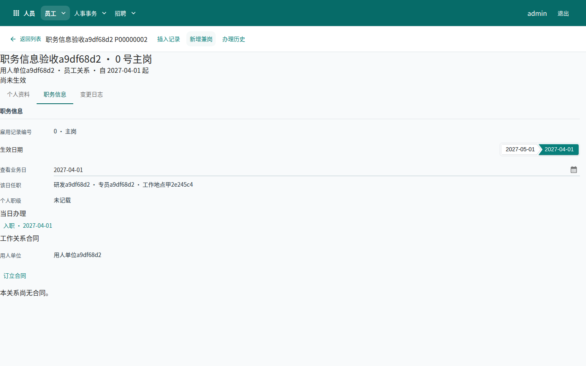
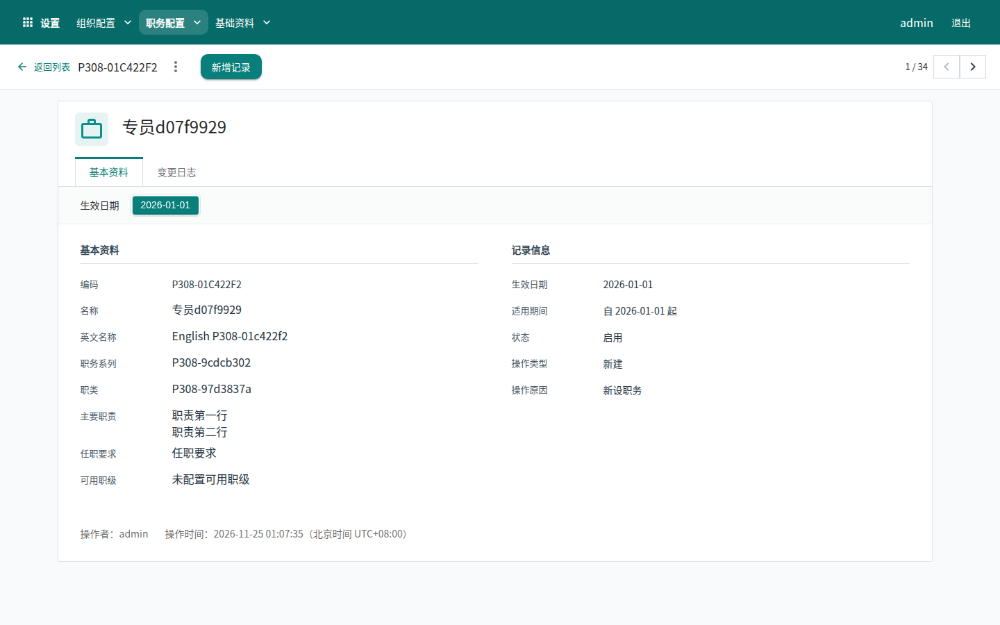

# CHNHCM-500 人员入口、职务信息与日期交互补充评审

2026-11-26，在固定 f 的 4386 页面复现了用户指出的四项问题，并在本人多任职、菜单选中态、办理历史、返回入口和时间轴顺序上补查出五项。本次登记 **9 项待修复，高 3、中 4、低 2**，编号 500-UI-12 至 20。优先处理普通「人员」入口、本人详情的「职务信息」页签，以及找不到本人已登记任职的路径。**500 页面专项暂缓验收。** [首轮 11 项](500-personnel-page-review.md) · [实施与验收原因](#entry-review-causes) · [截图、键盘和布局读数](data/500-personnel-entry-and-date-review/observations.json)

## 1 用户指出的四项问题

### 1.1 500-UI-12　高　普通「人员」入口被拆成两份名录

管理员在应用切换器点「人员」，页标题是「员工」，表格的可访问名称是「员工任职列表」。展开顶栏的「员工」，两个菜单项实际写作「员工列表」「人员档案」。前者按任职列行，当天显示 0 份任职、0 人。后者的页标题是「人员档案」，表格称「员工名录」，显示第 1–20 条，共 24 人，并提供「登记人员」。两页的对象、结果集和可办动作都有差别。只读账号从同一应用直接落在「人员档案」。当前菜单没有字面写作「人员列表」的项。用户要求普通入口统一称「人员」。[应用落地页](data/500-personnel-entry-and-date-review/01-people-default.png) · [两个菜单项](data/500-personnel-entry-and-date-review/02-desktop-menu.png) · [按人列行的页面](data/500-personnel-entry-and-date-review/03-archive.png) · [只读入口](data/500-personnel-entry-and-date-review/21-reader-directory.png)

拆分可追到提交 `a99c0cd`。原按人页面的标题从「员工」改为「人员档案」，新增的任职名录使用「员工」。后续菜单在应用壳并列配置两个入口。500 第 3 节及 502 明确要求保留两种查询。现行路线图与本次明确的人员入口有冲突，需要一并核对菜单、页标题、辅助技术名称和入口权限。[菜单定义](../../apps/web/src/app/App.tsx#L83) · [任职名录标题和跳转](../../apps/web/src/features/hire/EmployeeDirectory.tsx#L278) · [按人名录标题](../../apps/web/src/features/personnel/List.tsx#L223) · [502 入口与页签](../specs/m01/502-person-directory-interactions.md#m01-change-log)

**关闭条件**　管理员和只读者按权限从「人员」找人，导航、标题和表格都能识别同一业务对象。尚未入职者、仅有未来任职者、多任职者各能从这个入口找到获权资料。登记与首次入职仍从适用位置可办。跨员工「人事事务 → 办理记录」有独立任务，单独保留其验收。专项任职名册若继续提供，应说明自己的业务用途、行粒度和授权。

### 1.2 500-UI-13　高　有任职可读的本人详情缺「职务信息」页签

从按人名录搜索 P00000002 并打开本人，只有「个人资料」「变更日志」。这份尚未生效的主岗可以读取，但需要点击单独的「工作关系与任职」才出现「职务信息」。同一管理员从任职列表点同一人，立即看到三个页签且选中「职务信息」。由此排除了样本无任职或经办人无读取权限两种解释。[本人详情](data/500-personnel-entry-and-date-review/04-person-direct.png) · [经中转后的主岗](data/500-personnel-entry-and-date-review/05-person-link-destination.png) · [从任职行进入同人](data/500-personnel-entry-and-date-review/07-from-list-day.png)

人员详情要求地址已携带特定的任职标识，且该标识匹配获权的 0 号，才显示页签。普通按人入口没有这个参数。页头在有历史动作时另画「工作关系与任职」链接，交给另一条路由按任期数量分流。500 的实施步骤还把「原档案中的任职链接」列为验收起点。[页签条件](../../apps/web/src/features/personnel/Detail.tsx#L98) · [页头中转链接](../../apps/web/src/features/personnel/Detail.tsx#L268) · [任期分流](../../apps/web/src/features/hire/AssignmentPage.tsx#L29) · [500 首单接入](../archive/plans/500-personnel-roadmap.md#job-information-delivery)

**关闭条件**　从普通「人员」打开同一人，能直接用鼠标或键盘进入获权的「职务信息」页签，保持本人身份和返回位置。用单份未来任职、多任职、未入职和仅有个人资料权四种样本分别验证。仅获部分任职的人员只见获权的对象和字段。

### 1.3 500-UI-14　中　「生效日期」标题靠左，两个日期节点贴到页面右端

在 1440×900、100% 下，P00000002 的日期标题右边界为 56 px，两个日期按钮所在控件的左边界是 1227.8 px，间隔 **1171.8 px**。同一构建、同一视口的业务单元和职务详情都是 **16 px**。三页使用同一日期组件。职务信息直接渲染组件，命中默认的右对齐。两个参考页把组件交给标准详情的时间轴区域，命中该区域的起始对齐。16 px 是本次参考页的实测值。[职务信息](data/500-personnel-entry-and-date-review/05-person-link-destination.png) · [业务单元](data/500-personnel-entry-and-date-review/10-bu-reference.png) · [职务](data/500-personnel-entry-and-date-review/11-job-reference.png)

| 人员主岗的职务信息 | 同一构建的职务详情 |
| --- | --- |
|  |  |

**关闭条件**　在同一构建同一视口并排复核。桌面标题和日期节点在同一区域连续阅读，窄屏按参考布局收起或换行，键盘可选实际记录。复用共享详情的时间轴区域，或证明其在本页的等效布局。第一轮 500-UI-06 仍追踪跨页签的身份、正文及返回，本项专门核对日期节点位置。[M04 调用位置](../../apps/web/src/features/hire/JobInformation.tsx#L548) · [基础样式](../../packages/ui/src/components/effective-dates.css#L3) · [详情区域样式](../../packages/ui/src/components/object-detail.css#L9) · [职务参考接线](../../apps/web/src/features/staffing/Detail.tsx#L443) · [507 对照要求](../specs/m04/507-job-information-tab.md#m04-ac-016)

### 1.4 500-UI-15　中　普通列表与职务详情都常驻任意查看日期

进入「员工」即见「业务日期」，进入本人主岗又见「查看业务日」。在列表输入 2027-04-15 后点 P00000002，详情沿用 04-15。再在详情输入 05-01，地址同时保留列表日 `businessAt=2027-04-15` 和详情日 `assignmentDay=2027-05-01`。即使用户未显式设置列表日，生成行链接时也会把服务端返回日写入地址。任职有 04-01、05-01 两个真实节点，可以直接点选。业务单元、职务两个普通参考页均经时间轴定位。[列表的业务日期](data/500-personnel-entry-and-date-review/06-assignment-list-day.png) · [点行后](data/500-personnel-entry-and-date-review/07-from-list-day.png) · [更改详情日期后](data/500-personnel-entry-and-date-review/08-explicit-view-day.png) · [行地址生成](../../apps/web/src/features/hire/EmployeeDirectory.tsx#L159) · [第二个日期输入](../../apps/web/src/features/hire/JobInformation.tsx#L554)

**关闭条件**　普通人员列表及本人详情都不要求或提供通用查看日期。进入任职时能直接看见服务端定位的实际生效记录，点历史或未来节点可读对应生效资料。仅在业务合同明确要求的专项任务内提供有具体含义的日期。办理生效日、登记或更正的原件、办理记录的范围筛选各按原用途验证。首轮 500-UI-05 中「保留查看业务日」的关闭条件按本次用户要求纠正。其中「选中适用的实际节点」仍需验证。[首轮 500-UI-05](500-personnel-page-review.md#500-ui-05) · [012 普通详情](../specs/m02/012-m02-functional-and-interaction-design.md#m02-ui-history) · [123 普通维护与专项查询](../adr/123-current-maintenance-and-dated-query-boundary.md)

## 2 多轮走查补充的五项问题

### 2.1 500-UI-16　高　从本人选择多份未来任职，必须猜中日期才看得到

管理员从 P00000005 本人点「工作关系与任职」，回到标题为「员工」的列表，姓名和编号随页头消失。页面有「查看全部员工」，当天的结果却是「0 份任职，0 人」「该日没有可查看的任职」，没有可供选择的任期或起日。手工输入 2027-04-15 后，同一限定、同一权限出现 **0 号主岗、1 号兼岗、2 号兼岗，三份任职一人**，三份都自 04-01 起。对照 P00000002 唯一的未来任职，系统可自行定位到 04-01。按当日统计为零符合实际。把这份统计用来「选择本人的任职」，则挡住了获权的未来任期。[本人入口](data/500-personnel-entry-and-date-review/12-multiple-person-profile.png) · [默认空结果](data/500-personnel-entry-and-date-review/13-multiple-choice-default.png) · [手工输入日期后的三份任职](data/500-personnel-entry-and-date-review/14-multiple-choice-with-date.png)

**关闭条件**　从本人「职务信息」可直接识别并选择已知的获权任职和任期，包括只有未来任职时。用本人编号、0/1/2 号、实际单位和期间核对结果。只见部分任职的角色看不到其余任职的存在或数量。在职专项目录仍按其业务日如实统计。[多任期转入全局列表的分支](../../apps/web/src/features/hire/AssignmentPage.tsx#L32) · [当前列表空状态](../../apps/web/src/features/hire/EmployeeDirectory.tsx#L258) · [已有用例直接填入已知日期](../../tests/e2e/first-hire.spec.ts#L2153)

### 2.2 500-UI-17　低　从任职列表进入详情后，导航把「人员档案」标为当前页

在「员工列表」展开「员工」菜单，选中态及 `aria-current="page"` 正确落在「员工列表」。点击该列表 P00000002 的主岗后，再开同一菜单，当前项变成了「人员档案」。在 390×844 打开导航抽屉也复现。应用壳只在地址恰好等于任职列表时返回其菜单标识，任职详情被归入按人页的路径。[入口菜单](data/500-personnel-entry-and-date-review/02-desktop-menu.png) · [任职详情的当前菜单](data/500-personnel-entry-and-date-review/09-detail-menu-active.png) · [窄屏抽屉](data/500-personnel-entry-and-date-review/36-mobile-menu-active.png) · [当前页判定](../../apps/web/src/app/App.tsx#L206) · [菜单选中态](../../packages/ui/src/components/AppNavigation.tsx#L69)

**关闭条件**　从统一人员入口下钻、切页签并返回，桌面菜单和窄屏抽屉均标明实际业务位置。跨员工办理从其独立菜单进入时能正确识别该任务。

### 2.3 500-UI-18　中　主岗点「办理历史」，查询日期清空且任职数变成零

从 P00000005 的三行结果进入 0 号，所看日期为 2027-04-15。点「办理历史」，新页标题却是「工作关系与任职」，URL 仍带 04-15。上方多出第三种通用日期「查询日期」，输入框为空，摘要为「可见在职 0 人，任职 0 份，占编 0」。下方同时列有三笔 04-01 的办理。重填 04-15 后，上方恢复「可见在职 1 人，任职 3 份，占编 0」。历史组件从空字符串初始化查询日，忽略传进来的日期，按默认日重新请求摘要。[进入历史后的零份](data/500-personnel-entry-and-date-review/15-person-history.png) · [重填原日后的三份](data/500-personnel-entry-and-date-review/17-history-date-restored.png) · [状态初始化与读取](../../apps/web/src/features/hire/HirePage.tsx#L52) · [历史页查询区](../../apps/web/src/features/hire/HirePage.tsx#L513)

**关闭条件**　从本人或所选任职查看办理历史，标题表明当前任务，可以直接核对对应办理。同一上下文无需再输日期。若展示与办理相关的日状态，明确其日期和范围并自动定位。用同一人三份任职验证，历史原件可返回原办理。[402 同日记录及返回](../specs/m04/402-hire-interactions.md) · [507 办理与任职下钻](../specs/m04/507-job-information-tab.md#personnel-action-register)

### 2.4 500-UI-19　低　两个详情返回动作写作「返回列表」，实际都回到另一详情

从 P00000002 主岗点「办理历史」，点击「返回列表」实际回到该 0 号主岗的「职务信息」。另一条路径从 P00000001 本人点「办理入职」，在未填表时用 Enter 激活「返回列表」，实际回到该人的「个人资料」。两种目的地都可以正确打开，但操作名称给出错误预期。首聘和历史共用同一返回按钮，调用时省略了标签，于是使用共享默认值。[历史中的按钮](data/500-personnel-entry-and-date-review/25-history-back-label.png) · [点击后回到主岗](data/500-personnel-entry-and-date-review/26-history-back-result.png) · [首聘中的按钮](data/500-personnel-entry-and-date-review/19-hire-date-positive.png) · [按 Enter 后回到个人资料](data/500-personnel-entry-and-date-review/32-hire-back-result.png) · [调用点](../../apps/web/src/features/hire/HirePage.tsx#L350) · [默认标签](../../packages/ui/src/components/RecordNavigation.tsx#L8)

**关闭条件**　从本人、任职或列表来的用户能从链接名称判断目的地，实际返回该对象和原位置。分别用鼠标、键盘验证，覆盖从任职打开历史及从本人办理首聘两条路径。

### 2.5 500-UI-20　中　职务信息的日期轴从晚到早，右方向键走向过去

P00000002 的节点从左至右排列为 2027-05-01、04-01。在 05-01 上按右方向键、Enter，实际选中较早的 04-01。P00000004 的三个节点也是 07-01、06-10、04-01。同一构建的部门编制有两个节点，从 2026-01-01 向右选中较晚的 04-01。共享组件自己的浏览器验收也明确从 1 月按右键应选 2 月。[两节点键盘实测](data/500-personnel-entry-and-date-review/33-job-date-order.png) · [三节点任职](data/500-personnel-entry-and-date-review/34-transfer-date-order.png) · [参考页向右选中较晚日期](data/500-personnel-entry-and-date-review/35-reference-date-order.png) · [共享键盘预期](../../tests/e2e/experience.spec.ts#L13)

职务信息取办理列表的日期，去重后按原顺序交给日期组件。办理查询按业务日降序，日期组件按传入顺序渲染，并把前方和后方的折叠菜单分别称为「较早」「较晚」。**关闭条件**　生效节点按参考轴从早到晚排列，方向键、窄屏选择器及有折叠时的早晚入口一致。同一天保留一个日期节点，节点下每笔真实办理仍可分别查看。本项与 500-UI-14 可分别复验，改变位置不会改变日期顺序。[办理读取顺序](../../internal/contexts/staffing/infra/postgres/job_information.go#L275) · [日期提取](../../apps/web/src/features/hire/JobInformation.tsx#L475) · [左右方向与节点渲染](../../packages/ui/src/components/EffectiveDates.tsx#L60)

## 3 为什么实施和前次评审都放过了这些问题

| 调查问题 | 在受测提交中查到的依据 | 整改与复验应落在哪里 |
| --- | --- | --- |
| 是否缺少共享规范 | 012 已规定普通列表和详情取消通用查看日期，通过真实记录定位。123 的原适用范围是 BU、部门和同模式基础资料。第 2.5 节列举「在职名册」「员工快照」为可评估的专项任务，要求交代角色、日期不可自动取得的原因、随日期变化的字段和授权。121 与 124 已要求逐页核对共享布局、参照页、具体接线及独立预期。[012 普通查询](../specs/m02/012-m02-functional-and-interaction-design.md#m02-ui-list) · [123 决定](../adr/123-current-maintenance-and-dated-query-boundary.md) · [121 页面继承](../specs/m02/121-dated-object-admission-matrix.md) · [124 逐页准入](../guides/124-dated-object-admission-and-capacity.md#page-standard-admission) | 普通人员页适用本次用户明确的规则。以 500 的页面继承表写清普通入口、具体记录及每一项有明文依据的专项差异，复用现有标准和参照页。 |
| 为何出现双名录及中转 | 501 要求在人员读权范围内查到尚未任职的人。500 第 3 节、6.3.1、502 及 507 又把按人「人员档案」与按日按任职列行的「员工列表」分开，并以原档案的任职链接为起点。402 把档案路径写入首聘入口。提交 `a99c0cd` 拆出任职名录，`58d1f5a` 在员工菜单并列两项，`a991322` 把多任职者导向带本人条件的员工列表。实施有可追溯的专项目标，这套目标与本次要求的人员入口及本人直接呈现页签冲突。[501 人员范围](../specs/m01/501-person-registration-requirements.md) · [500 页面继承](../archive/plans/500-personnel-roadmap.md#personnel-pages) · [502 页签与按人入口](../specs/m01/502-person-directory-interactions.md#m01-change-log) · [507 入口](../specs/m04/507-job-information-tab.md#job-tab-layout) · [402 首聘](../specs/m04/402-hire-interactions.md) | 由 M01、M04 与体验维护者一起对齐菜单名称、普通列表要找的对象、本人各页签及主兼岗选择。写出未任职、仅未来任职、仅见部分任职及仅有档案权时各自的入口。领域内仍分别核权。 |
| 为何常驻三个日期字段 | 500 已引用 123，但引用紧接人员登记的授权和导出说明。506 明写按「所看业务日」计任职，507 明写列表业务日及 `businessAt`，也要求详情默认选今日适用记录或未来首条。402 要求区分该日任职与办理记录。上述条款支持按日的业务计算，未给普通「人员」入口、本人职务详情和办理历史分别定义三个常驻任意日控件的任务。此前交付记录反而把「从菜单选业务日」列为通过路径。[500 的 123 引用](../archive/plans/500-personnel-roadmap.md#personnel-pages) · [506 任职行和计数](../specs/m04/506-job-information-records.md#m04-br-009) · [507 节点与日状态](../specs/m04/507-job-information-tab.md#job-tab-fields) · [早期菜单验收](500-job-information-delivery-review.md) | M04 在每个页面的实施条款写清日期由服务端、所选生效节点、原办理还是经办人提供。若另设跨人员在职名册，单列其日期用途、授权和下钻规则。普通页用「不输入任何日期也能找到未来任职」验收。 |
| 为何用了同一个组件仍错位、倒序 | 500 第 4 节和 507 第 4 节已经引用 BU／职务详情、共享时间轴、012、121、124。M04 仅调用了 `EffectiveDates`，缺少共享详情时间轴区域提供的对齐样式，并直接沿用「办理列表」的倒序。日期组件按调用方顺序渲染。共享样例与职务产品的接线提供了独立参照。[507 的实施对照](../specs/m04/507-job-information-tab.md#m04-ac-016) · [业务单元实际接线](../../apps/web/src/features/organization/DatedPages.tsx#L535) · [共享键盘行为](../../tests/e2e/experience.spec.ts#L9) | 由页面实施和体验验收对同构建同时量取标题至节点的间距，并用两个以上已知日期验证键盘方向、菜单及选中资料。校验共享组件是否出现，覆盖不到这两个错误。 |
| 为什么浏览器用例和首轮评审没有拦住 | 人员用例明确等待「人员档案」标题。任职用例从本人点击「工作关系与任职」，断言跳到全局列表，手工填已知日期后才断言三行，接着用同一条路径跑五种视口及 200%。另有用例显式填「查看业务日」和历史页「查询日期」。历史交接把这条流程记为已验证。首轮 500 页面评审也把保留 04-15 查看日写进 500-UI-05 的关闭条件。[按人入口断言](../../tests/e2e/personnel.spec.ts#L75) · [中转及预填日期](../../tests/e2e/first-hire.spec.ts#L2151) · [历史页查询日](../../tests/e2e/first-hire.spec.ts#L226) · [详情查看日](../../tests/e2e/first-hire.spec.ts#L829) · [前次通过的范围](500-job-information-delivery-review.md#21-人员上下文主岗页签和旧档复查) · [首轮判据](500-personnel-page-review.md#500-ui-05) | 复验从用户办理目标写出预期。起点只提供本人姓名或编号，禁止预先告知样本日期。同时检查有无多余入口、获权页签、语义正确的菜单与返回链接。原业务回归继续验证计数、任期、授权和准确来源。 |

**原因判断**　普通查看日期、标准详情布局和逐页验收均已有项目规范。012 未指定 M01 的菜单名称。本次「人员」命名和本人直接进入职务页签的依据是用户明确的要求，原专项合同选择了另一套入口。500 引用的 CubeBox 员工表按任职列行，可以解释计数与行粒度，不能单独决定给经办人几份名录。普通页面与专项日期的边界也没有落到每一页的实施条款。时间轴的问题发生在已有明确参照的组件接入环节。旧浏览器断言和首轮报告又沿用了实现中的中转与日期作为前提。需要同步调整专项合同、实现和验收判据，逐项按本报告复验。[500 的体验来源及分批选择](../archive/plans/500-personnel-roadmap.md)

## 4 实测轮次、对照与适用边界

受测工作树为 `wt-dev-f`，HEAD 为 `b67cb724f759473a761e7153796a5a1acd4b2bdf`。开始补查时工作区已有首轮问题登记、原图及索引的未提交改动。固定构建清单记录的起点是 `39660e7`。清单内 1,157 个前端与共享源文件和本树逐个相符，28 个在线前端文件也全部匹配。清单与本树另有 4 个后端集成测试、3 个生成模型的摘要不同。此次结论限定为该地址的实页和已核对的实现。实测在固定 `m01-profile-f` 的 Web 4386、API 8386、DB 54376 上完成，使用有界面 Chromium 140.0.7339.186、管理员与只读账号以及已有合成样本。[固定环境交接](509-t04-remediation-implementation.md#fixed-environment) · [截图与读数](data/500-personnel-entry-and-date-review/observations.json)

| 走查 | 实际操作和对照结果 |
| --- | --- |
| 第一轮，逐项复现 | 从应用菜单检查两份名录。用 P00000002 分别从按人入口、任职行打开同一人。记录标题、网格名称、页签、日期输入框、实际选中节点和参数。到同一构建的业务单元和职务普通列表、详情对照日期位置和查看入口。 |
| 第二轮，改变任职数量和返回路径 | 从 P00000005 经按人入口选多任职，对比默认日与 04-15 的结果。点 0 号的办理历史、展开原办理、重填原日，再从 P00000002 的历史返回。另从 P00000001 打开首聘，以取消及页头返回分别退出。仅从原办理展开后出现的来源标识，在该样本有单位、任期及主兼号可核对，本轮未据此另记缺陷。 |
| 第三轮，核对权限及日期例外 | 只读账号能从普通按人入口读 P00000002 的个人资料和变更日志，没有更正、任职中转或职务页签。P00000001 可直接办首次入职。实际「到岗日」有明确业务含义。跨员工办理记录展开的是「生效起日／止日、办理起日／止日」筛选。另从「设置 → 职务配置 → 部门编制分配 → 所选部门 → 查看指定日」实际打开「统计日期」。313 明确该日同时决定部门总额、直属岗位及分配明细。这些场景均有明确任务。[只读本人](data/500-personnel-entry-and-date-review/22-reader-person.png) · [未入职本人](data/500-personnel-entry-and-date-review/18-first-hire-person.png) · [到岗日](data/500-personnel-entry-and-date-review/19-hire-date-positive.png) · [办理期间筛选](data/500-personnel-entry-and-date-review/31-register-date-positive.png) · [专项统计日期](data/500-personnel-entry-and-date-review/20-quota-date-positive.png) · [313 统计合同](../specs/m03/313-position-capacity-contract.md) |
| 第四轮，核查历史、键盘、窄屏与参照 | P00000002 打开 05-01 旧修订的「查看当次任职」后仍能填「查看业务日」。改至无办理的 05-02，旧来源仍锁定、历史短条仍在，原办理及其采用定位却从页面消失，记入 500-UI-15 的影响范围。另核对两个主岗和部门编制参考页的节点先后。390 像素的任职日期菜单同样把 05-01 排在 04-01 前面，向下、回车实际选中 04-01。在桌面及窄屏打开应用菜单检查当前项。[改日前的旧办理](data/500-personnel-entry-and-date-review/27-historical-view-date.png) · [改日后的历史页](data/500-personnel-entry-and-date-review/28-historical-date-after.png) · [日期切换代码](../../apps/web/src/features/hire/JobInformation.tsx#L477) |

100% 下分别检查本人详情及主岗页的 1440×900、1440×540、390×844、320×900、320×256。五种尺寸的本人详情都只显示两个页签并有中转链接。任职页在两个桌面尺寸的标签至控件间隔均为 1171.8 CSS px，390 宽为 199.4，两个 320 宽为 129.4。关键路径再以 1280×900 校准，在固定 1280×987 外框做真实 Chromium 200% 缩放，内容为 640×450，以 Enter 从本人进入职务信息并聚焦日期输入。补查采集 36 张原图，随本报告登记 35 张，每张都有场景、角色、尺寸及 SHA-256。[390 宽本人](data/500-personnel-entry-and-date-review/23-mobile-person.png) · [390 宽职务信息](data/500-personnel-entry-and-date-review/24-mobile-job.png) · [原生 200% 本人](data/500-personnel-entry-and-date-review/29-native-profile.png) · [原生 200% 职务信息](data/500-personnel-entry-and-date-review/30-native-job.png) · [完整清单](data/500-personnel-entry-and-date-review/observations.json)

本次调查聚焦可见的页面和导航。签约表单的签订日、招聘录用操作的业务日另核对了代码用途。其办理效果沿用各自业务专项。固定库只执行浏览、查询、选择及取消。本次仅切换上述两个固定账号。动态撤权、仅见一个兼岗的独立角色、全套业务回归及原生 400% 沿用既有专项证据，9 项问题的修复后实页复验待执行。原 509 已关闭的 27 项保留其受测版本结论，首轮 500 的 11 项继续按编号追踪。固定 4386 保留给用户验收，由 f 维护者在下次更新或验收结束时复查。[签约日期](../../apps/web/src/features/hire/RelationshipContracts.tsx#L54) · [录用操作日期](../../apps/web/src/features/recruiting/Offers.tsx#L639) · [首轮页面登记](500-personnel-page-review.md) · [509 原批次结论](509-t04-remediation-implementation.md)
